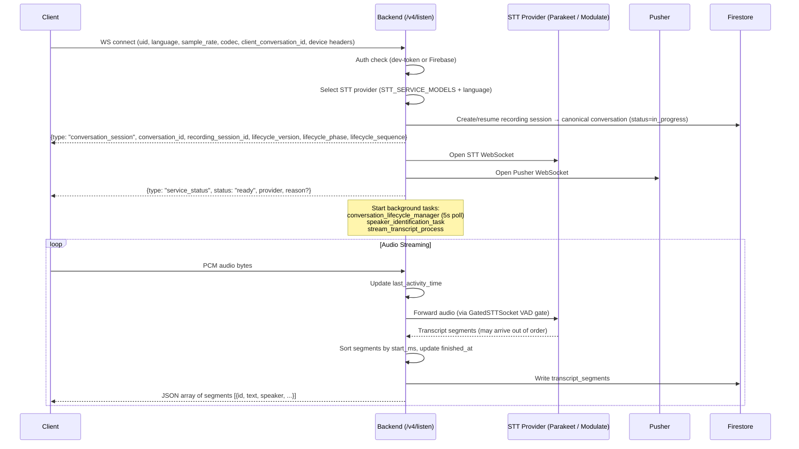
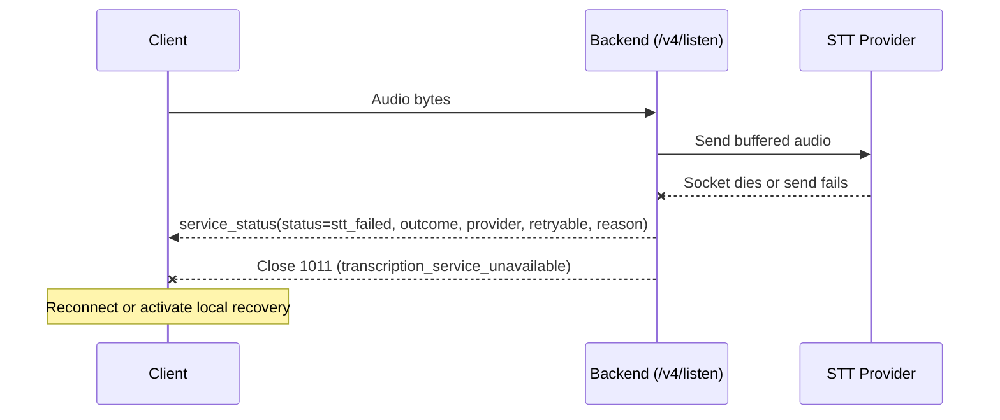
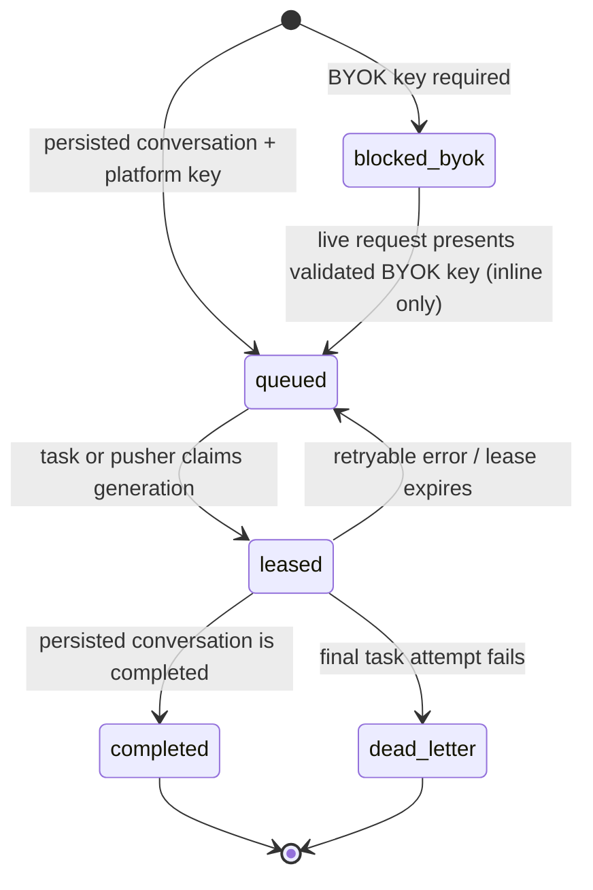
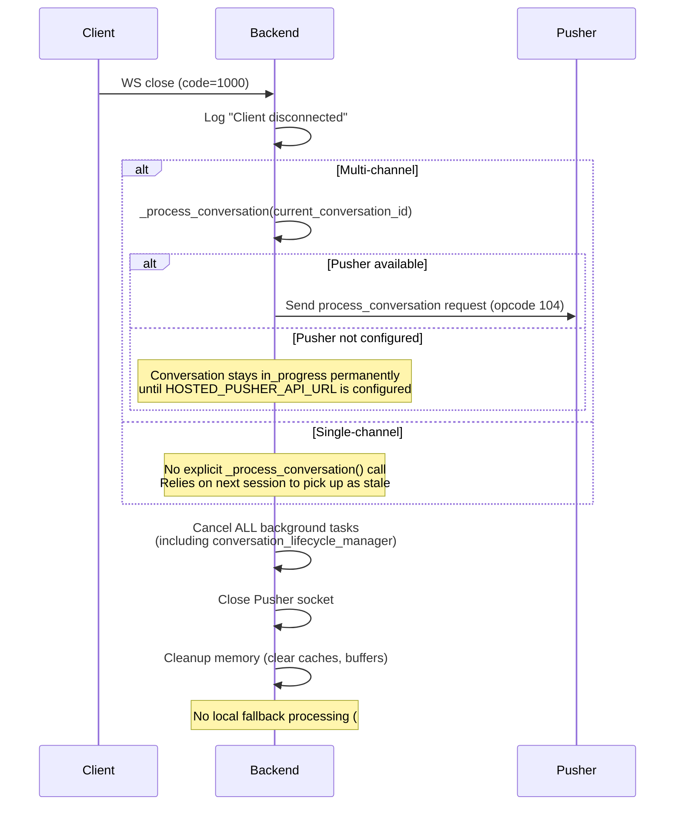
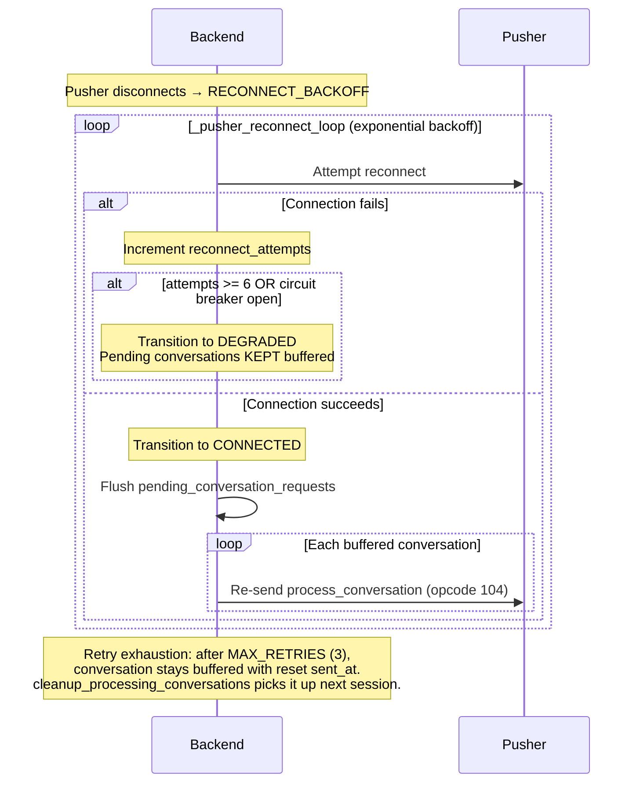
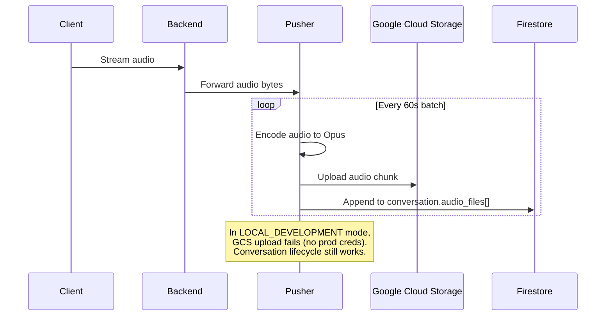

# Listen + Pusher Pipeline — Sequence Diagrams

At a new recording reservation during a partial batch ramp, the owner-load
predicate in `config/policy/ramp.py` keeps heavy owners on the legacy route.
`BATCH_PIPELINE_RAMP_EXCLUDE_HEAVY_OWNERS=off` disables this admission narrowing.
The check runs at the existing database write boundary, never on audio frames
or pusher flushes. An existing `batch_live_v1` owner keeps draining through
finalization and WAL retries even if its current load is heavy. Thresholds,
telemetry and the separate heavy-owner qualification gate are documented in
`batch-pipeline-serving.md`.

Soniox transport exceptions log once at the first socket death, with bounded
`operation`, `exception_class`, `received_close_code`, `sent_close_code`,
`close_cause`, and `session_age_bucket` fields. `-1` means no close frame was
observed in that direction; an empty received close frame is reported as `1005`
(no status received). The WebSocket library's keepalive timeout is a sent `1011`
and has `close_cause=keepalive_ping_timeout`. These diagnostics omit exception
text and provider close reasons, and retain the existing typed failure and
recovery behavior.

## Default-off funded transcription cap

`STT_CAP_DISPATCH_ENFORCEMENT` gates provider creation and audio sends through a
shared live admission state, including multichannel, replay and replacement legs.
Denial preserves receiving and existing audio storage paths; accepted provider
work drains. Custom/on-device STT and flag-off metering retain their behavior.
The [dispatch contract](stt-cap-dispatch.md) also documents sync holds, recovery,
BYOK funding, additive metrics and the per-client activation decision.
The cap proxy forwards provider-specific finalize arguments, including window
VAD `finalize(vad_pause=True)`. `STT_CAP_FINALIZE_FORWARD_ENABLED` defaults on;
false/0/off uses generic finalize without reopening held providers. That emergency
mode can flush sub-second speech fragments earlier because it omits the ordinary
speech guard. See [windowed live STT](operational/windowed-live-stt.md) for bounded
local-send phase/exception attribution and the listen-train acceptance checks.
Sync recovery fences a provider-bound `dispatched` receipt before paid STT or
ingestion, and atomically checkpoints ingest proof alongside the conversation.
Before every new recovery provider intent (including retries), an always-on,
shared Redis Lua token bucket admits both audio seconds and one intent. Defaults
are 60 audio-hours/hour and 12k intents/hour with at most one minute of burst
credit. Pacing denial or Redis failure checkpoints `next_attempt_at` on the hold
without creating an attempt or metered charge; release preserves that deadline.
The durable sweep rotates owners in one-candidate rounds, newest-first inside
each user's consent/cutoff. Sealing, cleanup and cached-result settlement remain
independent. See [recovery pacing](stt-cap-dispatch.md#shared-recovery-pacing)
for settings, telemetry and operational limits.
Known non-calls clear the intent. After 30 minutes, ambiguous work reconciles
from that proof or gets one second dispatch; a second ambiguity retains the audio
as failed reconciliation. Successful siblings finalize independently. Flagged
oversized GPU empty-result retries become held work without a failure attempt;
the unflagged retry follows main's behavior.

Both legacy and ladder-only execution require the authenticated owner to match
`STT_CAP_DISPATCH_COHORT` and the original lane to match
`STT_CAP_DISPATCH_LANES`. Empty cohort admits nobody; both manifests keep the
switch false, cohort empty, lanes `live`. Listen's receiver and each provider
constructor name the UID and live lane. Pusher retains its existing source/import
and shutdown closure; it does not own another PCM hold sink. Recovery of a live
hold stays live through the shared sync segment processor, even while sync/batch
are disabled. Missing legacy hold origin maps to sync, explicit unknown origins
stay paused. A reserved excluded backlog source can yield to a later live hold
only after an ownership/month-fenced transaction proves it never dispatched and
refunds its chosen estimate once; receipts, leases, text claims and uncertain
reads retain the reservation. Even empty/null lease-token or piece-plan keys
and missing/nonzero retry timestamps retain claim history. Flag-off and custom
STT bypass admission before request identity is read; active non-custom calls
still require the authenticated UID and live scope. See [cohort, provenance and ramp](stt-cap-dispatch.md#cohort-and-lane-rollout-david-2026-10-18)
for the dazheng-owned rollout, three-hour 5% soak, rollback and #22352 dependency.

## Ladder budget refresh and execution admission (default off)

With `LADDER_V1_BUDGET_ENFORCEMENT_ENABLED=true`, selected funded ladder/Free live sessions
install the shared provider admission state even when legacy dispatch remains off.
It carries remaining units and debits accepted PCM at the pinned provider speech
rate. A packet exceeding the estimate is suppressed while capture continues.
There is no per-audio-chunk I/O. Full scans run at session start, every 900 seconds,
and on subscription invalidation. At >=90% used or below two minutes at the maximum
managed speech rate, the 60-second flush refreshes only the current hour, today's
gateway day and today's API day, combining them with the session's closed-bucket
sum. Rollover closes the old buckets once; backdated writes reconcile at 900 seconds.
The existing flush subscription is reused. Unavailable snapshots retry after
60 / 120 / 240 / 480 / 900 seconds, capped at 900; successful reads reset backoff.
Custom STT without a funded socket keeps the 900-second cache.

Near-cap external usage is detected within a 60-second flush plus persistence
latency. Far from cap, concurrent external spending can remain unseen for 900
seconds. This is not a distributed reservation; accepted provider queues and
already-admitted batch work may drain. Sync execution and each GPU ASR microbatch
reauthorize with the current ladder allowance. Exhausted uploads use durable
holds instead of a ladder 402 or locked transcript; explicit backlog choice or a
fitting upgrade intent recovers them and checks the current allowance again.
Reset does not process backlog. All conversation sources preserve capped transcripts
with `processing_deferred=true`; first-open cannot consume that backlog. See
[funded halt and choice](ladder-v1-cutover.md#funded-halt-and-user-chosen-backlog-david-2026-10-18). Ladder-only activation bypasses legacy monthly seconds.

The month reader batches only elapsed day refs, never future days. A normal near-cap
minute costs three ledger reads plus the existing subscription read. The required
900-second full scans still add periodic spikes: at H=408 hourly documents / D=17
elapsed days, ordinary / amortized reads per minute are 1 / 30.47 at 0% and 50%,
and 4 / 33.27 at 95%, versus the prior 30.53 / 30.53 / 444 averages. Rollover adds
one closing-hour read and, at midnight, two closing-day reads. See the complete
[failure/read-cost model](stt-cap-dispatch.md#ladder-v1-admission-in-21488).

Unprojected seconds receive the pinned provisional speech rate without a silence
ratio; unpriced gateway attempts receive the standard-chat estimate. Atomic
unpriced-quantity counters keep priced seconds/events out of residuals. Newly
attributed quantities and units remain separate from history. For each ambiguous
historical leaf, charge `max(historical priced units, unknown-provider proxy)`
once, plus separately attributed new units. Ambiguity never raises a 503 or denies
a paying account until reset. Residual and historical ambiguity histograms
(`omi_ladder_unprojected_*`, `omi_ladder_ambiguous_priced_*`) and the shared degraded
fallback metric expose uncertainty without user labels or historical writes.
Repeated evaluations are observations, not unique usage.
With ladder flags off, shadow totals and #21866 dispatch behavior remain unchanged.
No switch or deployment binding is activated.

## Windowed live transcription deadlines

Parakeet packing is independently gated by `PARAKEET_PACKING_ENABLED=false`
on the GPU service. When enabled, `/v1` and `/v2` historical uploads enter the
same scheduler as live windows, one at-most-120-second GPU quantum at a time.
Queued live windows always win the next dispatch; a running kernel cannot be
preempted. Whole-file `/v2` speaker clustering retains the original audio and
absolute segment times. This changes neither window session admission nor the
2 requests / 35% capacity decision. The independent `PARAKEET_EXPLICIT_CUDA_GRAPHS`
flag persists the existing CUDA graph selection across NeMo timestamp setup.
The [packing runbook](runbooks/parakeet-packing.md) owns the demand-scaler train,
warm floor, mixed-load gates and rollback.

`PARAKEET_WINDOW_DEADLINE_CUT_ENABLED` defaults to `false` in code and
both listen manifests. Qualification must explicitly enable it in the target
listen cohort. While enabled, a successful nonempty POST can release its held
tail through the existing timestamp-preserving cut only when the remaining
first-text/progress deadline is at most
`PARAKEET_WINDOW_DEADLINE_CUT_POST_LATENCY_SECONDS` (default `1.2`, approximately
the observed POST p95; invalid/nonpositive values use the default). A normal
first POST after six seconds of capture retains sentence anchoring. Neither a
full audio pace nor the next pacing wait increases the allowance.

Emitted text advances the existing capture anchor and cancels the applicable
deadline. Empty answers and stalled in-flight POSTs retain the original deadline
and replay/failover behavior. This opt-in mitigation only rescues a nonempty
answer returning near expiry; it does not extend the deadline or guarantee
survival for a held answer returned earlier. Forced releases remain included in
`omi_stt_window_forced_cuts_total`.

## Same-provider speaker scope preservation and successor replay deduplication

During live `/v4/listen` sessions on flaky connections, mid-session reconnects to the same STT provider retain the session's active `SpeakerProviderEpoch` and connection scope across successor sockets (`same_provider=True`). This guarantees that `ConversationSpeakerIdAllocator` preserves mapped speaker numbers (e.g. SPEAKER_0, SPEAKER_1) across reconnects without renumbering speakers. Successor replay duplicates and straddling segments are deduplicated against the session timeline's `last_end` in the session callback, while successor windowed sockets count stream seconds from their own 0.0 boundary without premature `last_emitted_end` truncation.

## Demand-driven live provider lane

The `/v4/listen` runtime owns the dark-by-default live-demand policy. Existing
`client_state {foreground, transcript_visible}` reports affect provider selection
only for allocated, declared-English single-language sessions. Unknown, malformed,
mixed or unreported state requires the vendor path; any active real-time app,
developer webhook, or admitted v2 mentor consumer does too.

With `STT_LIVE_DEMAND_ENABLED=true`, every listen socket registers authenticated,
stage-scoped Redis presence, including sockets outside the routing cohort. The
server generates the socket identity; payloads cannot supply another user's
identity. Hidden state remains valid while the socket heartbeats. Stale/missing
presence and dependency failures require a vendor. Deploy presence globally at
zero allocation and drain older pods/sockets before admitting a canary.

`STT_LIVE_DEMAND_PERCENT` and the private Firestore `stt-live-demand` cohort
select routing membership. The old UID env list is a migration fallback only. `STT_LIVE_DEMAND_MIN_DWELL_SECONDS` defaults to 15: stable
hidden demand admits the existing Parakeet window leg, while visible/unknown
or consumer demand returns to vendors immediately. Existing window allocation,
capacity, pressure and recovery controls remain authoritative. Non-English,
multi-language, BYOK, custom, multi-channel, onboarding and phone-call routes
retain their existing selection.

A replacement connects while the old leg serves. Before retiring that leg,
listen rechecks shared demand and consumers, snapshots unanswered capture, and
fences old callbacks. New audio enters the existing ordered replay/live-tail
pump. Refused or dead cheap candidates keep the healthy vendor and pin the
session to vendors; a dead previous leg belongs to ordinary transport recovery.
The demand coordinator is a supervised lifetime task, so its failure cannot
leave an adopted cheap lane without future visibility reconciliation.

Pusher continues receiving the adopted transcript/audio and running its existing
fanout; it does not select this demand lane or need these four env variables.
Listen exposes `omi_listen_live_lane_seconds_total{lane,reason}` and
`omi_listen_live_lane_switches_total{from_lane,to_lane,reason}`. Shared
`omi_fallback_total{component="stt_live_session"}` records provider and gate
failure causes. These session-wall seconds complement actual paid-audio meters.

Rollout, lease/capacity details, test acceptance and rollback belong to the
[demand-driven live STT runbook](./operational/demand-driven-live-stt.md). The
lead starts at at most 5% and waits at least 12 hours before any expansion.


Parakeet `/v3/stream` receives literal `finalize`, flushes its remaining
transcript segments, then sends WebSocket close 1000 after every tail send has
succeeded (including an empty tail). Returning without that frame previously
made production callers observe synthetic 1006. Client disconnects and failed
flush/tail delivery retain their existing failure lifecycle; session cleanup and
admission release run in every case.

The standalone `POST /v1/stt/transcribe` Parakeet proxy uses the shared
managed-transcription allowance before calling the provider. It probes the
uploaded media duration and rejects a file that exceeds the remaining allowance;
successful provider responses increment root `hourly_usage.transcription_seconds`
by that duration, rounded up to a second. Deepgram BYOK cannot exempt this
Omi-managed Parakeet call. This proxy does not measure VAD speech or change the
live-listen, offline-sync, or locked-conversation policies.

Admission and usage recording are not a distributed monthly reservation. The
proxy probes the seekable upload spool and initially checks allowance before
acquiring a provider slot, then rechecks allowance after queueing. It holds its
four-slot semaphore through the usage write attempt, bounding dispatched but
unaccounted requests to four per serving process/event loop. A failed usage
write emits fallback telemetry and returns the completed transcript, avoiding
a retry-driven duplicate provider call. With healthy, launched monthly accounting, the conservative overshoot bound is
`N × D` seconds, where `N ≤ 4 × P` for `P` serving processes and `D` is the maximum
accounted media duration admitted per request. The finite allowance check bounds
`D` by the plan allowance; the configured production Parakeet one-hour file cap
normally narrows it further. The semaphore is not shared across replicas, and an
accounting-write outage does not have this finite cumulative bound.

> Last updated: 2026-09-30 (safety-WAL segments bind to their live rollover generation through `external_data.recording_origin_id`, staged by the private Firestore sync-lineage-resolve cohort, kill switch SYNC_LINEAGE_RESOLVE_ENABLED=false; same-occasion smart merge at finalization (default on, kill switch CONVERSATION_SMART_MERGE_MODE=off); S1 capture-evidence exploratory dark write; live STT language profile, Soniox hints and conformance telemetry; optional Parakeet final-pass shadow; conversation-wide speaker resolution for sync-captured conversations; Cloud Run sync shares the diarizer ILB via `HOSTED_SPEAKER_EMBEDDING_API_URL`; cross-device overlap linked without discard at finalization; provider-scoped speaker identity and bounded clustering; durable meeting receipt; bounded client-kind propagation; end-of-conversation wake-word command adjudication; private conversation start-location provenance; explicit finalization capability admission; semantic release probes; identity-bound Pusher promotion receipts; bounded sync empty-retry with phase-attributed failure telemetry)

Conversation finalization notes and opted-in mobile/app chat use shaped invocation
when `OMI_SHAPED_AGENT_MODE=on` on prod backend, backend-sync,
backend-sync-backfill, backend-listen, and pusher.
The legacy notes writer and shaped comparison/shadow branches have been removed.
`cohort` now serves the same shaped path as `on` for every UID. Episode evidence
capture and its ENABLED/PERCENT flags are retired; rich roster and screen inputs
continue under their own flags, without constructing unconsumed evidence items.
An off, unset, or unknown mode disables shaped serving; restoring the legacy
notes/mobile chat path requires an image revert, not a flag flip. Stateless chat
generation remains on its separate OpenAI-compatible runner.

Dev finalization hosts declare the same shaped mode as prod. Admission requires
`OMI_SHAPED_AGENT_MODE` on every finalization host and enforces literal agreement.
Explicit-cache options pass through `get_llm` after BYOK model resolution; notes,
structure, chat and memory content breakpoints require that resolved model to be
GPT-5.6-family or Luna. Unrelated STT keys do not disable OpenAI cache opt-out.

>
> These diagrams document the real behavior observed during E2E testing with
> live services (backend, pusher, STT providers, embedding API). Update when the
> pipeline changes.

Backend-listen and pusher share the private Firestore `dream-agent` cohort in
their deployment environment; no UID env binding is required. Existing
conversation/memory/task post-write hooks signal the hourly backend-sync sweep.
Shadow writes only admission state and encrypted reports, preserving finalization, user records, questions and vocabulary. See [the dream runbook](runbooks/dream-agent.md).
Dream vocabulary is optional capture context: `DREAM_AGENT_VOCABULARY_STT=true` combines encrypted per-user vocabulary spellings with existing live and offline-sync keyterms;
read failure uses existing terms with fallback telemetry.
Vocabulary and STT gate defaults remain off.

Conversation processing adds a shared **Known spellings** block from Dream vocabulary
(including aliases) and trustworthy active People names. `CONVERSATION_KNOWN_SPELLINGS` defaults
to `true`; set it to `false` to disable the block and its reads. The block is capped
at 60 canonical entries and 1,500 characters, including grounding instructions:
use a spelling only when the transcript clearly refers to it, never invent a
reference or infer attendance/identity. Summary, action-item, app-summary and
transcript-memory prompts share it; each source is read at most once within a
processing run, with a fresh scope for a separately deferred extraction. Read
failures retain available context and emit fallback telemetry. No extra LLM call
is made. Spellings are per-user context after the shared cache breakpoint, never
part of the shared prefix bytes or cache eligibility. Shaped notes carry them as
a separate per-user field alongside their capture evidence.

People names require a nonempty stored speech sample, a positive `label_evidence`
counter (`manual_labels`, `card_confirms`, `card_picks`, or `auto_confirmed`, all
authored by user assignments/answers), or retained aliases from the explicit
rename transaction. Creation has no origin marker, so timestamps and derived
confidence alone do not qualify a name, including a multiword name. Single-token
filler/common words and demonyms, letterless names, and dismissed people are
excluded even when evidence exists. Unconfirmed CJK fragments therefore cannot
enter the block; confirmed names in any script can. Old People aliases are not
rendered, because an old filler alias could cause the model to invent a reference.
Dream vocabulary and its aliases retain their own authority.

The speaker-resolution step seeds the spelling cache from its already-read full
People list. If that step did not read People, spelling hints use one collection
query capped at 200 documents, without voice-learning projection transactions.
Filtering the already-read list may scan past junk entries without additional
Firestore reads, retaining at most 60 names. Both paths retain the per-run cache;
an empty reused list does not trigger a second query.

Modulate batch language is selected by utterance word totals, breaking ties by
total duration. Utterances under three words do not vote when any longer utterance
exists. Missing detection uses the requested language or `multi`, including empty
results. Sync retains its existing chunk-merge language behavior: persisted
`TranscriptSegment` records have no per-segment language for a conversation-wide
weighted recomputation.

The live calendar stamp includes the meeting title (an empty string when absent)
so it is a valid `CalendarMeetingContext` for finalization and summarization even
when its scheduled window makes continuity hydration unnecessary.

Live calendar-backed conversations with content retain their conversation across
silence until the stored `external_data.calendar_meeting_context.start_time` +
`duration_minutes` + 120 seconds of grace. The stored calendar event id owns this
window; screen-derived identity does not extend it, and meeting-treatment
eligibility does not gate it. Reconnect admission, continuation-pointer lookup,
and the active lifecycle loop use the same deadline. The window never shortens the
ordinary or user-configured silence deadline: speech after the scheduled end, or a
longer silence setting, keeps that deadline. Source/device/lock partitions
and empty-generation deletion keep their existing checks; non-meeting recordings
keep the 120-second silence rule. The continuation transaction reads the complete
conversation metadata, including the stored calendar context, without decoding
transcripts; compressed rows use the durable `has_content` marker. If only an
existing calendar event id is available (partial meeting context, external
calendar event id, or a linked Google event), the same paths read that exact
`users/{uid}/meetings` document using the calendar source + event id natural key.
They never infer a meeting from an overlap query. Missing/mismatched records keep
the ordinary silence deadline; lookup faults emit fallback telemetry.

`PATCH /v1/conversations/{id}/assign-speaker/{speaker_id}` accepts optional paired
`start` / `end` query parameters in conversation-offset seconds. Only complete
segments inside `[start, end)` are assigned; segments crossing a boundary stay
unchanged. Range edits write segment-only manual receipts and never promote their
labels or rejections to a whole voice or a future rollover. Omitting the range
retains the existing whole-cluster assignment, including clearing older selected
overrides. Stable-id redirects select the range on the donor's original timeline.

The live path observes a run of at least ten distinct segments on one scoped
speaker plus three consecutive rejected voice matches. It emits one
`omi_live_speaker_collapse_total` increment and an `event=live_speaker_collapse`
log per run, with segment/match counts only. A different voice/provider scope or
conversation resets the observation; accepted matches reset the rejection count.
This signal does not change diarization, thresholds, provider choice or labeling.

Conversation responses project the internal receipt's `capture_evidence.coverage`
into optional `capture_coverage` (`mapped` / `incomplete` / `unknown`). Internal
source-position receipts remain excluded from the wire. Mobile conversation
detail shows the localized “Partial recording” chip only for `incomplete`; legacy,
unknown and mapped rows stay quiet. No conversation-list placeholder is added.

Phone safety-WAL uploads may carry the client recording id and audio interval.
Listen creates a new server recording id and conversation on a silence
rollover, while the phone tags all WALs with `client_conversation_id`, stored
on each live generation as `external_data.recording_origin_id`. Sync binds each
VAD segment to the one generation whose source, device, lock and interval
(5 s early, 60 s past its last word) hold it; donors resolve to their survivor,
and a strictly contained multi-canonical overlap decides in a fixed order — the
phone's stamp among rows a visible (not deleted, not discarded) covering
canonical proves, then the single canonical backed by a validated committed
live run covering or exactly adjoining the segment's decoded source frames
(ownership evidence only; the segment is still transcribed), then a lone
visible canonical — otherwise the segment keeps no target under
`ambiguous_pending`, rechecked against a fresh lineage read at most three
times before the retryable
failed-segment path — and straddles split. Missing or non-deciding frame
evidence (no decoded map, or none projected) is an ordinary abstain, not a
failure: two visible covering canonicals stay pending while a lone visible
canonical wins. Otherwise a segment keeps the phone's
`conversation_id` stamp or the unbound path, which never adopts a live row.
Bound segments lexically repeating a live window drop only when independent
source-frame evidence proves the repeat — a unique `sync_vad` receipt per
incoming segment whose touched frames the live row's `origin=live` snapshot
positively covers — or it is a same-capture exact retry: normalized identical
text at an identical absolute range or segment id, AND a shared nonempty
`sync:` scope with the stored line (a scope match alone never authorizes a
lexical drop); lexical or exact-range text alone never suppresses
(`SYNC_LINEAGE_LIVE_DEDUPE_ENABLED=false`, same allowlist). All-repeat uploads
acknowledge without writes or enrichment, and `SYNC_LINEAGE_RESOLVE_ENABLED`
off restores whole-batch binding. One level earlier, uploads carrying the
opt-in S1 source-position signal additionally trim source frames covered by a
committed live transcript proof before VAD/STT (`SYNC_WAL_AUDIO_COVERAGE_ENABLED`,
default on, same allowlist): only `committed_transcript_v1` envelopes authorize
trimming and receipt-only snapshots abstain, while the proof's receipt wall
anchors must independently reproduce the decoded WAL basename clock and
geometry within 2 s — a negative lifetime check that rejects stale or
competing reuse of a capture root rather than treating time agreement as
proof; recall stays conservative and very close cross-socket root resets
additionally rely on the independent app root-rotation release: kept frames become derivative WAVs under a
`.coverage/` sibling named by phone-clock offset — a kept interval may also
carry up to 0.25 s per side of already-received context frames (small bounded
duplication; non-contiguous captures are never concatenated) — while missing,
malformed, conflicting or out-of-bounds evidence retains the original audio,
and an upload without the claim costs no lookup. The lexical receipt matcher
stays disabled on this production seam — it is invoked with no WAL context
with which to prove live ranges — so only committed frame proof suppresses
audio; exact sync-scoped retries at intake remain unchanged, and the bounded
context margin conservatively preserves repeats. Derivatives are internally
marked `coverage_trimmed` so the 1 s VAD minimum admits genuinely new
sub-second slices; unmarked audio keeps the floor unchanged. The live-dedupe switch also gates the lineage
diagnostics added with it: on, a clean no-row lookup probes the recording id
once (`id_probe`, ceiling 16), each resolve line counts returned candidates
only, and stamp-fallback live appends bucket extent growth on `span_delta_bucket`
(`sync_lineage_append` or `sync_lineage_stamp_append`); off restores the main
query set and log format — no probe, no stage counts, no stamp-append marker
or line.
See `backend/utils/sync/ARCHITECTURE.md`.

Staged rollout uses the private Firestore `sync-lineage-resolve` cohort to limit
per-segment binding. Missing Firestore fields retain legacy env membership;
empty or absent legacy lineage keys preserve enable-all, including dev.
The kill switch wins over binding admission. Sync appends to live targets always
preserve the live origin, and fresh speech on any `sync_live_target` always
advances its revision regardless of cohort membership or the lineage kill
switch. The metadata-only listen origin stamp stays under the kill switch alone.
Cloud Run preserves omitted live allowlists; listen retains its legacy chart
value until a separate removal PR after seed and verification. Read errors deny
cohort membership. Refused eligible uploads log
`event=sync_lineage_resolve outcome=not_allowlisted` with no ids. The metric
comes from backend-sync, which is not scraped, so logs are the watch source.
See [private rollout cohorts](runbooks/rollout-cohorts.md) for seeding, cache
expiry, deploy ordering and rollback.
Per-segment binding always requires a complete validated S1 upload claim set
for the exact uploaded basename set, after the lineage kill switch and cohort
admission. Absent, invalid or incomplete claims fall back to the pre-lineage
whole-batch resolver; a post-decode mapping-count mismatch takes the same route
before VAD. Each refusal emits one bounded `s1_refused` outcome with a closed
reason and no ids, names or claim content. The former S1 requirement flag was
graduated on 2026-10-20; lineage admission and its kill switch remain authoritative.
Widen only after the 48 h log gates in `ARCHITECTURE.md`, then watch 24 h.
The full API `backend-integration` image also mounts sync and listen routes and carries the same gate. `desktop-backend` has a separate router set with neither site. Deploy renderers reject missing or divergent prod literals and chart drift. Persisted refresh debt from an admitted append survives narrowing without reappending speech; open live rows leave that refresh to finalization. Stage the chart before gated code, drain sync work across mixed writer revisions, and use only a compatible historical Helm release for rollback. See the deployment details in `utils/sync/ARCHITECTURE.md`.


The bounded lookup filters by both start and finish so an old stamp-extended
row cannot hide behind newer generations; a truncated overlap set proves no
binding. The read projects the lineage routing field paths only — widened to
each row's `capture_evidence` envelope solely when the tiebreak could decide
(safe-overlap admitted, dark write on, a decoded segment map present), under
the same document ceiling. With lineage enabled, sync defers enrichment for an open live row,
and fresh live speech advances the revision fence after sync has enriched it.
Sync preserves a pinned live origin when the WAL begins earlier; pre-pin
speech is retained but marked unplaced for playback. The index must include
`finished_at` as well as `started_at` before this query can serve; a missing
index degrades to the origin-row lookup plus stamp fallback.

The backend-to-Pusher binary protocol accepts only opcodes `100` through `105`.
Audio frames (`101`) require the four-byte opcode, an eight-byte timestamp, and
PCM payload; JSON opcodes require an object payload, with transcript, finalization,
and speaker-sample fields validated before they enter background queues. Malformed
or unknown frames close the session with a protocol error instead of reaching
application processing. The backend-to-Pusher WebSocket query also carries the
bounded `client_kind` resolved from the listen connection headers. Pusher forwards
that bounded value to webhook delivery and inline finalization journey metrics;
it never forwards a raw client header as a metric label.

Transcript, speaker-sample, audio-webhook, and private-cloud queues are bounded.
Buffered audio also shares a per-session byte budget, so variable-size payloads
cannot bypass item-count limits. A failed or cancelled backend-to-Pusher send
retains the pending item for reconnect replay; buffers are cleared only after the
send completes. Finalization opcode `104` carries the durable job id and dispatch
generation, and Pusher claims that Firestore-owned job before processing.

After a finalization lease is acquired, `finalizer.py` may admit a Parakeet
**shadow** pass before canonical processing. Admission schedules a tracked task
on the finalizer host: the pusher GKE pod for live WebSocket handoff, or
backend-sync Cloud Run for a Cloud Tasks retry. The listen backend dispatches
finalization and does not run this pass. Shutdown cancels the tracked coroutine;
an active worker thread can run until process exit, then be lost with no shadow
retry. Keep the Cloud Run
shadow flag off until a separate durable task exists. Admission does not await
STT. The pass waits for the 60-second pusher upload flush,
reads only registered private-cloud chunks, separates each blob at long runs of
digital silence, and transcribes up to 90-second Parakeet `/v2` windows on each
blob's own timestamp. A forced cut keeps 10 seconds of context so an utterance
crossing it can be recovered. The pass runs Omi speaker matching and
conversation-wide clustering, then compares the result with the streaming
record. It never edits the conversation or any user-visible transcript,
speaker, summary, memory, or translation. See
[`transcription-shadow.md`](transcription-shadow.md) for gates, metrics, storage,
and the known best-effort background-task limit.

The optional cached-evidence alternatives, encrypted shadow receipts, cohort,
metrics and promotion criteria are documented in the
[speaker grouping shadow runbook](speaker_grouping_shadow.mdx).

## 1. Connection + Streaming + Transcription

### Segment-upload processing shape

Both `POST /v1/conversations/from-segments` and
`POST /v1/dev/user/conversations/from-segments` accept conversation source
provenance, including `workflow` and `external_integration`. Omitted or null
source defaults to `phone`. A session-id upload builds a stored `Conversation`;
an upload without a session id builds `CreateConversation`. Both summarize their
transcript segments regardless of the source label. Only an
`ExternalIntegrationCreateConversation` with integration provenance uses its
`text`, `text_source`, and `text_source_spec` fields for text-based processing.
Segment validation continues to return 422, and processing failures keep the
existing privacy-safe 5xx / BYOK 429 contract.

The STT provider is selected at session start via `STT_SERVICE_MODELS` env var
(e.g., `modulate-velma-2,parakeet`). The first provider whose deployed model
supports the requested mode wins: Parakeet's live RNNT model is English-only,
so multilingual sessions and non-English single-language sessions use Modulate.
Listen startup loads transcription preferences once and uses its
multi-language setting to request Modulate auto-detection, avoiding a second
user-preference read on WebSocket startup. The separately deployed Parakeet
batch model retains its multilingual capability. A client Parakeet preference
can prioritize Parakeet only when that live-model capability matches; it never
overrides the selected service/language/model tuple. All providers implement the
`STTSocket` ABC and are wrapped by the universal `GatedSTTSocket` VAD gate.

When `STT_ROUTING_MODE=shadow`, listen computes the cost-ordered, capability-
filtered primary against static selection and counts agreement without changing
connections. `on` applies that policy only to the stable UID cohort selected by
`STT_ROUTING_ON_PERCENT` (default zero). Fleet health is a binary gate on
classified provider errors and completed text, with shared
5%/25%/100% recovery trials. The existing Parakeet allocation hash and capacity
admission stay intact. Redis refresh/write work stays off connect with a 75 ms
default deadline; faults use local evidence and known benches, and router errors
restore the filtered configured order — for canary sessions that means the
permitted registry targets themselves (target IDs, endpoint breakers and
replay declarations intact, and only states carried by the cache outage demote
known restricted entries), for everyone else the filtered family chain — ramp-withdrawn or
account-quarantined targets are denied on every dial path, and an entirely
empty permitted set
raises a bounded chain-unavailable rather than dialing. No worst-provider
probes or score ranking remain in
the active router. Legacy first-text counters remain diagnostics rather than
additional health samples. Plain no-text and deadline-only outcomes are
censored: they neither bench nor promote. Serving/connect errors use a closed
provider-attributable reason set; later failures after a no-text diagnostic
remain observable. Failed recovery trials require the same failure-user
breadth as fleet benches; narrow failing cohorts retain their trial share with
bounded per-user voting windows, while healthy small cohorts can promote.
Promotion additionally needs 30/60 admitted outcomes from 10/20 distinct users
after a 300/600-second trial dwell on the Redis clock.
The cost-v8 evidence seam is `LiveLegOutcome.settle`: the serving decision
settles both source-leg fallback and router observation exactly once. A first
claim after client disconnect/inactive/shutdown excludes the death and preserves
prior text success; already claimed connected-client evidence remains valid. Liveness
reads and transport closes do not infer provider blame. Accepted provider deaths
and actual text have no VAD minimum. Receiver teardown is marked before tail
sends; idle/request timeouts, rotation, local capacity and audio/client causes
are censored. Connect rejection shares the accepted leg's outcome, without a
second writer. Pending hops settle on successor text, failure, cancellation or
owner close, with a 30-second telemetry-only degraded settlement bound.
Per-target healthy evidence admits three outcomes per UID fingerprint per
five-minute Redis-time window; trial user-vote rules remain. The bounded
settlements/observations counters must reconcile exactly; shared vote admission
and Redis write loss are separate metrics. Never-refreshed snapshots are NaN.
Health stages cannot empty an eligible chain;
all-degraded selection uses stage, observed provider error rate, then cost. The
terminal target keeps its full eligible share when no cheaper stage-100 target
can absorb the session. Explicit ramp/account/capability exclusions remain. Terminal
legs honor capacity signals and a five-second process-local cooldown after
`capacity_full`, without treating capacity as provider disruption. If every
candidate is capacity-blocked, one least-recently-refused candidate may dial
through its normal circuit/admission gate so a sole recovered target can serve.
Shared state is namespaced by deployment stage and a hashed endpoint/credential
identity (`cost-v8` cost and lease keys; `fleet-v2` splits endpoint-scoped
selection/probe/score keys from a credential-only account bench that survives
endpoint rotation); changed identity starts its scoped state fresh.
Endpoint attribution goes one level deeper: scores, selection benches and
probe leases partition by the actual serving endpoint, so evidence from one
custom registry endpoint never moves its siblings or the configured default,
while account quarantine stays credential-wide and dominates every sibling.
Endpoint connection breakers share that partition under a 64-identity bound
per process: the bound evicts only the oldest closed breaker, and while every
cached breaker is open or half-open a new endpoint identity is refused by the
same circuit/admission gate instead of resetting a live bench. Unlike the
shared Redis keys, the local selection-breaker identity excludes the
credential: rotating a key clears only account/quota state and retains an
unchanged endpoint's connect/serve outage evidence, while an endpoint or
stage change starts fresh scoped selection state.
While routing is off, connect snapshots report a neutral score and merge only
family account benches — selection benches and scores are ignored without
being erased. Per-language freshness is read for every bounded supported language at
each refresh — an unread language is unknown, not healthy.
Connect-refusal backoff is separate from account and selection-health benches:
three target-local 429/connect refusals within 10s cool the target for 2/4/8/10s.
If backoff suppresses every otherwise-admissible route before any real dial, one
earliest-cooldown-expiry target still receives a bounded attempt. A due probe
claims the exclusive probe slot; an early extra attempt does not claim that slot
or extend/escalate cooldown on refusal. Account, failed-target, capability,
window admission, and recovery time/attempt exclusions remain hard. The escape
emits the bounded connect-backoff `escape` event and shared fallback telemetry.
Global-stage pod cache views (including freshness/unknown state), scoped CAS
transition metrics, classified outcome counters and static/proposed pairs are
documented with exact PromQL in the runbook. See the [STT design](../utils/stt/ARCHITECTURE.md#cost-ordered-health-gated-live-routing)
and [live STT routing runbook](runbooks/live-stt-routing.md).

Router-promoted paid spillover validates each configured provider cap (integer
0–10000); malformed values deny promotion and preserve configured order with one
warning per provider per process. The recovery terminal-after-text alert aggregates
all `backend-listen-metrics` traffic, including stable and former-canary series;
the pinned recovery flag is enabled across production listen. See the
[routing runbook](runbooks/live-stt-routing.md#router-on-readiness-controls-default-off).

The adapter log statements routed through `sanitize_provider_error()` do
not echo raw provider or user text. Live-socket, batch, and auxiliary STT error paths
route exception strings and provider frames through
`sanitize_provider_error()`, which emits only a validated numeric status
(`code=`), a canonical diagnostic phrase or `[redacted]` (`diagnostic=`),
and a closed-set exception category (`exception_type=`), capped at 160
characters. Severity and the typed death/close classification are
unchanged — only the free-text payload is withheld, since provider bodies
can carry account details, signed URLs, paths, or transcript text even
when purely alphabetic. Raw provider text stays latched on `death_reason`
for classification and failover; router-boundary logging and rethrows
outside this patch can still surface it. The Deepgram SDK's own private
logging is unchanged.

Soniox streams final token deltas whose network-frame boundaries can split a
word. Its adapter retains the pending word across frames, preserving subword
text until whitespace, a speaker change, a gap of at least three seconds, or
the provider's `<end>`/`<fin>` marker establishes a boundary. A 4,096-character
limit bounds accumulation; non-final and translated tokens do not enter the
spoken transcript. Segment times use the provider's `start_ms` and `end_ms`,
minus speech-profile preroll, rather than extending to the next token's start.
Listen retains a normalized primary-language profile across failover. For a
non-English multilingual session, Soniox gets filtered primary-plus-English
`language_hints` while language identification remains enabled. A separately
allocated routing arm may try Soniox first; it falls through to the normal
provider chain on a failed connect. Push-to-talk, batch transcription,
multichannel, custom STT, and BYOK routing retain their existing behavior.
The Soniox adapter carries the agreed language of final
tokens as private metadata; the listen receiver removes it before persistence.

Audio-timeline v2 retains at most the configured segment-buffer limit in each
of its pending and unplaced fallback queues. If pending text fills the first
queue, new text enters the legacy transaction as unplaced, retaining its ID
and SEND conversation owner. A retry after an ambiguous commit filters IDs
already stored inside that transaction, plus the durable
`live_transcript_replay_receipt`: segment IDs absorbed by an earlier committed
merge no longer exist in the stored transcript, so the transaction also treats
the receipt's commit buckets as seen before planning the fresh batch. The
receipt is written in the same `transaction.update` as the merged transcript,
holds the newest two absorbing commits of at most 128 absorbed IDs each (256
total), is stored encrypted and zlib-compressed
independent of the document's data-protection level, and never leaves the
document — `prepare_conversation_for_read` drops it before any read response.
A pure replay or a write that absorbs nothing leaves the receipt
byte-identical; a replay that also carries fresh text keeps that text as its
own segments without rotating the buckets. A batch larger than 128 unique
incoming segments absorbs nothing so every supplied ID survives durably in the
transcript instead of overflowing a bucket. While a same-owner retry sits in
the unplaced fallback lane — whose wall-clock lag is unbounded — normal
absorbing writes for that owner defer back to the pending queue so they cannot
age a pending ambiguous ID out of the two-commit window; photos and other
owners still drain. Two commits cover the serial per-owner drain: at most one
ambiguous commit per owner can be unacknowledged behind the current batch, and
the extra retained bucket is conservative margin. The normal retry budget is
bounded (.5/1/2/4/8 s scheduled), while fallback lag is unbounded — the
same-owner deferral above, not a TTL assumption, keeps the window valid. A
document without the field has no historical absorbed-ID coverage; its first
absorbing commit starts the receipt. If both queues fill during a store
outage, admission raises an explicit capacity error and emits a metric; the
callback cannot buffer transcript indefinitely.

When VAD requests finalization, Soniox queues a `{"type":"finalize"}` text
control after accepted audio. Receive completion and synchronous `finish()`
flush the last committed word exactly once; asynchronous draining awaits that
callback even when the provider completion deadline expires. Off-loop finish
and finalize calls schedule their work on the provider loop. These contracts
are exercised in `tests/unit/test_soniox_token_boundaries.py`, including the
downstream transcript merge that inserts spaces between distinct segments.
The live transaction merges incoming words after applying current speaker
identity, so their `speaker_match_source` matches the saved tail. It still
reads manual speaker receipts inside the transaction before joining segments;
receipt-covered words remain separate.

The managed Soniox leg keeps active VAD gating: after speech it forwards the
four-second hangover, then withholds silence and sends a keepalive control every
10 seconds. A VAD boundary also queues `finalize`; the provider emits `<fin>`
after finalizing already received audio. Neither control carries PCM or adds a
send span. Soniox's [keepalive](https://soniox.com/docs/stt/rt/connection-keepalive)
and [manual finalization](https://soniox.com/docs/stt/rt/manual-finalization)
docs describe this lifecycle, but do not promise an exact timestamp shift across
a pause. Production final tokens observed 1–30 seconds beyond the cumulative
sent-PCM axis. This does not establish clock semantics: the default shadow
ledger reserves elapsed wall gaps only as a hypothesis, without registering
withheld audio as received. Compact placement stays authoritative. No PCM
silence is synthesized by the managed leg or adapter. Pre-roll and the hangover
are real receiver PCM and their spans are registered when admitted. Neither
keepalive nor finalize establishes that Soniox advances its audio clock.
The 5/9/34-second tests simulate the elapsed hypothesis; they do not prove
remote provider timing. A controlled timing probe remains necessary.


Segments buffered in `realtime_segment_buffers` are sorted by `start` time
before processing — this corrects non-deterministic WebSocket arrival order
from providers like Modulate whose internal parallelism can deliver shorter
utterances before longer ones.

Realtime mentor dispatch validates `MENTOR_PIPELINE=cohort` locally before
running `process_mentor_notification`, the shared paid/opt-in, buffering and
debounce admission. Only when admission returns conversation messages does the
cohort resolve the independent PostHog flag: `proactivity_v2` true dispatches the v2 mentor;
false, unknown or a flag error dispatches nothing (fail closed) — the legacy
mentor lane was deleted after v2 reached 100%. Any other env value invokes
neither path. The shared bounded flag cache, failure diagnostics and rollback
latency are defined in the
[proactivity v2 contract](proactivity_v2/CONTRACT.md#enablement-prerequisites).

Live episodes (`utils/episodes/live.py`, kill switch `EPISODES_ENABLED`) see the
same realtime batches after the paywall check and before mentor admission. They
buffer final segments per user in process and, when a moment ends (a pause of
45 seconds, 600 words, or a move to another conversation), schedule one tracked
background update. The update first requires the client-capability marker
(`episodes:client_seen:{uid}`, left by the user's app calling `/v1/episodes` from a channel in `EPISODES_CLIENT_CHANNELS`;
`utils/episodes/client_gate.py`): without it the moment is dropped and counted,
so users on clients that cannot show episodes cost nothing. It then makes one gpt-5-nano call over the compact episode
state plus only that moment's text. It never blocks the fan-out, writes no
conversation, task or memory, and is restarted from durable state by finalization
(`finalize_persisted_conversation` calls `utils/episodes/service.on_conversation_finalized`
after `complete_finalization_fanout`, bounded and fail-open). See
`backend/utils/episodes/ARCHITECTURE.md`.

Provider speaker labels are connection-local. Before a live segment enters a
conversation, listen stamps the actual `stt_provider` and an opaque
`speaker_id_scope`. The scope advances whenever the provider changes and is
new for every client reconnect. A conversation-local allocator hydrates the
persisted IDs, then maps `(speaker_id_scope, speaker label)` to the next small
integer `speaker_id`. Therefore Deepgram `SPEAKER_0`, Modulate `SPEAKER_00`, and
a reconnect that restarts either provider's numbering cannot share an identity.

The same boundaries also split one person into many ids: every reconnect,
failover, and uploaded sync chunk (`sync:{segment_id}`) restarts numbering, so a
3.6h pendant dinner measured 1874 ids for about five voices. Processing
therefore resolves speakers for the whole conversation before it summarizes
(`utils/conversations/speaker_resolution.py`, called from `process_conversation`
on every trigger). When every capture scope is a sync chunk, it embeds each
segment of at least 1s from the stored private cloud sync audio (each chunk blob
decoded on its own; merging chunks drifts where they overlap). Live scopes
always require each segment to prove placement through sync chunks, the v2
marker, or a validated capture span (see "Trusted capture-span placement and
live speaker resolution" below), because misplaced audio would merge the wrong voices. It caches the embeddings, encrypted, at
`audio/{uid}/{conversation_id}/speaker-embeddings.v1.enc`, so sync updates embed
only new segments and conversation/account deletion purges the cache with the
audio. `utils/stt/conversation_speakers.py` then clusters the embeddings
(average-linkage AHC at cosine 0.70, then fragments within 0.60 of a voice with at
least 30s of speech are absorbed into it; calibrated on real pendant audio against
the owner's voiceprint), matches each voice's pooled centroid against enrolled
voiceprints at 0.50 + 0.10 margin (pooled owner voices measured 0.24-0.33, other
voices 0.63+, so the per-clip 0.65 would name a companion the owner), and merges
voices that match the same identity. Manual receipts constrain it: a
labeled `speaker_id` keeps its id and is one voice with every other id labeled as
the same person; two different labeled identities never merge. Every covered
segment gets `speaker_id_scope = conversation:{id}`, `speaker = SPEAKER_{id}`, and,
for a voiceprint match, `speaker_match_source = conversation_voice`. The result
rides the normal processing write (fenced by `sync_content_revision`), and the
conversation's `speaker_resolution` tells clients whether ids are people:
`resolved` (above), `capture` (one scope, no audio: capture's ids stand), or
`unavailable` (restarted numbering and no audio: count no ids). Its
`participant_speaker_ids` are voices with at least 10s of speech. The stage fails
open onto capture's ids; `CONVERSATION_SPEAKER_RESOLUTION_ENABLED=false` disables
it, and `CONVERSATION_SPEAKER_RESOLUTION_BUDGET_SECONDS` (45) and
`..._MAX_EMBEDDINGS` (1500) bound one run, which resumes from the cache next time.
Every early exit retains its aggregate reason (`no_audio`, `unaligned_audio`, or
`no_embeddings`) so a successful sync reprocess cannot conceal an unavailable
resolution. The Flutter transcript presents anonymous IDs as provisional when
the status is `unavailable`; those chunk-local IDs must not be displayed as
dozens of confirmed participants.

Owner-recognition diagnostics are observation only: matching thresholds, budgets,
queue ordering, and identity labels stay unchanged. Live refusals emit at most
one `event=owner_recognition_diagnostics kind=live_refusal` summary per reason
per generation. Successful enqueue, profile load, score generation, and publication
use `kind=live_progress`, with the same bound. An early finalization sample uses
`kind=live_checkpoint`; drain/rollover closures use `kind=live_stop`. Logs carry UID,
conversation, recording, socket, and speaker scope; UID never enters a
Prometheus label. Budget refusals reuse the existing `cap=voice|socket|both`
counters and first-block log, while the generation summary retains those counts.
Resolver exits carry the same attribution and pass name, including separate
`private_cloud_disabled` and `endpoint_unconfigured` reasons.

The conversation's internal `owner_recognition_diagnostics` field contains
only whitelisted counts, enums, durations, and IDs: no transcript, audio,
embeddings, distances, or secrets. It is omitted from client JSON and schema.
At most four live generations, eight scopes per summary, and 8 KiB of encoded
metadata survive. The first-resolver summary is immutable across later repair
and reprocessing; transactional merges retain newer live sequences. Live
metadata piggybacks on identity flushes, with a metadata-only transactional
read/update only after a generation closes at drain or rollover. Early
finalization checkpoints are log-only and neither mutate the summary nor claim
persistence; comparisons completed before closure enter the frozen summary.
Each closed socket/conversation/generation claims at most one standalone attempt
before awaiting persistence; concurrent and repeated boundaries cannot retry it, even
on failure. Closed summaries are flushed after speaker refresh even when no labels were
produced. Existing identity/processing writes can also carry the summary. Unchanged snapshots do not write. Thus
N generations add at most N successful standalone writes (and N transaction
invocations; Firestore may retry reads within a transaction). Each can advance
the document revision once and invalidate an overlapping late-repair CAS.
There is no extra diagnostic write on the segment loop. The unqueried map has
a declared single-field indexing exemption, inherited by its descendants;
applying exemptions follows the separate approved field-exemptions operation. Optional metadata
is omitted if the resulting document exceeds the conservative 900 KiB size
guard; failures preserve existing metadata and allow content writes to continue.
A stopped generation freezes its summary so an in-flight old task cannot claim
success in the successor. Queue/task counts describe the sampled boundary,
not a completed queue barrier or proof that an owner was present.

Pre-recorded STT results from providers such as Modulate and Parakeet are
normalized before they are written as transcript segments. Consecutive entries
from the same speaker may be merged when their gap is under 30 seconds, but no
normalized segment may span more than 30 seconds. A provider entry that is
already longer than 30 seconds is split into contiguous equal-duration slices
before merging — each slice is at most 30 seconds — and its text is distributed
evenly across those slices, so timestamps stay proportional to the text they
carry. A slice is never emitted without text: an entry with fewer words than
slices is split into as many slices as it has words. Normalization capitalizes
only a segment's first character and keeps the provider's casing for the rest,
so names, acronyms and "I" survive and sync's text-based speaker naming can
match an introduction such as "my name is Sarah".

Post-processing stores the normalized result under the `prerecorded` transcript
model and exposes that key through the transcript comparison API. The former
`fal_whisperx` collection is a legacy read path only and is not the active
post-processing output.

The mobile `/v2/voice-messages` route uses the same pre-recorded decode and VAD
boundary before it starts chat generation. If strict VAD finds no speech, the
SSE response ends with a typed `error:` frame whose error is `no_speech` and
whose outcome is `expected_silence`; it never completes as an empty HTTP 200.
The frame keeps the existing released-client-compatible prefix, uses a bounded
provider label, and does not record a chat-quota question because no visible
human message was created.

Every `/v4/listen` stream receives a durable, user-scoped `recording_session`
resource before it creates or resumes a conversation. A client-generated
`client_conversation_id` remains that resource's ID when present; legacy
clients receive a server-generated UUID. The optional
`conversation_role=meeting` marker is supplied by desktop after a
machine-observed call-start boundary; omitted or invalid values remain
`ambient`. That bounded marker is durable session provenance committed at
OPEN; finalization does not rewrite it based on how long the session lasted.

Meeting treatment is a separate finalization decision. A desktop meeting that
was neither discarded nor created by a maximum-duration rotation is eligible
only when its durable `started_at` and `finished_at` span at least five minutes
and its non-empty transcript covers at least 60 seconds of speech. Speech time
is the union of valid segment intervals, so overlapping microphone and system-
audio transcriptions of the same remote speech count once. The backend uses the
result to gate the meeting Chat receipt and records the verdict, reason,
duration, and deduplicated speech input on the durable finalization job. The
conversation document carries only a read projection. Desktop completion
notifications consume that projection. The synchronous desktop upload route
writes the same deterministic completed-job receipt and returns its projection.
Short or mostly silent calls still finalize as ordinary conversations, with
their original role and provenance unchanged.

The resource atomically binds the recording to exactly one conversation, so
reconnects return the original canonical mapping rather than falling back to a
user-global Redis pointer.

The backend emits a `conversation_session` event carrying that recording
identity:

```json
{
  "type": "conversation_session",
  "conversation_id": "<uuid>",
  "recording_session_id": "<client_conversation_id>",
  "status": "in_progress",
  "lifecycle_version": 1,
  "lifecycle_phase": "in_progress",
  "lifecycle_sequence": 0
}
```

`conversation_session`, `memory_processing_started`, and `memory_created`
carry the same versioned envelope. Clients must accept an envelope only when
the recording and conversation IDs match their local session and the sequence
is higher than the last accepted sequence. The phase is part of the contract:
`in_progress`, then `processing`, then a terminal `completed`/`failed`/
`discarded`. Older events without the envelope retain the legacy identity and
timestamp compatibility path only.

`RECORDING_SESSION_MODE=dual_write` is the safe default: it persists and
compares the durable binding while preserving the legacy proposed route on a
mismatch. `shadow` has the same routing behavior for validation-only rollout;
`enforce` promotes the canonical durable binding and rejects durable-store
failures. Mapping conflicts, stale-event discards, and legacy fallback paths
use shared fallback telemetry for the cutover gate.
The resource contains only IDs, phase, sequence, schema version, and
timestamps; it never stores transcript content, credentials, or raw WebSocket
payloads.

The same recording ID is always a retry of its original generation: after a
terminal result the backend returns that canonical binding and its terminal
envelope instead of rebinding it. A silence or status rollover on a live
WebSocket receives a fresh server-generated recording ID and can therefore
bind a new conversation without mutating the terminal generation. If an
empty-generation cleanup wins the Firestore transaction race against buffered
STT segments or photos, the late write is fenced rather than recreating the
terminal parent; the listen handler opens one fresh generation and replays that
buffer once. The first-segment `started_at` value commits in that same content
transaction, so this recovery cannot leave a timestamp-only write behind.

Deleting an empty generation also sweeps its private-cloud audio, but only
when that generation never registered any. Emptiness is decided from
transcript segments, photos and `has_content`; `audio_files` is deliberately
not part of the test, so a recording whose STT produced nothing while the
provider was failing still reaches this delete with real audio registered on
it. Those bytes are the last surviving copy of that recording and are kept, at
the cost of leaving a prefix under `chunks/{uid}/{conversation_id}/` that no
Firestore row points at any more — the bucket has no lifecycle rule there, so
retained audio is retained until something reclaims it deliberately. Only a
generation with no registered audio is swept, because nothing else could have
referenced those chunks. The decision reads the snapshot the delete
transaction actually removed rather than re-fetching the document: a fetch
beforehand races the pusher's own registration write, and losing that race in
the other direction would delete a recording that had just become
referenceable.

When the private-cloud flush writes `audio_files` onto a conversation that a
mid-session delete removes between the flush's existence read and its commit,
`update_conversation` reports the owner as gone (returns `False`) instead of
raising: the flush then takes the same stop-syncing path as any other deleted
owner rather than surfacing `404 No document to update` as an ERROR on every
remaining flush of the session.

## Capture-device provenance

Every capture client with WebSocket-upgrade header support sends
`X-App-Platform` and `X-Device-Id-Hash` on `/v4/listen`. The backend records
that provenance on the conversation stub, allowing extracted canonical
memories to participate in the **This device** filter. Browsers cannot attach
custom upgrade headers, so `/v4/web/listen` carries the hash in its required
first auth message; the backend fixes its platform to `web` before creating
the conversation. Missing provenance remains unknown rather than being
assigned to a different device.

## Demand-processing intent and sync settlement

Demand processing (default off) accepts only an explicit boolean `surface_open`
from opted-in clients. Legacy listen `foreground` / `transcript_visible` frames
remain telemetry when server flags turn on. Phone foreground and Mac main-window
visibility also report independently of listen sockets. In-flight reports retain
close/occlusion changes; failed closes retry on the next 30-second heartbeat.
Mac visibility is sampled again after asynchronous header preparation.

Tier priority does not bypass sync append settlement: the existing
`SYNC_REPROCESS_SETTLE_SECONDS` (production 600 seconds) extends one durable
reprocess obligation, with a 59-minute demand ceiling for continuous appends.
Redis scheduling, open-time priority promotion, Redis-loss fallback and worker
claims all retain this content boundary. Invisible effects remain independently
coalesced and may run immediately on explicit demand. See the
[demand-processing runbook](runbooks/demand-driven-processing.md).

## Summary vectors during durable finalization

The finalizer writes summary vectors only after successful lifecycle persistence
and a winning fanout claim, after smart-merge donor handling. It indexes every
structured, non-discarded, non-deleted conversation it processes, including
already-completed replays and rows whose intelligence bundle is suppressed.
A separate first-open processing path no longer defers this write; indexing
runs in the normal conversation processing pass and does not mutate processing
receipts.
A persistence loss or losing fanout claim emits no vector or other canonical
side effect. Completed fanout replays do not repeat the write.

## Duplicate captures across devices

Dream's verified `merge_conversations` cleanup is separate from ingest merging.
It requires completed, uncurated captures with overlapping time and matching
speech. The journal atomically adds `dream_duplicate_of` to the redundant row;
current/default visibility hides that row without changing lifecycle status,
moving segments, or deleting either recording's audio. Review preserves the two
labels and surrounding speech. Exact row and account-generation fences protect
Undo/Redo, which removes/restores the link. A later user edit conflicts. Existing
capture ownership, finalization, relevance discard and compliance remain with
their current writers.

An Omi device paired to the phone app and the macOS app in the same room open
two independent `/v4/listen` streams, and each stream owns its own
conversation — cross-source sockets never share one, because the two captures
can legitimately hold different audio (a pendant in the room plus a headphone
meeting on the laptop, #5388). Multi-device recording therefore stays fully
enabled on every client; nothing is toggled off.

The durable `finalize_persisted_conversation` service attaches an advisory link
once completion is persisted and the fanout claim is owned (including completed
replays). Sync/REST callers use the same helper after successful completion
persistence in `process_conversation`. `duplicate_capture.link_duplicate_captures` reads completed conversations
for the same user through the existing `(status, finished_at)` query/index. Different,
known sources qualify, and so does the same source when both captures share one
non-empty `client_device_id` (one physical device cannot record two different
conversations at once). An unknown device, or the same source on two devices, stays
separate. Neither side may be discarded, and both windows must be positive. Overlap must be strictly greater than 60 seconds and greater than 0.5 of
the shorter window. Override with `CROSS_DEVICE_DEDUP_MIN_OVERLAP_SECONDS` and
`CROSS_DEVICE_DEDUP_MIN_OVERLAP_RATIO` (finite, nonnegative; ratio at most 1).
These wall windows compare simultaneous capture, not user-visible content duration.

The longer capture is primary, with lexicographic document ID breaking duration
ties. Either finalization order can link the shorter capture, even when it finished
first. Same-source pairs do not receive this cross-device pointer; they are grouped
only when the shared-speech confirmation below passes. A transaction rereads both documents and fences deletion, discard, status,
source, or window changes before updating only the secondary's `external_data`:

- `duplicate_capture_of`: the existing primary-conversation pointer.
- `cross_device_duplicate`: `primary_conversation_id`, `method=wall_clock_overlap`,
  `overlap_seconds`, and `overlap_ratio` (relative to the shorter window).

Existing external metadata is preserved. A preexisting duplicate pointer is left
alone, making retries idempotent. The primary is untouched. Unlike #13703's earlier
content-similarity policy, overlapping capture no longer triggers auto-discard or
suppresses summaries/derived effects. Overlap is a possible shared meeting; distinct
or complementary speech remains independently available. `processing_conversation_id`
is a lifecycle identity and the meeting receipt is a treatment verdict, so neither
is repurposed as a cross-capture group.

**Capture groups (one event, several surfaces).** A window match only proposes a
pair. For up to six window matches per finalization, the helper re-reads the
other capture's decrypted transcript and measures shared speech
(`utils/conversations/shared_speech.py`). Word trigrams are compared, and
containment is taken against the smaller transcript. Confirmation requires
all three of these, each overridable:

- at least 30 words on each side (`CROSS_DEVICE_GROUP_MIN_WORDS`);
- at least 15 shared trigrams (`CROSS_DEVICE_GROUP_MIN_SHARED_TRIGRAMS`);
- containment of at least 0.25 (`CROSS_DEVICE_GROUP_MIN_CONTAINMENT`).

**Complementary containment (`CAPTURE_GROUP_CONTAINMENT_MODE`, default `shadow`).**
Sparse ASR substitutions and interleaved turns can break enough exact trigrams
to reject a complementary pair. The
containment detector (`utils/conversations/capture_containment.py`) covers that
complementary case: within the intersection of both wall windows it takes the
capture with fewer in-window words, aligns each of its `is_user` utterances
(8+ tokens) to a chronological bundle of one to three contiguous user segments
on the other side (both ends within 12 seconds, and each member must end no
later than the next begins), and accepts a pair only when
a bounded ordered longest-common-subsequence match covers at least 0.8 of the
utterance tokens and shares at
least two distinct adjacent bigrams. Overlapping same-track variants remain
competing candidates that can each be selected on their own; they are simply
never concatenated into one bundle. Only ordered subsequences count as
coverage — a fully reversed transcript still fails — while a partial reorder
keeps whatever ordered subsequence survives; this is not bag-of-words overlap.
The ordered LCS is optimal rather than the previous greedy difflib alignment,
so it can resolve some ambiguous token alignments more optimally; every
threshold remains shadow-mode and uncalibrated. A join additionally requires 40+ matched
words, 20+ distinct matched tokens, 3+ distinct matched utterances, 45+ seconds
of union duration of matched utterance intervals (not wall-span gaps), and
matched coverage of at least 0.8 of the smaller side — always exact matched
words divided by all in-window smaller-side words for the full population that
authorizes a join; only the shadow path extrapolates from the strided sample
described below. Every threshold is a deliberately conservative heuristic, not
calibrated on real account data. All inputs are bounded and every bound fails
closed with a specific label. The raw scan caps at 4,096 segments including
out-of-window text (`bounds_segments`); character and word totals
(524,288 / 64,000, `bounds_chars` / `bounds_words`) count only text wholly
inside the intersection, and valid out-of-window text is skipped before any
tokenization or accounting. Per-segment caps stay 2,048 characters, 128 words,
and 90 seconds (`bounds_segment_chars`, `bounds_segment_words`,
`bounds_segment_seconds`); candidate discovery fails at 16 bundles per
utterance (`bounds_candidates`). Layout violations report separately:
`layout_shape` for a malformed segment list, `layout_timing` for missing,
non-numeric or boolean times, `layout_non_finite` for NaN/inf or oversized
ints, `layout_out_of_window` for intervals wholly outside the capture window,
`layout_window_slop` beyond a ±2 s tolerance (within it, endpoints clamp to the
window), `layout_unplaced` for `audio_alignment` `unplaced` text, and
`layout_overlap_ratio` when one track's redundant overlap exceeds half its
placed duration — own-voice is one track, non-user tracks key on speaker id or
bounded spelling, and exact time+word duplicates dedup after the ratio counts
(one copy allowed, triples reject). Degenerate durations drop and count in the
clamped `dropped_segments` log field. Every in-window
string, including whitespace-only text, counts toward the character
budgets; missing or non-`is_user` attribution, malformed timing, and speech
outside the shared window are never evidence. Work per pair is additionally
bounded end to end: candidate windows are located by index lookups over the
sorted target starts rather than a full rescan, the two-shared-bigram half of
the acceptance conjunction (the pair still needs the 0.8 ordered-LCS coverage)
is evaluated before any alignment so lexically disjoint candidates never reach
the DP, and four pair-wide budgets — 4,096 bundle-check span attempts, 128
matcher calls, 16,384 summed compared tokens, and 262,144 summed LCS cells —
bound discovery and all alignments together, so even candidates that never
qualify cannot rescan the target; any projected overflow returns its specific
bound label (`bounds_bundle_checks`, `bounds_matcher_calls`, `bounds_tokens`,
`bounds_cells`) with no partial evidence. In `shadow` mode only, when the
smaller side carries more than 32 eligible utterances, the matcher inspects a
deterministic sample of at most 32 unique utterances strided evenly by
cumulative eligible word mass — quantile positions over the running word total,
including both endpoints, never a first-N prefix; repeated quantile hits on one
utterance retain their multiplicity as its coverage weight — and extrapolates
coverage as (sum of weight × per-utterance matched fraction / sum of weights) ×
(eligible/total in-window words); rejected matches contribute zero. When the
matcher inspects every eligible utterance, each weight equals the utterance's
word count and the estimator reduces to the original matched/total ratio. The
sampled coverage is a weighted heuristic estimate, not whole-transcript proof
and not a raw matched/smaller ratio. The numeric evidence keeps `smaller_words`
as the full in-window denominator while the matched fields count actual matched
words in the sampled utterances only. Modes: `off` runs nothing new, `shadow`
computes and logs the fixed content-free line
`event=capture_group_containment mode=… phase=rule would_join=… reason=… basis=… dropped_segments=…`
(labels and numbers only — never transcript, identifiers, or errors), and `on`
authorizes the same `join_capture_group` writer with the detector's numeric
evidence and the existing expected windows and transcript fingerprints — but
only on a full-population decision: `on` never samples, so the matcher sees
every eligible utterance (the unchanged pair-wide budgets can still abstain),
the `basis` log label records `full` versus `sampled`, and the join condition
requires `basis=full` so a sampled estimate can never authorize membership. The
symmetric shared-speech path, its evidence, and its events are unchanged, and a
detector fault cannot inhibit it. The mode is declared `shadow` on all six
processing hosts — Cloud Run `backend`, `backend-sync`, `backend-sync-backfill`,
`backend-integration`, and GKE `backend-listen` and `pusher`.

### Default-off deterministic shared speech

`CAPTURE_SHARED_SPEECH_MODE=off|shadow|on`, the UID allowlist and stable percentage
cohort gate a bounded overlap-only sentence matcher at the existing duplicate
capture seam. Off preserves incumbent behavior. Shadow emits identifier-only
verdicts; on requires ordered, time-aligned shared sentences and sufficient
matched duration, including same-source duplicates. Group writes remain
metadata-only and preserve Separate exclusions and transactional fences.
The current authorized rollout deploys Cloud Run dark then shadow only; Pusher
and listen keep mode off and receive code through their regular train. No on
activation is qualified. Design, calibration, bounds and rollback details are in
[the shared speech runbook](operational/capture-shared-speech.md).

EXP-003's Jev capture shadow concluded no-go on 2026-10-17: 3 of 14 “same” calls
were wrong (79% precision, below the preregistered 90% bar), and its re-summary
half was dropped. The log-only shadow has been removed. Its deterministic
replacement is the overlap shared-speech matcher described in the
[shared-speech runbook](operational/capture-shared-speech.md); the experiment
record remains in `docs/experiments/EXP-003-jev-capture-shadow.md`.

In production, unrelated pairs of the same user from different surfaces
peaked at a containment of 0.13 (p99), while pairs that heard the same speech
landed between 0.2 and 0.8. Confirmed pairs join one group through
`database/capture_groups.py`, which is the only writer of:

- `capture_group`: `id`, `primary_id`, `revision`, and `members[]` (`id`,
  `source`, window, numeric evidence), identical on every member.
- `capture_group_exclusions`: the conversations a person separated this one
  from.

The group `id` is minted independently of any member, so the primary (the
longest window) can move without changing the event identity. A capture joins
an existing group through any member. Two different groups are never bridged
by one pair. The group is capped at 12 members. Every member is re-read inside
the transaction, so a discard, a deletion, a separation or a window change
fences the join.

Processing writes (`upsert_conversation_with_lifecycle`,
`persist_processing_result_with_lifecycle`) strip `capture_group`, so a stale
in-memory conversation cannot clobber membership. Deleting a conversation
removes it from its group first. `POST
/v1/conversations/{id}/capture-group/separate` leaves the group stickily; a
pair dissolves when one member leaves.

Grouping is presentation metadata only. Transcripts, summaries, discard state
and derived effects stay per capture. Clients render one row per group from
the members they have loaded and keep every member reachable.
`omi_product_event_total{event="capture_group_joined"}` counts the outcomes:
`applied`, `none` (window match without shared speech) and `conflict`. A
failure records `duplicate_capture_check → separate_captures` and never blocks
finalization.

The candidate read is bounded to 100 rows ordered by finish time; dense histories
or delayed finalization may exceed it. Saturation and lookup/write/config failures
emit shared degraded fallback telemetry. Successful new links log only numeric
overlap measurements, never UID, document IDs, or transcript. There is no backfill,
no index migration, and no automatic clearing of historical discard flags or links.
UI grouping, transcript merging, multi-capture chain consolidation, and link
reconciliation after later user edits/discards remain follow-ups.


## Occasion conversations (episodes cohort)

For the episodes beta cohort, the live conversation is the occasion instead of
being split on silence and stitched back together by smart merge afterwards
(`backend/config/occasion_conversations.py`, ruling David 2026-10-22).

- **Admission** happens once per session in `runtime._bootstrap`:
  `client_gate.occasion_mode(uid, source)` requires `OCCASION_CONVERSATIONS_ENABLED`
  (on unless set off), the episodes cohort, and the per-user client-seen marker,
  and fails closed on any read error. Desktop sources and multi-channel
  (phone-call) sessions are never admitted, so their boundaries are unchanged.
- **Silence window.** An admitted session's `conversation_creation_timeout` is at
  least `OCCASION_GAP_SECONDS` (15 min, a constant); a longer user setting wins.
- **Reconnects.** When a new recording id opens a session, `_occasion_attach_target`
  proposes the user's open conversation instead of a fresh id when it is
  `in_progress`, not deleted, discarded or locked, from the same device and an
  attachable source, under the span cap, and resumable under the extended
  timeout (`event=occasion_attach`). The recording-session transaction then
  binds the new recording id to it and restamps
  `external_data.recording_session_id`, which sync lineage accepts.
- **Span cap.** `lifecycle_loop` turns `continue_current` into
  `process_and_create_new` once a conversation has spanned
  `OCCASION_MAX_SPAN_SECONDS` (3 h, smart merge's cap)
  (`event=occasion_span_rollover`).
- **Off** restores the 2-minute split and per-recording conversations at the
  next session; open sessions keep the timeout they started with.

## Same-occasion folding across a silence split (smart merge)

The two-minute silence split can turn one occasion into several pendant
conversations. `utils/conversations/smart_merge.py` runs inside
`finalize_persisted_conversation` on both finalization hosts (pusher for the
live handoff, backend-sync for Cloud Tasks), only for `CAPTURE_END` jobs, after
the fanout claim is `claimed` and before duplicate-capture linking or any derived
effect. `CONVERSATION_SMART_MERGE_MODE` selects `merge` (the default when the
variable is unset or blank), `shadow` (decide and record, never merge) or `off`
(the kill switch: one env read, no I/O; an unrecognized value also means `off`);


The candidate is the newest visible conversation of the same source created
before this one, then the first row of the same device partition; a busy
immediate predecessor blocks the pair instead of being skipped. Deterministic
gates (source `omi`, recorded gap 120 s-60 min, speech gap at least 120 s, 25
words per side, no user-managed row, no wake word, no user-ended predecessor,
no custom-STT row, 3 h span, 4,000 segments, 12 fragments) run before one Jev question on the
`conversation_smart_merge` lane (3 s, one attempt). `p_same >= 0.35` merges;
any error keeps both. Every answered pair stores a server-only
`smart_merge_decision` (numbers and ids, no text) on the new conversation.
For a merge verdict, the decision is persisted before the absorb transaction
so a retry reuses the same score.

The absorb transaction also refuses either parent when
`has_transcript_corrections` is set. User and agent corrections live in an
encrypted overlay anchored to captured segments; folding their source rows would
invalidate those anchors and Undo receipts. The live-parent check runs before
planning or writing inside the transaction, including when a correction races a
previously computed merge verdict. Both captures and their original speech stay
intact. Dream's duplicate-capture correction uses a reversible hide-with-link
instead of this ingest absorb path.

One more deterministic gate never reaches Jev: a discarded capture of the same
source and `client_device_id` whose `started_at`/`finished_at` interval
intersects the open gap — survivor `finished_at` to the donor's
`max(started_at, created_at)`, so the wall-clock rescue gap is covered too —
refuses the fold with `event=smart_merge decision=skip
reason=intervening_discarded`. Endpoint touches and rows wholly outside the
gap do not block, so a tombstone ending exactly at the survivor's finish still
lets future chains merge. One verified exemption: a deleted donor tombstone
that already redirected into this survivor, carries the donor ledger entry for
it, and is listed in the survivor's own fragment ledger or `sync_merged_from`
set is a constituent of the predecessor — its absorbed content is not an
independent discarded capture, and a drifted finish on it cannot fence the
survivor off forever. Every other discarded row, deleted or not, counts. The
scan reuses the same registered preceding query (and its
`conversations_discarded_source_status_created` index) with `discarded=True`,
no page limit, and a `created_at` upper bound of `datetime.max`, so barriers
older than the predecessor page still count and a capture whose ingestion
landed after the donor's `created_at` cannot hide — the gate never assumes
`created_at` ordering matches speech times.
The absorb transaction re-runs the identical interval check on its freshly
read rows before planning or any write, so a discard committed between the
decision and the absorb still rejects with the same reason. No flags or
thresholds changed.

For a pair proven to share a client recording, the wall-clock rescue now runs
unconditionally when the legacy gate skips it. The legacy gate runs first and
keeps its exact verdict when it accepts; otherwise the rescue uses the new row's
`created_at` and newest fragment's own `finished_at`. The absorb transaction
rechecks that same legacy-first decision on fresh rows. Existing smart-merge
logs retain `gap_path=legacy|wallclock`; the shadow-only log and metric were
removed. This admits about 800 additional merges per day fleet-wide. The
`CONVERSATION_SMART_MERGE_MODE=off` kill switch still stops merging.

A merge keeps the earlier conversation's id. One transaction appends the new
transcript on the survivor's absolute timeline and turns the new row into the
sync bridge's redirect tombstone (`deleted`, `discarded`, `sync_merged_into`),
so the listen `memory_created` event for it carries `discarded=true`, detail
reads redirect to the survivor, and the survivor's deletion purges it. The new
conversation's own derived effects never run; the donor's search/vector rows
are retracted through the sync bridge seam, retained audio is copied when the
survivor keeps cloud audio, and the survivor is reprocessed once per merge
(`ProcessingTrigger.SMART_MERGE`) under a revision lease. A committed merge whose
cleanup or refresh fails fails the finalization attempt; every retry resumes the
donor, whatever the mode, before the fanout claim (which fences the discarded
donor and so closes the job), after checking its job epoch/generation/binding.
Stale or terminal jobs never resume. A failed refresh releases its unique invocation
lease; even same-job refreshes are exclusive. A processing receipt tied to both
merge and sync revisions lets a failed vector write retry without rerunning the
completed processing bundle. Deferred retraction keeps cleanup retryable. Late
repair WALs that target a donor append to its survivor (`utils/sync/assignment.py`). The absorb advances the survivor's
`sync_content_revision` to fence an older processor, and the refresh write
requires the current lease owner and revision.

`CONVERSATION_SMART_MERGE_FLATTEN_ENABLED` (unset or blank = on; only
true/on/1/yes enable it, everything else = off) lets a donor that already
absorbed sync-bridge ancestors merge: the same transaction re-points each
inherited tombstone one hop at the survivor, unions the ancestry into the
survivor's `sync_merged_from` under the twelve-fragment budget, and bumps each
re-pointed tombstone's `sync_content_revision` to fence in-flight receipts.
Any ancestor that is missing, foreign, malformed, cyclic, over budget, or
user-managed rejects the absorb with no writes; the decision-time
`sync_content_revision` snapshots fence a transcript that changed before
commit. An explicit sync target carrying `sync_merged_into` resolves in one
hop inside the assignment transaction only when the row is smart-merge
lineage (a smart-merge donor tombstone or a redirect to a smart-merge
survivor); ordinary sync tombstones keep the prior temporal fallback — a
deleted or discarded survivor supersedes, a longer chain or cycle conflicts —
so late uploads land on the survivor. Bridge cleanup and the flattened ancestors' transfer, retraction
and audio copy finish on the donor marker's persisted count even after the
flag is off. Absorbs and bounded rejection reasons count in
`omi_conversation_smart_merge_flatten_total`; the audit sibling carries the
content-free `flattened_ancestor_count` when the donor marker records one.
Apply the kill switch to the six hosts that run the finalizer or sync
assignment: Cloud Run backend, backend-sync, backend-sync-backfill,
backend-integration, and GKE backend-listen and pusher.

The same absorb transaction writes a content-free audit sibling,
`users/{uid}/smart_merge_audit/{donor_id}` (ids, decision numbers, model and
question version, ledger position; `expire_at` 60 days out with no TTL policy
active), outside every conversation cascade so the record of a merge survives
the survivor's deletion. Identifiers are bounded slash-free tokens; source, model,
question version and mode match server-known values. It costs two extra reads
(durable account-deletion marker and destructive-operation gate, only on the
absorbing path) and one extra write. Blocking/malformed authority or an invalid
projection commits the merge without the sibling. An authority RPC or audit
staging error rolls back and restarts the absorb without audit I/O; it never
continues on a transaction with a failed read. Merge policy stays unchanged.
`CONVERSATION_SMART_MERGE_AUDIT_ENABLED` (unset or blank = on; only
true/on/1/yes enable it, everything else = off) removes the extra I/O.
Apply the kill switch to GKE pusher and Cloud Run backend-sync, which host the
finalizer. Outcomes are logged as `event=smart_merge_audit outcome=...` and counted in
`omi_conversation_smart_merge_audit_total`; purged survivors are counted by age
since their last merge in `omi_conversation_smart_merge_survivor_deleted_total`.
This counts purges, including manual-merge source deletion, not user-confirmed
false merges. Account wipes/raw database deletes bypass this counter. The
`last_merged_at` stamp and deletion counter remain active when audit I/O is off.

## Conversation start location

Mobile clients may send one bounded `X-Omi-Conversation-Geolocation` header on
the authenticated WebSocket upgrade. It contains the position captured at
recording start, its capture timestamp/source, and optional accuracy. The
backend validates the coordinates and persists the snapshot on the initial
conversation document; it never logs the header. A last-known position is used
only when the client cannot obtain a fresh fix and the OS timestamp is no more
than 15 minutes old.

The same snapshot is stored with local WAL metadata and sent on a later
`/v2/sync-local-files` upload, so delayed/offline processing uses the recording's
own location instead of whichever user location happens to be newest. Existing
conversation location always wins. The 30-minute Redis user-location cache is
retained only for compatibility with older clients. Missing permission, invalid
coordinates, stale fixes, upload failure, and reverse-geocode failure all fail
open; raw valid coordinates remain usable even without an address.



### Connect-time audio format admission

`validate_audio_format` (`backend/utils/transcribe_decisions.py`) runs before any
decoder or buffer is built. `sample_rate` must be one of 8000, 11025, 12000,
16000, 22050, 24000, 32000, 44100 or 48000 for every codec (opus narrows that
to opuslib's set, and bare `lc3` is refused); anything else closes the socket
with 1003. Released clients send 8000 (the query default, pcm8), 16000 and
48000 (phone calls). The query value sizes per-session buffers, so an
unbounded rate could allocate gigabytes and OOM-kill the listen pod;
`AudioRingBuffer` also caps its own capacity at 48 kHz as a second guard.

### Speech-profile onboarding handshake

Question-based speech-profile sessions connect with `onboarding=enabled`. After
the mobile listener is subscribed, it sends `{"type":"start_onboarding"}`. The
backend answers with question index `0` and treats duplicate start messages as
no-ops, so the first prompt cannot be emitted before the client is able to
consume it. Subsequent answers or `{"type":"skip_question"}` advance the same
server-owned question index.

### Custom STT without raw audio

With `custom_stt=enabled` the app's composite socket forwards the custom
provider's segments as `{"type":"suggested_transcript","segments":[...]}`, and
it forwards binary audio only when "send raw audio to Omi" is on. With it off
no frame reaches `_mark_first_audio`, so the receiver anchors the session clock
from the first suggested transcript instead: `first_audio_byte_timestamp =
now - max(segment end)` (`custom_stt_clock_origin` in
`backend/utils/transcribe_decisions.py`; custom segment times count from the
provider stream's start, and non-finite or negative ends count as 0, so the
origin is never in the future). Only the origin is set: the first-audio funnel, live-transcription
journey and usage window stay untouched because no audio was accepted. Without
an origin the legacy persistence loop dropped every batch and the empty
conversation was deleted at close. An origin already set by audio is never
moved.

### Live STT observability

For backend-provider `/v4/listen` sessions, `omi_live_stt_accepted_total`
increments when the listener receives its first nontrivial audio frame. A
successful terminal is emitted only after a nonempty transcript has been
delivered to the client WebSocket. Provider failures finish the same attempt
through `terminate_live_stt_session`, preserving their bounded failure phase;
other attempts that end before delivery are classified during teardown as
`failure` or `cancelled`.

Inbound codec decode failures drop that WebSocket frame and leave the session
open. `omi_listen_audio_decode_failures_total{codec,client_platform}` counts
each dropped frame with bounded labels. The receiver writes the first failure
with payload byte count, declared codec, sample rate, bounded source and platform, then one
`listen_audio_decode_streak_exceeded` event after 50 consecutive failures;
neither log includes audio bytes or transcript text.

These metrics use only the closed `provider`, client `platform`, deployment
environment, outcome, and phase labels. They do not include transcript content,
user IDs, model revisions, or other high-cardinality request data. Custom-STT
sessions are excluded because the backend does not own their provider socket or
provider attempt lifecycle.

`omi_stt_language_constraint_total` counts the actual forced, hinted or auto
mode at each adopted live connection. `omi_stt_output_language_segments_total`
counts in-profile, out-of-profile and undetermined finalized segments by
provider, bounded primary group, routing arm, and declared/learned profile source. Soniox final-token language
and an optional Velma final-utterance language take priority; otherwise the
receiver detects from at most 512 characters of segment text off-loop with a
24-letter minimum and 0.95 confidence floor. It logs one `live_stt_language_summary` at session close
with codes and counts only. No transcript text reaches these metrics or logs.
With `STT_LEARNED_LANGUAGE_PROFILE`, session close also schedules a bounded
20-session per-user code-count update. At least three sessions are needed before
the learned set routes a multilingual session; failures fall back to the declared
prior without stopping transcription or teardown.

Session-level headline SLI (2026-09-26): teardown also emits exactly one
`omi_live_session_transcript_outcome_total{outcome}` per backend-STT session —
`transcribed` once any nonempty transcript batch reached the client,
`no_transcript` otherwise (STT-terminal sessions never get the short-session
excuse), and `too_short` for clean teardowns of sessions with under ~10 s of
audio or zero VAD speech. The unit is one accepted WebSocket, so a client
reconnect counts once per socket. Per-provider traffic lights complement it at
the connect seam: `omi_stt_provider_connect_total{provider,outcome,
error_class}` (recorded on both the legacy order and the configured chain),
`omi_stt_provider_circuit_open{provider,kind}` mirroring the process-local
breakers, and `omi_stt_provider_retired{provider}` exporting the deployment's
`STT_RETIRED_PROVIDERS` (default `deepgram`). See
`backend/docs/operational/windowed-live-stt.md` for the alerts.

The new live-STT recovery behavior described below — enlarged replay retention,
paced prefix replay, the recovery controller, and its metrics — is gated by
`STT_FAILOVER_RECOVERY_ENABLED`, which defaults to `false` in code and remains
`false` for dev listen; prod listen chart/runtime values set it to `true`.
The mode is pinned once at session start; in-flight sessions
and successor legs keep it even if the environment changes, so toggling the
variable only affects new sessions (or replacement pods). When off, sessions
run the pre-recovery paths: the 135-second capture cap and legacy reconnect
budgets, plain `asyncio.Queue` provider send queues without writer pacing, the
legacy finalize/EOS order, and legacy circuit rejection semantics; the new
recovery metrics register but stay at zero. When on, including prod listen
after the stable Helm rollout, the recovery paths below apply. See the rollout
gate in
`backend/docs/operational/windowed-live-stt.md`.

Recovery-armed initial paid legs and recovered successors use the independent
paced tail, including when the replay prefix is empty. Its supervised pump
waits for bounded send-queue headroom; capture and disconnect observation
continue while wire delivery waits. A stalled writer still times out within
the adapter's two-second queue bound. On later failover without a window replay
ring, the old wrapper transfers its unwritten tail to the next successor before
abort, preserving capture timestamps and debiting confirmed writes. This path
retains the 26-second tail admission cap and 28-second packet residence bound;
overload/expired backlog keeps the existing failure/skipped-audio accounting. A synchronous enqueue that latches a typed
capacity failure retains that cause; it does not open a provider-outage circuit
as `send_failed`. Flag-off sends retain their original behavior.

A client disconnect with code 1006 is a cancellation unless separate terminal
STT or runtime failure evidence exists. Recovery's graceful drain eligibility
is separate from that label. Any-text attempt success is irreversible, so later
STT loss needs a session-close gate; see the comparison notes in
`backend/docs/runbooks/listen-stt-careful-rollout.md`.

For an allocated windowed-TDT session, listen retains a bounded 90-second
capture-positioned PCM ring. Delivered window segments advance its finalized
sample boundary. If the socket dies after accepting audio, the receiver starts
the replacement provider epoch at the first unfinished sample and replays that
audio before sending the current unsent chunk. Replay uses 1x audio-time pacing,
a 20-second prefix budget, and a 5-second setup bound. Its armed audio slot
absorbs sub-frame timer oversleep without accumulating drift; a slip of one
frame or longer discards missed-slot credit instead of bursting. A longer unanswered ring
is cut to its newest 20 seconds with a bounded skipped-seconds metric; this
explicit cut is not an emitted-text safe trim. Live ingestion continues into a
bounded 26-second ordered PCM tail, which drains before EOS on departure;
undelivered teardown cuts are metered. A replacement adopted while the
client is closing inherits the drain before its tail pump starts, still
inside the original shutdown deadline. On recovery-armed sessions an ordinary
client disconnect owns one absolute shutdown deadline: the receiver keeps
already-connected prefix and tail delivery, queued wire writes, EOS, and final
provider callbacks inside a 28-second delivery budget, then allows up to 2
seconds of bounded cancellation/abort cleanup, while the transcript consumer
stays alive until the bounded STT drain completes so last provider callbacks
persist before finalization. That overall ~30-second bound is shared by the
monitored persistence drain and the cancellation-acknowledgement wait on the
session supervisor, and teardown plus conversation finalization always run
afterwards; flag-off sessions keep the legacy supervision order unchanged. See
the replay pacing and latency contract in
`backend/docs/operational/windowed-live-stt.md`. A full ring triggers failover
before an unfinished sample can be evicted. The replacement epoch stitches
provider-local transcript times onto the original capture sample axis.
Parakeet's `/batch/metrics` exports total and live-lane pending count and oldest
queue wait. Listen resolves every ready GPU pod through the chart's headless
Service and polls them off the session-start path. A replica is busy at four
live requests pending or 0.75 seconds of oldest live wait; admission uses the
busy-plus-unknown share of the ready pool. Per-replica last-good live samples
survive a failed poll for at most 15 seconds.
Admission requires the configured minimum and a strict majority of ready replicas
to report fresh telemetry; busy plus unknown replicas reaching half the pool
stands down. A single hot pod in a larger healthy pool does not deny the fleet.
DNS failure and lost quorum still stand down; admission performs no I/O. The
window POST explicitly marks its live lane; unmarked requests remain backfill.
Each live POST also carries `X-Omi-STT-Timeout-Seconds`, the caller's remaining
POST budget sampled at local STT-semaphore admission. The service converts it
into a monotonic queue deadline — request start plus the lesser of the supplied
budget and an 8-second cap, defaulting to 8 when the header is absent; a
malformed, non-finite, or non-positive budget is rejected 400 before the upload
is written. Queued live requests are pruned when the caller cancels or the
deadline expires; owned uploads are unlinked only while still pending, since a
dispatched batch owns its files until GPU completion. An expired queued request
fails with a bounded 503 counted as a `queue_timeout` lane refusal. That expiry
is signalled on the wire with `error: 'queue_timeout'` in the JSON body and an
`X-Omi-STT-Error: queue_timeout` response header. Listen classifies only that
exact signal — a 503 carrying the header — as a `capacity_full` window death
with the bounded `queue_timeout` capacity subtype, so queue expiry fails over
without recording a serve circuit strike or inspecting the body. An unmarked
503 keeps the existing `provider_5xx` behavior. Old listen ignores the new
signal and records one serve failure for the 503, immediately opening its
process-local Parakeet serve-error circuit and failing over; it retains the
false-provider-failure risk until upgraded. New listen against old Parakeet
sees no marker and preserves that existing behavior. Deploy listen first, then
the Parakeet image through the existing `gcp_parakeet.yml` workflow, to avoid
introducing signalled queue expiry while old listeners remain. Backfill
requests ignore the header and never carry a deadline.
Within the 20-second replay audio budget, a partial replay retains un-emitted audio, including bytes accepted by
a replacement that dies before returning text, for the next vendor leg. The
ring continues across downstream providers; emitted capture positions trim it.
A failed replacement is excluded by its actual provider, including a rejection
at the final health check, and the receiver tries the remaining eligible chain.
Callbacks from an epoch retired for replay are fenced, including callbacks
queued on the listen loop, so the failed epoch cannot duplicate replayed words.
The retained window span bypasses downstream VAD gating and finalize signals
during replay: speech admitted with window gain cannot be discarded by a
different downstream VAD decision. Ordinary sends keep their existing gate.
Each adopted replacement gets 15 seconds of new capture headroom while it
processes a potentially full source backlog. The bounded target-and-time
recovery controller (unique targets within the shared episode) bounds
retention at 150 seconds; stalled un-emitted audio still fails over
before eviction. This ceiling grows from the original 90-second ring only
while a replacement is handling its replay obligation. As soon as transcript
progress leaves at most 75 seconds of capture, the cap returns to 90 seconds
without evicting pending audio, leaving the full 15-second headroom free.
A later replacement can reserve headroom again.
The ring survives until session teardown, but emitted text continuously settles
its contents; healthy continuous speech normally retains only its current tail.
150 seconds of mono PCM16 is 2.4 MB at 8 kHz, 4.8 MB at 16 kHz, or 14.4 MB
at 48 kHz. With the ordinary 30ms flush floor, owned Python ring objects add
about 0.565 MB per ring. At 60 sessions/pod and three post-failover sessions,
the conservative 16 kHz planning allowance for these changes is about 16 MiB of added
RSS (14 MiB of measured owned ring objects, plus shadow VAD and allocator margin). This is additional
to the old post-adoption path, which cleared the ring; it is not merely the
45-second increase. Provider queues and model memory are separate allocations.
Replacements with ordinary VAD disabled use a shadow gate
for replay accounting only: every byte is still forwarded, and it introduces
no finalize signals. Settled silence retains the same recent 15-second tail
instead of filling the ring on an otherwise healthy idle replacement.
Downstream capture-progress bookkeeping activates when each window-origin
replacement is created, even if the preceding epoch has fully settled the ring
and its replay snapshot is empty. New speech still remains pending until that
replacement emits text; silence trimming cannot discard it. A session that
never fails over does not track that extra progress.
`testing/bench_live_leg_send.py` compares real class implementations against a
pinned pre-PR Git revision using identical synthetic PCM and deterministic
dependencies; vendor I/O and ONNX inference are excluded. Its `--ring-memory`
mode measures retained ring objects at the normal 30ms flush floor.
Window POSTs mark their
request so `parakeet_prerecorded_requests_total` excludes live canary errors
while covering the batch path used by sync backfill.

Previously `stt_live_session ... outcome=exhausted` meant an individual
replacement hop died before producing text, even when selection continued.
These failed hops now emit `degraded` when another candidate is being tried;
`exhausted` is reserved for no remaining replacement path. Budget/auth deaths
map to `quota`/`auth`; other typed deaths (and untyped closes) map to `other`,
with a bounded log-only `subtype` (`modulate_serve_error`, `connection_lost`,
etc., or `untyped`). The shared fallback metric dimensions remain unchanged.
Only an actual failure to find a serving replacement terminates live STT,
emitting `stt_failed` and closing the client WebSocket with 1011; recovery then
requires a client reconnect. Configured and circuit-open candidate skipping
continues to be enforced by the connector.
A typed chain exhaustion on a mid-session rebuild
(`LiveChainExhausted` from the managed dial) is classified evidence, not a
crash: the rebuild arms log one
`STT failover chain exhausted` ERROR line (FC-typed-failure-collapsed-to-generic)
while the `omi_fallback_event ... outcome=exhausted` WARNING and the typed
`stt_failed` client status carry the operational signal. Untyped dial faults
keep the `STT failover connect raised` traceback for diagnosis.
A process-local full window and its five-second capacity cooldown are skipped
in static/shadow serving as well. A refused or circuit-open Parakeet primary
cannot block the remaining non-account rescue leg. Terminal rebuild failure
is latched under the receiver lock; replay-ring pressure uses the same
idempotent client-close path as an ordinary send failure. Queued audio and
monitor observations therefore cannot repeat an exhausted chain.
A managed session may make one additional Soniox connection after that leg's
previous transport loss (`connection_lost` or `send_failed`), only when its
local circuit is closed and no untried configured Deepgram rescue is available.
The failed window never re-arms. Rebuilds share the bounded target-and-time
recovery controller rather than counting distinct providers. Each 60s
episode ends on the first nonempty successor transcript or, for an adopted
but silent successor, on five continuous seconds of observed-connected dwell
after adoption; the connected-dwell proof clears only the deadline — pending
leg settlement still requires real text or the terminal path. A successor
dying before either proof keeps the original episode's remaining budget;
one dying after the release opens a fresh 60s episode, and a session is
bounded to twenty such episodes. The unique-target ledger, dial count, and
that single Soniox re-entry grant span all of a session's episodes. A proven
recovery — the successor's first nonempty transcript, or the five-second
connected dwell — rebases the ledger onto the identity the session actually
adopted: identities that earlier episodes paid for stop counting against the
session, so the next ordinary provider death still has untried legs instead
of exhausting a healthy chain. An adoption with no bound identity (legacy
reconnects and sockets that bypass the reservation seam) proves the episode
without a rebase. The receiver-side session failure sets follow the same
evidence: adopting a hop clears only the adopted identity (and its family's
recorded failure, with the paired rebuild counter); families that never
re-dialled stay condemned for the session, and provider-level circuit
breakers remain the cross-session authority.
Concurrent last-resort handshakes retain the configured circuit probe limit.
A session waits at most 12 seconds for an occupied non-account probe slot;
account benches and window shedding are never forced. At the 300ms default
liveness grace, 35 otherwise healthy serialized handshakes take about 10.5s,
excluding provider connection latency. Actual completed text still determines
recovery. Exhausted STT fallback children are exposed at zero on process start,
so a first burst after the first scrape is visible to Prometheus `increase()`.
Late upgrade rejection recovery also applies to control sessions that started
on Soniox or Modulate: an eligible next provider is attempted before terminal
closure. These sessions do not have the window replay ring, so preserving their
un-emitted cross-provider tail remains outside this change. A follow-up would
need a replay ring and emitted capture accounting for all managed sessions;
60 filled 90-second PCM16 rings at 16 kHz require about 165 MiB of payload
(about 186 MiB including normal ring objects), before allocator and VAD costs.
Before the first window transcript, 12 seconds after the active speech episode
starts or four consecutive empty speech-containing POSTs ends the Parakeet leg.
A fully answered-empty episode with less than one admitted second and at least
five trailing capture-silence seconds cancels that deadline and resets the
empty streak. New speech starts a fresh 12-second budget; unresolved audio or
an episode of one second or more retains its original deadline. The death path
replays all untranscribed capture from the 90-second ring to the next vendor;
the failed provider is excluded for that session. After first text, window
formation and emission continue without this startup bound.

The same authoritative attempt emits fail-open PostHog product events:
`Transcript Started` at first nontrivial audio and exactly one of `Transcript
Completed`, `Transcript Failed`, or `Transcript Cancelled`. Those events carry
the durable recording/conversation IDs, selected provider/model/language,
bounded source/platform, terminal phase, and session duration. The user
ID is used only as PostHog's `distinct_id`; transcript content and raw provider
errors are never included.

The separate `Listen Socket Zero Transcript` product event is diagnostic, not
the outage denominator. It is coalesced per UID in a five-minute process-local
window, carries only a 16-hex SHA-256 recording correlation plus the coalesced
count, and is bounded to 10,000 recent UIDs. Every socket still increments
`omi_live_session_transcript_outcome_total{outcome="no_transcript"}` before
coalescing; that Prometheus series remains the authoritative outage signal.

### Listen loop health metrics

Four process-level series watch the listen HPA retune (D0b: CPU 55%, socket guards 35 ws and 16 LB requests per pod):

- `omi_listen_event_loop_lag_seconds` (histogram): `asyncio.sleep` drift beyond the probe interval, one probe per process.
- `omi_listen_frame_processing_seconds{codec}` (histogram): wall time from receiving one client audio frame to being ready for the next receive. `codec` is a closed set: `opus`, `aac`, `lc3`, `pcm8`, `pcm16`, `multi_channel`, `other`; anything else maps to `other`.
- `omi_vad_windows_total` (counter): Silero windows inferred by the streaming VAD gate.
- `omi_vad_inference_seconds_total` (counter): wall seconds inside VAD gate inference, including conversion and buffering calls that complete no window.

No series carries uid, session or conversation labels.

`LISTEN_LOOP_METRICS_ENABLED` is the kill switch. It is on by default; `false`, `0`, `off` or `no` disables it. It is read when the probe starts, once per session for frame timing and once per VAD gate, so a change takes effect at the next process start.

The lag probe is a process-wide task started from an empty `contextvars.Context`, so it never keeps the first session's BYOK keys or uid alive.

D0b watch: `histogram_quantile(0.99, sum by (le) (rate(omi_listen_event_loop_lag_seconds_bucket[5m])))` must stay under 50 ms for 24h after the retune rolls, and before the HPA floor is lowered.

### Listen websocket close metrics

Each session that reaches teardown counts once in `omi_listen_ws_close_total{code_class, initiator, held}` (`utils/observability/listen_close.py`). The labels record the **first** close the server observed; a later close-frame echo of the same end doesn't change them.

- `initiator=client`: a `websocket.disconnect` frame read by the receive loop, or by teardown's bounded drain, carrying the client's code. ASGI reports a peer that left without a close frame as `1006`. A send-side `WebSocketDisconnect` (heartbeat, events, segments) is not an observation, because Starlette reports every send failure as `1006` whatever the peer sent. When nothing has been observed and the receive loop has exited, teardown reads queued messages, discarding data frames, until a disconnect arrives or `CLOSE_FRAME_DRAIN_SECONDS` (0.25 s) runs out. Only then does it close.
- `initiator=server`: a `websocket.close` returned, either teardown's `close(code=close_code)` or the terminal STT close in `utils/stt/live_failure.py` (teardown then skips its own close).
- `initiator=unknown`: no frame was read and no server close returned. `code_class` is then the server's intended `close_code`.
- `code_class` is one of `1000`, `1001`, `1006`, `1011` or `other` (application codes such as `1008` and `4xxx` count as `other`). `held` is `true` when the session was cap-held at teardown start (`receiver.cap_paused` or `live_hold.paused`).

`omi_listen_ws_close_finalize_seconds{initiator, held}` measures the time from that first observed close (or teardown start, if none was observed) to the end of teardown. Pre-session rejections in `_admit`/`_bootstrap` and the decoder-initialisation close never reach teardown, so they aren't counted. No series carries uid, session or conversation labels, and every series is zero-initialised at import.

### Provider STT stream ends

The client side above is listen's own websocket. The provider side is every Modulate and Soniox stream, counted once per stream in `omi_stt_provider_stream_end_total{provider, closer, code_class}` (`utils/stt/provider_stream_end.py`) and logged as one `STT provider stream end` line.

- `closer=vendor`: a vendor error frame, close frame, clean EOF or transport drop ended the stream. A drop with no close frame either way is `code_class=1006`.
- `closer=us_timeout`: our keepalive ping went unanswered (sent `1011`), our drain gave up waiting for the vendor's done/finished frame, a failover serving check timed out, or Soniox idle-closed the socket.
- `closer=us_drain`: the pod is draining. Either the listen session ended with `1012`, which uvicorn sends to every websocket at shutdown, or the `utils/stt/pod_drain.py` SIGTERM marker is set. A transport drop after SIGTERM counts here, not as `vendor`. A vendor error frame stays `vendor`.
- `closer=us_failover`: we replaced the stream, or rejected a replacement candidate, mid-session.
- `closer=us_client_gone`: any other session teardown (the client left).
- `code_class` is `1000`, `1001`, `1006`, `1011`, `4xxx`, `other`, or `none` when no close frame was seen.

The log line adds the received and sent codes, the typed reason, a sanitized close diagnostic, a session-age bucket and the vendor's `request_id`. The request id comes from an allow-listed handshake header (`x-request-id`, `cf-ray`, `x-amzn-trace-id` and others), or from a `request_id`/`trace_id`/`session_id` field in an error frame, and is logged only when it matches a strict id shape. The vendor error lines (`Modulate streaming error`, `Soniox stream closed`, and the others) and refused handshakes (`STT provider connect rejected`) carry the same `request_id`. Once per process and provider, `STT provider handshake header names` lists the header names the vendor returned (names only), so the allow-list can be checked against what the vendor actually sends.

`omi_stt_provider_connect_seconds{provider}` measures successful connects, from the first attempt (Soniox retries included) until the stream accepts audio. `omi_stt_provider_first_text_seconds{provider}` measures from the first audio written to the stream until its first text, partial or final.

### Dev-only parity-pack capture

For local conformance debugging only, the listen runtime may write a restricted
local cassette. It starts after listen has selected its STT service and accepts
only an exact Firebase UID from `OMI_PARITY_PACK_ALLOWED_PRINCIPALS`. Capture is
off unless all of `OMI_ENV_STAGE=dev`, `OMI_PARITY_PACK_CAPTURE=1`, and an
absolute, outside-repository `OMI_PARITY_PACK_ROOT` are present. No Helm or
production setting enables it.

When enabled, the receiver records decoded client PCM (including each
multi-channel PCM stream), successfully forwarded STT audio, and provider
transcript callbacks. The runtime persists the anonymous cassette during
teardown. Events and raw audio retained in memory are bounded (1,000 events or
8 MiB of audio); once either limit is reached, remaining capture events are
dropped. Capture initialization, observation, and persistence errors are
isolated from the listen path.

### Terminal STT provider failure

Provider initialization failure, a latched dead provider socket, or an audio
send failure is terminal for the current client WebSocket. The backend first
awaits a bounded `service_status` event (`status=stt_failed`, semantic
`outcome`, provider, retryability, and one of the documented reason codes), then
closes the client with code 1011 and reason
`transcription_service_unavailable`.

The send boundary clears its local audio buffer only after the provider socket
accepts the chunk. On failure, the bytes remain in that buffer until normal
session teardown frees it; they are never cleared while the client connection
stays open and appears healthy. The client close is the recovery signal for
mobile and desktop reconnect/fallback logic. The backend deliberately does not
replace a provider socket in-session because maintaining transcript timestamp
continuity across that handoff requires a separate state model.

#### Provider re-admission pacing (serve-error bench)

A provider that dies mid-session (a typed serve error, e.g. Modulate/Velma
`modulate_serve_error`) benches its process-local selection circuit
(`utils/stt/provider_resilience.py`). The bench **escalates**: each further
serve death in an unbroken benching cycle doubles the window from the
baseline (180s default) up to 8x, and the ladder resets only on a full close
(a probe that actually served). While such a bench stands, re-closing the
breaker requires **serving evidence** — the probe session delivering a
transcript segment or the provider's done frame (`SafeModulateSocket`
health callbacks, attached by the connect seam) — never the 0.3s
post-connect liveness grace alone, which a doomed stream passes before the
fault kills it. The `/v3/speech-profile/stt-availability` pre-flight answers
from the same breaker, so an escalated window also extends the "primary
down" answer clients see; it flips true the moment the window lapses.
Operational detail: `backend/docs/operational/modulate-serve-error-bench-escalation.md`.



## 2. Conversation Lifecycle (Silence Timeout Path)

This is the normal path when the client stays connected but stops speaking.

Desktop can persist a transcript-only conversation as `processing` with
`deferred=true` and postpone LLM enrichment until the first open. That first
open claims the row with a Firestore transaction that clears `deferred`, sets
`status=processing`, and renews `processing_admitted_at` together. The flag is
the ownership fence: concurrent opens cannot both launch enrichment. If
enrichment fails, the lifecycle service atomically publishes
`status=completed, deferred=true`; the UI stops polling, and a later open can
claim the row for one clean retry. Routers must not split either transition
into independent field writes.

**Key design rule (#6061):** Listen NEVER processes conversations locally.
All conversation processing routes through pusher or the dedicated durable
finalizer worker. Before either handoff, listen persists a Firestore
finalization job. The legacy live pusher path claims that same job and
transfers it to pusher process-scoped ownership, so closing the originating
listener after the opcode-104 handoff cannot cancel it. When the durable
dispatch flag is enabled, Cloud Tasks wakes the worker using only the opaque
job id and generation. `pending_conversation_requests` remains a low-latency
reconnect aid, not the durable source of truth.

Pusher is therefore a canonical-memory mutation host, not only an audio relay.
The deployable-to-capability roster in
`backend/scripts/runtime_env_capability_contracts.py` declares every host that
can run persisted finalization. Runtime-manifest validation rejects a missing,
unknown, or disabled memory mode for those hosts, and Pusher repeats the same
static admission check at process startup before it serves traffic or starts
background work. A deploy that omits `MEMORY_ENABLED=on` is invalid even when
its image, readiness probe, and WebSocket protocol are otherwise healthy.

Before a job can become `completed`, the finalizer atomically claims a durable
fanout boundary with a persistent idempotency key. It passes that key to the
integration endpoint and records `fanout_status=completed` only after the
call returns. Lease recovery retries the same key, so a crash after an
integration call cannot silently drop fanout or create an unkeyed duplicate.

```mermaid
sequenceDiagram
    participant Client
    participant Backend as Backend
    participant Pusher
    participant OpenAI as OpenAI (LLM)
    participant Firestore

    Note over Client: Client stops sending audio<br/>(silence keepalive OK — doesn't update finished_at)

    loop conversation_lifecycle_manager (every 5s)
        Backend->>Firestore: Check finished_at on current conversation
        Note over Backend: If now() - finished_at >= conversation_timeout (120s)
    end

    Backend->>Backend: _process_conversation(conversation_id)
    alt Finalizer configured
        Backend->>Firestore: Transaction: finalization job queued + status=processing
        alt LISTEN_FINALIZATION_DISPATCH_MODE=inline
            Backend->>Pusher: Send process_conversation request + job lease (opcode 104)
        else LISTEN_FINALIZATION_DISPATCH_MODE=cloud_tasks
            Backend->>Cloud Tasks: Named task {job_id, dispatch_generation}
            Cloud Tasks->>Finalizer: OIDC-protected run handler
        end
        Backend->>Firestore: Create new stub conversation
    else Pusher not configured (HOSTED_PUSHER_API_URL unset)
        Note over Backend: Skip processing — conversation stays in_progress permanently.<br/>Pusher is required for conversation processing in production.
    end

    alt Pusher connected
        Pusher->>OpenAI: Generate title, overview, category, emoji, action_items
        OpenAI-->>Pusher: Structured data
        Pusher->>Firestore: Write structured data + set status=completed
        Pusher->>OpenAI: Extract memories
        Pusher->>Firestore: Save embedding vector
        Pusher-->>Backend: Opcode 201 (conversation processed callback)
        Backend-->>Client: {type: "memory_processing_started", recording_session_id, conversation_id, lifecycle_version, lifecycle_phase, lifecycle_sequence, memory: {...}}
        Backend-->>Client: {type: "memory_created", recording_session_id, conversation_id, lifecycle_version, lifecycle_phase, lifecycle_sequence, memory: {...}}
    else Pusher disconnected (RECONNECT_BACKOFF / DEGRADED)
        Note over Backend: Live request buffered in pending_conversation_requests;<br/>durable job remains recoverable by the reconciler
    end
```

Before discard and structured extraction, the finalizer renders a separate
segment-ID-labelled task transcript. A pure matcher marks evidence-backed
English `Hey Omi` / `Hey Omie` / `Hey Omni` forms inline, including adjacent segments within
two seconds and tokens welded to following words. The discard model still
adjudicates whether a short marked utterance is meaningful, and the structured
extractor still decides whether it is a concrete command; the marker never
creates a task by itself.

The shared prompt prefix separately reports whether the capture carries model-usable source content: transcript text beyond the compact `[<segment-id> <cluster>]` turn headers, or a nonblank described photo. `get_conversation_notes` returns an empty `Structured` without constructing the notes model when a capture is metadata- or header-only; actual screen frames under the rich-context flag still count as content on their own. The volatile task instructions travel as a user message, not system — Vertex maps system messages to `systemInstruction`, so an all-system request would reach Gemini with empty `contents`. Ordinary empty captures are rule-discarded before this point; a restored blank capture keeps `relevance_discarded=False` and falls back to the deterministic minimum title without a model call.

When and only when the matcher found a phrase, a separately framed, extended-reasoning classifier receives the full marked transcript, matched segment IDs, content-free extraction references, and speaker labels. Its validated discrete verdict and the extractor must agree before an intersecting item keeps `explicit_command`; rejection demotes the item to the confidence floor and review path.
A `task_command` verdict can promote an intersecting non-explicit extraction, but it never synthesizes a missing item or changes capture confidence. Non-intersecting ambient items are untouched.
Question verdicts are measured but deliberately produce nothing in v1 because the task extractor and capture policy have no question-routing destination. This path has no realtime wake-word state or notification surface.

After `_write_action_items` persists extracted tasks, its background
`auto_sync_action_items_batch` worker exports them to the configured default
task integration. Cloud exports are independent: each item retains one result
in input order, and a read, OAuth refresh, or export-marker failure does not
erase earlier successes or skip later items. Per-item exceptions emit bounded
degraded telemetry and a generic failure; shared configuration failures still
stop the batch and cancellation propagates. Apple Reminders retains its single
push. This is best-effort export, not a durable retry queue: the worker does not
automatically repeat an uncertain provider create after a failed marker write.

Reminder effects read the saved task lifecycle after persistence rather than
using extraction state. Cancelled, superseded, completed, deleted and undated
tasks do not arm reminders. An unavailable post-create reminder read emits
degraded telemetry and skips that reminder step without failing the committed
extraction or blocking vector/export continuation. This is not a durable
reminder retry; transport and offline-device delivery remain best effort.

Before initial task writes, automatic refreshes and desktop candidate capture,
`utils/conversations/action_item_extraction.py` rejects named owners only when
their first name differs from the account profile (NFKC/casefolded, with
possessives and punctuation stripped). User/me aliases remain admitted. Surname
differences and surname initials stay kept because STT can mangle them. Empty or
unknown ownership, including an unavailable profile name, stays compatible.
A conservative English post-filter drops clear third-person ongoing-status
sentences. Both rejection reasons increment `omi_action_item_extraction_dropped_total`
and emit bounded count logs without names or task text. The notes task-specific user
suffix receives the account profile identity. Universal ownership/status instructions
live in the notes-only mount after the shared baseline, independent of episode/title flags;
shared conversation context and baseline static/volatile prompt bytes stay unchanged.
It asks for only the owner's commitments/direct requests;
another attendee asking/emailing the owner is that attendee's task, while the owner's
agreement to deliver becomes a verb-led Send task. Observations are excluded.

Automatic `SMART_MERGE` and `SYNC_UPDATE` refreshes with prior tasks use
`utils/conversations/action_item_refresh.py`: existing documents (including Apple
links, completion, edited descriptions/dates, folders, manual assignments and
provenance) are untouched, even when extraction omits them. Exact duplicates and
conservative near-duplicates are skipped, including matches against completed or
deleted rows and earlier additions in the same refresh. Token-set Jaccard similarity
must be at least 0.8 after filler removal and a small verb synonym map; substitutions
are refused and extra content is limited to final/latest/updated/revised modifiers.
Numbers, codes, negation and directional/time qualifiers stay distinct. No model or
embedding call is added. Matching remains scoped to one conversation;
segment-anchor shadow pairs never act. Accepted rewordings become receipt aliases.
A bounded conversation receipt (`action_item_refresh`, generation + hashed keys
and task ids) retains aliases after edits and suppresses recreation after hard
deletion. Soft-deleted rows also suppress recreation. **Hard deletions and original
titles edited before the first receipt are unknowable**; a delete-time identity
tombstone would close that historical gap, but is outside this change.

Before smart-merge or sync-bridge donor cleanup, an atomic transaction transfers donor task ids
to the survivor without delivery. Exact matches are annotated with
`refresh_duplicate_of`; ordinary unedited generated duplicates are soft-hidden,
keeping the survivor ID. Completion transfers atomically to an active survivor
only when their current descriptions match exactly. Manual, edited, curated or
externally linked donor rows stay visible; timestamps or receipt aliases indicating
possible edits are protected, as are historical rows without usable timestamps.
Donor provenance and user/external fields stay on their own rows.
Pending donor delivery markers are retired atomically on transfer, so survivor refresh
cannot export or reschedule them. Donor deletion receipts transfer too. Existing
duplicate external objects are not deleted or reconciled.
Transactions read current rows before writes and retry conflicts, check the
conversation sync revision and account generation, and never fall back to replace
on error. Bounds are 200 task documents, 200 identity hashes and 400 alias slots;
overflow fails closed for that conversation: further automatic additions or donor
cleanup can remain blocked until explicitly resolved. Manual task creation and other
conversations are unaffected; rollback restores the destructive legacy behavior and
must not be treated as a lossless capacity recovery. No receipt pruning is introduced.
Pure planning and database/orchestration live in separate small modules.

New tasks persist atomically with the receipt, then receive vectors, then a durable
one-time delivery claim. Exported, completed, deleted, Apple-linked or pending
Apple tasks are not delivered. The worker rereads current rows before delivery.
Retries before a claim recover pending tasks; **a crash after a claim or ambiguous
provider failure can leave an unexported task**. This is at-most-once submission,
not provider exactly-once delivery; no new outbox sweeper is introduced. Other task
export paths and a user mutation after the final read remain outside this fence.

`ACTION_ITEM_REFRESH_PRESERVE_ENABLED` is default on (blank/unset/on/true/yes/1/enabled);
false or any unknown value restores legacy replacement and donor cleanup for future
work. It does not undo prior transfers. Declare it on backend, backend-sync,
backend-sync-backfill, backend-integration, pusher and backend-listen. The content-free
`event=action_item_identity mode=preserve` log and `omi_action_item_refresh_total`
count kept_existing, added_new, transferred_from_donor, skipped_duplicate and disabled.

For N existing rows and A additions, reconciliation reads two control/conversation
documents, N projected query results and N full rows, plus A collision reads; it writes
A new tasks and one receipt. An empty query is billed at least one read. Pending P
rows add P vector-payload reads, P+2 transactional claim reads, up to P claim writes,
and up to P worker reads (plus unchanged external integration reads/writes). Donor
transfer adds one donor conversation read and a second query/full-read pair, and
writes one patch per donor plus the survivor receipt. Retries multiply these counts;
cache invalidation is unchanged infrastructure. Unscoped triggers and flag-off add
no Firestore reads. First-time scoped processing probes for existing rows, then uses
the unchanged legacy writer/delivery order.

Legacy processing (`USER_REPROCESS`, `SERVER_RECOVERY`, first processing without
prior rows/receipt, or preservation disabled) replaces the conversation's tasks. A new item whose description has the
same exact canonical form (width/typography normalized, ordinary text case-folded,
sentence punctuation and whitespace collapsed; internal punctuation, numeric signs,
numeric compatibility symbols and Unicode joiners retained; code-bearing descriptions
retain case) as a prior
row of the same conversation keeps that row's id and export
marker (`utils/conversations/action_item_identity.py`), so its cloud task-app
copy (Todoist, Asana, ClickUp, Google Tasks) is not created again; reworded or
new items are delivered as before. Apple Reminders keeps the previous behavior:
an Apple-linked or pending row (`apple_reminder_id` set, `export_platform` =
`apple_reminders`, or `sync_requested` set) never lends its id, so a reprocess
pushes a second reminder. Pending pushes use fresh ids too, so a delayed client
callback cannot attach an old Apple copy to the replacement row. The old Omi
local notification is cancelled; the old Apple Reminders copy is left alone,
as on main.
The Reminders sync is last-writer-wins on Omi `updated_at` vs the reminder's
`lastModifiedDate`, and the replaced row has no edit timestamp, so a kept link
would let the extraction overwrite a title or due date the user edited in
Reminders; the duplicate keeps that edited copy. With prior rows, delivery is
queued only after the task vectors are written. An unexpected planner error
falls back to the kill-switch plan (`outcome=planner_error`).
`ACTION_ITEM_IDENTITY_PRESERVE_ENABLED` (unset = on, any unrecognized value =
off) restores recreate-under-fresh-ids; `event=action_item_identity` logs the
per-replace counts and the processing `trigger`. The measurement-only anchor shadow
and its extra prior-task provenance read were removed per DEC-PRD-005 on
2026-10-20; exact task identity, reminders and deliveries are unchanged.

Notes, memory, and app prompts share
a normalized meeting roster in the CONVERSATION METADATA prefix: participant
names and organizations come from the resolved calendar or screen-derived
meeting context, and `spk` cluster binding follows the stricter roster guard.
A desktop meeting capture treats the remote audio channel as mixed — when more
than one remote participant could share it, that cluster stays `spk ?` rather
than attributing several people's words to one name. Background context (prior
meetings, people facts, goals, memories, and screen text) is gathered
best-effort and appended only to the notes volatile suffix as BACKGROUND
CONTEXT; it never enters the shared prefix, the memory extractor, or app
prompts, and no single source failure can block the note.

The default-off `MEETING_NOTES_EPISODE_EVIDENCE_ENABLED` switch also requires
sticky percentage admission (default0). Kept captures gather the existing rich
inputs only after relevance; discard behavior and consent gates stay unchanged.
Typed speech, screen/OCR, messages and background evidence share source IDs,
times and actors. Connected non-speech evidence can explain the episode but
must never be presented as speech; unrelated screen content stays excluded.
Claims are optional and default off; sharing is the owner's whole-note decision.
David locked deterministic selection with C7/no effort override and C6/xhigh at
1500 speech words and two admitted source kinds. One bounded repair addresses
vacuity/provenance/presentation; residual violations retain the best usable note.
Detail reads filter stale claim spans; list/search omit the metadata. Memory and
app prompts retain their existing gates. See `utils/conversations/EPISODE_EVIDENCE.md`
and `utils/conversations/EPISODE_ROLLOUT.md` for mapping, acceptance and ramp.
Extended writer budgets apply only in existing leased finalizers; synchronous
requests keep their prior bound. C6 is clamped115s by the shared gateway, with
one C7 fallback. No outer lifecycle, lease or request deadline changes; see
[`EPISODE_DEADLINES.md`](../utils/conversations/EPISODE_DEADLINES.md).

Meeting-context merges retain `participant_sources` alongside the legacy combined
participant list. Shaped notes consume its separate `expected_calendar` and
`observed_screen_listing` sets, including after context serialization. A name may
appear in both sets; a screen-only name is never promoted to an expected invitee.
Neither set establishes attendance. Legacy roster rendering remains unchanged.

Approved meeting screenshots feed the same pass. The Mac adjudicates frames
before it finalizes (admission accepts an in_progress/processing conversation
once its transcript fixes a trusted content window), and the judge stores
`visible_participant_names` and `screen_summary` on approved frame docs only.
Tile names join the roster as
`screen_activity` participants where no better source named them and each frame
adds a SCREEN MOMENTS line to BACKGROUND CONTEXT; up to four frames (≤1024 px JPEG,
6 s total GCS read budget) ride the notes call as image parts. Frame docs record
`storage_bucket`; every host reads only docs whose bucket equals its own
`BUCKET_SCREEN_FRAMES` (legacy docs belong to `based-hardware-dev-screen-frames`),
so a notes host without that env reads no frame evidence at all. The bucket follows
the customer data plane: dev hosts serve production Firestore and use
`based-hardware-prod-screen-frames`. Skipped docs count
`screen_frames_foreign_bucket_dropped_total{reason}`; older dev-bucket docs move with
`scripts/migrate_screen_frames_to_data_plane_bucket.py`.

The Mac closes the listen socket before that evidence pass lands, and teardown
admits finalization at once. So the shared finalizer (pusher, Cloud Tasks, and
therefore `POST /finalize`) waits, bounded by `MEETING_NOTES_EVIDENCE_WAIT_SECONDS`
(code default 0; 25 on dev and prod finalizer hosts), before processing a desktop
`conversation_role == 'meeting'` capture on `capture_end`/`client_finalize`. It
proceeds as soon as this bucket's adjudication marker is set for the
conversation's current trusted content window. It skips the wait when the host
has no `BUCKET_SCREEN_FRAMES`, the account's screenshot setting is off, or the
conversation has no trusted content window at the first poll (`no_window`: no
pass can be stamped for it). The wait is async (a poll is one `db_executor` read), fails open, and
counts `meeting_notes_evidence_wait_total{outcome}`.

### 2.1 Durable finalization ownership

`conversation_finalization_jobs/{job_id}` is the finalization ledger. It is
created atomically with the `in_progress → processing` transition and is keyed
by `(uid, conversation_id, finalization_revision)`. A task is a named,
at-least-once wake-up only; duplicate delivery, reconnect replay, and manual
reconciliation must first acquire the Firestore lease.

If reconciliation supersedes a queued or expired lease, it increments
`dispatch_generation` and enqueues the newer generation. Once both sides
negotiate result protocol `2`, any already-delivered live callback or Cloud Task
carrying the old generation is acknowledged and dropped: the live session
removes its pending request, and the durable task for the newer generation owns
recovery. Returning an old-generation rejection as a retryable error would
replay the same fenced payload indefinitely without consuming an attempt. The
pusher callback includes the rejected generation only when the listener
advertises result protocol `2` in opcode 104.
Either deployment order is data-safe: a v2 pusher talking to a legacy listener
retains the pre-fix non-terminal response shape, while a v2 listener talking to
a legacy pusher leaves the no-generation response on its bounded timeout path.
Mixed versions therefore retain the pre-fix retry behavior; rollout is complete
only after both backend-listen and pusher use protocol v2. Once both sides use
v2, the listener compares the rejected generation with its current pending
entry before dropping it, preventing a delayed generation-1 response from
deleting a newer generation-2 request.



The job and task payload never contain transcript text, raw BYOK keys, headers,
or raw exception text. `blocked_byok` is an explicit recovery state: durable
offline BYOK is not supported without a separately reviewed credential broker;
the worker must never silently use Omi keys.

A stale `in_progress` row with content can also be finalized by the always-on
backend reconciliation sweep (or the opt-in self-heal sweep) as a
`SERVER_RECOVERY` admission on the same conversation id —
never a new conversation — through this same durable job ledger. The recovery
run reuses normal persistence but is fenced by a pre-persist structured guard:
kept output carrying only the deterministic minimum raises before the
completed-status transaction. An explicit relevance discard is a valid
terminal outcome without rich structure only when the sweep verifies its
persisted server-recovery verdict and preserved transcript and audio IDs. With
`LISTEN_FINALIZATION_RECOVERY_MINIMUM_TERMINAL_ENABLED`, a clear rule-level
ordinary discard (empty transcript, filler, mic check) skips the paid notes
model and is recorded as an explicit server-recovery discard, the same verdict
capture-end processing reaches; it stays restorable through Show discarded.
That discard requires strict decoding of the stored transcript and never
writes its blob or compression marker. The persistence transaction rechecks
protected structure, user title and `sync_relevance_user_kept`. A post-admission
edit or restore refuses the discard before any content or decision write and
takes the existing typed-minimum terminal path: the row remains visible,
the job is dead-lettered, and self-heal reports `dead_letter` rather than
verifying a contradictory discard. The finalizer also carries the stored
restore marker into relevance assessment, so a restored row never receives
a discard decision.
The sweep verification queue has a one-hour admission deadline. It releases
expired queued jobs, expired leases, and completed jobs whose conversation
never completed before scanning for new admissions in the same tick. A live
lease remains protected. Legacy entries use job creation time; entries without
a timestamp receive a fixed first-observation deadline. BYOK-blocked jobs
never occupy verification slots. Expiry does not verify content, clear job
ownership, or mint another recovery generation: the durable reconciler owns
platform-key replay and the BYOK policy owns blocked jobs. Completed-job
timeouts page once per tick with an aggregate critical alert; content shrinkage,
job-binding and other completion refusals still page individually.

Any other minimal result ends the job on its first occurrence instead of
retrying the same content. That lease-fenced terminal write sets a still-bound
conversation to completed and visible with its transcript retained; explicit
reprocess remains available. Provider and parser failures
stay on the ordinary retry budget. Turning the flag off restores the previous
retry behavior.

Every terminal that moves a `processing` row into the default list (this
dead-letter, BYOK abandonment and crash-orphan recovery) leaves it titled. In
the same transaction it decodes the snapshot's transcript with the read path's
own uid-keyed decode (strict: a blob that fails authentication is no
transcript), and replaces an empty generated title with
`deterministic_minimum_title` (the first sentence, else `Recording · 3:14 PM`
in the user's zone). A real or user title is never touched. The legacy
1 MiB orphan terminal is the one exception: its write must only shrink the
document. Only the dead-letter sets `summary_retryable=true`, and only after
a transient failure (`final_attempt_failed` / `processing_failed`) on a row
whose summarizer input is usable (decoded transcript text, or a photo with a
description) and that has no earlier summary. The title and marker only grow
the document, so they are added only when its estimated size stays under the
1 MiB ceiling; a row at the ceiling still commits the status-only terminal. A
blank `user_title` is no override on read or in the processing persists that
re-apply it; the user-facing title writes are unchanged. Clients then offer "Summary failed · Retry", which
calls `/reprocess`. `recovery_structure_unavailable` never sets it, because the
model ran and a retry gives the same answer. Successful enrichment clears the marker with an explicit null. Budget deferral
retains the retry marker and any display projection until chosen funded work completes.

Live listen sessions also hold a five-minute lease on their user-scoped
`recording_sessions` document. Accepted decoded audio renews it at most once a
minute. Session opening writes the binding and the conversation's bound
recording-session ID in one Firestore transaction, so recovery cannot observe
a committed session without its conversation-side fence marker. A
`SERVER_RECOVERY` admission reads that session document in the same Firestore
transaction as the conversation and refuses an `in_progress`, unexpired,
identity-matching lease. Lease renewal and recovery admission therefore
conflict atomically; a sweep cannot finalize an audio-bearing conversation
that a live socket still owns.

Eligible meeting receipts also carry the stable Chat intent ID and, after the
desktop kernel acknowledges its journal write, the materialization time. The
durable receipt projection remains on the finalization write path. The disabled
historical receipt seeding reconciler has been removed from startup and the
five-minute sweep.

See [Listen finalization jobs](./listen_finalization_jobs.mdx) for configuration,
replay, metrics, and the operational runbook.

### 2.2 Pusher release qualification

Image readiness is not finalization readiness. Development promotion records an
identity-bound receipt containing the source SHA, immutable image digest,
qualified contract fingerprint, rendered chart fingerprint, live Deployment
configuration, Deployment generation, and every ready Pusher pod identity. It
then sends the committed PCM fixture through the public authenticated
`/v4/listen` route and requires all three semantic observations from the same
capture: the expected transcript, an opcode-104 durable handoff attributable to
the candidate Pusher workload, and terminal completed-conversation readback.
`NOT_RUN`, missing, stale, contradictory, or identity-mismatched evidence is a
failed qualification.

Production promotion consumes that exact development receipt and immutable
digest; it does not rebuild the image. Before ordinary production mutation, a
separately protected isolated canary pairs a one-replica listener with a
one-replica candidate Pusher and routes the listener only to that Pusher. The
same authenticated real-audio probe must complete through the candidate and
produce its own identity-bound receipt. Canary resources are removed on both
success and failure. The normal rollout records a new live receipt after Helm
converges. Automatic rollback remains disabled until a previous release has an
explicit image, configuration, schema, and protocol compatibility attestation;
failure stops promotion instead of guessing that the previous revision is safe.

Finalization failures emit only the bounded
`omi_capture_finalization_failures_total{reason}` counter. Allowed reasons are
`memory_fence`, `memory_config`, `provider`, `stale`, and `processing`; raw
exceptions, user IDs, conversation IDs, and transcript content are excluded.
The production alert treats `memory_fence` or `memory_config` as an immediate
stop-the-line signal because they indicate that a finalization host cannot
honor its declared canonical-memory capability.

## 3. Disconnect Path

What happens when the WS connection closes.



**Teardown invariant:** flush any remaining multi-channel mix via `audio_bytes_send` **before** `pusher_close()` so `ListenPusherSession._flush()` can deliver tail audio to pusher.

## 3.1 Pusher Reconnect & Pending Flush

When pusher reconnects after a disconnection, all buffered conversations are replayed.



Close-code severity: a close the pusher sends for its own rolling update
(1012 service restart) is expected, self-healing transport churn — buffered
audio and pending conversations replay on the replacement socket — and logs
at INFO (`Pusher * Connection closed` lines; FC-lifecycle-close-classified-by-transport-phase).
Every other close (abnormal 1006, internal 1011, TLS 1015, no close frame)
keeps the ERROR meaning of those lines. Independently of the close code, a
close raised by a socket that a reconnect already replaced is informational
on the flush and receive paths and never tears down the freshly installed
connection.

## 4. Speaker ID Lifecycle (2-Session Flow)

A manually taught voice is available after a usable embedding is stored and
profiles are refreshed at a new conversation boundary. The user's own voice is also identified via their speech
profile embedding (loaded at session start alongside person embeddings).

```mermaid
sequenceDiagram
    participant Client
    participant Backend as Backend
    participant Pusher
    participant EmbeddingAPI as Embedding API (wespeaker)
    participant GCS as Google Cloud Storage
    participant Firestore

    Note over Client: SESSION 1: Assign Speaker

    Client->>Backend: Stream audio (speech segments)
    Backend-->>Client: Transcript segments with speaker labels
    Client->>Backend: PATCH /v1/conversations/{id}/segments/assign-bulk {segment_ids, assign_type, value}
    Backend->>Firestore: Persist MANUAL decisions and generation atomically
    Backend-->>Client: Acknowledge saved assignment
    Client->>Backend: speaker_assigned notification with acknowledged segment_ids
    Backend->>Backend: Validate receipt and queue best-effort sample (opcode 105)
    Backend->>Pusher: Forward speaker sample request

    Note over Pusher: SPEAKER_SAMPLE_MIN_AGE = 120s<br/>SPEAKER_SAMPLE_PROCESS_INTERVAL = 15s

    loop Speaker sample queue (every 15s)
        Pusher->>Pusher: Check if sample age >= 120s
    end

    Pusher->>EmbeddingAPI: POST /v1/speakers/extract (audio bytes)
    EmbeddingAPI-->>Pusher: 256-d embedding vector
    Pusher->>Firestore: Store vector in person.speaker_embedding; sample paths in speech_samples[]

    Note over Client: SESSION 2: Auto-Label

    Client->>Backend: WS connect
    Backend->>Firestore: Load profiles (session start and next conversation boundary)
    Backend->>GCS: Load user speech profile WAV (if exists)
    Backend->>EmbeddingAPI: Extract user embedding from profile audio
    Note over Backend: Cache user embedding as 'user' sentinel
    Client->>Backend: Stream audio
    Backend->>EmbeddingAPI: Extract embedding from current speech
    EmbeddingAPI-->>Backend: 256-d embedding
    Backend->>Backend: Cosine distance vs cached embeddings (persons + user)
    Note over Backend: Match if distance <= 0.65 and runner-up margin >= 0.10; live evidence >= 5s, up to 3 clips
    alt Match is user's own voice
        Backend->>Backend: Set is_user=True on segments via speaker_to_person_map
    else Match is known person
        Backend-->>Client: {type: "speaker_label_suggestion", speaker_id, person_id, person_name, segment_id}
    else No enrolled voiceprint matches
        Backend->>Firestore: Persist speaker_identity_status=no_match
    end
```

All three REST assignment forms use `database.conversations.assign_conversation_speaker`.
It persists manual overrides/defaults, invalidates contributing profiles, and clears
client projections atomically; live/sync writers overlay decisions, keep unseen
appends, and identify merged-away segments. When a sync bridge retires an ID already
open on a client, its tombstone is followed on detail reads. Manually curated
conversations are never sync bridge donors, and a same-stream rollover carries the
active scope's winning manual decisions as `source:'carried'` generation-1 entries.
Assignment follows the same owner-scoped redirect inside its transaction. A donor speaker number is translated through its
stable segment IDs before updating the survivor, because bridge allocation
can give that number to another voice. A missing or user-deleted survivor
remains a 404; missing selected segments fail instead of labeling another
speaker. The returned conversation carries the survivor ID for client refresh.

Manual assignments normally commit bounded person/owner teaching jobs beside the receipt. The ledger (`database/speaker_learning_jobs.py`) caps 32 jobs,
200 segment ids, 256 KiB of serialized document, five attempts, two-minute leases and seven-day eligibility. Preparation/staging failures omit bookkeeping;
confirmed aborts involving bookkeeping get one fresh label-only transaction that recomputes current authority, evidence and owner retraction. Ambiguous commit
failures propagate. Immediate teaching remains fail-open. Person reads reconcile each ledger once per request; live sample rates persist; missing ledgers lazily
admit receipted legacy work once. Manual attempts claim their newest matching job; audio publish/finalization/sync/reprocess run ≤5 jobs per 45 s pass with
30/120/600/3600 s backoff, no timers/scheduler. Authority/quality fences stay unchanged; `omi_speaker_learning_jobs_total` reports queued/retried/stored/terminal.
Only runnable authorized work is `pending`; other failures stay `unknown`. Expiry needs later access; clients still collapse unknown/timeout into more-speech.

Legacy person teaching, owner confirmations and speaker-tag preview clips use `utils/speaker_audio.py` through one shared pure gate in `utils/conversations/audio_placement.py`:
strict `locate` requires a real `started_at` and trusts only a fully validating v2 manifest or a `sync:`-scoped contributor union covering the window; other clocks answer
`untrusted_clock` and may cut provisional candidates (a legacy preview can still seed from `created_at`) only behind the mandatory transcript verification, while `unplaced`,
`invalid_window` and `missing_origin` refuse. Because legacy provider and stored-audio clocks may differ, flagged-off `SPEAKER_TEACHING_TEXT_PLACEMENT` adds a text-anchored
re-cut on `text_mismatch` alone — person teaching only when exactly one fully decoded ≥10 s interval failed, owner on the existing ≥5 s clip — searching ±10 s (≤32 s of audio),
one STT pass plus one final verification (≤44 audio-seconds under a shared 30 s STT deadline that suppresses internal provider retries), and refusing ambiguous or
segment-granular word times. Main's manifest timestamp selection is retained. Authoritative spans use strict sample placement: newest selected blobs fill positions first, earlier
overlaps fill holes, and gaps/truncation always reject. No padding or rounding tolerance is permitted in this policy. Filename-only chunks and unverified legacy/live batches use
main's exact merger and trim for the selected window, preserving its samples and format priority. These clips are labelled `compatibility/uncertain_timing`, never proven `covered`.
Pooled teaching skips unavailable windows and includes only their contributors. The 10 s floor, text-containment (0.9), dominant-speaker (0.7), embedding and voiceprint
publication gates are unchanged. Existing voiceprints survive rejected attempts. No entitlement or deployed flag setting changes; future manual merges rebase segments from source wall-clock origins.

One session shares listing and decoded cache across all legacy pooled windows.
Both policies have identical limits: 32 actual download attempts including SDK
transient retries, 64 MiB reserved transfer bytes including failed attempts,
and a 30 s admission deadline. There is no budget escape. Exhaustion returns
no clip with `download_limit`. The SDK default transient predicate/backoff
retries each leaf with the remaining timeout; transient errors are never
negative-cached. Only missing objects and decode failures are negative-cached.
Downloads use the existing 32-slot semaphore and bounded byte ranges; unknown
sizes that reach the byte allowance reject rather than decode a partial object.
Listing is capped at 10,000 objects, 1,000 per page; each page has a 1 s request
and retry timeout. The deadline is checked while iterating and after decoding.
The 30 s value bounds admission, not preemption of a running SDK request or
native decode. A final listing request/retry can overrun it by up to 2 s;
CPU decode and transport scheduling cannot be assigned a strict wall-time
upper bound by this synchronous API. No elapsed-time latency was measured.
Person teaching retains 30 s / 12 windows and one embedding; the default-off text-placement path alone can add its bounded search and re-verification.

`omi_speaker_clip_coverage_total` uses bounded `outcome`, `reason` and `caller`
labels: `complete`, `gap`, `uncertain_timing`, `download_limit`, `decode_failed`,
`download_failed`, `missing_blob`, `invalid_window`; callers are `teaching`,
`owner_confirmation`, `preview`, `unknown`. No user content enters labels.

Owner display names share `database.auth.get_user_name`: Firebase display name,
Firestore `name`, then an explicit identity bullet on the first line of
`ai_user_profile.profile_text`. Only the first name is displayed; unknown-name
labels retain their caller defaults. Transcript prompts, chat prompts, API speaker
labels, and live/sync owner embedding caches use this resolution. Live matching
loads a stored owner embedding even when `speech_profile.wav` is absent; audio
recovery still requires that file. Matching evidence and distance margins are
unchanged. Text introductions matching the owner's first name (casefolded), or
English stopwords including "because" and "googling", cannot mint a person.
A detected name keeps its transcribed casing after the first letter ("McDonald",
not "Mcdonald"), because live and sync find people by exact name.
Existing people and stored conversation labels are not backfilled.
A detected or typed name resolves an existing active person by exact name first,
then ignoring case and repeated spaces, so "Alice" finds a person saved as "alice"
instead of minting a second one.

People's `voice_readiness` is derived from stored evidence: `ready` requires
verified v3 samples and a finite nonzero vector; `saved_sample_awaiting_embedding`
means audio exists but processing is still needed, not that a job is running;
`not_learned` means no samples; missing/legacy/malformed evidence is `unknown`.
Live v3 embedding recovery remains available. Offline matching pools distinct speaker intervals, longest first, into at most
three balanced WAVs of at most 10 seconds each. Short turns concatenate without
intervening silence; overlapping frames count once. Multiple queries use live's
normalized mean embedding and unchanged 0.65 threshold / 0.10 margin. The batch
floor stays at one second **total**, not live's five-second waiting policy.
Longest-segment speaker ordering and post-comparison person dedup stay intact.
The sync pipeline and pusher shadow pass share these speaker identity helpers in
`utils/sync/speaker_identity.py`; the pusher must not import the sync pipeline's local VAD stack.
`speaker_id_decision` keeps the legacy fields (`clip_seconds` is the longest
segment, historically capped at 10 seconds during extraction) and adds `segments`,
`clips`, actual `evidence_seconds`, distinct `available_seconds`, `failed_clips`,
`outcome`, and `evidence_policy=pooled_v1`. `omi_sync_speaker_decisions_total` has
only a bounded outcome label, including `insufficient_evidence`, `audio_error`,
and `embedding_error`; no evidence is silently skipped once matching is configured.

Accepted sync voice labels carry `speaker_match_source=sync_embedding` inside the
existing protected transcript payload. This is observational provenance, never
teaching or access authority. The manual assignment transaction clears it even on
confirmation; only after commit does `speaker_id_review` log the first manual
review and `omi_sync_speaker_reviewed_segments_total{outcome="confirmed|corrected"}`
count it. Retries see cleared provenance, and locked/deleted or failed writes emit
nothing. Manual receipt overlays also clear stale automatic provenance. Legacy and
text-only labels have unknown origin and are excluded. Metrics contain no IDs;
review logs contain the user UID and bounded conversation/segment digests.
This is a **segment-weighted, self-selected correction proxy**, not a
false-accept rate: unreviewed labels have unknown correctness, crash-after-commit
can lose events, and clients that replace metadata can reduce coverage. See
[sync speaker evidence](sync_speaker_evidence.md) for the measured baseline and
qualification experiment.
Offline sync on Cloud Run calls the same Embedding API through
`HOSTED_SPEAKER_EMBEDDING_API_URL`. That binding must be the diarizer
reachable internal HTTP endpoint used by GKE backend-listen and pusher — not the
in-cluster `*.svc.cluster.local` URL that only in-cluster Parakeet can reach.
The optional [shared model Gateway](../charts/internal-gateway/README.md) adds
`/diarizer`, `/diarizer-batch`, `/parakeet`, `/vad` and `/nllb` routes through
separate Services while preserving existing Ingresses. This chart change leaves
caller URLs unchanged; the lead switches one service at a time, including every
speaker-ID host together. VAD requires the full `/vad/v1/vad` URL. Batch uses its
own isolated release and `/diarizer-batch/v2/diarization`; Parakeet WebSocket and
window paths retain their base prefix through the rewrite.

`is_user` remains the compatibility projection, while
`speaker_identity_status` preserves its evidence state: `user`, `not_user`,
`no_match`, or `unknown`. A failed enrollment match is `no_match`, not a
confident `not_user`; downstream identity-sensitive consumers must keep those
states distinct.

Parakeet embedding diarization does not use the enrollment threshold. Short
in-session clips use a clustering cosine-distance threshold of `0.60`, while
voiceprint acceptance uses `0.65` with a `0.10` runner-up margin. Clustering creates at most eight
centroids per stream. After the cap, a miss is merged into its nearest
centroid; the merge is reported as a degraded fallback (`omi_fallback_total`,
`reason=capacity_full`, or a log line in the standalone Parakeet image) and
the miss does not update that centroid's running mean, so a capped speaker
cannot drag another speaker's centroid away. The segment is never dropped and
no overflow speaker ID is invented. Backend-side defaults use
`SPEAKER_CLUSTERING_THRESHOLD` / `SPEAKER_CLUSTERING_MAX_SPEAKERS`; the
Parakeet service uses the `PARAKEET_`-prefixed equivalents.

### 4.1 Speaker tag prompts ("Was this you?" / "Who is this?")

`routers/speaker_tag_prompts.py` serves a small daily set from completed,
unlocked conversations started in the last **48 hours** with stored audio.
`owner_check` is free on every plan and asks only **Was this you? — Yes / No /
Skip**. `confirm_person` and `identify` remain paid automatic non-owner naming
cards; manually naming a voice through the tag sheet remains free.

Owner cards require `GET /v1/speaker-tag-prompts?owner_excerpt=true`. The updated
Flutter client declares that capability; default false withholds owner cards from
older clients. Existing voice-profile settings still gate prompts. There is no
server rollout environment flag: client capability is the enablement boundary.
Legacy owner answers without excerpt evidence reject with 409 rather than assign
a whole speaker. Paid cards keep their existing protocol.

Owner selection loads only the enrolled owner's print. It embeds complete,
placed, source-consistent 5–10 second constituent windows (at most 16 per
conversation, inside the existing 8 second list budget), pools each scoped voice,
and chooses the group whose cosine owner distance is closest to .50. It plays
the constituent closest to that centroid. Current diagnostic score rows use
`min_constituent_v1`, so they do not substitute for pooled evidence. Labels never
rank a question. No enrollment, incomplete evidence, long segments requiring a
crop, mixed capture/source windows or overlapping unselected audio mean no owner
card. No threshold or voice model changes.

Prompt constituent vectors use a separate owner-encrypted private evidence object
`audio/{uid}/{conversation_id}/owner-prompt-embeddings.v1.enc`, not generic Redis
JSON. It holds at most 16 PCM-digest entries (4096 dimensions each), usable for
12 hours, with a 2 MiB serialized cap. Uploads use the existing owner storage
write fence; conversation audio and account storage purges remove the object.
It does not overwrite the post-resolution owner-evidence cache.
Ordinary conversation deletion also purges this derived object immediately after
the durable deletion intent, independent of the primary-audio cascade policy.
Fill checks that intent and source existence before and after upload; a late fill
or unconfirmed post-write check removes the object rather than leaving an orphan.

At most four cards, two per conversation and two owner cards per daily set remain;
**at most one owner card can ever be issued per conversation**. Issuance claims
`owner_confirmation_prompt` atomically on that conversation. This durable quota
survives Skip, refresh, concurrent list requests and the seven-day answered-ID
retention; a lost list response can consume the opportunity. Deleted or merged
cards are not retargeted. Existing shown/dismissed cooldowns remain.

The server stores the selected segment IDs, exact complete bounds, speaker scope,
capture run, receipt generation, roster/audio fingerprint, PCM digest and every
selected segment's baseline owner/person/status label. The
clip request carries `prompt_id` and `evidence_id`, must use those exact bounds,
and stamps delivery only when the bytes match selection. Flutter enables Yes/No
after complete playback; Skip needs no playback. The server can prove delivery,
not human listening. It validates the current binding inside the assignment
transaction, so regrouping, deletion, locking, audio replacement, receipt changes
or a consumed card reject atomically with 409. Yes/No pass `segment_ids` and
`segment_only=True` through the shared manual receipt/effects path. No creates
only an excerpt-local `not_me` rejection, without a name or print; existing
non-owner labels in that excerpt are preserved. Answers return
only changed IDs for client reconciliation, never all equal speaker numbers.

Explicit segment-only owner decisions do not reserve the owner conversation-wide
or become a whole-voice anchor/rejection in listen, sync or post resolution.
Legacy whole-voice Me receipts retain their reservation. Owner-card decisions
set `use_for_speech_training=False`; even a matching legacy `card_generation`
cannot override that opt-out on segment-only receipts. Enrollment remains a
separate explicit-consent tag/enrollment action with its existing purity gates.

Desktop coverage is retained for the two-channel path: `channels>=2` uses mic
channel 0x01 as owner and system/remote channel 0x02 as non-owner through receiver
callbacks and transcript persistence. Mono desktop source alone grants no owner
identity. Shared microphones, echo and someone else at the mic remain risks;
no incremental desktop lift or fleet coverage is claimed.

Before offering a prompt, selection checks the exact clip window against v2
validated chunk spans or conservative legacy `audio_files` bounds. Legacy file
durations are estimates; the padded `conversation_audio.spans` playback length
is never treated as proof of recorded speech. The top four eligible candidates
are cut and transcribed; the resulting words must match the overlapping
single-speaker transcript through `verify_and_transcribe_sample`. A failed or
unavailable verification removes that candidate. Verdicts are cached for 12 h
under a hash of the owner, conversation, window, expected text, language and
audio manifest; a positive verdict also records the decoded clip digest, so a
same-timestamp blob replacement must verify again. Transient failures cache
for 5 min. The clip endpoint repeats
the coverage check and requires the same content verdict before returning WAV.
This applies to legacy live and merged sync rows as well as v2 rows.

Pacing is server-owned: `POST /shown` starts a 20 h cooldown, three unanswered
sets in a row (`POST /dismiss`) back off to 7 days, and an empty scan is cached
for 2 h so repeated app opens do not rescan 30 conversations.

Answers and the transcript tag sheet share `assign_conversation_speaker`; `POST /v1/conversations/{id}/speakers/{speaker_id}/reject`
writes that same ledger (optionally per `segment_ids`). These routes preserve plain
string/integer IDs; only invalid Firestore document shapes fail before storage.
`someone_else` with a `person_id`/`name` labels that person on paid naming
cards. Their negative answers write `rejection: {kind, person_id}` on the receipt decision —
`not_person` earns `AUTO_CORRECTED` once per conversation, `not_a_person`
stores an ignored-voice marker (`ignored_voices`, newest 200) — and the voice is
filtered from live matching, resolution, and prompt selection until a newer
positive decision wins. A segment's `speaker_label_source` projects provenance:
`manual`/`carried` under a winning decision, `auto` for match-only evidence.

The same transaction keeps each person's `label_evidence` tally
(`models/person_confidence.py`, `utils/person_evidence.py`): hand labels, card confirms and picks,
hand-confirmed automatic matches, and corrections of an automatic match to that
person, each counted once per conversation. `GET /v1/users/people` derives the
person's `confidence` band (confirmed / likely / unverified) and reasons from it;
automatic matches alone never raise the band. `scripts/backfill_person_label_evidence.py`
seeds the tally from existing receipts (dry run by default, resumable, idempotent).

**Pinned-speaker prior** (`PINNED_SPEAKER_PRIOR_ENABLED`, default on; only false/off/0 stops it). People
can be pinned (`PATCH /v1/users/people/{person_id}/pinned`). With the flag on,
live (`routers/listen/speakers.py`) and sync (`utils/sync/speaker_identity.py`)
matching record up to three `voice_candidates` (close / possible / weak) on
unlabeled segments, and a rejected decision whose best candidate is pinned and
within 0.05 above the threshold (margin met) or 0.04 short of the margin (under
the threshold) is flagged `suggest`. Live emits it as a suggestion event; selection
turns it into an "Is this <name>?" prompt and ranks "Who is this?" candidates by
voice match, pinned first within a level. Auto-label threshold and margin never change. Voice learning stays behind existing gates:

- **Other people**: `extract_speaker_samples` (unchanged quality gates) — and
  that function now returns early when the user turned off
  `users/{uid}.save_other_voice_profiles` (default on). Every teaching path (tag
  sheet, tag prompts, live socket) reaches it, so the switch is enforced once.
- **Owner** (explicit-consent `is_user` tag-sheet assignment or enrollment;
  excerpt owner checks do not teach): the
  confirmed clip is the longest clean same-voice run, 5-10 s of distinct owner
  speech, passing `verify_and_transcribe_sample`; its embedding pools into
  `users/{uid}.speaker_embedding` as the normalized mean of the enrollment
  voiceprint (`speaker_embedding_base`, refreshed when another writer replaced
  `speaker_embedding` after the last pooling) plus the last 5 confirmations.

`GET /v1/speaker-tag-prompts/clip` streams at most 12 s of the user's own stored
audio as WAV (`speaker_tag_prompts:clip` rate limit). Instrumentation is
privacy-safe: Prometheus `omi_speaker_tag_prompt_{requests,served,skipped,sets,answers,
quality,voice_samples}_total` and `omi_voice_profile_setting_changes_total`
carry only closed-enum labels. `omi_owner_confirmation_events_total` counts
`shown|yes|no|skip|stale_rejected`, without identifiers or content. `quality` turns answers into precision
(`owner_auto_confirmed|rejected`, `person_auto_confirmed|corrected`) and recall
(`owner_missed`, `person_missed_known`) observations — biased toward what was
asked, so compare trends per kind rather than reading absolute accuracy.

Mixed-baseline excerpts are classified independently of segment order and emit
`owner_mixed_yes|owner_mixed_no`; their denominator is one answered mixed excerpt,
not segments or speech seconds. They do not increment uniform precision/recall
outcomes. The released response enum stays `unknown_voice` for these answers;
Skip stays `skipped`. Binary owner answers to uniformly named non-owner excerpts
observe owner misses/non-owner abstentions, not that person's naming precision.

The updated client reports the current visible question, once per card; subsequent owner cards
use `set_shown=false` to retain the original set cooldown and set-count semantics. Unbound
owner cards from an older backend are withheld by the client. Visibility stamps
the exact issued prompt/evidence/segment identity once, even if Yes/No/Skip
committed first and changed the transcript fingerprint. This bookkeeping never
clears the consumed marker or restores playback/answer/issuance authority.

### Paid access during speaker browsing

Empty-query speaker search (`speaker_id=user` for Me, or an owned person ID)
uses the bounded snapshot-cursor conversation scan. Speaker/discard predicates
run before a request-scoped `PaidLockRecovery` admits historical locked matches;
otherwise the search helper would discard them before recovery could run.
The same fresh active-paid/ordinary-allowance policy owns both selection and
durable access-only writes. BYOK/reviewer overrides cannot authorize recovery,
and `processing_deferred` backlogs retain their explicit processing choice.

Only the selected response page is unlocked through `update_conversation` under
the account write fence, before redaction/serialization. Skipped pages, unrelated
speakers and pagination lookahead are never rewritten. Existing scan/document
caps, date filters and truncation headers remain unchanged. Free/inactive/
exhausted matches stay hidden, including in pagination. Authority/persistence
failures return retryable 503; no transcription, summaries or billing is started.
Unlocked or unrelated rows add no entitlement dependency. This boundary is shared
with the list/detail/keyword recovery work in #22031, not a second plan policy.

Verification and rollout checklist:

- [x] First-action HTTP browse for Me and a named person; subsequent detail and
  a new client lifetime read the durable access patch and original content.
- [x] Denial, unknown authority, failed-write retry, deferred backlog, bounded
  page-only writes and truncation regressions exercise production behavior.
- [ ] Merge/release and privately verify the affected account before closing
  #20590. Local fixtures do not establish production entitlement or recovery.

### People-stats aggregate cache

`GET /v1/users/people?include_stats=true` aggregates the newest conversations (locked/discarded excluded, `started_at` else `created_at`, per-segment `person_id`/`start`/`end`/`speaker_match_source`) into one `person_id -> {conversation_count, last_heard_at, talk_seconds, auto_conversation_count}` map per call. `database.people_stats_cache` caches only that map — Person rows and signed speech-sample URLs stay fresh reads. Entries live at `users/{uid}/people_stats/v1/{generation}/{scan_cap}` in the generic Redis cache (60 s TTL, 262144-byte serialized cap on read and write; oversize/corrupt/nonfinite payloads are misses). A per-uid generation token at `people_stats:v1:{uid}:generation` (86400 s TTL, fetch-or-create via `SET NX`) namespaces every entry: a writer-side bump retires all outstanding entries at once, so the 60 s entry TTL is only a safety cap for a failed invalidation — normal writes invalidate immediately. `collect_people_stats` resolves generation and entry before consuming the scan iterator, so a hit performs zero Firestore reads; it re-checks the generation before writing. If invalidation happens after that check, a fill may still be written under the retired key, which is unreachable. A `ListReadBudget`-truncated scan is never stored — only a full capped pass is cached. For N repeat loads within one unchanged 60 s generation, one capped scan serves all N: a fully populated first scan means a hit avoids all 1000 conversation reads (raw reads can reach 2000 because tombstones and invisible rows consume the document budget without yielding). Every operation fails open to the uncached scan; generation and invalidation failures log uid + error type and count `other`/`cached`->`uncached`/`connection_lost`/`recovered`.

Durable mutation boundaries bump the generation outside the Firestore transaction, before best-effort search-index observers: conversation lifecycle upsert/persist/create, `update_conversation`, delete, status transition/claim, discard/restore, `finished_at`, manual speaker assignment, segment rewrites (manual, inferred, streaming), sync assignment, per-batch unlocks, smart-merge absorption, empty-generation cleanup, and finalization intent creation (which accepts snapshot-bound extra updates). Intentionally not hooked: deadletter/orphan/BYOK completions that only touch status/title on an already-counted row, first-open obligation patches (folder/apps), sync-bridge/listen-continuation/recording-session marker writes, text/summary/events/photos/translation-only helpers, person CRUD/renaming/pinning/evidence (presentation reads stay fresh), and speech-sample signed URLs. A writer that changes visibility, timestamps, segments, attribution, or delete/merge state must hook in; without one the stale map is evicted only by the 60 s entry TTL.

Hard deletion invalidates the People cache immediately after the parent document is deleted, before proactivity source cleanup. A cleanup failure must not leave the committed deletion hidden behind a stale aggregate.

## 5. Private Cloud Sync (Audio Upload)

When `private_cloud_sync_enabled` is set for the user.



### Offline upload status ownership

`GET /v2/sync-local-files/{job_id}` first applies the per-UID hot-loop ceiling
(40 polls per 20 seconds, HTTP 429 with `Retry-After: 20`), then reads the job
without mutating it, checks
the authenticated owner, and only then attempts stale Cloud Tasks recovery
under the worker's run lease. An old progress timestamp alone cannot fail
an active worker, override standby, or replace a concurrent completed result.
Inline coordinators retain their own terminal-write authority. The recovery
and retained-audio limits are documented in the
[two-lane sync runbook](runbooks/sync-two-lane.md).

### Sync backfill handler-budget deferral (Cloud Run request timeout)

`backend-sync-backfill` runs each Cloud Tasks sync job inside one
`POST /v2/sync-jobs/run` request. Starlette's `TimeoutMiddleware` answers its
route cap (`HTTP_SYNC_JOBS_RUN_TIMEOUT`, default 1500 s) with a 504 without
cancelling the downstream pipeline, so an over-budget job would hold the ASGI
request until Cloud Run kills it at the platform's maximum request timeout.
The handler therefore ends the attempt itself: one budget
(`SYNC_JOB_HANDLER_BUDGET_SECONDS`, derived at startup to sit strictly below
the route cap, the Cloud Tasks dispatch deadline, and the run lock's TTL minus
`SYNC_JOB_RESPONSE_MARGIN_SECONDS`) wraps payload parsing, lock admission,
staged-file downloads, and the pipeline as a single deadline. For sequenced
deliveries the deadline is captured before the wrapper's `begin_job` and
prior-job reads and rides the attempt state into the body's timeout as
remaining time, so a stalled setup read cannot buy the attempt a fresh full
budget after it.

On expiry the handler defers instead of failing: it persists the chain count
on the sequencer owner FIRST (`budget_deferrals` in the task payload,
`active_budget_deferrals` on the owner) — required before anything schedules
a replacement, because the sweep's lease-expiry redrive re-dispatches the
owner's original payload and a write that fails first returns the
queue-owned 409 (`owner_write_failed`) with no replacement left orphaned —
then writes a `deferred_until` marker on the Redis job (replacement time +
`QUEUED_DISPATCH_STALE_SECONDS`), enqueues one delayed replacement task past
the preserved run lock's TTL (`RUN_LOCK_TTL_SECONDS + 60 s`), and acks 200
with status `deferred_handler_budget`. One absolute post-budget deadline
bounds the owner-count write, run-lock acquire drain, marker write, and
enqueue together; a mid-flight executor leaf (lock acquire or marker CAS) is
drained or fenced rather than racing the cleanup clear, and an acquire that
cannot be settled returns the queue-owned 409 (`acquire_unsettled`) because
no replacement schedule can be proven past the lock. When the enqueue
definitively failed, the compensating marker clear is best-effort: a clear
that also fails or times out records its own fallback (`marker_clear_failed`)
on top of the enqueue failure, because the surviving marker keeps
suppressing stale recovery after the queue-owned retries exhaust.

Status polling honors the marker: a deferred job — `processing` or `queued`,
direct or sequenced-excluded — is not stale until `deferred_until` passes
(polls must not terminalize the planned silent window). Once the marker is
overdue the job resumes normal staleness so a lost replacement self-heals
through the poll's run-lease finalizer; for a queued job the overdue marker
is itself the recovery signal even when earlier retryable failures left
`attempt`/`started_at` populated. When the chain spends the whole attempt
contract (`SYNC_TASKS_MAX_ATTEMPTS`), the handler returns the queue-owned
409, and the UID sequencer's sweep terminalizes the abandoned Redis job
(reason `sync_budget_chain_exhausted`) before releasing its owner. The
persisted count denotes a successfully scheduled next attempt, not a
completed one, and the replacement is deliberately delayed past the lease —
so a still-future `deferred_until` marker keeps the owner until its horizon
instead of terminalizing the final paid-for delivery as a stale epoch. A
fence job whose content ledger durably completed before the terminal write
converges that result instead of failing (`ledger_converged`). The terminal
handoff is required before the lane advances, retried on transient Redis
failures and on a terminalization CAS whose re-read still shows a nonterminal
job, and fenced by an atomically acquired run lock (an unacquirable lock
retains the owner — the holder's own terminal write always wins) so the
finalization never races a live attempt.

### Conversation playback artifact

At conversation completion (`process_conversation`, and `_finalize_sync_audio_files` for offline sync), an `audio-merge` Cloud Task (schema_version 2, name `amc-{conversation_id}-{fingerprint}`) builds **one dense per-conversation MP3** — `playback/{uid}/{conversation_id}/conversation.mp3` — containing only captured audio: intra-part gaps (&lt;90s) stay silence-filled, inter-part gaps (&gt;90s) are collapsed. The handler stamps the conversation doc with `conversation_audio`: a spans manifest (`{file_id, wall_offset, artifact_offset, len}` per part, wall offsets relative to `started_at` — the `TranscriptSegment.start` basis), both durations (`duration` = wall clock, `captured_duration` = audio only), and the `audio_files_fingerprint` it was built from.

Staleness is fingerprint-driven: when late chunks change `audio_files` (pusher batch flush after completion, offline sync, conversation merge), the stamped fingerprint no longer matches and both the call sites and the `/v1/sync/audio/{id}/urls` poll re-enqueue a rebuild under a new task name (defeating the named-task tombstone). `/urls` returns the artifact as a top-level `conversation_audio` object alongside the per-part `audio_files` list, which remains for older app versions.

### Audio timeline v2 (AUDIO_TIMELINE_V2, dev-only until promoted)

The flag-off capture clock exposes `omi_audio_timeline_segments_total{mode="legacy",outcome="mapped|rejected"}`
for the accepted-send denominator and `omi_audio_timeline_rejects_total{mode="legacy|v2",reason="...",provider="..."}`
for bounded reject reasons. Reject and mapped children appear on events only;
idle exporters no longer pre-create their mode × provider × send path × reason
products. Use the scrape target's `up` to check exporter liveness.
`omi_audio_timeline_mapped_total{mode="legacy|v2",provider="..."}`
attributes successful mappings to the same closed provider set (Modulate,
Soniox, Deepgram, Parakeet, unknown). Callback failures are separate batch
events in `omi_audio_timeline_callback_errors_total`; they do not inflate the
segment reject denominator. These counts contain no user or session labels.
A mapped legacy segment follows the existing v1 timestamp path, including the
active gate's remap for non-passthrough providers; the mapping only attaches a
private capture window for live speaker identification.

`SONIOX_CAPTURE_AXIS_DIAGNOSTICS=false` is measurement only. When enabled,
each actual Soniox socket retains queued/written PCM sample counts and two
monotonic clock anchors, with no audio or transcript retention. It measures raw
original final-token ends before preseconds subtraction, idle-reopen offset,
VAD remap or managed leg rebase. `omi_soniox_capture_axis_delta_seconds` has
bounded reference/phase/write_state/queue labels: token minus written/queued PCM,
connection/first-write elapsed time, queued minus the compact managed ledger,
and optional provider `total_audio_proc_ms`/`final_audio_proc_ms` minus written
PCM. Those processing fields are measured as reported, without assigning them
clock semantics. Each observation is one response with original final tokens
(maximum final-token end), rather than a persisted segment or distinct ID.
Processing-field observations can also occur on responses without tokens.
Signed buckets are seconds; use bucket/count distributions, not rate of signed
sums. `inflight` marks a wire write awaiting completion: only `settled` events
can establish overshoot beyond successfully written PCM. Successful text
keepalive/finalize/end and binary audio frames have bounded sibling event counts;
control frames add zero samples. The sibling
`omi_soniox_capture_axis_comparison_total` joins wire overshoot (greater than
100 ms), exact queued/compact-ledger conservation, phase, write state and queue on the
same response. `queue=drained|backlogged` compares written and queued samples exactly
at response receipt. `settled` alone can still have backlog. Query
`ledger="equal",queue="drained",write_state="settled"` on the joint counter for
conserved, drained PCM; every delta histogram also has the queue discriminator.
Histogram marginals do not additionally select ledger equality. The full static
label Cartesian product is at most 1,150 series per process including `_created`:
56 histogram children x 16 samples, 96 comparison children x 2, six event children
x 2 and 25 validation-detail children x 2. The 100 ms threshold is diagnostic only. Numeric overshoot
samples log at most four times per socket and once per minute per process;
no audio, text or identity is logged. Missing ledgers and diagnostic errors count
separately. Constructor, binding, queue/write accounting, response, getter, metric
and log failures disable diagnostics for that actual socket and attempt one bounded
`diagnostic_error` increment without changing connection, PCM or parsing. If the
error collector itself fails, transport still proceeds. All four new families
(including HELP/TYPE) are hidden from scrapes while the switch is OFF, even after
an ON observation; existing families keep their registration and data. Admission
remains pinned at socket construction; runtime OFF hides old samples immediately
but new socket construction/restart is needed to remove existing socket state.
Initial and idle-reopened transports have separate phase labels;
reopened ledger references subtract the exact configured provider resume offset.
Elapsed-axis `on` deliberately reports the compact ledger as unavailable.

The same switch adds `omi_audio_timeline_elapsed_validation_detail_total` with
`map_refused|no_gate|invalid_interval|vad_uncovered|classified`, leaving the old
validation metric unchanged. `map_refused` includes outside-send, discontinuity
and collapsed candidates; `vad_uncovered` includes decisions evicted from the
2048-chunk retention. This decomposition cannot retrospectively explain the
supplied production `unknown` aggregate. None of these metrics changes capture
placement or enables the elapsed hypothesis.

`SONIOX_WIRE_LEDGER` defaults to `false` in code. Production listen and pusher
declarations are enabled; other services and dev stay off. New
managed Soniox transports snapshot it. ON carries receiver-observed capture
spans through the VAD output, replay and idle-onset queues, and registers them
only after the actual binary WebSocket write succeeds. Every emitted sample
consumes compact provider time; missing, malformed, partly unknown or
out-of-receiver capture spans reserve an unplaceable provider interval. A
prefix emitted before binding is also unplaceable. Later known sends cannot
slide backward across that interval. Failed writes grant no capture proof.
Repeated manual finalization advances Soniox's processed-audio axis without
wire PCM. Synthetic probes at the production 16 kHz configuration measured
strict advancement to the next 120 ms boundary, including a further 120 ms for
an exact-boundary or no-audio finalize. The base wire ledger uses reported
positions; the separately gated ordered-finalize path below verifies the measured
quantum. ON sends every audio and control frame exactly as OFF does,
including VAD-pause finalize, keepalive, terminal end and planned idle drain.
No acknowledgment wait, altered pacing or transcription latency policy is added.

The provider cursor is separate from the emitted-PCM ledger. With
`SONIOX_ORDERED_FINALIZE=false`, only a final
`<fin>` response to the sole outstanding finalize, received before any subsequent
audio write begins, may anchor the cursor. Both `total_audio_proc_ms` and
`final_audio_proc_ms` must report the same nonnegative integer position, exactly
representable at the configured rate and no earlier than the cursor. The delta
reserves a provider-only hole with no capture or ownership proof. Token endpoints
and ordinary progress responses never authorize padding. A write begun before
acknowledgment, even if it completes afterward, is unplaceable; subsequent PCM
remains unplaceable until a later uncontested finalize establishes an anchor.
A single valid acknowledgement racing PCM preserves control association and
may recover at a later uncontested checkpoint. Duplicate or unsolicited `<fin>`,
combined `<fin>`s, overlapping controls whose identity is unprovable, malformed
progress or a contradictory/regressing/repeated position permanently lose
association on that socket. A repeated exact position cannot distinguish a
duplicate from a new zero-padding control; it is conservatively refused.
After loss, no number of sole-pending, PCM-conserving reports can grant capture.
Only a fresh transport with a new local clock (including idle reopen) recovers;
the wire carries no independently verifiable control IDs. On reported-only
clocks, legacy reported-hole/display-origin bookkeeping continues after loss
so visible timing and idle rebase match main. That cursor is never capture
proof: uncertainty stays latched and all later sends carry no capture spans.
Every successful binary write still counts as emitted PCM regardless of origin.
The switch selects the compact-with-reported-holes axis over the experimental
elapsed axis and retains strict observed-send containment. Unknown text persists
without an audio window. OFF retains the admission-time ledger exactly.

`SONIOX_ORDERED_FINALIZE` is one additional default-off switch, effective only
with the wire ledger, production Soniox endpoint/model (`stt-rt-v5`) and mono
pcm_s16le at 16 kHz. Controlled synthetic probes covered sub-boundary offsets,
back-to-back finalizes and five finalizes in flight: all 28 individual `<fin>`
reports and 18 post-finalize speech starts matched the ordered padding model.
For local provider cursor P, sending a finalize reserves the provider-only hole
through `(floor(P / 1920) + 1) * 1920`, including another full quantum at an
exact boundary. PCM/control bytes, FIFO ordering, pacing and finalize policy
stay unchanged. No transport or transcript wait is introduced.

A queue of at most 64 predictions matches each subsequent single `<fin>` to its
own sent control. Both integer progress fields must equal that predicted
position; current PCM count at acknowledgement time is irrelevant. Capture maps
for subsequent successful writes use the predicted origin, but intervals after
the earliest unverified checkpoint remain unplaced until verification. This
prevents persisting a speculative window before a later mismatch. Tokens already
emitted while unverified retain text without a window; no historical repair is
attempted. A mismatch discards the mapped suffix starting at that checkpoint,
including coalesced-span tails, and permanently refuses subsequent sends on
that socket. PCM conservation and a sole pending control cannot prove identity
after association loss. No reported-only recovery or model reanchor is allowed
on that transport, including a clean-looking report below a rejected prediction.
Missing acknowledgements, failed writes, queue overflow, duplicate/unsolicited
acknowledgements and multi-`<fin>` responses also fail closed; the latter cannot
associate multiple controls with a single shared progress position. Ordinary
progress frames and token times never authorize padding. Teardown invalidates
pending capture maps before flushing tokens; idle reopen uses a fresh clock.

`omi_soniox_ordered_finalize_checkpoints_total{outcome="verified|mismatch|unverified"}`
is registered only when the new switch is effective. Every outcome now counts
one successfully written control, including controls sent after loss: verified
counts matched FIFO reports; mismatch settles the entire queue cleared by an
unassociable report; unverified settles each discarded prediction at overflow
(64 queued controls plus the overflow control), teardown, or later writes on a
locked transport. Failed writes do not count as sent or settled. It mirrors the
ordered-mode settlements of the complete gate below; it is not a frame counter.
The existing clean/raced/missing-ack family still describes wire ordering;
a raced checkpoint can now be verified and produce known windows. Positive holes
are reserved at send time on this path, so their existing counters include
predictions (which may subsequently be disproven); they are never PCM or capture.
Both switches OFF retain exact main behavior and metric deltas. With the wire
ledger ON and ordered OFF, the correctness repair only removes unsafe capture
grants; new gate metrics describe that conservative change.

`other_refused` counts refused translator candidates outside retained raced-PCM
attribution, not a single causal cohort. It includes nonnumeric/nonfinite and
zero/reversed intervals, missing/unknown send origins, padding holes or outside
accepted sends (including early token-edge jitter), provider/capture or wall gaps,
collapsed intervals and compacted/evicted proof. Historical races outside the
bounded diagnostic history also land here. On the new path, unverified predictions
can temporarily land here. Existing capture-window attribution and outside-send
geometry counters further describe these reasons; this aggregate alone cannot
split a production count into causes. A whole continuous capture window across
a hole/gap, or without receiver evidence, is not provable. Race verification can
recover some candidates even when this label obscured their race attribution;
zero-duration source text does not prove an audio duration in clock-only mode.

Idle reopen freezes its provider offset after the old writer and receiver drain,
including any acknowledged provider-only padding. The replacement transport starts
a fresh local clock. Its diagnostic origin uses emitted PCM independently;
provider padding is never called queued, written or ledger PCM. The diagnostic
ledger reference includes emitted samples with unknown capture origins.
Idle callbacks preserve the full rebased native token interval for capture
translation. The previous socket's visible endpoint can exceed an uncertain
reopen origin; clipping against that endpoint must never shorten the interval
tested for containment. Clock-only translation applies the identical OFF/ON
visible monotonic clamp afterward, including for refused tokens. Projected mode
keeps its own wall projection. Private visible-time metadata is consumed before
the receiver sees the result; a cross-gap token remains without a capture window.
Pusher carries an inert mirror declaration; managed Soniox sockets run in listen.

Wire-ledger rollout uses ON-only bounded counters, independent of the existing
capture-axis diagnostics gate. OFF creates no collectors and changes no values
even if a previous ON socket registered them in the same process:

| Counter | Semantics |
| --- | --- |
| `omi_soniox_wire_ledger_finalize_checkpoints_total{outcome="clean\|raced\|missing_ack"}` | Each begun finalize control settles once. `clean` is a sole, uncontested, exact nonregressing position, including zero padding; `raced` includes subsequent/in-flight audio, overlapping controls and invalid/missing positions on a received `<fin>`; `missing_ack` settles outstanding controls when the receive loop ends, including timeout/cancellation. Unsolicited/duplicate acknowledgments settle no controls. |
| `omi_soniox_wire_ledger_provider_holes_total` | Positive reported holes actually registered on the bound logical epoch, including pre-binding padding registered once at bind. |
| `omi_soniox_wire_ledger_provider_hole_samples_total` | Total registered hole samples; convert with the configured wire rate, independently of emitted PCM. |
| `omi_soniox_wire_ledger_intervals_total{outcome="known\|unplaceable_by_race\|other_refused"}` | One outcome per translator candidate, before persistence/merging. `known` grants an observed-send window. A refused native interval overlapping PCM emitted while the finalize clock was uncertain is `unplaceable_by_race`; unknown origins, provider padding, capture gaps and other refusals are `other_refused` unless they also overlap that uncertainty. |

Race attribution retains at most 4096 coalesced provider intervals per epoch.
Checkpoint telemetry settlement never resets pending provider controls or
anchors later queued audio. Finalizes begun after receive termination count
as missing acknowledgments immediately; repeated teardown counts nothing twice.
It cannot authorize a window. Late refusals beyond this attribution history
fall into `other_refused`; the capture map still fails closed independently.
Unbound emitted prefixes remain unknown-origin refusals. New socket clocks
start fresh after idle reopen; prior logical-epoch race history stays available
for delayed intervals. These are local evidence cohorts, not provider-confirmed
source-word boundaries or counts of distinct persisted segments.

The complete rollout gate is active on both reported and ordered wire clocks,
with fixed `mode="reported|ordered"` labels only:

| Metric | Unit and settlement |
| --- | --- |
| `omi_soniox_wire_ledger_controls_total{mode,outcome="sent\|verified\|mismatch\|unverified"}` | `sent` counts successful finalize WebSocket writes. Each settles exactly once: verified identity/position, mismatch on loss (entire cleared queue), or unverified on a normal PCM race, overflow, teardown or a later control on a locked transport. Acks inside a send await defer settlement until that write succeeds; failed writes count neither sent nor settled. At drained transport closure, sent equals the sum of the three settled outcomes. During operation their difference is pending successful controls, never a failure fraction. |
| `omi_soniox_wire_ledger_association_lost_total{mode}` | One irreversible association-loss event per socket, including ambiguous acks, queue overflow or failed transport writes; never one per later ack. Ordinary teardown with missing acks is unverified, not a new loss event. |
| `omi_soniox_wire_ledger_sockets{mode,state="placeable\|pending\|uncertain\|association_lost"}` | Active socket occupancy. Pending is the ordered suffix fence awaiting verification; uncertain is a reported PCM race; association_lost is locked until a fresh transport. Close releases occupancy exactly once; late queued writes cannot re-enter it. Integrate pending/uncertain/lost occupancy over time for socket-seconds of refused coverage. |
| `omi_soniox_wire_ledger_recoveries_total{mode}` | Ordered pending queue fully verified, or reported uncertainty recovered with intact association. Association-lost sockets have no same-socket recovery. Fresh clocks start placeable; inspect idle/reconnect counts separately. |

Stop rollout on **any mismatch or association-lost delta > 0 pending diagnosis**,
any false known window, or unexplained missing-ack/overflow cohort growth. There
is zero tolerated mismatch percentage. Compare sent and settled units for both
modes over intervals including drain; use the old clean/raced/missing_ack cohorts
to distinguish ordering from verification. Conserving actual PCM, candidate
refusals/known fraction, distinct and committed coverage, fallback occupancy and
independently inspected known placements are all required together. A lower
refusal rate alone is never success. Prior proven prefix windows stay valid;
new PCM on a locked socket loses known coverage through its remaining lifetime,
and pending ordered suffixes are discarded. Text and wire bytes remain intact.
The anomaly frequency and fleet coverage cost require these new cohorts; no
production-data reads or fleet-rate estimate are implied by synthetic tests.
There is no expected reduction in `wire=past` or
`total_audio_proc_ms` minus written PCM: ON retains every finalize frame and
provider-only padding. R12's finalize-suppression drift-collapse criterion is
superseded. No production cohort or enablement is established by local tests.

`SONIOX_ELAPSED_AXIS=off|shadow|on` defaults to `shadow`. In shadow, Soniox
keeps the compact send axis for all placement and speaker windows, exactly as
`off` does. A separate elapsed-axis map supplies metrics only; it never gates
window attachment, changes provider PCM, or changes transcript fields. `on`
selects the unverified elapsed axis; operators must require a live timing probe
and validation before selecting it;
`off` disables the candidate map. Each Soniox candidate and mapped Modulate
control segment increments `omi_audio_timeline_elapsed_validation_total` by
`provider` and `outcome=on_speech|on_silence|partial|unknown`. The comparison
uses bounded raw VAD decisions by capture sample, not the provider send map;
missing/evicted decisions or unmappable candidates count as `unknown`. Speech
decisions are stored by input chunk; if a chunk contains both speech and silence
VAD windows, any overlapping candidate counts as `partial` rather than claiming
speech for the whole chunk. Buffered VAD windows can straddle input chunks or
cover only part of one, while the Boolean result is assigned to the whole
chunk. Thus `on_speech` and `on_silence` can disagree with the exact samples
of a candidate, even when `partial` is not reported. Also, a positive provider
interval starting exactly at the latest accepted send's end can receive a
one-sample tail if its final arrives before the next send; a later send can
reveal a capture gap and make that same start unplaceable. This boundary
placement depends on callback order. A shadow calculation failure disables
validation for that provider epoch and increments
`omi_audio_timeline_elapsed_shadow_errors_total` once; compact placement and
accepted sends continue. VAD can
misclassify speech, so the metric is independent placement evidence rather
than a substitute for a provider pause/finalize/keepalive timing probe.

V2 keeps every emitted provider segment as text. Intervals crossing a VAD
discontinuity, missing their owner, or arriving after owner closure are retained
as `audio_alignment=unplaced` on their proven send owner. If no owner is
provable, the current row is an explicit, counted degraded fallback. Their persisted
`start=end=-1` cannot resolve to a v2 audio span in released clients, which
seek by `start` alone. They are excluded from clip and speaker embedding work.
The v2 persistence drain retries uncommitted text with stable IDs and bounded
backoff. A successful owner write is excluded from later retries even if a
different owner or photo write fails in the same drain; photos retry separately.
After five failed v2 retries, each still-uncommitted segment moves once to
the legacy segment transaction with its original ID and SEND owner, at
`start=end=-1` and `audio_alignment=unplaced`. The fallback queue remains in
the session drain with an eight-second retry delay if that transaction is also
unavailable. The listen supervisor has a bounded shutdown drain, so this
in-memory queue cannot survive a process loss during a simultaneous legacy
store outage; a durable external dead-letter would be needed for that stronger
guarantee. No v2 marker or speaker clip is created by the fallback.
Mapped rows retain their accepted capture-run start for live merging; rows
across a skipped VAD gap stay separate so merging cannot invent a wider window.
The expected remaining speaker-recognition gap is the fraction of segments
without a proven capture window; production per-reason and per-provider counts
are still needed to size that gap before any v2 production flag change.

`AUDIO_TIMELINE_V2` admits **new eligible recordings only**: single-channel,
server-STT live capture on a fresh conversation. Existing sockets, resumed v1
conversations, multi-channel mixes, custom/BYOK STT, offline WAL sync and
manually merged rows always stay v1. The flag is read at the call boundary
(`config/audio_timeline.py`); flag off preserves v1 transcript coordinates and wire behavior.
Legacy storage additionally retains known private capture windows as described below.

One coordinate. A per-listen-socket integer capture sample cursor
(`utils/audio_timeline.CaptureTimeline`) owns the order of decoded PCM16 mono.
The first anchor is the first accepted decoded frame; a later anchor is set
only at a measured inter-arrival hiatus (both wall estimate and monotonic gap
beyond 2 s — a wall-clock step can never mint an hour of recorded audio).
`conversation.started_at` is pinned once, transactionally with the typed
`audio_timeline: {version: 2}` marker, to the wall projection of the first
accepted audio sample of that conversation (fenced in
`update_conversation_segments`: once pinned, stale `started_at` writes are
ignored). Only a conversation admitted as v2 from its first audio may pin:
a resumed row adopts its persisted `started_at` (datetime, number, or ISO
string) as a non-pinnable projection origin and never gains the marker; a
row whose `started_at` cannot be parsed is locked to legacy projection for
its lifetime. The first segment of a v2 conversation may therefore start
after 0.

Provider times. Every selected provider socket — initial fallback and
send-path failover — gets its own epoch translator created at callback
creation. Sockets record only sends the provider accepted (pre-roll spans
included through the VAD gate; the legacy direct socket still records sends
when VAD is disabled or fails to initialize; SafeDeepgram keepalives are never audio);
provider timestamps map through those spans to capture samples, then to the
wall axis, before `_enqueue_stt_segments`. A zero-duration provider point
inside an accepted send gets a one-sample capture window and a `recovered`
counter. Out-of-range, evicted, reversed and collapsed intervals retain
their transcript text at a zero-duration capture anchor with persisted
`audio_alignment: unplaced`; they carry no speaker-ID window and cannot
qualify for an audio-backed speaker prompt. `rejected` and `unplaced` count
these cases, with bounded reasons (`outside_accepted_sends`,
`evicted_interval`, `zero_length`, `collapsed_interval`). The clock never
clamps them onto a neighboring epoch. Straddling-generation segments still
follow the owner fence. Two *different* provider times never clamp onto
one capture sample: the send map's edge tolerance accepts a single endpoint
overshoot past a span end (the provider's tail buffering), but an interval
that would collapse to one point fails closed instead of fabricating a
zero-length segment at a span edge (the 2026-09-26 dev collapse). The
windowed TDT leg enforces the same rule at the source
(`WindowedParakeetSocket._materialize`): emitted positions are the honest
window-relative mapping, its emission boundary is snapshotted in the
socket's own stream seconds *before* the callback rewrites `start`/`end`
onto other clocks, and TDT timestamps at/beyond the posted window duration
or re-detections of already-emitted audio are dropped and counted in
`omi_stt_window_emission_drops_total` rather than emitted at a fabricated
position. The window replay ring uses that emitted anchor, mapped through
the provider epoch's accepted-send spans onto capture samples, as its trim
floor. It retains every later capture sample during an in-flight POST and
replays from the floor on failover; VAD-gated gaps do not move the provider
anchor onto the wrong capture position. A 90-second ring overrun fails the
window leg before accepting another chunk if un-emitted speech still needs
the space. The window socket's VAD speech spans are pruned with its POST
anchor; rapid VAD flicker coalesces adjacent spans within the 1,024-entry
bound while retaining every speech sample. Near the PCM buffer limit, a long
unfinished TDT tail at the context cap is forced out if an earlier tiny
segment would advance the anchor slower than one POST pace; earlier and normally
progressing windows keep their sentence boundary. Because VAD can admit fewer
provider seconds than the capture ring retains, the window also cuts a held
TDT tail when projected capture lag reaches two thirds of the 90-second ring.
The remaining third is headroom for another paced POST; it is not a guarantee
that a cut can advance the anchor. Empty responses provide no held tail to cut,
and very short text can make insufficient progress. A stalled leg still fails
over before replay audio is evicted, with its own bounded reason
`replay_ring_overflow`: replay lag is session-local, so it is neither
`capacity_full` nor provider-health evidence. `capacity_full` fallback logs
carry a bounded `subtype` identifying PCM buffer, admission, or queue-timeout
capacity without adding a metric label.

When no admitted speech is awaiting an answer, the ring retains **15 seconds**
of recent VAD-negative capture before trimming settled silence. This is the
full default streaming replay horizon, rather than the 300 ms VAD pre-roll,
and preserves a generous recent margin for VAD misses. Silence alone cannot
fill the 90-second window ring. A fresh 40 ms blip after a full silence ring
previously admitted 280 ms with pre-roll and failed on the next packet,
before the 12-second first-text deadline (armed on speech send) was due.

Managed window sessions retain the original VAD end-of-speech POST and
1.5-second provider-silence / 2-second wall-idle paths for ordinary utterances
with **at least one second of unresolved VAD-admitted speech**. This uses the
existing startup short-episode boundary, excluding retained answered-empty
context: a prior answered clip cannot make a new blip eligible. Pause POSTs
keep sentence anchoring; an empty managed idle answer also keeps its anchor,
PCM and exact replay so a mid-utterance decode can recover with more context.
The first-text rescue remains 12 seconds from the episode's first speech;
there is no new forced-POST timer or POST-relative deadline extension.

Short fragments below that boundary bypass the ordinary pause/idle
paths and wait for **5 seconds of trailing capture silence** before their
stranded flush. This exceeds ordinary 1.5–4 second pauses and leaves seven
seconds of the startup budget for pacing and the POST. If speech resumes
before selection, it stays in the same sentence-anchored context. Direct
socket callers retain their explicit finalize, idle and close behavior.
An ordinary utterance that remains unresolved after those earlier POSTs can
still use the existing long-silence accounting path; restoring cadence does
not remove its answered-empty replay retention.

A stranded clip shorter than 1.5 seconds receives zero padding for its POST;
timestamp validation, embeddings and replay still use its original duration
and PCM. A successful **empty** answer advances only pending-speech accounting,
not the POST or emitted-text anchor. Its PCM remains in TDT context for later
speech, and its capture audio remains in fallback replay until the normal
90-second capture age expires it. Answered-empty TDT context expires
conservatively 90 capture seconds after the answer, preventing repeated noisy
blips from growing the PCM buffer indefinitely. A short pause does not authorize
any of these transitions. No unposted speech floor is discarded.

Replay retention and pending capacity have separate sample boundaries, both
mapped through the provider epoch's accepted-send spans. Answered history can
age out while new speech is pending, but no unresolved sample can be evicted
to make room. Ring-pressure cuts use the pending span, excluding retained
answered history. A stalled POST still fails through the existing replay path,
and a late answer from the dead leg emits nothing. The 12-second deadline and
four-POST empty-streak limits still rescue real speech, even after an empty
stranded answer. Only a fully answered, quiet episode of **less than one second
of VAD-admitted provider audio** retires its startup timer and empty streak.
This one-second bound is conservative relative to the observed 280ms blip:
pre-roll counts as admitted audio, and no unresolved or in-flight fragment is
exempted regardless of size. The cancellation allowance is additionally bounded
by **three seconds of
unique VAD-admitted speech answered empty since the last emitted text**. Empty
POSTs with overlapping context count each admitted sample once. Neither a
cancelled timer, a new episode, long silence nor context aging resets this
budget. At or above three seconds, keep the current episode's deadline and
empty streak; subsequent short episodes cannot renew it. Only actual emitted
text resets the budget; parsed text held for sentence anchoring does not.
Three seconds permits isolated 280ms admissions but rescues several short
real utterances: eleven such blips (3.08s), four 760ms episodes (3.04s), or
five 600ms episodes (exactly 3s). No PCM, POST anchor or replay boundary changes
in this transition. Speech resuming while a POST is in flight remains protected.

On later speech, a new deadline starts immediately on admission rather than
waiting to cross a floor. The existing first-text histogram continues to
measure from the **session's first VAD speech**, including prior answered
blips and quiet intervals, so its bake baseline retains the original semantics.
`first_text_deadline` fallback logs carry `vad_admitted_seconds` (lifetime),
`posts`, `empty_posts`, `answered_empty_stranded_flushes`,
`seconds_since_first_speech` (original admission), `episode_admitted_seconds`,
`seconds_since_deadline_speech` (active budget), and
`answered_empty_admitted_seconds` (the cumulative cancellation allowance).
The immutable snapshot is
taken before pump cancellation and carried through the existing replay hop.
Seconds are bounded to 86,400 and counts to 1,000,000; non-finite seconds use
`-1`. All values are log fields only, never customer content or metric labels.

A stranded flush is one-shot for each silence period, re-armed only by new VAD
speech. Thus the additional flush rate is bounded by one per blip plus at least
five seconds of capture silence, as well as the existing wall POST pacing.
`omi_stt_window_stranded_flushes_total{outcome}` counts `performed`,
`answered_empty`, and `answered_text`; answers describe parsed server output,
not necessarily emitted text. `settled_unplaced` is additive, not a fourth
exclusive result: it also counts an `answered_text` flush whose text was only
unplaceable, so do not sum it with the answer outcomes. These fixed values have no user/session
labels. A failed/cancelled attempt has no answer increment. Retained empty
history and its context-expiry endpoints remain bounded by the capture horizon.

Replay-cut diagnostics count coalesced requests
(`omi_stt_window_replay_cut_requests_total`), forced tails actually emitted with
replay-anchor progress (`omi_stt_window_replay_cut_performed_total`), and skipped
or deferred attempts (`omi_stt_window_replay_cut_skipped_total{reason}`). The
fixed reasons are `post_in_flight`, `post_pacing`, `no_text_yet`, `no_held_tail`,
and `other` (for example, unusable timestamps). A request can be deferred and
subsequently performed; these counters are not mutually exclusive outcomes.
An already pending request is not counted again for each capture chunk. A
natural sentence/idle emission is `no_held_tail`, rather than a pressure cut.

Before `replay_ring_overflow` cancels the pump, listen snapshots numeric state and
carries it onto the existing recovered fallback event: `un_emitted_capture_seconds`
(projected protected capture span including the unsent overflow chunk),
`vad_admitted_seconds` (accepted VAD output in the existing ring, including
hangover, excluding gated gaps and the unsent chunk), `seconds_since_text`
(monotonic wall time, `-1` before any text), `posts_since_anchor`,
`empty_posts_since_anchor`, `post_in_flight`, `empty_streak`, `cut_pending`, and
`pacing_wait`. POST counts include head-recovery requests and reset only when
the emitted replay anchor advances, not when an empty result slides the POST
anchor. Empty streak continues diagnostically after first text, while its
failover limit remains startup-only. Log seconds are capped at 86,400 and
counts at 1,000,000; these values never become metric labels. No transcript,
audio, user or session identifier is recorded by these diagnostics.

`has_untranscribed_speech()` checks startup speech or VAD spans remaining after
the current POST anchor; it does not mean the audio has never been posted, nor
is it a ledger of every capture sample retained behind an empty-result slide.
An answered-empty POST is not proof that admitted audio contains no words:
TDT can return empty on a mid-utterance start. A long-silence stranded answer
therefore settles capacity without eagerly discarding its context or replay
copy. A stranded answer whose text lies only past the fragment's real duration
(inside the added silence envelope) settles the same way, counted as
`omi_stt_window_stranded_flushes_total{outcome="settled_unplaced"}`; otherwise
its anchor would wait for a repost no quiet span selects and overflow the
ring (`PARAKEET_WINDOW_STRANDED_DRIFT_SETTLE_ENABLED`, default on, is the kill
switch). Other empty context-cap slides retain their existing pending-speech
protection. Retaining replay gives the replacement leg an opportunity to recover
words that Parakeet never emitted.

A non-window replacement leg (Soniox, Modulate) tracks the same obligation by
VAD speech end versus the capture end of its placed text. When the ring would
overflow, capture older than the ring horizon settles like an answered-empty
window, instead of failing over, only if the leg is serving, the provider owes
no output (`has_pending_provider_output()`: no Soniox non-final or unflushed
token, no buffered Modulate partial), and the last speech or replayed send
before the horizon is at least 15 s old. Speech inside the horizon stays pending.
Kill switch `LISTEN_NONWINDOW_REPLAY_SETTLE_ENABLED` (default on); counter
`omi_stt_nonwindow_replay_settles_total{provider}`. On a Soniox leg, final
text also accounts every tracked speech send older than that 15 s grace,
whether or not the text was placed on the capture axis, so a provider that is
actively transcribing does not overflow the ring
(`LISTEN_NONWINDOW_EMITTED_TEXT_ACCOUNTING_ENABLED`, default on). A provider
that left the session only for `replay_ring_overflow` is excluded from that
one replacement selection and re-admitted once a successor is adopted
(`LISTEN_SESSION_LOCAL_EXCLUSION_RELEASE_ENABLED`, default on; counter
`omi_stt_session_local_exclusion_releases_total{provider}`). A selection hop
whose origin route was never dialed names its skip as the fallback `reason`
(`session_excluded|recovery_budget|circuit_open|capacity_full|policy|unconfigured|last_resort`)
instead of `connection_lost`, and an exhausted chain logs
`live_stt_chain_exhausted origin= reason= skips=family:cause,...`. Its overflow diagnostics add
`leg=nonwindow speech_unemitted_seconds text_segments placed_text_segments
provider_output_pending`. A `connection_lost` fallback log line from a Soniox or
Modulate socket also carries a bounded transport `cause`
(`remote_close_normal|remote_close_error|keepalive_timeout|abnormal_close|clean_eof|reset|timeout|tls|dns|other`),
log-only, including selection hops whose rejected leg died untyped. Ownership of recent
capture ranges is retained as coalesced same-conversation *runs* for 120 s of
capture time (a hard run cap is a pathological bound, not the working limit),
so a provider final trailing its audio by tens of seconds still resolves its
owner; a sample older than the oldest retained run fails closed (retention
may have trimmed the run and every boundary that contradicts the surviving
conversation), and the single-conversation fail-open applies only between
retained runs inside that horizon. A late batch whose owning conversation is
still `in_progress` is
persisted to that row (persist-only: no client delivery, realtime
integrations, onboarding or translation — the session's current conversation
owns the live socket, and the late row's finalization owns its
post-processing); a terminal or processing owner is fenced out and counted.
Diarization accounting (`Diarization Completed`) covers both persistence
modes. Deepgram's SDK delivers transcripts on its own thread; the receiver's
callbacks hop onto the listen event loop before touching timeline or send-map
state (`_run_on_listen_loop`), so all capture-clock mutation stays
single-threaded. The deferred callback runs on its own copy of the segment
list; a failure inside it is counted in `omi_audio_timeline_segments_total`
as `rejected` (with one bounded log line — exception type and segment count
only) instead of dying as a bare asyncio callback error.

Wire. The listen→pusher opt-in is the bounded `audio_timeline=2` WebSocket
query parameter on `/v1/trigger/listen`; a capable pusher answers with the
pusher→listen acknowledgment opcode **202** (`{"type":"audio_timeline_ack",
"version":2}`) before any v2 audio. An old pusher ignores the unknown query
key and stays silent: the bounded 4 s ack timeout then leaves the negotiated
socket *uncertain* — it accepted the query but cannot prove span framing. A
new session discards it: the uncertain socket is closed (a close failure
leaves the session disconnected rather than downgrading on it), a replacement
connects without the `audio_timeline` query, and only that plain v1 socket
receives the buffered runs — so fallback storage is spanless by construction,
and the replacement rebinds the conversation before its first audio. If no
replacement can be established the session stays disconnected and the buffer
is retained for a later attempt. The ack is required again on every
reconnect; if it is missing mid-recording after v2 already ran active, the
recording continues, transcripts and
finalization keep flowing, but audio is withheld (a coverage gap) and
audio-linked features are withheld for the gap — the recording is never
terminated and never silently downgraded. The suspended session keeps
reading that same socket: a late ACK that passes the identical wire
validation on the still-installed socket lifts the suspension and flushes
the retained runs with their pinned positions, while a malformed,
unsupported-version, or foreign-socket ACK is ignored. Opcode 101 keeps its
12-byte header
(`opcode | float64 timestamp | PCM`): the timestamp is the projected start of
the run's first sample, retained per buffered run (with its conversation
binding) from acceptance through replays and reconnects. Buffered runs are
flushed as one 101 frame per contiguous same-conversation group; a projected
gap larger than 1 ms between runs (a client stall that minted a capture
anchor, or withheld-then-resumed audio) splits the group so the stored bytes
never erase the gap while the header claims the first run's position. Opcode
103 is emitted ahead of each conversation boundary so the pusher flushes
rather than concatenating across rollovers. The announcement is socket-local:
every newly installed socket — including each replacement after a reconnect —
rebinds the current conversation before its first 101, so audio buffered
across a same-conversation reconnect keeps its binding instead of waiting for
a new conversation boundary.

The dev qualification probe sends the same 17-word release fixture eight
times (136 expected words) at the fixture's 100 ms PCM cadence, then
near-silence while finalization completes. The paced send takes about 39 s;
the terminal readback allows 240 s within the five-minute probe token lifetime.
The base probe checks that the completed client conversation contains the
fixture phrase and has at least four passes' words (68), while bounding that one
conversation to at most 120% of all eight sends. Late STT flushes can land in
a rollover generation; the observed client conversation held about six passes
in run 35583992730, leaving two passes of headroom at this lower bound. The
136 words remain a diagnostic total sent. Its receipt and CI status line
report the observed and expected counts and the failure stage without text.
Candidate-pod attribution is checked after terminal readback even if the
durable fixture phrase is missing, so a transcript mismatch still reports
whether the candidate Pusher handled the finalization handoff. Passing still
requires both candidate attribution and the durable transcript checks.
Its separate opt-in alignment scenario sends the fixture twice (34 expected
words), with delivered silence and an inter-arrival gap between sends. The
shadow pass uses the first stored chunk as its time origin; its result records
the scalar difference between that origin and `conversation.started_at` so a
text-estimated remap shift can be checked against the capture clock. The two
offsets should have opposite signs when the live and stored audio clocks
refer to the same samples; the result also exposes the v2 marker verdict.
The shadow annotation remap verifies each target's text against its live source,
or an exact sequential text partition, before carrying speaker receipts and
summary references. Sequential filler is unresolved even when its time overlaps.

Storage. v2 audio runs compare against the last accepted run's end with 1 ms
tolerance: a positive discontinuity flushes the partial 60 s chunk and closes
the pending per-conversation batch (never concatenating across a gap or
inside a batch), exact replays are ignored, partial overlaps are trimmed
after verifying the retained bytes, and conflicting bytes for an accepted
range fail closed. An overlap reaching past the live buffer is verified
against a bounded digest ledger of uploaded runs (`(start, end, sha256)` per
contiguous batch, recorded only after the batch's GCS upload succeeds — a
chunk evicted by the bounded queue or a batch dropped after exhausting its
retries leaves no entry); a range that can be neither byte-compared nor
digest-matched is a conflict — counted in
`omi_audio_timeline_replay_conflicts_total`, the unverified overlap is never
stored, and the frame's bytes past the accepted end continue the run from
that end so no new tail is lost. A failed upload retries on a later
process-interval tick (never in the same loop turn), keeping its batch
order in the ready lane; during shutdown the retry gate is skipped so the
drain stays bounded. Chunk
queues carry the authoritative PCM sample count; uploads stamp span metadata
(`v2_start`, `v2_samples`, `v2_sample_rate`) on the blob and refuse to
overwrite a colliding 3-decimal filename: identity is a SHA-256 of the
plaintext payload compared against the existing blob (decrypted first for
enhanced protection, whose ciphertext length can never prove or disprove a
retry), so an identical retry is an idempotent no-op and equal-size
conflicting content — or an existence probe or download that errors — fails
closed. Listing rehydrates spans; grouping splits
at actual uncovered ends or overlaps; `AudioFile.chunk_spans` exposes
validated contiguous coverage (absent on legacy files) and joins the artifact
fingerprint.

Ambiguous sends are reconciled before replay only on a negotiated
audio-timeline socket. A run's identity fields are fixed into an envelope —
resolved conversation, exact opcode-101 header timestamp, PCM and projected
start — before its first send attempt; the only mutation it ever undergoes
is trimming a verified committed prefix, it is not a literally frozen value.
On a socket whose pusher acknowledged the timeline, a send that raises
(including cancellation) marks only that envelope uncertain; it is replayed
verbatim, in order, and is never recombined with newer audio or retimed, so
the legacy header arithmetic stays identical for unambiguous sends. On a
legacy socket the same failure discards only that attempted envelope — its
bytes are counted once in
`omi_listen_pusher_audio_discarded_bytes_total{reason="legacy_uncertain_send"}`
and it is never retained or replayed; envelopes never attempted (a failed
conversation announcement or a later 101 in the same flush) stay retained
normally. Legacy spanless storage carries zero replay inference:
`storage.reconcile_audio_chunk_prefix` returns no proof and performs no
listing, existence, or download I/O when `require_spans=False`, so a
legacy retry behaves like the literal main uploader and streams its payload
verbatim — including an overwrite at the same 3-decimal filename key.
Before a spans resend, the producer verifies how many leading
bytes are already committed through `storage.reconcile_audio_chunk_prefix`
(a bounded plaintext compare that decrypts enhanced-protection objects
first): it walks adjacent committed spans across rebatching while every
overlapping PCM byte is compared. Verified bytes are
skipped and the retained tail keeps its
position shifted by exactly the trimmed samples; on the negotiated span
path, unverifiable or raced evidence resends the whole envelope verbatim —
zero proof is never permission to discard, so a concurrent commit landing
after a zero-proof span query can still double-store. The uploader runs the
same reconciliation independently for span-bearing uploads, so a rebatch or
a replayed `A+B` resend stores only the genuinely new tail; span objects
are written create-only
(`if_generation_match=0`) with precondition races re-reconciled within
bounded attempts and refuse existence/content collisions, while legacy
writes are not atomic and never probe. The storage helper itself takes no
span or upload argument: it performs no listing, existence, or download I/O
when `require_spans=False`, so spanless calls return zero proof
unconditionally. Only on the negotiated span path does the stable timestamp
plus verified payload act as bounded occurrence identity, not a universal
producer id: a resend whose only plausible covering span evidence is
unreadable, unpinned, or ambiguous cannot be proven and can still
double-store; spanless legacy payloads carry no such identity and stream
verbatim, overwriting at the same key like the literal main uploader.

Consumers. `segment_wall_window` / `covered_window` / `coverage_outcome`
(`utils/audio_timeline.py`) are the one coordinate conversion and the
metadata-backed coverage check with the outcome vocabulary
`covered|missing|pending_upload|no_audio|unsupported` (counted in
`omi_audio_timeline_*` counters at bounded reconciliation points; labels
never carry UID, conversation id or content). Clips, speaker-tag prompt
selection and speaker-sample extraction serve v2 conversations only from
validated span coverage; a v1-only chunk list is a candidate, never proof.
Playback parts stay one contiguous span per part (grouping splits at every
real gap), preserving the released clients' strict-seek arithmetic.

#### Span-bearing storage decoupled from v2 text

Span-bearing private-cloud storage is always admitted for eligible sessions —
single-channel server-STT — **without** adopting v2 text projection. The former
storage flag graduated on 2026-10-20, including dev. The
listen side sends the existing `audio_timeline=2` capability and honors
projected `101` starts only after the pusher acknowledges; before an ack the
session keeps legacy byte semantics and never claims spans it cannot prove.
Ack loss mid-recording uses the same suspend/withhold/resume lane as v2: the
buffered run keeps its projected position until a capable socket returns, and
text delivery is unaffected. On the pusher the negotiated protocol is the only
signal — an unnegotiated legacy socket never acquires spans — so a spans session's chunks carry `v2_start`/`v2_samples`/
`v2_sample_rate` blob metadata and `AudioFile.chunk_spans` exactly as v2
chunks do; `omi_audio_timeline_chunks_written_total{reason="with_spans"|
"without_spans"}` counts each successful upload completion — a completion
denominator, not a unique-object count, since an idempotent retry can
complete the same stored object more than once. Provider
text keeps the clock-only path end to end: provider-native `start`/`end`,
the private `audio_capture_start`/`audio_capture_end` window, and no
`audio_timeline` marker or `started_at` pin. v2 and spans are independent
admissions; `AUDIO_TIMELINE_V2` on implies nothing about the spans flag and
vice versa. For a storage-only rollout `AUDIO_TIMELINE_V2` must stay false:
only then does the text path keep legacy provider-native semantics. The
admission mode a session took is pinned for that recording's life, so
mid-recording flag flips never retcon stored or projected audio.

#### Trusted capture-span placement and live speaker resolution

Speaker span resolution is unconditional per DEC-PRD-004 (2026-10-20),
independent of the storage flag. `audio_placement.locate(..., capture_spans=True)` is a
pure function that returns the trusted reason `capture_span` only when every
link holds: the contributor is not sync-scoped, the text window is union-
covered by mapped segments, `audio_capture_start`/`audio_capture_end` are
complete, finite and ordered, the implied capture window agrees with the
segments' own offsets/durations within the strict 1 ms coverage tolerance,
and the stored span manifest proves the whole capture interval. Manifest
caveat: the entire `audio_files` manifest must pass the v2 validator — every
chunk needs a finite span paired with its timestamp — before any capture
window is trusted, and the window itself must be fully span-covered. A mixed
manifest where some objects carry spans and some do not, a spanless legacy
object, a coverage hiatus, or a capture window straddling an uncovered gap all
refuse with `untrusted_clock`; nothing is ever synthesized from arrival
timestamps. This deliberately leaves some real mixed recordings unavailable.
Sync scopes keep their `sync` reason and the v2 marker still wins wherever it
exists, so span-bearing mixed live+sync conversations resolve.

A span overlap is not union coverage. When two separate `chunk_spans` entries
intersect — nested, identical, or chained across more than two — their
intersection names audio that could have come from either stored object, and
choosing one silently could crop the wrong PCM. `prepare_audio_coverage`
indexes each manifest once into validated merged coverage plus merged
ambiguity intervals, and `locate` refuses any requested window touching an
ambiguity interval — `uncovered_audio` on the v2 path, `untrusted_clock` on
the capture-span or saved-sync path — while windows fully outside it still
place. There is no source-equivalence exception: every cross-entry overlap is
treated conservatively, including byte-identical ranges, and adjacent
half-open runs keep the ordinary 1 ms coverage tolerance. Because the refusal
lives in the shared gate it protects speaker resolution and clip extraction
alike.

Sync provenance is stamped, never inferred. When resolution rewrites a
`sync:`-scoped segment onto its own `conversation:` scope it first records a
private `audio_source` marker — `{'type':'sync','start','end'}` with absolute
endpoints — which persists like the capture fields: absent from JSON dumps,
generated client schemas, client projections and integration redaction. A
later run trusts that marker exactly like a `sync:` scope only while its
endpoints still equal the segment's position on the conversation origin
within the 1 ms tolerance: a merged donor re-based onto the survivor clock
keeps its absolute endpoints and still validates, while retimed, malformed or
non-sync markers — and live capture fields alone — carry no weight. Ordinary
text merges keep the marker only when both sides hold valid sync sources on
the same clock offset whose endpoints match each segment's own duration,
with contiguous or overlapping absolute windows; a one-sided, inconsistent
or gapped merge clears it rather than lending one side's proof to the other.
The marker's reach is strictly additive: it is only ever stamped while a live
`sync:` scope is visible, so rows resolved before it existed carry none —
nothing back-fills or re-infers them. After cache loss a resolved segment
that also carries live capture fields may rebuild its embedding under the
verified sync placement only while the marker validates against the current
origin and the segment stays placed, finite and ordered — retimed, malformed,
non-sync and genuinely capture-derived histories still refuse. Nor does the
marker prove
the bytes there belong to one upload: a manifest whose spans overlap the
saved window still refuses.

Conversation speaker resolution embeds every
non-Omi embeddable segment only from a `locate()` window — sync, v2, or
trusted capture span — and refuses before the first diarizer call if any
required segment is unplaceable. Placement cost is paid once per
conversation, not per segment: the stage builds one `PreparedAudioCoverage`
index (validated union coverage plus the ambiguity intervals above) and each
`locate` call probes it with bisect instead of rescanning the manifest.
The manifest is counted before serialization: one entry per file plus the
larger of its `chunk_spans`/`chunk_timestamps` lengths. A manifest above
`MAX_PLACEMENT_SPANS` (10 000) remains unvalidated. Coverage preparation
checks the stage deadline per file, per span, and around sorting and sweeping;
any exceeded bound yields an unvalidated index, never a partial one.
Preparation and per-segment placement share the stage
deadline, so an unfinished preparation or placement fails closed as
unavailable before any provider call rather than trusting a partial
placement. Capture-derived embeddings are cached under
keys prefixed `capture-span:` while sync, v2 and legacy-compatible entries
keep the bare segment id; the cache holds at most one selected key per
segment because stale keys are pruned against the current selection, so a
segment never carries a legacy key and a capture key simultaneously. The v1
cache format stays readable, existing bare-id entries on own/legacy scopes
are reused without re-embedding, and a shifted capture endpoint re-embeds
only the affected entry. One nuance: when an own- or legacy-scope segment is
newly placed on the capture clock but already holds a duration-matching bare
entry — output this stage itself wrote under an earlier resolution — that
entry is reused as cached compatibility rather than treated as a capture-
sourced embed; live scopes never get that reuse.
Before the first diarizer call the consumer takes one bounded actual blob
inventory — after placement, before any embedding or cache upload — and
proves it end to end: every listed object must carry a positive generation
and correspond to a manifest timestamp/span pair in strict whole-manifest
correspondence (including objects outside the requested windows — a
conservative refusal that accepts an availability cost), and every pending
trusted window must map onto unambiguous actual coverage. All listed objects
are then prefetched within the session budget (at most 32 downloads, 64 MiB,
30 seconds) with each download pinned to its listed generation and decoded
to PCM before a single embedding call: a span's declared duration must match
the decoded duration, a spanless object's extent is its actual decoded end,
and any positive overlap between distinct objects — including identical
extents — refuses. A late-arriving chunk, a missing or extra object, a
duplicate, a malformed entry, missing generation (as on storage providers
that do not expose one), or a span whose decoded sample count mismatches all
refuse the whole read with `unverified_inventory`/`unaligned_audio` before
any embedding or cache upload; a generation that changes between listing and
download fails the pinned fetch rather than substituting replacement PCM.
`omi_audio_placement_total{reason=...}` counts each `locate` per attempt, and
`omi_conversation_speaker_resolution_reasons_total{outcome,reason}` breaks
each stage outcome down by `capture_span|sync|v2|mixed|cached|none`
or the first refusal reason.

With the consumer ON, clip selection is strictly additive: compute the exact
legacy midpoint-chunk clip first from the invocation's generation-pinned decoded
cache. If it contains at least one second of verified PCM, embed those same bytes
with the existing cuts, duration and cache key. A cache miss cannot replace that
evidence with a longer clip. Only otherwise try adjacent-chunk assembly from the
same cache. Recovery cuts inward on each half-open sample grid, snaps only
floating arithmetic roundoff, and caps all pieces together at 240,000 samples
(15 seconds at 16 kHz). Only a leading or trailing missing edge of at most the
existing 1 ms coverage tolerance may be trimmed; at least one second of PCM
must remain. Assembly refuses internal gaps beyond 1 microsecond wall-axis
roundoff, without padding or interpolation. A gap outside an embeddable base
subclip does not withdraw that subclip. Live, sync and v2 placements share this
policy after inventory admission.
Existing embedding/cache formats, keys and download/time/embedding caps stay intact.

For `outcome="no_embeddings"`, `reason` is exactly one of `all_short`, `no_eligible`,
`chunk_boundary`, `clip_too_short`, `embed_failed`, `budget`, `max_embeddings`,
`invalid_vector`, `missing_vector`, or `no_clip`. Primary precedence is no eligible
IDs/speakers, all short eligible speech, invalid vectors, budget/cap, embedding
failures, chunk boundary, short clip, missing keyed vector, then no clip. The existing
one-per-run anonymous log includes `reason`, `stop`, `embeddable`, `pending`,
`cache_hits`, `new_embeddings`, `valid_vectors`, `clip_skips`, `embed_failures`, and
numeric eligible/short/speech/ID/speaker/attempt/vector/stale counts for mixed causes.
No transcript, path, cache key, provider error body or user identifier is logged.
Reason labels measure processing outcomes, not unique conversations or voice accuracy.
Invalid cached vectors are counted but retain the existing cache policy.

The consumer flag and legacy arithmetic have been removed. Rollback requires
reverting DEC-PRD-004. The independent switches still apply:
`CONVERSATION_SPEAKER_RESOLUTION_ENABLED=false` disables the stage entirely,
`LIVE_SPEAKER_CAPTURE_CLOCK=false` stops new capture windows being written.
Eligible new sessions always negotiate span storage; rollback requires reverting
the graduation and redeploying listen.

Eligible listen/pusher sessions always negotiate span storage; processing
hosts use trusted placement unconditionally, including dev. Watch
`omi_audio_placement_total` for capture placements and refusal reasons.

#### Live speaker ID runs on the capture clock for every server-STT session

The clock itself is **not** flag-gated. Every single-channel server-STT
listen session runs the capture sample cursor, the per-provider-epoch
translators (rebuilt by `_rebuild_stt_socket_locked` on every mid-session
failover, including streams whose timestamps restart at zero) and the
capture-positioned `AudioRingBuffer`; `state.capture_timeline_v2` alone
admits the v2 persistence described above. With the flag off the translator
runs in clock-only mode: the non-passthrough callback still applies the
active VAD gate's `remap_segments` to provider timestamps exactly as
`make_stream_callback` did on main — the epoch translation only *attaches*
the private capture window without rewriting `start`/`end` — so
provider-native segment times, conversation ownership and the pusher wire
stay unchanged. Known windows also persist as private `audio_capture_start` and
`audio_capture_end` (absolute Unix seconds); unknown windows add no fields.
These fields are absent from generated client schemas and live/pusher frames.
Text absorption unions only overlapping or touching windows; gaps, missing windows
or partial sentence redistribution clear them without changing text or public times. With
the flag on, the send-map translation replaces the gate mapper; both never
apply. Introduction detection ("My name is …") runs on the merged segments in
clock-only mode exactly as without windows; only the duplicate embedding
enqueue is re-homed to the provider's raw segments, each carrying its capture
window — the live merge relabels merged turns with the absorbing segment id,
and the matcher's covered-audio subtraction already dedupes overlapping
re-sends. The capture-positioned `AudioRingBuffer` walks its per-write span
ledger on `extract`, so a clip window crossing a client stall returns the
audio on both sides of the gap, never the gap itself as audio. Multi-channel
and custom-STT sessions keep no capture clock. The counter `omi_live_audio_capture_windows_total{outcome="persisted|unavailable",reason="known_window|missing_window|merge_unavailable"}` observes committed legacy segment versions after text merging, not distinct segments or provider tokens; identity-only history rewrites are excluded. Existing provider-reject metrics explain missing mappings. Capture-window presence does not prove durable legacy chunk alignment: burst arrival and wall-clock jumps can still disagree with arrival-stamped chunks. Consumers must validate placement/coverage; no buffer-retention or v2 rollout change is part of this additive write.

`LIVE_SPEAKER_CAPTURE_CLOCK` (default on, read at the call boundary in
`config/audio_timeline.py`) is the runtime kill switch for this always-on
speaker path: a falsy value reverts both halves of the pair together — the
ring buffer returns to arrival-timestamped writes and clock-only segments
attach no capture window, disabling new private-window writes as well as capture-based matching,
without a deploy; already-stored windows remain. The v2 persistence and wire stay unchanged.
It only applies to legacy (clock-only)
sessions: while a session's v2 persistence is on, its speaker queries and
persisted offsets project capture samples onto the wall axis, so the ring
buffer stays capture-positioned even with the switch off (arrival spans under
capture-clock queries would mismatch every speaker window for the whole
recording, not just one buffer length). Flipping it mid-session can mismatch
the retained ring-buffer spans for up to the buffer's duration; it is an
emergency lever, not a toggle.

Live matching records bounded exits in `omi_speaker_id_match_exits_total` and evidence/decision logs.
Live query admission additionally records the following closed-label counters:

| Counter | Meaning and reading |
| --- | --- |
| `omi_speaker_id_budget_exits_total{cap="voice\|socket\|both"}` | One increment per denied reservation, classified exclusively at the same refill snapshot. Sum the three caps to recover `omi_speaker_id_match_exits_total{reason="embedding_budget"}`. `voice` means only the current voice allowance (12 initially, up to 18 after bounded recovery) blocked; `socket` means only the shared bucket blocked; `both` means both blocked. |
| `omi_speaker_id_embedding_attempts_total{outcome="reserved\|succeeded\|failed"}` | `reserved` counts synchronously spent voice attempts/socket tokens. `succeeded` means query extraction returned, even if matching subsequently rejects, loses authority, or becomes stale. `failed` means encoding/extraction raised or the caller was cancelled; a cancelled executor request may still finish remotely. Neither completion refunds budget. Completions can lag reservations. |
| `omi_speaker_id_budget_voices_total{cap="voice\|socket\|both"}` | First denial per admitted numeric voice per matcher generation, classified by its first cap. Provider scope changes of the same numeric voice do not reset the admission cap or incidence marker. Rollovers reset this marker, including for carried voices whose attempts remain spent. |
| `omi_speaker_id_budget_sockets_total{cap="voice\|socket\|both"}` | First denial per socket lifetime, classified by the first cap, including a voice-only denial. It counts sockets experiencing any budget denial, not exclusively sockets exhausting tokens; rollovers do not reset it. |
| `omi_speaker_id_rejector_demotions_total{action="deferred\|coalesced"}` | `deferred` counts newly created or converted proven-rejector pending entries placed behind ordinary work; `coalesced` counts provider updates absorbed into an existing pending rejector entry. Repeated queue inspection does not recount either. These measure scheduling opportunities, not comparisons or saved GPU calls. |
| `omi_speaker_id_rejector_tail_denials_total{reason="reserved_tail"}` | One otherwise-admissible reservation denied because a proven rejector would spend the last two socket tokens. No token or voice attempt is spent. Actual voice/socket exhaustion still uses the existing exclusive cap counters instead. |

Compare exit rates by cap to locate pressure. Compare summed exits with summed
voice/socket incidence over a long window to distinguish repeated blocked updates
from affected voices/sockets; these are incidence cohorts, not active gauges or
distinct-user counts. Each of the four original budget/extraction counters has exactly three preinitialized label values:
12 counter series per target, plus 12 Prometheus `_created` series. No UID, socket,
recording, conversation, generation, speaker, or provider scope is a metric label.

The first denied reservation for each voice/generation writes exactly one
`speaker_id_budget_first_block` metadata line with `uid`, `socket`, `recording`,
`conversation`, `generation`, numeric `speaker`, provider `scope`, spent `attempts`,
refilled `tokens`, successful `evidence_seconds`, available `pending_seconds`, and
exclusive `cap`. Later denials, including cap transitions, do not repeat the line.
UIDs occur only in this log; there is no transcript, PCM, or embedding payload.
The old per-update `speaker_id_exit reason=embedding_budget` log is suppressed;
its legacy metric continues to increment alongside the exclusive counter.

The live matcher queue holds at most 100 pending entries. Ordinary provider
updates remain separate and in exact FIFO arrival order; there is no untried,
near-owner, duration, or age-based priority. Queued work carries timing/identity metadata
and the enqueue-time matcher generation, never PCM or transcript text. The
existing per-voice lock serializes tasks, and at most 16 matcher tasks run.

Only a proven rejector is deferred behind all ordinary work, and its pending
updates coalesce with merged audio intervals and the latest segment ID. Three
completed comparison rounds in the current matcher generation must all clearly
reject every enrolled owner/person candidate. Each round requires the existing
five-second evidence floor; attempts, extraction failures, duplicate audio,
pending evidence and roster re-evaluations do not count as completed rounds.
Any non-clear completed result permanently prevents proof in that generation:
accepts, margin ambiguity, contention, invalid/empty comparisons and the whole
calibrated owner near band remain protected. Known manual authority also
prevents demotion. Current distances are rechecked, so profile re-evaluation
cannot leave a newly close voice in the rejector tail. Proof resets on rollover.
Coalescing never crosses generation, conversation or provider-scope fences;
each entry retains at most 128 disjoint intervals. Other voices use identical
per-update clip selection and initial-evidence cadence.
Deferred entries retain their earliest enqueue position. If current proof is
revoked by manual authority or profile re-evaluation, the pending entry returns
to that position among ordinary work; later arrivals cannot keep overtaking it.
The entry drops its pooled audio ranges and restores the latest provider update's
original start, end and duration, so ordinary clip selection uses only that latest
interval rather than the former rejector pool.

After the existing monotonic socket refill and actual cap checks, a proven
rejector cannot reserve with two or fewer tokens remaining. Those tokens remain
available to any ordinary voice, including a tried voice still building initial
evidence. This records `rejector_tail_reserved` in the bounded exit/diagnostic
reason vocabulary, separately from actual `embedding_budget` exhaustion. It
does not add tokens, refund failures, or create retries.
The approved cutoff applies to the fractional balance literally: a balance of
2.1 can spend one token and leave 1.1. It does not reserve two whole request
opportunities at every fractional balance; that would require a different cutoff.

Each dequeued update contributes its own audio interval to the existing pending
minimum-evidence accumulation. Successful queries subtract already-embedded
ranges, select at most ten seconds using the existing centered/chronological
policy, and clear pending metadata. Unselected leftovers do not create another
queue entry: only an ordinary provider update can drive another query. Duplicate
or overlapping updates cannot double-count successful evidence. Failures and
budget denials retain pending metadata, but introduce no autonomous retry.

This retains the restored scheduling/query cadence for all ordinary voices,
while preserving #21181 budget telemetry and all authority/stale-generation guards. The telemetry
names, labels, first-block semantics, and exclusive-cap/legacy-count equality
above remain compatible with owner-recognition diagnostics. The initial 12-attempt
voice allowance (with targeted recovery below), shared 16-token burst/refill of 240 per hour, acceptance thresholds,
margins, manual veto, and contention remain unchanged. Actual calls and latency
can differ for proven rejectors inside the same request ceiling. The new
counters add exactly three `_total` series (plus three `_created` series) using
closed labels and no UID, socket, conversation, scope or speaker labels.

Owner diagnostics keep their query/comparison, budget, progress/refusal and
stop hooks with this FIFO scheduler. Stop/checkpoint `pending_queue` samples
`queue.qsize()`: it counts pending entries, including separate ordinary updates
for the same voice and a collapsed entry per proven rejector/fence. Closed generation summaries stay frozen when stale queued
work is examined after a rollover.

The old `too_short` exit is three reasons: `segment_shorter_than_minimum`, `no_fresh_audio`, and
`window_shorter_than_minimum`. An attempt that spent an embedding but cannot publish because final
authority is unavailable records exactly one `authority_unavailable` exit, after applying known
receiving rejections/retractions. It does not fabricate an acoustic decision; short probes also retain
their separate reconnect-rejection accounting. A finished transcript records one `owner_recognition_outcome` log and
`omi_owner_recognition_conversations_total{surface,source,outcome}` from `process_conversation` after
every successful persist, including the free-tier terminal stores. Sync intake's completed status is
not a prior observation: the first enrichment counts, and a later pass counts only when that row had
not already been enriched or terminally stored. Reprocessing an already enriched conversation does not
increment again. Live accepts, rejects, ambiguous owner claims, and still-accumulating evidence increment
`omi_speaker_id_live_decisions_total{target,decision}`, and the `speaker_id_decision` line carries
`session` and `conversation`. A same-stream rollover counts mapped speakers on
`omi_live_speaker_rollover_total{carried,target}` before the matcher clears them; automatic mappings
are `carried=none` because only manual receipt decisions are copied.
Owner learning records `omi_speaker_tag_prompt_voice_samples_total`, including `stale_assignment`.
Automatic non-owner naming (voiceprints and introductions) requires `named_speaker_prompts_allowed`.
Live checks once per conversation (upgrade/downgrade observed at rotation/reconnect); sync/shadow
reuse one batch snapshot, even with zero prints. Processing/history check once per request.
Free users load only the owner print. Owner recognition, manual edits, rejection-only card answers,
same-stream receipt carry, and teaching from free manual tags remain available on every plan.
Owner teaching requires current receipt consent; a card grants teaching only to its exact generation.
Corrections retract intersecting owner contributions and rebuild from the base and remaining sources;
legacy provenance retracts at conversation granularity. Retries retain one contribution per conversation.
Owner and person publication fence source existence and generation; person publication rechecks consent.
Owner clip coordination uses `sync_executor`; history competes against all usable prints, including owner.

Provider segment IDs are normalized once at `TranscriptProcessor.enqueue`
admission: a raw segment arriving with a missing or empty `id` is minted a
uuid before the batch splits across the segment buffer, the capture-window
map, and the raw speaker-detection queue — shared raw identity is
established before the typed/raw fanout, so event construction can never
see a null `segment_id` (the live merge may still relabel a merged turn
with the absorbing segment's id, as described above). Matcher failures stay
privacy-safe: a `ValidationError` raised while building the wire event logs
only the model title plus the first structural error's `loc` and `type`
(`validation_model`/`validation_loc`/`validation_type`) — never input
values, field contents, or transcript text.

## 6. Event Wire Protocol

### Server → Client (JSON over WS text frames)

| Type | Format | Example |
|------|--------|---------|
| Transcripts | JSON array | `[{id, text, speaker, speaker_id, speaker_id_scope, stt_provider, is_user, speaker_identity_status, start, end}, ...]` |
| Events | JSON object | `{type: "...", ...}` |
| Keepalive | Plain text | `"ping"` (not JSON — filter before parsing) |

### Event Types

| Event | Fields | When |
|-------|--------|------|
| `service_status` | `{type, status: "ready", provider?, reason?}` | After WS connect, services initialized. `provider` names the STT provider actually serving (absent for custom-STT sessions); `reason` is `fallback_from_<selected>` only when the fallback chain moved the session off the selected provider |
| `conversation_session` | `{type, conversation_id, recording_session_id?, status}` | Exact recording-to-conversation binding; identified clients require IDs to match |
| `memory_processing_started` | `{type, recording_session_id?, memory: {id, ...}}` | Conversation sent to pusher for LLM; only emitted for the listen session's current conversation |
| `memory_created` | `{type, recording_session_id?, memory: {id, structured: {title, overview, ...}}}` | LLM processing complete; only emitted for the listen session's current conversation |
| `speaker_label_suggestion` | `{type, speaker_id, person_id, person_name, segment_id, suggested_person_id?}` | Speaker matched via embedding. With `PINNED_SPEAKER_PRIOR_ENABLED`, a pinned near-miss arrives with an empty `person_id` (a suggestion, never a label) and `suggested_person_id` naming the pinned person; the field is omitted otherwise |

### Client → Server

| Type | Format | Notes |
|------|--------|-------|
| Audio | Binary frames | PCM16LE bytes |
| Silence keepalive | `b'\x00' * 320` | Resets `last_activity_time` but NOT `finished_at` |

## 7. Timing Constants

| Constant | Value | Location | Purpose |
|----------|-------|----------|---------|
| `conversation_timeout` | 120s (min) | `routers/listen/runtime.py` | Silence before lifecycle triggers |
| `last_activity_time` timeout | 90s | `routers/listen/runtime.py` | WS inactivity disconnect |
| `SPEAKER_SAMPLE_MIN_AGE` | 120s | pusher.py | Wait before extracting embedding (skipped on shutdown) |
| `SPEAKER_SAMPLE_PROCESS_INTERVAL` | 15s | pusher.py | Queue poll interval |
| `WS_RECEIVE_TIMEOUT` | 300s | `pusher.py`, `routers/listen/contracts.py` | No-data timeout on WebSocket receive; detects dead connections |
| `BG_DRAIN_TIMEOUT` | 30s | `pusher.py`, `routers/listen/contracts.py` | Grace period for background tasks to drain after disconnect before force-cancel |
| `lifecycle_manager` poll | 5s | `routers/listen/conversations.py` | Check `finished_at` interval |
| Pusher audio batch | 60s | pusher | GCS upload batch size |
| Speaker verification policy | 0.65 / 0.10 | `utils/stt/speaker_match.py` | Maximum cosine distance / minimum runner-up margin; live uses >=5s, <=3 clips |
| Speaker clustering threshold | 0.60 | `utils/stt/speaker_clustering.py`, `parakeet/speaker_math.py` | Short-clip in-session centroid cutoff |
| Speaker clustering cap | 8 | `utils/stt/speaker_clustering.py`, `parakeet/speaker_math.py` | Merge misses to nearest centroid after capacity |
| `PENDING_REQUEST_TIMEOUT` | 120s | `routers/listen/conversations.py` | Timeout before retrying a pending request |
| `MAX_RETRIES_PER_REQUEST` | 3 | `routers/listen/conversations.py` | Max retries before keeping buffered |
| `PUSHER_MAX_RECONNECT_ATTEMPTS` | 6 | `utils/listen_pusher_session.py` | Reconnect attempts before DEGRADED |
| `MAX_PENDING_REQUESTS` | 100 | `routers/listen/contracts.py` | Max buffered conversations per session |

## 8. WebSocket Task Supervision

`routers/listen/runtime.py` and `pusher.py` use an `asyncio.wait(FIRST_COMPLETED)` supervisor loop instead of `asyncio.gather()` to manage background tasks. This prevents ghost connections where a hung background task blocks cleanup forever.

**Supervisor exits on:**
- Client disconnect (receive task completes)
- Background task crash (exception)
- Lifetime task normal completion (e.g. heartbeat inactivity timeout)

**Supervisor re-waits on:**
- Finite task normal completion (e.g. `process_pending_conversations`, `speaker_identification_task`)

The pending-conversation sweep (`pending_convos`) isolates each earlier conversation it finalizes: a row whose finalization raises is logged (`Listen pending finalization failed stage=...`) and left for the next session's sweep, and the remaining rows still run. It must never crash the supervisor, because a row that fails every time (for example a document at Firestore's 1 MiB limit) would otherwise end every reconnect for that user seconds after it starts. The log carries a bounded `reason=` (`document_size_limit`, `expired_transaction`, `contention`, `other`) and `document=` kind, never the Firestore message, which names the document by its uid-bearing path. Contention and expired transactions are transient and are retried by a later sweep. A rejection at the 1 MiB ceiling that names the row's own document is permanent, so instead of retrying it on every reconnect the lifecycle owner closes the row `in_progress` -> `completed` (`close_oversized_in_progress_conversation`): the two-byte-shorter status is the one write such a document still accepts, the transcript is kept as stored, and the deterministic title is added only if it fits. It is fenced in-transaction on the row still being `in_progress` with no durable job, not discarded/deleted/deferred, untouched for an hour (`update_time`), and estimated within 64 KiB of the ceiling; any refusal leaves the row as it was and logs `close=<outcome>`. The closed row has no generated summary, memories or action items.

The CURRENT session's legacy live persist loop (`TranscriptProcessor.process_loop`, flag-off, resumed, custom-STT and multi-channel drains) answers every permanent Firestore write rejection in-band, not just the 1 MiB ceiling. The loop classifies each failure (`_handle_oversized_legacy_persist`, `is_permanent_firestore_write_rejection`) and splits them: permanent rejections — the document-size 400, a permission-denied row, or a row whose every field-bearing write is refused by policy (`FAILED_PRECONDITION`/`PERMISSION_DENIED`) — must move to storage that still accepts the speech, while transient rejections keep the whole-batch retry. A permanent rejection shrinks the retried batch: when more than `LEGACY_PERSIST_SHRINK_FLOOR` (4) segments are retained, the newest tail is dropped each attempt (bounded so saturation cannot grind the backlog one-segment-per-8s for hours); at or below the floor the batch is kept whole, `omi_fallback_total{component="other",from_mode="live_transcript_persist",reason="document_size_limit"}` counts each rejection, and the generic `Live transcript persist failed; retained ...` error is reserved for transient failures. The mid-session rollover (`create_new_in_progress_conversation(rollover=True)` — the same recovery the no-merge-result path uses) is probed at most once per 60 seconds when the retained batch is at or below the floor, or when a full-cap backlog has survived a hundred rejections (`LEGACY_PERSIST_STALL_REJECTS`, ≈5 minutes of live traffic at the 8s cap) without shrinking — the all-day storm shape where every tail drop was instantly replaced by new speech and the oldest speech never reached the write boundary. The probe keeps the speech queued so it lands on the fresh generation; a failed probe is logged and absorbed, never fatal to the session. The same permanence rule holds one layer up in pusher: when the storage authority's account-deletion write fence (`DestructiveOperationInProgress`) refuses a private-cloud batch upload, the session latches on the first refusal — the queued backlog drops with its byte budget released, later chunks drop at admission, one `Private cloud sync stopped: account writes are fenced by a destructive operation` warning replaces the per-batch retry errors, `omi_fallback_total{component="pusher",from_mode="private_cloud_sync",to_mode="drop",reason="policy",outcome="exhausted"}` counts it once, and the WebSocket still closes 1000 (the fence is policy, not a session fault); every other upload error keeps the three-attempt retry ladder.

After supervisor exit, remaining tasks drain with `BG_DRAIN_TIMEOUT` (30s) before force-cancel. The connection gauge (`inc`/`dec`) is always paired in `try`/`finally`.

## Offline speech continuity

Sync uses the same default speech-gap boundary as realtime: silence of at least
120 seconds splits conversations. VAD-segment timestamps and last-word ends define
incoming intervals. Empty VAD or STT creates nothing and cannot bridge records.
A VAD-admitted segment whose provider response or normalized transcript is empty
gets exactly one identical bounded `prerecorded` retry; a second empty is valid
`expected_silence` — no conversation or partial-result writes, but the segment
still persists its processed markers so a Cloud Tasks redelivery skips it (a
completed job also persists its content ledger), while an exception on the
retry keeps normal failure classification.
Transactional intake joins connected sync-owned speech components independent of
arrival order, keeping existing IDs on append and redirects for genuine bridges.
Reconnect IDs do not partition membership. Missing explicit targets and empty live
stubs use ordinary temporal assignment; stubs remain untouched. Explicit targets
with real live transcript or photo content retain live attachment and identity.
Source, device and lock state isolate components; unknown device is its own partition.


`SYNC_LIVE_OVERLAP_ENABLED` defaults on. An unstamped upload can adopt a
completed or in-progress live conversation when its speech interval strictly
overlaps that row, both rows identify the same known device/source/lock
partition, and the live row has content and live provenance. Discovery reads
only interval metadata (up to 128 rows, 10-second RPC deadline); the assignment
transaction rereads and validates all candidates, preferring the greatest
overlap. Empty reconnect stubs, touching intervals, other devices and deleted
rows stay excluded. Explicit targets retain priority. The existing merge path
owns transcript dedupe, speaker assignments, lifecycle and revision fencing;
live identities are never donated into each other. Adoption pins `started_at`
even without `audio_timeline` (production listen has v2 disabled), preserving
offsets from the listener's cached origin. Earlier sync speech keeps its exact
negative offset and is marked `unplaced`; it remains visible without claiming
seek alignment. Fresh live writes advance `sync_content_revision` for every
adopted target, so an older processor cannot overwrite a delayed live final.
Neither safeguard depends on the lineage rollout allowlist.

This admission creates no hidden donor and no pending merge debt. Lookup failure
uses ordinary retained sync publication immediately; live document capacity
exhaustion uses the existing size-rollover fallback. Captured speech never waits
for another upload to make a hidden row visible. Storage/commit failures still
propagate to existing durable job retries. Set `SYNC_LIVE_OVERLAP_ENABLED=false`
on the four sync writers to restore the old admission path. Bounded
`event=sync_live_overlap` outcomes distinguish merged, published and lookup-failed
attempts without account or transcript labels. Other live/live overlap causes
and cached Home donor eviction are outside this change.

Compatibility is equality of all three fields: two locked captures are compatible,
so locked chunks merge, append to a locked explicit target and deduplicate on retry
exactly as unlocked ones do. A mismatch means a field differs.

An explicit target whose source, device or lock state differs from the upload
always falls back to compatible temporal assignment, leaving the target untouched.
This can retain speech already present in an incompatible live row as a second
conversation: dedupe remains scoped to compatible selected rows. A stored retry
anchor whose provenance changed is still rejected rather than replaced; an
unchanged anchor remains an ordinary retry. The recovery flag graduated on
2026-10-20.

Classified persistence failures (`provenance_mismatch` and `redirect_cycle`
conflicts, the recognized Firestore document-size marker, and the data-shape
exception classes) count as strikes in the repeat-failure cap: three matching
failures of the same content within 24 hours pause it for 24 hours, after which it
is admitted again automatically. Nothing pauses on the first occurrence and nothing
pauses permanently. A batch with at least one classified failure earns the strike
even when sibling segments succeeded; differing fingerprints in one batch share the
`persistence:mixed` token. Sibling checkpoints and partial results are kept, the
failed-job response retains local WAL audio, and completion is never reported.
Unknown Firestore 400s, expired transactions, contention and transport failures are
never strikes. `sync_assignment_target` reports bounded `mismatch` tokens (`lock`
only when lock state differs); `sync_persistence_exception` reports `firestore_error`
and `firestore_doc_kind` (`conversation`, `donor`, `sync_day_index`, `sync_recent`,
`other` or `none`, derived from the rejected document's collection segments, never
its ids). Persistence failures use provider/model `unknown` and `sync_persistence_failed`,
preserving STT provider attribution for STT failures only.

A temporal merge only grows the canonical conversation, so a long run of adjacent
chunks can reach Firestore's 1 MiB document limit. `assign_in_transaction` plans the
whole write without writing, estimates the encoded canonical with Firestore's
documented storage-size rules (`utils/firestore_document_size.py`), and when a growing write
would exceed `SYNC_CONVERSATION_BYTE_BUDGET` (900 KiB) it re-plans in the same
transaction with that conversation excluded: it is never the chunk's target, donor or
bridge, every retry, deletion, provenance, receipt and smart-merge fence re-runs, and
only the speech the full plan found new moves on, to the next eligible conversation or
a new one (`sync_assignment_target outcome=size_rollover trigger=estimate`, one event
per committed plan, with an `excluded` count). The decision comes only from the
complete encoded plan, so a write that fits behaves exactly as before. Each accepted
rollover is re-checked until it fits; a chain of full conversations costs one plan per
row, which only an account at the ceiling pays. An
identical retry plans the same rollover and deduplicates into it. A dedupe-only retry
still writes in place. When no safe home exists (the new row would overwrite a
tombstone, be empty, or break a fence) the original write stands
(`outcome=size_rollover_unavailable`). If a commit is still rejected for size, and the
message names a conversation (or no document), `assign_sync_conversation` retries once
with it marked full (`outcome=size_limit_retry`, then `trigger=commit_limit`); a
second rejection, or one naming an index document, fails as before and earns a strike.

`models/conversation_continuity.py` owns the shared predicate. The remaining policy
input difference is that realtime can configure its timeout per session, while WALs
do not carry this setting and sync uses the default. Job leases, persistence fences,
encryption codecs and revision fencing remain in force. Bridge effects use existing
merge/delete helpers; original donor audio remains available for late uploads.
Sync failure telemetry is fixed-shape: segment and job log events carry a closed
pipeline-phase token and a bounded exception class, correlated by UUIDv4-only
`job_ref`/`attempt_ref` fields — never metric labels and never exception text,
audio, paths, or user identifiers.

The September 19 incident arose from legacy sync adopting a different empty
live-flap stub per WAL. Realtime reconnect reuse and empty-stub reaping remain
explicit follow-ups. See `utils/sync/ARCHITECTURE.md` for recovery and indexing limits.

### Transactional manual-speaker boundaries

Live capture passes fresh, unmerged STT segments to `update_conversation_segments(live_segments=...)`.
The transaction reads the current transcript and manual receipt, then merges only
its tail and the fresh batch, after applying the receipt to both so compared
provenance is post-decision. Every attempt also rebuilds the
`live_transcript_replay_receipt` commit buckets from the document — never from
caller state — so a retry after a lost acknowledgement cannot merge the same
words twice; a present-but-malformed receipt fails the transaction closed
without writing. Each absorbing commit appends its absorbed IDs as one bucket
of at most 128, retaining only the newest two buckets, and the receipt is
rewritten only when a merge absorbs new
IDs. A segment covered by a selected-ID decision blocks all
concatenation and partial sentence transfer. A speaker-wide default is a boundary:
that speaker's segments only append to each other in chronological order (no sentence
repair, no late arrivals), and never exchange words with another speaker. Clears,
training opt-outs, and legacy receipts receive identical protection.
Inference updates may change identity fields, but the current manual receipt wins.
The accepted transcript and `LiveTranscriptMerge` deletion delta return together;
only committed IDs drive live updates and `SegmentsDeletedEvent`.

Translation and inference flushes use `segment_update_fields`: they can update
existing IDs but cannot restore retired IDs or replace speech text/timestamps.
Both lifecycle processor writers reapply the current receipt before committing.
The processor also reads and applies that receipt to its in-memory transcript
before building the summary prompt, including when audio-based speaker resolution
is unavailable. The mobile detail page regenerates an existing summary after
four seconds without a newly acknowledged speaker edit, or when the detail page
closes. Saves still in flight keep their conversation ID and regenerate once
after the final successful acknowledgement, even if the detail page was disposed.
The reprocess response carries `X-Omi-Speaker-Receipt-Summary: 1` only after
the processor successfully reads and applies the manual receipt (including a
confirmed empty receipt); a failed receipt read or application sends no header.
Without it, the detail page keeps the explicit retry action. Processor content
freshness for non-sync rows remains a separate limitation.
Protection migration re-encodes the receipt and transcript in one per-document
transaction; the stored level outranks a live caller's cached hint.

REST-to-listen cache invalidation remains deferred. A label changed elsewhere may
remain visually stale until the client reloads, a socket wake occurs, or an
accepted update covers that segment. The 30-second cache refresh alone does not
force a historical segment to be delivered again. The transactional merge remains protected
through that interval; the stale cache never authorizes changing labeled spans.

### S1 capture evidence

Capture evidence is always produced and accepted on backend and mobile
(graduated 2026-10-20). macOS sends no stable-artifact evidence; its unused
env-gated producer was removed. The phone WAL allocates a frame ordinal once before either delivery. The
client sends a `capture_evidence_frame` JSON control record immediately before
the corresponding `/v4/listen` binary frame. Version 1 carries
`capture_root` (UUID), `clock_epoch` (nonnegative integer), `source_frame`
(nonnegative integer) and `byte_length`. The authenticated listen socket checks
the next binary frame length and records a bounded frame-to-decoded-sample map
in its existing transcript write. Unpaired, malformed and multi-channel frames
remain unknown; wall time never becomes a source key.

Safety WAL uploads may send the internal `X-Omi-Capture-Evidence` JSON header:
`{"version":1,"files":[{"name":"...bin","capture_root":"<uuid>","clock_epoch":0,"source_frame_start":0,"frame_count":100,"rate_hz":16000,"codec":"pcm16","channel":"mono"}]}`.
The header is optional and limited to 4 KiB/20 files. The signed-in account
scopes the claim; the server validates file names, frame counts, decoded sample
rate and mono channel against the uploaded bytes. Its existing pre-VAD job
update records verified ranges. A VAD derivative retains its original WAV
sample offset, and each STT span maps to original WAL frame plus within-frame
offset. Assignment combines bounded receipts from every contributing track;
overflow or an unsupported transform marks coverage incomplete or unknown.
From-segments accepts a bounded list of original desktop local segment IDs and
millisecond-relative positions before the client merges/compacts them. This is
stable local-artifact lineage, not proof of source-audio or cross-device clock
alignment. Fixed-label
counters report receipt attempts.
No new Firestore operations, authoritative replay suppression, scene grouping
or effects are introduced by this stage. Exact mixed-channel audio and legacy
uploads remain unsupported.

Committed capture coverage is always enabled (graduated 2026-10-20). Live transcript
writes now piggyback only whole source frames covered by the fresh transcript's
recognized provider word/token intervals (each <=2s, mapped independently, gaps
never filled), cumulatively acknowledged per generation (512 stored notes,
512 callback entries inspected), and anchored by receipt wall times plus
bounded root/epoch high-water history. Proof and speech land in
one transaction; a span-only segment or invalid/missing word metadata adds no
new coverage, and when no usable proof remains — receipt or history conflicts,
bounds overflow, failed commits — the committed-coverage unknown envelope
persists instead of authorizing suppression. Receipt-only evidence never
authorizes audio or lexical suppression. The producer alone never widens
lineage cohort admission; the dedupe and WAL-coverage switches remain. Pusher
does not execute the committed-coverage producer.

### Translation admission and output truthfulness

After connect preferences load, `TranscriptProcessor` construction binds the
existing `LiveLanguageProfile.expected` to the coordinator. These are spoken-language
priors, not reading preferences. The permanent profile gate defers short
out-of-profile detections locally. Expected foreign detections require agreement
between raw and filler-cleaned local reads; expected foreign clauses can still
override an English-dominant mixed turn. A >=40-letter, >=0.95-confidence sample
on both reads establishes an unlisted language for that conversation. Without a
profile, short Latin-script guesses defer until substantial evidence arrives; a
clear non-Latin script can establish its language sooner. This may delay genuine
short Latin-script speech without a profile. Deferrals never poison shared negative
caches. Provider-echoed target codes alone cannot write a negative cache entry for
unchanged foreign source text. Conversation changes discard queued work and prior evidence.
The phone-call interpreter bypasses the profile admission gate to preserve short
foreign replies; it still applies the output guard before writing a badge.

The permanent output guard rejects empty/case-only rewrites and conservative
near-copies before cache publication and segment persistence, including legacy cache hits.
Token-multiset Dice >=0.80 requires independent target-output evidence and either English
grammatical edits or separately confirmed target-language lexical edit spans. Foreign
edits in mostly English text remain translatable. This is a bounded heuristic, not a
semantic guarantee; the live demand gate does not disable these quality filters.
`omi_translation_decisions_total{target_lang,decision,reason}` records admission/guard
decisions; `omi_translation_skip_total` counts skip, defer and rejection reasons. Neither
counter measures shown badges or fleet correctness. No user text enters labels or logs.
Historical translations, client rendering, STT routing and billing are unchanged.

The backend-only [on-demand translation contract](translation-on-demand.md)
adds socket-local `client_state` demand with an optional renewable lease,
source-fenced display materialization, and an explicit bounded detail-read
request. Per the owner decision of 2026-09-29 these switches ship enabled
(default on) with kill switches back to legacy behavior. Current clients send
visibility edges but do not renew a lease or opt into detail translation.

### Jev relevance control

The ambiguous relevance tier uses Jev when the stable conversation bucket is
below `CONVERSATION_RELEVANCE_JEV_PERCENT`. That percentage is the sole Jev
relevance control; unset means 0, production remains at 100, and dev remains at
0. Restores, deterministic rules, calendar retention, and plan gates keep their
precedence. Owner flips, relevance shadows, keep-all, and keep-rescue were
retired under David's 2026-10-18 rulings. Existing shadow records are not
migrated or deleted and expire under their existing TTL. See [EXP-004 closure](experiments/EXP-004-jev-relevance-owner-ramp.md).

### Empty-title presentation and diagnosis

Flutter's presentation-only fallback uses the shared transcript parity fixtures and,
without text, the localized Recording label plus `OmiDateFormat` in local time.
It never changes `structured.title` or the title editor's value. The existing
`Conversation Untitled Rendered` event measures use of this clock fallback;
compare within a build. It fires at most once per conversation and surface per
app session (subject to the session budget), **not once per newly created
empty-title conversation**. Old recording dates and repeated sessions prevent
using it as a daily creation count.

`recovery_structure_unavailable` means no rich structure survived, not a provider
timeout. Provider exceptions leave `_get_structured` through the existing typed
processing-failure retry path. The `selfheal_guard` refusal log now includes a
bounded `structure_reason`: `transcript_decode_failed` or `no_enriched_structure`.
Neither field contains transcript content. Do not retry unreadable blobs as
provider outages. The existing `omi-journey-capture-fail` alert
uses the durable terminal projection; inspect the current alert manifest for
its 30-minute denominator and dwell rather than adding a raw-count page.

### Soniox idle transport

Soniox bills a real-time stream for every connected second, keepalive silence
included, so the idle close is default-on. `SONIOX_IDLE_CLOSE_SECONDS` defaults
to `45` seconds, the value prod listen ran since 2026-10-06; `0`, a negative
value, `inf` or `off`/`false` is the kill switch and preserves the
always-connected adapter and keepalive wire behavior. Unset, blank or unreadable
values keep the default. Positive values below `20` seconds clamp to `20`, with
one warning per process. No environment overrides it.

Two triggers start a planned close:

- **VAD silence.** Continuous active-VAD silence for the threshold, after the
  gate's hangover has released the word boundary.
- **No client frames.** `SONIOX_IDLE_NO_FRAMES_SECONDS` (default `60`, floor
  `10`, `0` disables only this trigger) of wall time in which the client sent no
  frames at all, in any VAD mode. VAD only runs on arriving frames, so a
  backgrounded app or a dropped pendant otherwise holds a billed socket open on
  keepalives until the session ends. If the last frame carried speech or its
  hangover tail (or any ungated audio), the close waits the 4 s VAD hangover on
  top of the interval, so it never finalizes inside that tail. A per-socket
  watchdog wakes once per interval; the next frame reopens through the same
  onset path below.

`SONIOX_IDLE_REARM_SECONDS` defaults to `60` seconds (floor `5`): after a
successful reopen, the socket stays connected for at least that interval even
if VAD flaps. Non-finite or invalid rearm values use `60`.
`SONIOX_IDLE_MAX_CLOSES_PER_HOUR` defaults to `12` planned closes per logical
session in a rolling monotonic hour, shared by both triggers; invalid or
non-positive values use `12`. Both legacy and managed connectors retain one
receiver-owned budget through provider leg rotation/recovery. When a limit
blocks a close, the transport stays open and continues normal audio/keepalive
handling. Expired hourly slots rearm naturally without resetting the silence
timer. Only Soniox legs participate; Modulate, Parakeet and Deepgram continue
their existing paths.

Every reopen starts a new provider speaker scope (see below), so the VAD policy
keeps the prod values. Lower VAD thresholds wait for speaker scope to survive a
reopen: keep the conversation scope and remap the new socket's `SPEAKER_N`.

A uid-hash treatment cohort can run tighter values on a static percent of users
without touching the global knobs: `SONIOX_IDLE_COHORT_PERCENT` (default `0`,
the cohort kill switch) selects sessions by
`cohort_bucket(uid, 'soniox-idle-close', bits=64)`, and in-cohort sessions read
`SONIOX_IDLE_COHORT_CLOSE_SECONDS`, `SONIOX_IDLE_COHORT_MAX_CLOSES_PER_HOUR`
and `SONIOX_IDLE_COHORT_REARM_SECONDS` when set, each falling back to the
global knob when unset. Out-of-cohort sessions always keep the global values,
and `SONIOX_IDLE_CLOSE_SECONDS=0` disables the idle wrapper for everyone
either way. The receiver-owned budget resolves the arm once per logical session,
consulting the listen request's uid only while the cohort is armed (percent > 0
plus at least one override), so identity-bypass and unauthenticated paths never
touch `request.uid`; the `omi_soniox_idle_cohort_*` companions carry the same
closes/reopens/latency/avoided series labelled `arm=control|treatment`.

The first raw VAD silence decision starts a monotonic timer. After the threshold
and the normal VAD hangover, a skipped-silence chunk schedules a planned close:
queue `finalize` behind admitted audio, queue the empty end-of-audio frame, drain
final tokens for at most two seconds, then close/abort the paid transport. The
logical leg stays alive and owns its pending text through that drain; this is
neither a provider death nor a recovery episode or router health observation.

On the next onset, VAD returns its retained original PCM pre-roll followed by the
onset chunk. The serving send boundary holds that packet until the old receive
loop has finished, opens the same captured endpoint/config, then admits those
bytes once in that order. Dial time adds transcript onset latency; capture keeps
its original positions. Provider timestamps restart at zero on the new socket;
its callback rebases onto the next accepted provider position in the existing
capture send ledger (including the elapsed-axis mode), or cumulative admitted
audio when that ledger is absent. WallTimeMapper / the capture ledger then
projects wall and capture positions. A socket epoch also resets local speaker
IDs so a restarted provider ID cannot impersonate an earlier speaker. A
failed dial enters the ordinary failover boundary; its retained admitted onset
packet bypasses re-scoring on the replacement and queues behind any recovery
tail. Only capture spans already proven admitted by replay are removed, so
pre-roll survives without duplicate delivery. Account/config rejections remain
real failures even if they arrive during the planned drain.
Shutdown while closed never opens a socket just to finalize the session.

The `omi_soniox_idle_*` close/reopen/failure counters (including
`omi_soniox_idle_closes_by_trigger_total{trigger="vad"|"no_frames"}`), reopen latency
histogram and estimated connected-seconds avoided counter register only for
flag-on Soniox transports. `omi_soniox_connected_seconds_total{demand_cohort}`
counts the wall time every Soniox websocket is actually open, flag on or off,
flushed by the writer about every 10 s and once at close. That is the billed
quantity: compare Soniox by connected hour, and divide
`omi_stt_provider_wire_audio_seconds_total{provider="soniox"}` by it for the
share of billed time that carried audio. Avoided seconds measure the actual closed interval, excluding
the close drain. These are estimated connection savings, not vendor invoices.
The fake-mode local soak establishes byte preservation and lifecycle behavior;
it does not measure real provider handshake latency or acoustic quality.

### Accepted replay sends and translator coverage

`LIVE_CAPTURE_WINDOW_TRANSLATOR_SENDS` defaults to `false` in code, the runtime
env overlays and listen/pusher Helm values. ON records successful raw replay
prefix sends before both the paced recovery pump and the legacy cross-provider
rebuild adopt a live-tail wrapper. Managed legs already account for replay and
are excluded from this extra wrapper. The prefix's compact provider axis begins
at zero and continues into tail sends; original capture sample references are
retained. No provider elapsed-axis selection or guessed callback offset is added.
The existing unpaced same-provider reconnect already wraps its prefix.

ON also registers a managed leg's accepted PCM immediately after `raw.send`
returns exactly `True`, before a subsequent `finalize` can fail. That failure
still fails the send boundary and follows the existing recovery policy. False,
raised and unobserved sends grant no new proof. Repaired epochs require complete
provider sample coverage and a strict wall projection; tolerance-sized overshoot,
VAD holes, wall hiatuses and compacted anchors remain unplaced with text kept.
Stored/public schemas, STT selection, transport pacing and audio storage stay
unchanged. OFF preserves the previous ordering and replay send path. The shared
send mapper always treats an exact exclusive end as belonging to the preceding
send and refuses capture gaps, duplicates or reorders within a window; this
correctness repair also applies with the switch OFF. Turning the
switch off prevents new repair registrations; accepted evidence already recorded
in an epoch is retained until that epoch ends.

### Live capture-window attribution

`omi_audio_timeline_outside_sends_total{provider,send_path,subreason}` adds bounded
geometry to `translator_outside_accepted_sends`: `empty_map`, `before_first_send`,
`after_last_send`, `interior_hole`, or `evicted`. These describe the retained send
ledger, not an inferred provider fault. Empty maps can indicate missing replay
registration; after-last refusals can be either an omitted prefix or actual
overshoot. Existing refusal, past-send, and stored-segment counters keep their
names, labels and counting semantics. This sibling counter counts outside-send
rejected segment translations, independently of persisted rows. A callback with
N refused segments increments it N times; retries recount. It stores no session
identifiers.


`omi_live_audio_capture_windows_total` keeps its existing labels and committed-version
semantics. The additive `omi_live_audio_capture_attribution_total{population,reason}`
counts the same versions (`population="version"`) and first stored segment IDs
(`population="segment"`) separately. An absorbed provider fragment that never exists
as a stored segment is not a distinct segment. The transaction snapshot, including
its replay receipt, determines first commits; no session ID is a metric label.
Counters observe acknowledged successful writes, not an exactly-once durable ledger.

Reasons are bounded in `config/live_capture.py`: translator refusals, send-map eviction,
anchor compaction, merge unknown side/gap/invalid window, partial redistribution,
custom STT, multi-channel, kill switch, and missing metadata. `inherited_unknown`
identifies an already unknown stored contributor counted again; the original cause
is not reconstructed after restart. A merge reason takes precedence over a fresh
contributor's refusal. Attribution travels in transaction-local metadata and is never
stored in a transcript or exposed through the public conversation API.

### Delayed-final capture retention

`LIVE_CAPTURE_WINDOW_RETENTION` defaults **off** in code, runtime overlays and GKE
values. Off retains 64 capture anchors and 4096 accepted-send spans. On admits
512 anchors and 16384 spans per map (including the Soniox shadow map). Clocks/maps
snapshot their bounds at construction, so disabling the switch affects new clocks
and provider epochs; existing ledgers remain bounded by their admitted limits.
No PCM, text or IDs are added to these ledgers. Retained rows still originate only
from decoded receiver observations and successful accepted sends. Compaction,
eviction, discontinuity and invalid-interval refusals remain fail-closed beyond the
new limits. Ownership history, audio format, embedding cache keys and resolution
status policy do not change. This flag cannot repair unknown merged text or fill
VAD gaps; measure first-commit attribution before promoting it.

### Half-open capture-window projection

`LIVE_CAPTURE_WINDOW_STRICT_PROJECTION` is independent of retention and defaults
**off** in code and every runtime declaration. ON projects legacy windows as
half-open sample intervals: an exclusive end exactly at a wall anchor uses the
preceding interval, and an interval crossing any positive observed wall
discontinuity refuses its capture window (`translator_discontinuous_interval`).
Compacted anchors still refuse. This applies within the original 64-anchor horizon
as well as old retained anchors. OFF preserves the former endpoint projection,
including its hiatus weakness. V2 translation always uses the same strict helper;
`AUDIO_TIMELINE_V2` stays off. Transcript text survives refusals; no gap is filled.

### Receiver-proven live merge unions

`LIVE_CAPTURE_WINDOW_MERGE_UNION` defaults **off** in code and every deployment
surface. With ON, each translated known piece can carry a private fixed-size
snapshot of its provider epoch, strict half-open window and contiguous accepted
send run. Accepted runs coalesce only when both provider and capture sample axes
are adjacent; strict wall anchors split the run. A positive-gap text union is
known only if both pieces have matching window proofs from the same epoch and
one snapshot covers the entire union. Received silence counts as audio; failed
or missing sends, VAD skips, wall hiatuses, compacted anchors and epoch changes
cannot be bridged. Legacy endpoint projection is not upgraded by this switch.

The transcript processor retains only one proven mutable tail per conversation,
up to 32 recent conversations, for this session. Each transaction validates its
snapshot window against that sidecar before merging. Successful writes return
the new tail proof separately from storage. Restarts, older tails, changed
transaction windows and uncertain write acknowledgements can reduce recovery;
no provider connection or raw audio is retained, and no epoch identifier or proof
enters stored transcripts, client projections or inbound diagnostic cassettes.
The receiver omits the proof from the copy sent to diagnostic capture while keeping
it on live transport. OFF preserves legacy text/window payloads and counters.

ON never changes row count, text, order, speakers or timing. It only retains the
union capture window when two known windows merge across a positive gap fully
covered by the receiver's accepted-send proof. Every merge involving an unknown
side keeps legacy absorption and clearing, regardless of punctuation, titles,
callback boundaries or row size. No row splitting or sentence-boundary heuristic
is introduced by this switch. Partial cross-speaker redistribution still clears
both windows because it lacks per-word proof. Manual protection, speaker scopes
and durable replay receipts retain precedence. Recovered unions
use the existing `known_window` attribution; there is no new metric label.
Capture placement and conversation-wide resolution still require stored-audio
span validation. The preservation and retention switches remain independent.

### Preserve original live provider pieces

`LIVE_CAPTURE_WINDOW_MERGE_PRESERVATION` is an independent default-off gate in the
live transaction planner. When enabled, a merge with a known capture window stops
if the other contributor is unknown or its known window is disjoint. Partial
sentence redistribution also stops when either original piece has a known window.
Original provider text, IDs, speakers, times and capture windows remain paired;
contiguous/overlapping whole-piece unions still work. Both unknown pieces retain
today's text merging, and manual protection/decisions retain precedence. Sync and
other combine callers do not opt in. No word boundaries or windows are invented.

This changes visible turn segmentation while enabled. It prevents future sticky
unknown survivors and preserves windows during partial repairs, but cannot recover
proof for already merged unknown text. A provider interval crossing a VAD gap still
refuses in the translator. The resolver must still validate every candidate against
stored span-bearing audio; field availability alone is not a resolved conversation.


Completed conversations retain meeting-treatment audit receipts and notes on the
conversation surface. Finalization, reprocessing, and receipt backfill do not post
capture or meeting-note cards into Chat; rich conversation links remain available
in agent replies to a user message.

Malformed allocation values encountered by the configured live-STT chain's
hard-permission pass produce `ProviderChainUnavailable` with a bounded five-second
retry in ON, SHADOW and OFF modes. No provider is dialed and no provider-failure
vote is written when permission cannot be established. The selection seam emits
`router_error` and `config_incomplete` diagnostics without the raw configuration
value. The kill switch retains the same permission checks.

### Internal voice-match score snapshots

`SPEAKER_MATCH_SCORES_ENABLED` defaults on for `OMI_ENV_STAGE=dev|local|offline`
and off otherwise. Production explicitly pins it true at merge+deploy on
backend-listen, pusher, backend, backend-sync, backend-sync-backfill and
backend-integration (the main image also serves developer processing there).
Rollback: set the flag false on all six hosts. Explicit `true|1|on|yes` enables
it on any host. Capture,
sync and conversation resolution snapshot existing cosine comparisons without
new model calls, audio reads or Firestore operations. Jev does not consume them.

Python-mode segment dumps carry transient `speaker_match_scores`; existing
conversation writes fold them into a conversation-level blob and remove them
from stored segments. The blob retains at most 16 speaker/scope keys per stage
(48 rows total), rounded to three decimals. The encoded field, including
compression and encryption, is capped at 8 KiB; stage-order tail rows
are omitted when needed. Its maximum Firestore field growth is 8,214 bytes
(8,192-byte value plus field name and string terminator), and protobuf field
growth is at most 8,224 bytes. Encoding failures
omit scores while committing content, with shared fallback telemetry. Partial
trims report `scores_trimmed`; only complete omission reports `scores_omitted`.
Score exceptions also cannot interrupt model construction or speaker assignment.
Diagnostics import shared telemetry only at call time, preserving package-stub
import isolation. Invalid decoded shapes are discarded before model validation.
Every Conversation entry point also drops raw or invalid optional score values
before typed validation. Manual assignment returns scores through the validated
UID-aware decode path, so committed assignment/rejection edits cannot fail their
response because of a stored score blob.
Capacity guards on existing documents delete an old score blob to reclaim space.
Partial text edits, assignments and translation materialization use the same
already-read document for that guard.
Processing transactions merge the current stored capture/sync rows ahead of stale
snapshot rows, while replacing resolution rows with a fresh result. A successful
resolution with no comparisons clears the old stage; an explicit empty snapshot
survives encoding so the processing transaction cannot restore stale rows. Sync bridges
aggregate decoded donor score lists before the existing encoding/write; manual
and smart merges do the same. Unscoped donor keys receive their source conversation
scope so equal speaker IDs do not collapse. Identity-merged resolution rows sum
constituent evidence, use minimum constituent distances, and record merged/scored
cluster counts and aggregation tags; the margin remains the representative decision. Manual
capture decisions retain the already computed comparison with the manual outcome,
including `manual_rejected` with no accepted identity. Existing
write snapshots also omit scores above the 900 KiB document budget, avoiding
new reads or score-triggered size-limit failures. Protection migration deletes
old optional scores if re-encryption fails rather than retaining plaintext.
Keys are stage-local; resolution
IDs must not be joined to capture/sync IDs without segment provenance. Margin
is nearest vs runner-up, and null denotes missing/non-finite evidence. Resolution
seconds count actual embedded PCM durations saved alongside the existing encrypted
embedding cache; older caches lack that duration and report null, without replay.

Unlike the coarse plaintext `speaker_resolution` status, these distances and
person references are biometric-adjacent evidence. They use the existing compressed
JSON codec and per-user encryption for enhanced protection, including protection
level migrations. Standard protection stores compressed JSON. Both segment and
conversation fields are excluded from OpenAPI, JSON responses, list/detail dict
views and integration/webhook payloads; backend Python
models retain the evidence before relevance and for offline reads. No backfill runs.

### Automatic owner continuity

A same-provider-stream rollover retains an accepted automatic owner match only
when its provider scope and loaded owner voiceprint remain unchanged. Donor
locks, deletion, manual decisions and owner rejection prevent adoption. This
state stays in the listen matcher; it never creates a manual receipt or
training authorization. After the donor/profile awaits, restore evidence and
recompare every current centroid against the completed profile roster and jointly
arbitrate all voices, withdrawing any automatic owner published during those awaits
when it is now contended or the completed roster rejects identity (including an
ordinary margin rejection). Transcript projection clears previously emitted
automatic live labels on both `ambiguous` and `no_match`, in the delivered
correction and persisted transcript; manual, carried and channel labels retain
their authority. A current receipt read
and generation/scope fences precede synchronous publication. Reconnects and provider stream reconstructions start a
new scope and must establish acoustic evidence again.

Live identity consumes positioned provider fragments, accumulating distinct
intervals in the existing ring before embedding. Overlaps and repeats count
once; successful extraction reserves its intervals. Account for the clip that
the three-entry evidence deque will evict before gating the next extraction.
A rejected voice, including a far/noisy rejection, can then reach another
five-second decision on later clean audio. Pooling skips unavailable PCM intervals and embeds
the usable remainder only if its actual PCM duration still meets the extraction
floor. Exact stored span ends use the span's integer byte count: subtracting
large epoch timestamps and truncating the result can discard one real sample per
frame, making an exactly sufficient physical window appear too short. Interior
endpoints retain the existing PCM16 floor, gaps stay absent, and byte proof uses
the same boundary rule as extraction. No tolerance, silence padding, thresholds,
budget, scheduling or identity authority changes are introduced.
`omi_speaker_id_pcm_windows_restored_total{reason="full_span_rounding"}` counts
selected candidate windows whose actual PCM meets the current extraction floor
while the old floored byte count on those selected windows would not. It records
candidate qualification before quota admission; it does not count unique voices,
GPU reservations, owner comparisons or owner recognition gains. Recovery's
newer-audio pool passes the same floor to avoid counting an insufficient pool
before an older-audio fallback. The one preinitialized closed label adds one total
series, with no IDs (the shared metrics endpoint suppresses `_created`). Compare
its rate with short-window exits, actual reservations/comparisons per conversation,
and live owner outcomes after deployment. `no_pcm` means none of the pooled intervals yielded PCM; a usable but short
remainder reports `window_shorter_than_minimum`.

Live owner decisions with nearest distance in `[0.65, 0.70)` and an enrolled
runner-up gap of at least `0.10` stay `unknown` / `pending` while additional
fresh audio or the finished-conversation pass can resolve them. This is an
evidence-state distinction: rejected voices already retry, and the band adds
no model calls, acceptance, or identity authority. Owner contention remains
`ambiguous`; insufficient runner-up margin and distances at or above `0.70`
remain `no_match`. A pending revalidation withdraws earlier automatic labels
on every segment, preserving manual, carried and channel authority. Optional
capture score snapshots also record `unknown` / `pending`; live decision logs
include the explicit `decision` kind. Acceptance stays
strictly below `0.65`, conversation matching stays at `0.50`, and owner
recognition remains free on every plan. Held-out calibration found no safe
acceptance lift from wider thresholds; the pending band must not be interpreted
as a measured recall improvement.

Each conversation admits at most 128 voice ids, with at most 128 pending intervals
per voice, 16 in-flight tasks and an initial 12 embedding attempts per voice.
Rollover resets uncarried voices' attempts and recovery state; validated automatic
owner carry and copied manual mappings retain both. Same-conversation profile
refresh and provider scope changes do not reset them. Accepted voices stop spending.
Within the initial allowance, rejected voices can retry with later provider audio.
Beyond it, recovery is restricted to a current calibrated owner near-miss or a
voice with no completed owner/person comparison in its retained session ledger. Completed
clear-far voices are excluded after even one round, before they can qualify as
proven rejectors. Other completed results outside the calibrated owner near-miss
predicate (including margin abstention and contention) receive no extra quota. A recovered owner re-arbitrates
all evidenced voices and withdraws competing automatic owner mappings.
Near-threshold misses, print-margin ambiguity, owner contention and missing prints
stay retryable. No new exit reason is added.
Retained evidence can still be re-arbitrated or rechecked against a recovered owner
without another embedding request.

An exhausted voice may receive at most two recovery tranches of three attempts,
for a hard maximum of 18 attempts per voice-generation. The first checkpoint is
made when the twelfth reservation spends quota. A grant requires at least ten
seconds of distinct, proven PCM after that checkpoint (or the prior grant), and
30 monotonic seconds after exhaustion/prior grant. Each tranche is granted only
when the current allowance is exhausted and a socket token can be reserved;
eligibility is rechecked before every extra reservation, including unused attempts
in an already granted tranche. The existing near-miss predicate requires the owner
to be nearest with distance in [0.65, 0.70), the existing 0.10 runner-up gap and no
contention. The completed-comparison ledger and any already-decided carried/manual row,
not attempts, failures or pending evidence, distinguish undecided voices.
Before rollover clears decision rows, retained quota snapshots a bounded decided
marker. An absent row remains ineligible until a current rebuilt near-miss permits
recovery; profile/donor awaits cannot turn an accepted carried owner into an
undecided voice or replace its multi-clip centroid with a recovery clip. The marker
supplies no identity authority or rejector proof, and resets with uncarried quota.
Roster re-evaluation alone never counts as a completed round. Current profile
distances are rechecked, so a later close/far result can change eligibility without
resetting attempts, tranches, freshness checkpoints or cooldowns;
there is no timer, automatic failed-request retry, refund, or socket exemption.
Freshness uses the ring's absolute append byte positions AND a capture-axis
high-watermark, with sample-aligned, non-overlapping span proof. Segment duration,
client/provider timestamps, arrival gaps, repeated pending windows, and overlapping
PCM spans cannot mint fresh seconds. Old prebuffered audio is excluded; a replaced
ring starts a new byte checkpoint while retaining the capture watermark and granted attempts. Reordered
windows can conservatively lose credit. State is bounded by the existing 128-voice
inventory, contains scalar metadata, and holds only a weak reference to the ring.
Unproven buffers fail closed. Grant consumption discards excess pre-grant credit;
a second grant needs another ten new seconds and another cooldown.

Recovery snapshots its selection boundary before observing new proof, pools
post-checkpoint ranges first up to ten seconds (including gapped phrases), and
uses older pending audio only when new physical PCM is below the evidence minimum.
The boundary remains available throughout the active tranche; advancing the proof
cursor cannot demote unreserved phrases. Grant checkpoints advance over all current
PCM only when post-checkpoint audio is selected for reservation and the increased
allowance covers the next attempt. Longer/newer intervals win within each pool,
using the newest end of long turns. The physical PCM
sample count is also capped at ten seconds even if malformed timestamp spans
overlap. Existing centroid eviction, thresholds/margins, manual authority,
owner contention and stale-generation fences still decide acceptance.

`omi_speaker_id_recovery_tranches_total{tranche="first|second"}` counts each
allowance grant exactly once, synchronously with its first admitted reservation.
`omi_speaker_id_recovery_acceptances_total{target="owner|person"}` counts the first
automatic acceptance per voice-generation after a successful recovery extraction;
it excludes manual labels, failed/stale extraction and contended/rejected results.
Later re-arbitration may accept that evidenced voice; repeated/reinstated acceptance
does not count twice. Carried state is not counted as a new recovery cohort.
`omi_speaker_id_recovery_denials_total{reason="proven_rejector|clearly_far|completed_not_near_owner"}`
counts each otherwise attempted extra reservation refused by eligibility, including
a grant request or an unused attempt in an existing tranche. `proven_rejector`
requires the unchanged three-round proof; `clearly_far` covers completed clear
rejection before that proof; `completed_not_near_owner` covers other completed
results outside the current calibrated near-miss predicate, including a retained
decided voice whose current row is absent during refresh. These refusals spend
no attempt/token and never advance the tranche checkpoint. Freshness, cooldown,
tranche/attempt ceilings and socket refusals are not counted in this eligibility
family; they retain the existing cap/legacy telemetry. Rates measure refusals,
not unique voices or causal GPU savings. These three recovery families add seven
counter series per target plus seven `_created` series; all label values are
preinitialized and closed, and no IDs are labels or new log payloads. Existing
#21181/#21235 budget/diagnostic and #21298 rejector counters keep their meanings.
Compare summed grants, first/second usage, eligibility denials and owner
recovery acceptance rates with voice-cap incidence and finalized outcomes on the
same instrumented pods. Acceptance/grants is descriptive, not a causal success
rate: a voice can use two grants, and acceptance can lag a grant. Lower exit counts
alone do not prove better recognition. Use a matched control and monitor false
acceptance/contention, latency and extraction request rates.

Worst-case additional GPU requests are six per qualifying voice-generation
(+50% versus its initial allowance), each at most ten seconds of PCM. Failed or
cancelled reservations spend this allowance too. All voices still share the
unchanged socket envelope below, so the socket's maximum request rate cannot rise;
actual utilization can rise within it.

The socket token bucket starts with 16 attempts, has capacity 16, and refills
at 240/3600 attempts per monotonic wall second (one every 15 seconds). Over `t`
hours since socket creation, attempts are bounded by `16 + 240*t`: at most 256
in the first hour and 240/hour in steady state, at no more than 10 seconds of
query PCM per attempt. Idle credit is capped at 16. Failures spend tokens and
reservation is synchronous before awaiting extraction; parallel voices share
the same bucket. Client audio timestamps cannot accelerate refill, and neither
conversation churn nor profile refresh resets the socket's tokens/refill clock. All
associated automatic voice state shares admission. Rollover prunes idle locks;
held/waited locks retire only after their last user finishes. Generation checks
prevent old work from publishing. Live unknown/ambiguous remains an abstention
when capacity is exhausted. The five-second decision floor, physical 0.5-second
floor and verification thresholds remain unchanged, as does WAL eligibility.

### Finished capture identity

Span resolution can use a verified subset of segments while other segments
lack placement. Unplaced segments abstain; inconsistent inventories, overlaps,
known coverage holes and raced blobs still refuse globally. Identity eligibility
uses actual distinct embedded duration independently of optional score logging.
Version-1 caches remain readable for grouping; entries without duration metadata
claim no owner evidence until verified audio supplies it.
When a segment has a proven audio window, an otherwise valid cache hit with
missing, zero or invalid measured evidence is refreshed from verified PCM under
the existing attempt/time limits. Nominal transcript duration is never promoted
to owner evidence. Unplaceable historical grouping remains cache-readable; a
failed refresh cannot claim new owner evidence. Valid measured cache entries
remain reusable without another embedding.

New evidence-policy cache writes use `speaker-embeddings.owner-evidence.v1.enc`
under the same encrypted, deletion-owned audio prefix. New readers prefer it,
then fall back to `speaker-embeddings.v1.enc`. Legacy objects stay untouched and
readable. Old pusher reads only the legacy filename: it cannot consume a new
short-evidence vector, or overwrite the new cache during reprocessing. This
is cache-policy isolation, not a retrofit of the old image's independent matching
behavior; old pusher still lacks the partial/late repair improvements.

After pusher finishes its private-cloud uploads, process-wide admission allows
at most two submitted/running late batches. Saturated admission can retain at
most two additional ID-only batches, each with at most 128 distinct candidates.
These wait asynchronously for 5, 15, 30, 60 and 120 seconds (230 seconds total),
then expire if admission is still unavailable. Waiting performs no Firestore,
audio, or model calls and borrows no executor thread. Submissions coalesce across
active and waiting keys; the handoff is atomic. Fresh eligibility, consent,
manual authority and the document revision are read only after admission.
The waiting path retains no PCM and changes no audio retention policy. Each admitted batch scans
at most 128 distinct conversations and selects at most eight eligible rows,
including all deferred completion rechecks; admission waits spend none of those passes. Rows still `in_progress` or
`processing` retain their attempt: async waits of 5, 15, 30, 60 and 120 seconds
re-read only those rows (at most six metadata snapshots per candidate, 768 per
batch). Waits borrow no executor thread but retain the batch's admission slot.
The eight-pass ceiling is shared across every round; a row that enters repair
is removed from subsequent rounds even if matching or CAS fails. Rechecks use
the freshly completed row's revision, never the earlier processing snapshot.
Overlapping drain submissions coalesce per process while a candidate is active;
the active set is bounded by two batches of 128 and cleared on task completion.
This is an in-process handoff, not a durable job: completion after the 230 seconds
of waits, process shutdown, or slot refusal can still lose this retry.
Selection follows eligibility, so ineligible early rows do not consume the eight
passes. The snapshot is reused for the revision CAS. Each pass has a five-second
advisory elapsed budget and at most 24 model attempts, including failures; no
late pass repairs enrollment audio. Cancellation of an async waiter cannot free
admission while its storage thread is still running. SDK/network timeouts are
not a hard five-second deadline.
It changes only transcript identity and speaker resolution on completed,
unlocked pendant/WAL rows. The commit compares the read document revision and
reapplies manual authority; intervening edits defeat it. It performs no notes,
task or lifecycle replay, and desktop/phone channel paths remain excluded.

`capture_evidence.reason=missing_source_position` refers to absent/unusable
client source-frame receipts, not absence of backend capture windows. Flutter
always sends source-frame receipts for supported WAL frames. Listen
and pusher must not synthesize client capture roots or frame ordinals. The
span-storage producer and unconditional span-resolution consumer
permit identity placement independently of client receipts.

Owner acquisition is plan-independent and shared by listen, sync/backfill and
finished-conversation resolution. Validate vectors before comparison; failures
reading names, entitlements or paid people cannot erase a loaded owner. Legacy
enrollment-audio recovery publishes only while the existing owner timestamp
and missing vector remain unchanged, with account deletion fenced in the same
transaction. It never learns from an automatic recognition decision. Live
requests that explicitly exclude a profile, onboarding and channel-authored
capture remain excluded. Eligible sockets retain the bounded matcher loop so
a later confirmed profile can be observed on rotation or a bounded load retry.
Failed acquisition checks its monotonic deadline on both dequeue and idle paths.
Per socket, at most eight failed loads and seven owner-only retries are allowed,
with 30/60/120/240/480-second capped backoff; enrollment-audio repair has a separate
three-attempt ceiling and 30/120/480-second backoff. Owner retries never reload
paid people or entitlement. These counters survive rollover. A newly acquired
owner rechecks retained verified evidence against current prints and receipts,
without requesting more embeddings when the voice quota is already spent.

Short-fragment inheritance is bound to `(speaker_id_scope, speaker_id)`.
Acoustically contradicted provider voices cannot assign an unembedded short
reply by majority; automatic identity on such a reply is withdrawn. Manual
receipt authority still wins. A short distinct provider voice without its own
compatible scoped votes stays unknown, even beside a known owner in the same
scope; temporal proximity never supplies identity evidence. An existing owner
accept on that short voice survives absent votes: only incompatible acoustic
votes establish contradiction. Manual merge reallocates automatic-only sources through the
existing allocator, retaining absolute capture positions. Sources containing
manual authority retain their numeric ids; full cross-source receipt migration
remains outside this patch and is a merge residual.

Free-desktop deterministic minimum paths still emit no managed calls. This
patch does not add a diarizer pass before those admission exits; unmatched free
desktop captures and budget-skipped custom-STT captures remain a residual.

[Owner continuity across rollover and reconnect](owner-continuity.md) documents
the complete carry/drop reasons, encrypted handoff lifetime, acoustic guards,
and metric denominators.

Rollover rechecks the donor after profile loading and reevaluates the retained centroid
against the current eligible prints. Late manual rejection, deletion, lock, or a new
competing print defeats automatic carry; distinct covered audio remains reserved.

The late-audio identity transaction also reads the account deletion marker before
writing. Its placement coverage index is initialized even when no segment is long
enough to embed, so short-only conversations abstain without an unbound index.

Late identity persistence lives in `database/speaker_resolution_updates.py` so
unrelated conversation database reads do not import its deletion-marker graph.
New v1 cache writes record the already-supported optional evidence duration even
when score instrumentation is off. Historical entries keep their grouping and
PCM semantics; a missing duration cannot support a new positive or negative.
Unknown identity results preserve existing identity fields regardless of whether
the accept came from capture or an earlier partial conversation pass. Grouping
can still rewrite speaker IDs and scopes. The shared projection also retains an
existing owner when a person-only roster accepts someone else or returns no match:
without a validated owner print, neither an owner comparison nor the enrolled
runner-up margin was established. An absent, invalid, or failed owner read supplies
no revocation authority. The reduced-roster decision is suppressed for the whole
resolved voice: existing labels survive and unlabeled members remain unlabeled.
Explicit manual decisions remain authoritative.
This does not change scored rejection with an owner-inclusive roster, owner
contention, multi-vote acoustic contradiction, or the conservative withdrawal of
multiple independent sync owner claims on the no-resolution path.

Missing owner-vector publication is isolated in `database/owner_profile_updates.py`.
Both new identity persistence helpers pin the customer data plane and read its
account-deletion marker in the same transaction; no compute-plane fallback is used.

The late-audio retry excludes both `phone` and `phone_call`, as well as desktop,
to preserve channel-authored identity and the free-desktop processing boundary.

Participant grouping marked `resolved` does not by itself suppress the late
identity retry: only a resolved row already containing an owner label is skipped.
A completed owner miss can therefore use newly available audio/profile evidence.

`omi_owner_identity_repair_total{outcome}` counts identity changes in successful
late CAS commits (`owner_added`, `owner_removed`, `identity_updated`). It compares
decoded transaction-current segments to the actual encoded write after manual
authority has been reapplied. Missing legacy segment ids use the same stable ids
as conversation reads. Unchanged identities emit nothing, even when resolution
metadata is updated. The observer runs once after transaction success. It does not
observe ordinary finalization again. The existing conversation counter/share
remain first-finalization snapshots. Metric failure cannot change a committed
repair into a reported storage failure.

Owner work has lifetime socket bounds: seven retry owner reads, at most three
recovery-state reads, three two-document repair transactions, three lost-CAS
owner rereads, and seven retained-evidence receipt reads. This is at most 26
additional logical document reads per socket, or 50 when every repair transaction
uses all five Firestore transaction attempts. Normal per-conversation profile,
people/projection, entitlement and name reads are separate. The bounded owner
work does not replenish after a session-hour. Live audio adds at most 256 model
attempts plus three owner-enrollment repairs per socket (existing paid-person
repair is separate). Late audio adds at most 192 model attempts per admitted
batch and zero enrollment repairs, with at most two active batches and two
ID-only admission waiters per process. At most 512 distinct `(uid, conversation)` keys
are tracked; only the 256 active candidate keys can own executor work. Waiting
can improve utilization of the existing two slots, without adding GPU concurrency.

### Relevance decision analytics

After successful processing persistence, the final relevance decision is enqueued
through the shared backend PostHog helper as `Relevance Decision Recorded`.
Properties are only `conversation_id`, enum-like `reason`, optional `arm`, and
boolean `discarded`; no transcript or user content is emitted. Deferred desktop,
deterministic minimum, and enriched processing each emit once per stored decision,
after the persistence fence. Capture failures never fail processing. This bridge
supports per-conversation joins to opens going forward (EXP-004 closure); it does
not backfill the stopped keep-all sample or change intake, promotion, or relevance.

Recovery verification fingerprints the original stored transcript and audio ids.
Both kept and explicitly discarded recovery results preserve those capture fields
and their speaker metadata transactionally. Model normalization must not rewrite
the raw encoding or replace audio appended after the processing snapshot; only
structured enrichment and lifecycle fields belong to the recovery result.

Verification refusals still page critically for content shrinkage, job-binding
mismatches, and terminal failures. Only the sweep that wins the cursor CAS emits
those pages; observers that lose the same cursor generation cannot multiply a
single refusal into a fleet-wide alarm burst. Standalone verification pages
immediately. Recovery never regenerates admitted audio from old chunk snapshots.

Owner continuity decisions use one final Firestore transaction snapshot for the
receiving receipt, original acoustic donor and immediate rollover donor (at most
three projected documents). Live arbitration/publication runs synchronously after
the snapshot and generation check, so a receiving correction during earlier
awaits cannot be replaced by a stale automatic owner suggestion.

Snapshot unavailability is kept separate from the receiving receipt. A failed
final transaction passes only already-known receiving rejections/retractions.
One publication gate stops manual, automatic, carried and shortened owner naming
and continuity renewal whenever final authority is unavailable.

### Live capture inactivity observation

`omi_listen_live_no_audio_sessions` counts open backend-STT sockets in either
state: no accepted, decoded frame within 300 seconds of admission; or, after
the first decoded frame, no raw byte frame longer than two bytes for 300 seconds.
The 10-second heartbeat samples the existing receive timestamp and resets a
monotonic timer only when byte activity changes. Control messages do not reset
it. Audio arrival/resumption or teardown removes the socket. Custom STT is
excluded because it sends client transcripts. The gauge has no customer labels
and starts at zero; a transition logs `omi_listen_capture_idle`. This observes
inactivity without forcing a disconnect. Intentional idle clients can contribute.
It cannot see a pendant wedge when the app never opens a backend socket. After
the first accepted frame, undecodable/unknown-channel frames count as raw byte
activity; the decode/drop metrics cover those separate cases. Calibrate fleet
alert thresholds against the idle baseline before paging.

## Owner identity attempt funnel

`omi_owner_identity_retry_total{pass,stage,reason}` observes the existing speaker
resolver without changing placement, identity, cache or persistence policy.
`pass="first"` is a first-finalization call that reaches the shared resolver
(using the existing owner-outcome `already_observed` test). A reprocess already
observed by that test emits no first-pass funnel. Earlier processing admission
returns do not reach this counter. `pass="late"` is a pusher drain retry candidate,
including its bounded completion rechecks. A processing row is unfinished, not
an immediate terminal `skipped/not_completed`; that terminal is emitted once
only when the recheck ceiling is exhausted or the row cannot reach completion.
Rechecks do not increment `entry`, and legacy coalesced active submissions emit nothing. The optional UID queue counts
in-flight duplicates as `deferred/in_flight` without another entry or skip.
Suppressed terminal resubmissions emit a matching `entry/candidate` and
`skipped/cohort_seen`, preserving skipped/entry accounting.
Another batch after completion may count the same conversation again. These
are attempts, not unique conversations or evidence of owner speech.
The counter cannot reconstruct historical failures or identify an account.

The funnel `(stage,reason)` pairs are closed:

| Stage | Reasons | Meaning |
| --- | --- | --- |
| entry | candidate | Known deduplicated candidates, before slot/scan admission; first passes at resolver entry. |
| eligible | candidate | Late snapshot passed existing retry eligibility and ID check; first pass has a nonempty conversation model. |
| deferred | slot_limit, coalesced, in_flight | Candidates retained in legacy admission waiters or merged into a UID cohort; retained pending IDs read no snapshot or audio. |
| skipped | slot_limit, queue_limit, queue_expired, cancelled, cohort_seen, scan_limit, pass_limit, missing, not_completed, deleted, discarded, locked, channel_source, private_cloud_disabled, missing_revision, already_resolved_owner, id_mismatch, empty_transcript, manual_receipt_unavailable, read_error, processing_error, submission_error | One terminal skip; capacity reasons mean the candidate was not scanned, not that its audio was ineligible. |
| cas_refused | missing, account_deleting, deleted, discarded, locked, not_completed, revision_changed | Late-only terminal verdict from the actual transaction snapshot, emitted after the outer transaction returns. |
| cas_committed | done | Late-only terminal commit, including canonical identity no-op; transaction callback retries do not increment. |

Admission deferral uses the same closed retry funnel: `pass=late,stage=deferred,reason=slot_limit`
counts retained candidates. Full waiting capacity, expiry and cancellation
before admission emit
`stage=skipped,reason=slot_limit`; coalesced duplicates add no entry. This adds
one bounded stage/reason pair; with optional coalescing there are 67 pairs, at most 134 series across both passes;
UID and conversation IDs remain outside Prometheus labels. Deferred admission
counts are not commits or owner additions. Terminal waiters remove their keys
under the admission lock before recording the skip; later callbacks release only
their waiting permit and cannot erase a same-turn resubmission. Cancellation,
including before the waiter starts, records one skip and releases only its
metadata reservation; handed-off batches add no admission skip. A cancelled active coordinator still
retains its slot until the storage future finishes.

`OWNER_IDENTITY_RETRY_COALESCE_ENABLED=true` opts into a process-local UID
queue; unset/false retains the two batches plus two waiters above. At most 16
UID cohorts retain IDs, each with one active batch, at most 128 distinct IDs
(including already scanned IDs for dedupe) and eight eligible attempts across
all merged submissions. Workers still share the existing two process slots.
New IDs for a retained UID merge into its pending set (`deferred/coalesced`);
duplicates still pending or owned by a worker emit `deferred/in_flight`, with no
entry or skip. Duplicates that have exited the worker (including read_error,
processing_error or not_completed) emit one matching entry and `skipped/cohort_seen`.
Dedupe retains the candidate/read ceilings; it does not silently imply recovery. New UIDs beyond the cap emit
`skipped/queue_limit`. Admission expires after 230 seconds; completion rechecks
share a separate 230-second deadline across merged batches. New submissions
extend neither deadline nor the candidate/pass budgets. New pending IDs wake
completion waits and run fresh-ID-only rounds while older processing IDs retain
their scheduled recheck. Arrival wakes consume no completion recheck slot and
borrow no additional pass budget; each older row still has at most five timed
rechecks within the original deadline. Slot release (including worker-thread cleanup) wakes the oldest
waiting cohort; every admission checks FIFO arrival order. The original poll
intervals remain a fallback if a release signal is missed. Expired queued IDs emit
`skipped/queue_expired`; cancellation emits `skipped/cancelled` for pending IDs
and unfinished worker results, once, retaining UID/slot ownership until the
shielded storage worker finishes. No transcript/audio is retained by the queue,
and waiting borrows no executor thread. Overflow, expiry and pod termination
can still lose work: this queue is bounded, not durable. Roll back by setting the
flag false and restarting the process; no stored schema changes are involved.

Canary readout: compare `skipped/queue_limit`, `skipped/queue_expired`,
`skipped/cancelled`, `deferred/coalesced`, `eligible/candidate` and
`cas_committed/done`, plus `skipped/cohort_seen`, pass/read costs and owner_added.
`skipped/slot_limit` is a legacy terminal counter and goes quiet with this flag
on; it cannot measure recovery in the new queue.

The only scheduler caller is pusher's session-end audio drain after an uploaded
manifest update. Its False return is not retried. A later upload session can
submit the same conversation again, but no timer/sweep guarantees that trigger.
`slot_limit` also includes old admission waiter expiry/cancellation. These
aggregate attempt counters cannot count distinct missed conversations or prove
that a skipped conversation was never retried.

`resolver_exit` has exactly 30 primary reasons: `resolved`, `partial`, `disabled`,
`no_audio`, `all_short`, `no_eligible`, `no_vectors`, `global_manifest_ambiguity`,
`zero_text_window`, `invalid_text_window`, `uncovered_window`,
`manifest_unvalidated`, `capture_coverage_hole`, `placement_deadline`,
`no_proven_window`, `listing_limit`, `inventory_metadata_invalid`,
`manifest_inventory_invalid`, `inventory_count_mismatch`,
`inventory_pair_mismatch`, `blob_missing`, `blob_read_failed`, `blob_decode_failed`,
`read_budget`, `decoded_duration_mismatch`, `decoded_overlap`,
`decoded_coverage_hole`, `embedding_budget`, `embedding_failed`, `other`.

Exactly one exit is emitted for each nonempty resolver call in a traced pass.
It describes the first executed terminal gate. Placement deadline returns before
later inventory checks. At the existing global inventory veto, attribution is
ambiguity → zero/other invalid text window → uncovered text window (only with a
validated manifest) → unvalidated manifest → capture coverage hole. Only after
those gates pass does the actual inventory/read proof run; its checks retain
execution order: read budget/listing, object metadata, manifest inventory,
count/pair equality, blob fetch/decode, decoded duration, overlap, coverage.
No clock, storage, embedding, eligibility or proof read is added to classify it.
`read_budget` includes the existing download/byte/deadline/transient-listing
budget refusal, not proof that audio is absent. `no_proven_window` includes
missing origin/provider position, explicit unplaced alignment and legacy-clock
refusal. An unvalidated manifest never counts as a demonstrated coverage hole.
Embedding failure/budget are primary only if no resolution is produced; a
usable partial resolution emits `partial`. Disabling resolution emits `disabled`.

There are 58 allowed pairs per pass, at most 116 counter children per process;
children are created only on observation and collector registration is reload
safe. No user, conversation, segment, speaker, exception or scope enters labels.
Late `resolver_exit` is intermediate: unavailable/no-op resolution may still
commit. Do not add it to late terminal counts. Late terminals are `skipped` +
`cas_refused` + `cas_committed`; entry minus terminals measures unfinished
attempts across interval boundaries. First resolver exits end acoustic attempts,
not the eventual summary/persistence attempt. Compare first and late separately.
`omi_owner_identity_repair_total` still counts only committed canonical identity
changes, and `omi_owner_recognition_conversations_total` still counts first
finalization outcomes. Neither existing counter changes its unit or emission.

Deploy pusher for late and pusher-hosted first passes; deploy backend/listen and
Cloud Run backend, backend-sync and backend-sync-backfill for their first-pass
coverage. No new flags, indexes, stored fields, routes or app release are needed.
This telemetry adds no retries, audio downloads, embedding calls or profile
reads. Mixed image versions are safe; older images simply emit no new samples.

## Dark at-cap choice contract

`HELD_CONTENT_ENABLED` defaults to `false`; `X-Omi-Held-Content: 1` is also
required for `GET` and `PUT /v1/users/budget-choice`. Missing/unknown capabilities
receive 404 before route auth and any choice or allowance read for a valid body.
Malformed PUT JSON can return 422 before dependencies; it performs no Firestore reads. This foundation does not change
sync/listen admission or existing `is_locked` rows.

The API uses the existing UTC calendar-month usage bucket (including annual
subscriptions). One metadata-only document at
`users/{uid}/budget_choice/current` holds the period, `on_device` or `upgrade`,
and `dont_ask_again`. Identical writes are idempotent; conflicting writes in the
same period return 409. A new period logically expires the old choice and
replaces the same document, avoiding unbounded history. Delayed older-period
writes cannot overwrite a newer choice. Each transaction attempt also checks the
current UTC month after its read, so a request delayed by allowance resolution or
a transaction retry returns `409 budget_period_changed`, including identical
replays of an expired choice. The [hermetic custody acceptance and proposed
graduation ramp](runbooks/held-content-acceptance.md) covers this boundary.
`upgrade` records intent only; managed
processing still requires a positive answer from the existing allowance resolver.
A lookup failure or platform trial paywall is `unavailable`, never a cap hit.
`X-App-Platform` reaches the allowance resolver. Drifted BYOK recovery clears
invalid keys before this route; it cannot grant managed access. GET and PUT share
a boost-exempt six-per-minute UID limit, failing closed before monthly usage
reads when Redis is unavailable. The plans API alone owns storefront visibility;
this response makes no upgrade-availability claim. Responses are typed OpenAPI
models with generated wire DTOs, not manual client JSON adapters. The API adds no entitlement,
quota, provider, subscription, or captured-content mutation.

Do not enable this flag before capable clients, capture custody, recovery and
on-device continuation are implemented and verified. In particular, staged sync
audio expires after one day and is not a safe month-long hold store. Client WAL
custody must survive a hold until successful processing, within the existing
retention contract. No new client capability is advertised by this foundation.

### Flagged shared batch diarization

Production stage B binds authoritative diarization for the private
`transcription-final-pass` cohort on backend,
backend-sync, backend-sync-backfill and pusher through the shared Gateway
`/diarizer-batch` prefix. Sync is enabled from B onward; A disables both sync
and live authoritative promotion. Offline/backfill recordings bypass
pusher shadow admission, so acceptance checks the sync pipeline output. Exact env stages, caps,
acceptance gates and rollback: [batch cohort ramp](diarizer-batch-cohort.md).

`TRANSCRIPTION_FINAL_PASS_DIARIZER=legacy` preserves the current shadow and sync
paths. `pyannote_shadow` admits the private `transcription-final-pass` cohort or
`TRANSCRIPTION_FINAL_PASS_PERCENT`. The former UID env list remains a migration
fallback only. `TRANSCRIPTION_FINAL_PASS_BACKEND` selects
`pyannote` (default), `legacy_ahc`, or the contract-compatible `nemotron` HTTP
adapter. The latter requires its own serving endpoint and qualification.

The shadow worker retains the already decoded registered PCM with exact silence
padding between capture chunks; it sends no second storage download. Anonymous
turns, overlaps, centroid evidence, embedding-space identity and provider version
travel through one `DiarizationResult`. Community-1 exclusive turns determine each
word by maximum overlap; midpoint breaks a tie and gaps abstain. Centroids use the
same pinned WeSpeaker v2 space as enrollments; incompatible spaces abstain from
naming. The roster builder preserves person entitlements. Centroid naming keeps
conversation-resolution thresholds, evidence minimum and owner arbitration;
public provenance uses `speaker_label_provenance.project_source`.

A sufficiently covered AHC result containing exactly one evidenced voice skips
pyannote and uses the same assignment/naming stage. Missing/partial evidence never
qualifies for this shortcut. V1 comparisons remain in `transcription_shadow_results/v1`;
v2 scalar outcomes/comparisons are separate. No private text or vectors enter metrics.

`TRANSCRIPTION_FINAL_PASS_SYNC_ENABLED=false` independently gates sync/WAL cutover.
When enabled for the same cohort, sync reuses its matching/storage WAV download
and passes absolute provider word clocks through the same triage, diarizer and naming seam.
It returns the legacy first-word origin; like legacy segments, sync intake adds the
first word's offset back, so persisted segments use the VAD file's `started_at` origin
(shared with its stored audio) and two-decimal clocks.
Failure retains legacy matching; manual owner reservations remain authoritative.
Live matching enters through an adapter preserving its clip policy unchanged.

`TRANSCRIPTION_FINAL_PASS_AUTHORITATIVE=false` independently gates record replacement.
Promotion requires complete audio and a current completed, unlocked conversation
revision. A transaction rechecks rollout, deletion and revision, verifies segment
correspondence, and changes only speaker fields on stored segments. Stored text,
IDs, clocks, translations and structured source IDs remain unchanged. Manual
receipts are resolved to the retained IDs; person edits and either direction of a
bare legacy `is_user` disagreement are protected. Conflicting speakers within a
stored segment, unsafe mappings, translation materializations and app/note derived
references block promotion. The existing encryption boundary protects the write.
This background speaker update does not rerun downstream memory
or summary jobs; authoritative rollout must qualify that integration before enablement.

Deploy the additive diarizer image first, then a separate batch Helm release
(`batch_main:app`, `DIARIZATION_V2_ENABLED=true`) on its own GPUs, then backend
and pusher with all cutover flags off, then a separately reviewed cohort flag PR.
The default embedding/v1 app eagerly warms its models before TCP readiness and
keeps concurrent legacy routes without the batch lock. The batch app warms its
models before listening; failures abort startup. `/v2/diarization` is reached
only through the shared internal Gateway `/diarizer-batch` prefix. Cloud Run
cannot use ClusterIP DNS. Production batch runs on the dedicated tainted T4
`diarizer-batch-pool`, with a one-pod David-only floor; qualify the direct per-pod
Prometheus queue scrape and adapter rule before ramping. Exact install/metric/cohort gates: `scripts/diarization_eval/batch_install.md`. See `scripts/diarization_eval/capacity.md`
for routing and the opt-in release overlay; verify caller reachability before
cohort enablement.
Rollback: disable authoritative/sync flags first, set mode to `legacy`, then restore
previous backend and diarizer image digests if needed. No stored-history reversal
is automatic. Shared scorer instructions: `scripts/diarization_eval/README.md`.

### Flagged ladder usage admission

`LADDER_V1_BUDGET_ENFORCEMENT_ENABLED` (default OFF) lets the shared allowance
resolver use the monthly blended ledger for Free and ladder-price subscribers.
At 100% it selects the on-device allowance, never a captured-content lock. Raw
sync admission returns the structured at-cap choice before consuming device
WALs. `LADDER_V1_LANE_METERING_ENABLED` (default OFF) attributes hourly shadow
writes to live, batch, on-device or unknown lanes without double-charging the
feature total. See [ladder cutover](ladder-v1-cutover.md) for ramp prerequisites,
partial-coverage limits, the choice API and rollback.
### Flagged mobile on-device overflow

`mobile-on-device-overflow` is default off. Mobile phone-only WAL records
exclude audio from automatic and manual cloud drains; native batch files use
`omibatchoverflow` in the existing recordings directory. The runner decodes
bounded 30-second windows without diarization and submits transcript text to
`POST /v1/conversations/from-segments` with a stable `client_session_id`.
`stt_provider=on_device:<engine>` survives the canonical ingest seam. Identity
remains one unnamed voice; the engine token is provenance, not a speaker claim.
Optional Foundation Models summaries use the existing hash-bound
`client_processing` display projection (`runtime=local`). Unsupported devices
submit text for ordinary cloud processing; this path does not send audio to live
STT or charge live transcription hours. Phone-only mode submits nothing and
keeps transcript-only conversations in the account-owned local WAL index.
`/reprocess` processes the existing transcript and does not re-transcribe audio;
mobile therefore hides the cloud re-transcription action for these recordings.
### Mobile Standard batch admission (default off)

New Flutter clients reuse `client_state` visibility and add
`mobile_batch_capability_v1: true` to request authorization on the existing listen
control channel (renewed every 60 seconds). Listen's `service_status` events
`ready` and `mobile_batch_admission` carry the optional boolean
`mobile_standard_batch`; absent/false means normal streaming. Permission expires
on the client after two minutes without renewal and on every socket close.
`MOBILE_STANDARD_BATCH_ENABLED` and `MOBILE_STANDARD_BATCH_PERCENT` default to
off/0; the private Firestore `mobile-standard-batch` cohort selects explicit
members. `MOBILE_STANDARD_BATCH_UIDS` remains a migration fallback only. Admission also requires
private-cloud sync, ordinary STT and no enabled integrations or developer audio/
realtime-transcript webhook. Inventory reads are limited to once per 30 seconds;
unknown inventory keeps streaming. Transcript visibility and voice commands
win per packet on the phone.

Batch-owned pendant frames never enter the socket or streaming safety WAL. Every
original Opus frame, including silence and padding, is journaled using the
existing WAL framing and sealed files enter normal `/v2/sync-local-files` recovery.
The sync upload path archives originals under `raw-mobile-batch/{uid}/` in the
private-cloud bucket before acceptance or decoding. Enhanced protection encrypts
unchanged bytes; the account-deletion storage gate/purge owns this prefix. It has
no application TTL. Sync playback and backend VAD's conversation assignment stay
unchanged. Deploy archive acceptance on backend-sync before advertising permission
on listen; rollback revokes new batching but continues accepting pending files.
Production admission binds `MOBILE_STANDARD_BATCH_ENABLED=true` and
`MOBILE_STANDARD_BATCH_PERCENT=0` only on backend-listen. Seed intended members
in `rollout_cohorts/{uid}.cohorts.prod.mobile-standard-batch` with the
[operator script](runbooks/rollout-cohorts.md); keep the UID env key absent.
Dev membership uses its separate `cohorts.dev` map in the same customer project.
Sync archive acceptance is unconditional; backend, sync workers and pusher
require no admission flags. Demand-driven STT presence must finish its global
presence rollout and drain old sockets before enabling the mobile cohort.
Production Helm
workflow source is pinned to `main`; its branch input cannot select an
intermediate presence-only commit. The lead must pre-roll presence on the
existing dark revision before dispatching the cohort workflow.
Policy, storage-parity evidence, bounds, VAD benchmark and lead-owned 5%/12-hour
ramp: [mobile Standard batch](../../app/docs/mobile-standard-batch.md).

### Forward canonical audio archive (default off)

`AUDIO_CANONICAL_PACKING_ENABLED=true` plus `BUCKET_CANONICAL_AUDIO` routes new
mobile as-captured Opus to a separate regional canonical archive. Pusher also
archives its supplied PCM16 capture bytes there after committing playback. Both
intakes retain their existing primary writes first; optional canonical errors
are logged and metered without failing those writes. Mobile keeps writing its
`raw-mobile-batch/` object during rollout. Successful bucket policy reads are
cached for five minutes per client and bucket. No existing objects are packed. Owner/day tar shards carry stored-byte
SHA-256, source generations, formats, provenance and conversation ranges. Source
erasure requires hash verification and embedded-manifest round-trip; durable
owner intents resume partial cleanup. Account wipe sweeps sources, packs and
indexes even when the flag is off. Linked conversation audio deletion rewrites
only affected packs. Bucket provisioning, exact lifecycle rules, pricing and
rollback are in `deploy/storage-lifecycle/FORWARD.md`; this code does not apply
bucket policies or deploy a scheduler.

Canonical conversation erasure has a durable owner-scoped deletion marker.
Intake checks it before and after source/receipt publication, cleans racing
uploads, and packing rejects marked captures. Manual merges preserve canonical
bytes, retarget packed and unpacked conversation ranges to the survivor, and
publish transitive source→survivor links for late retries. Manifest rewrites are
durable and verified; later survivor deletion re-lists sources, indexes and packs
before releasing the owner gate. Only the explicit privacy endpoint and account
wipe erase canonical audio. Shared cache/merge cleanup never implies privacy erasure.
PCM ranges include sample counts, full tail duration and plaintext byte ranges;
enhanced encryption envelopes use a **big-endian** uint32 length prefix.

### Historical sync queue retirement

Redis sync jobs retain their existing 24-hour TTL by default. Two optional
write-time settings accept integer seconds from 3600 through 86400; unset,
invalid, or out-of-range values preserve 86400. `SYNC_JOB_COMPLETED_TTL_SECONDS`
changes only the TTL atomically published with a winning `completed` mutation
(both legacy and run-token-fenced CAS). Queued, processing, failed and partial
failure records, pending indexes, retry checkpoints and run leases keep their
existing lifetimes. A shorter successful-result window means a client returning
later may see 404 and re-upload its retained WAL; existing content/segment
deduplication still applies, but reconciliation traffic can increase. Failed
results retain 24 hours for dead-letter and retry-material cleanup.

`SYNC_JOB_METRIC_ONCE_TTL_SECONDS` changes only `terminal_outcome_metric` and
`segment_outcome:*` guards. A retry after this window can count telemetry again;
`speech_ms`, `dg_ms`, `usage` and unknown tags retain 24 hours. Do not shorten
billing guards based only on nominal retry count: queue pauses, dispatch delay
and long-running attempts also bound their lifetime. Neither setting rewrites
existing Redis entries or deletes results on completion. Rollback restores the
default for future writes; already-shortened entries cannot be recovered.

Backfill ownership and expired-head retirement are defined in [the two-lane runbook](runbooks/sync-two-lane.md#expired-head-retirement-train-1). Under `SYNC_BACKFILL_RETIRE_EXPIRED_AT_CLAIM`, Redis-absent unbound waiting work is retired transactionally before dispatch, with a bounded loop and a per-job run lock. Dispatching owners are reconciled under the same guard; running/bound work remains protected. Retirement emits `sync_backfill_expired_retired` and never counts as completed transcription or deletes client audio. Flutter/macOS retain queued WAL audio for completion or 404-triggered re-upload.

Backfill admission transactionally creates or repairs its sequencer owner. Completion and retirement transactionally park empty owners outside the hot reconcile query while retaining their fencing epochs; admission wakes them atomically. The bounded pending reconcile scan self-heals legacy missing owners over a configurable window (default 30 minutes), honors the staggered deadline before claiming or retiring waiting work, and meters `sync_backfill_owner_repaired`. The operator-only dry-run/apply procedure is in [backfill owner repair](runbooks/sync-two-lane.md#backfill-owner-repair).

### Bounded backfill preparation

The per-owner sequencer can warm a bounded prefix of staged-audio downloads while its head runs. Execution remains serial, including adjacent recordings, assignment, merge and billing. `SYNC_BACKFILL_OWNER_CONCURRENCY_ENABLED=off` stops preparation and ignores cached bytes; the default width is 2 only with at least 8 pending jobs. Generation validation protects deletion and replacement. Queue limits and backfill maxScale are unchanged. Bounds, fairness and throughput limits are in [bounded owner preparation](runbooks/sync-owner-concurrency.md).

### Sync VAD segment cache

`vad_is_empty(..., cache=True)` stores sync VAD segments in Redis for 24 hours by
default. `VAD_CACHE_TTL_SECONDS` is read when each cache entry is written and
accepts integer seconds from 300 through 86400; unset, invalid, or out-of-range
values keep the 86400-second default. It is declared at 86400 for the backend,
sync, and sync-backfill Cloud Run services in both dev and prod. A cache miss
recomputes VAD, so a shorter setting reduces cache residency while increasing
repeat VAD work. Existing entries keep their original expiry.

The default-oldest `SYNC_BACKFILL_ORDER` policy can select descending pending
capture time for a UID cohort, including persisted work draining while sequencer
admission is off. Direct tasks receive a bounded newer-first eligibility
preference; Cloud Tasks does not guarantee order among eligible tasks. Segment
assignment remains chronological within a job, and atomic interval intake
merges late earlier chunks across jobs. The existing pending sweep retires
Redis-expired old tails without modifying a newer active owner, audio or user
data. Index prerequisites, cohort controls and limitations are in the
[newest-first rollout](runbooks/sync-two-lane.md#newest-first-rollout).

### Shared Gateway caller routes

NLLB, VAD and every speaker-embedding host (including Parakeet fallback) use
the environment-specific shared Gateway paths. Parakeet STT retains its legacy
hostname. Dev uses `172.16.48.49`; prod uses `172.16.160.20`. Qualify Gateway
programming and caller reachability before deploying.

Caller deploy order, route requirements and independent rollback are documented
in [the Gateway caller runbook](internal-gateway-callers.md).

### Sync batch final-pass admission

The optional sync final pass shares a fleet Redis budget across fresh and backfill
(10 audio-hours and 1,000 attempts per UTC hour) and one in-flight call per process.
Admission refuses immediately, before embeddings and batch work. Redis connect/read
I/O has finite 0.5s timeouts; a stalled peer cannot retain the final-pass slot. Exhaustion, Redis
failure or invalid limits retains legacy speakers and logs
`event=sync_final_pass outcome=skipped_budget`. Retries consume another reservation.
`TRANSCRIPTION_SYNC_FINAL_PASS_HOURLY_AUDIO_HOURS` and
`TRANSCRIPTION_SYNC_FINAL_PASS_HOURLY_REQUESTS` declare the limits. Production defaults stay at stage B (David-only); selecting complete
stage C explicitly enables 1% plus David on all four hosts. Outcome/failure logs use the full
SHA-256 of `sync-final-pass:` plus UID for correlation, with no identity metric label.

Long-audio batch qualification uses the same final-pass HTTP client and public
corpus only; see [the stage C load method and probe commands](diarizer-batch-stagec-load.md).
Its wall/RTF scenarios remain unqualified until the lead fills the timing table.

### As-captured archive

Per David's 2026-10-22 ruling (P71), the as-captured archive is a fleet
default, not a trial: `AUDIO_ARCHIVE_LIVE_ENABLED` and
`AUDIO_ARCHIVE_READ_ENABLED` default **on** (flag-only kill switches, no
percent cohort) so the original live Opus packets are captured before they are
transformed for STT/pusher, using the same `omi-wal-uint32le-opus-v1` container
and shared canonical writer as the mobile Standard archive. Live packs are
owner/conversation/hour/channel bounded at 16 MiB; non-Opus PCM uses lossless
FLAC. v1/v2 offline intake archives original uploaded files before decode and
acceptance (still behind `AUDIO_ARCHIVE_SYNC_ENABLED`). Raw metadata records
unknown legacy provenance explicitly; storage consent never authorizes training.

PCM remains available in dual-write. READ prefers complete, checksum-verified
raw spans; STOP_PCM (default off, ramps on `AUDIO_ARCHIVE_STOP_PCM_PERCENT`,
never the shared `AUDIO_ARCHIVE_PERCENT` that COALESCE pins at 100) skips a
batch only when committed raw reconstructs every PCM range, verified by
capture-PCM hash or byte-identical decode. Missing spans,
checksum failures or identity mismatches keep today's
path. Rollback STOP_PCM first; retain READ for raw-only history until verified
PCM regeneration. Archive tail flushing runs after STT drain, outside its deadline.
Regional cache routing never relocates canonical capture. Account and conversation
deletion purge live and noncurrent generations across configured buckets.

The [archive runbook](runbooks/sync-ingest-archive.md) owns flag phases, bucket
provisioning, C023 estimates, playback/byte/deletion canaries and the STOP_PCM
≤5%/≥12h ramp.
### Recent LEGACY offline-sync admission

V2 resolves identity from `X-App-Platform` + `X-Device-Id-Hash`, but grants
DEVICE_BOUND capture-time trust only after verifying `X-Omi-Sync-Capture-Manifest`
and the server conversation window. A present device header alone is not proof.
Pure offline capture has no such server window; partial conversation drains
cannot claim the existing immutable manifest either.

`SYNC_LEGACY_FRESH_ENABLED=true` (code/dev/prod default false) lets whole LEGACY
batches whose oldest capture is within `SYNC_FRESH_MAX_AGE_SECONDS` enter fresh
capacity only for private `sync-legacy-fresh` cohort members (the old UID env
list is a migration fallback), or a stable SHA-256 UID bucket in
`SYNC_LEGACY_FRESH_PERCENT` (default
zero). Buckets match transcription final pass; the master flag disables both.
Malformed/non-finite percentages select nobody beyond the allowlist; finite
percentages clamp to 0–100. The atomic Redis token reservation still applies to
every selected account. Existing historical jobs are never moved. Trust remains LEGACY. Each
request costs `max(1, ceil(actual multipart bytes / MiB))`; defaults refill 60
tokens/hour with a ten-token burst per account across replicas and devices.
`SYNC_LEGACY_FRESH_HOURLY_TOKENS` supports 1–120 and
`SYNC_LEGACY_FRESH_BURST_TOKENS` 1–60. Bad config, unknown file size or Redis
failure demotes to backfill. Budget Redis connect/read I/O has a one-second
timeout and runs off the event loop. Upload retries spend again; timestamp/session-id
changes cannot reset the account budget. The budget bounds work admission,
not billed speech. A fresh-only hard restriction or daily ceiling demotes a
promoted LEGACY batch to backfill before persistence and final admission metrics,
so optional promotion never introduces a fair-use 429. DEVICE_BOUND fresh keeps
its existing 429 response. Trusted manifests retain their existing route. Future,
invalid/missing timestamps, mixed historical batches and lookback rejection
keep their existing semantics. Deprecated V1 stays unchanged.

`omi_sync_lane_admissions_total{lane,trust,reason}` and `sync_lane_admission`
record the final budget and fresh-gate decision. New reasons: `recent_legacy_capture`,
`legacy_fresh_budget_exceeded`, `legacy_fresh_budget_unavailable`,
`legacy_fresh_hard_restricted`, `legacy_fresh_daily_ceiling`. No account
labels are added. Optional final-pass logs now include `lane` and
`duration_seconds`, covering decoding, embedding triage, diarization and naming
inside the adapter. These times exclude the preceding WAV download and are
not whole-job latency. See [drain qualification](runbooks/sync-legacy-fresh-drain.md).

### Sync assignment contention retry

Fresh uploads can overlap for one account: clients serialize the HTTP POST, but
continue uploading after the asynchronous 202 response. Backfill sequencing
reduces overlap among backfill jobs; it does not exclude fresh/live writes.
Atomic assignment reads/writes `users/{uid}/sync_assignment/recent`, relevant
UTC day index documents, and canonical/donor conversation documents. Segments
are embedded in conversations; separate content ledgers do not serialize these
assignment transactions.

`SYNC_ASSIGNMENT_CONTENTION_RETRY_ENABLED=true` (default false everywhere) wraps
sync assignment in the existing shared bounded contention helper. Five outer
attempts use fresh transactions and equal-jitter backoff (maximum 2.4s total
sleep), retaining the SDK's five commit attempts and the existing three-attempt
expired-ID restart. The outer budget also handles read-time `Aborted`, which the
SDK's commit-only retry misses. Only explicit aborts/cause chains are replayed;
ambiguous transport failures and unrelated invalid arguments still escape.
Indexes, conversation append, dedupe and revision ownership remain atomic.
The static `firestore_transaction_contention operation=sync_assignment` log
records retry/recovered/exhausted without identity/content fields. Disable the
flag to restore the previous boundary; no schema migration is needed.

A later content revision may fence an older enrichment pass after its intake
already committed. That job can ACK `outcome=superseded` with zero successful
segments. Prove convergence with processed-segment receipts and actual segment
IDs in the surviving conversation; a zero-success ACK alone is not proof of
no loss. User-deletion/assignment supersession is a different path and must not
be treated as evidence that content landed. Qualification requires every
synthetic uploaded segment to appear exactly once, including these cases.

Sync's trailing-edge `sync_reprocess_outbox` records the enrichment obligation
before dispatch, including the batch projection's atomic ready receipt. A host
without a complete queue, sync worker handler, matching OIDC audience, and
invoker identity persists `dispatch=null`; it does not retry an invalid binding.
Production backend-integration uses the fresh `sync-jobs` binding from the runtime
manifest. The projection pump and backend-sync's two-minute sequencer sweep both
repair due obligations. Repair can bind an incomplete legacy row inside its CAS,
rotating the task token while retaining version, quiet-window, and lease fences.
Valid backfill bindings remain on their original worker and queue. Unbound hosts
skip invalid rows and increment `sync_reprocess_unbound_total{action="repair"}`
instead of emitting a per-row repair error.

### First-summary deadline and repair (dark)

`FIRST_SUMMARY_DEADLINE_ENABLED` (default false) caps the existing outbox's first
summary dispatch at original pending time + `FIRST_SUMMARY_DEADLINE_SECONDS`
(default 120, bounded 60–120); the private `first-summary` cohort supports a
canary. A nonempty old UID env list remains a migration fallback; both empty
and absent keys deny nonmembers unless the independent percentage ramp admits
them, preserving main #22113.
First-summary work bypasses demand-tier waiting and uses a 120s lease, renewed
every 30s for the same owner/task token while the request is alive. Only a
replacement conversation owner fences persistence; the same owner's result can
commit after its original expiry. The claim uses the already-loaded snapshot;
each heartbeat adds a CAS read/write. Three empty kept results terminally block
the obligation with `empty_output_exhausted`, outside the indexed due scan,
without clearing any structured content. Intake discards never enter that index.
Appends and retries preserve the original time; later enriched revisions retain coalescing.

`FIRST_SUMMARY_PRESERVE_ADMITTED_ENABLED=false` is an independent dark drain
control on integration and both sync task handlers. With the deadline master switch
still on, an existing finite `summary_deadline_at` keeps its dispatch ceiling,
demand bypass, short lease/heartbeat, repair cadence and output requirement after
percent/allowlist rollback. A scoped owner context carries that policy through the
synchronous processing/persistence callback and resets on every exit. New outbox
marks ignore that context, so nested marks cannot widen cohort admission. A callback
returning no output retains the admitted obligation without consuming the existing
three-empty-model-result budget. A confirmed persisted rule discard settles normally. Completed/effects-only rows and new out-of-cohort conversations
retain their existing coalescing behavior. No read, new queue or paid-intent reset
is added. It cannot reconstruct already-deleted outboxes; existing debt repair
requires its own explicit enablement and eligible owner cohort. Turning the
preserve control off restores legacy rollout behavior; turning the deadline master
off disables deadline handling entirely.

`SUMMARY_DEBT_REPAIR_ENABLED` (default false) adds completed server-minimum debt
to the existing repair owner: one globally leased two-minute page, at most 100
rows and ten admission attempts. It reuses the same outbox/generation, checks
manual/discard/deletion/privacy/local-only/BYOK/lease fences, and emits terminal
summary receipts only after the fenced write. No new claim reads. A rendered
section body or nonempty overview is required; a title/actions/events alone do
not settle debt. The bounded debt gauges include their sample timestamp.

[Index readiness, read budget, historical-provenance limits and enable/rollback](runbooks/summary-guarantee.md)
are part of the rollout contract. This PR ships dark and does not bulk-repair
unmarked historical rows or change record-projection completion semantics.

### Dormant batch pull protocol

[Batch pipeline worker](batch-pipeline-worker.md) defines a separate default-off
pull queue with 64 owner-hash scheduler shards and per-owner ordered result log.
The sync route selects it only with `BATCH_PIPELINE_ENABLED` plus owner
allowlist/percentage; an atomic content-ledger protocol seal prevents a legacy
twin. Admission rollback leaves accepted work draining with 20s heartbeats.
Compute failures retain the ordered head and retry with a 600s backoff cap;
historical dead heads can be redriven by authenticated internal RPC or owner
polling. Privacy-fenced recovery is isolated without clearing deletion fences.
Model VAD ends are cropped to the actual sample buffer, and ASR window clocks
use the integer slice origin. When detected speech has no owned ASR words,
the Parakeet worker retries once on the entire capture, as a single-item batch
with 2s of synthetic silence on each edge (at least 8s total). This removes VAD
cuts and core ownership from the retry; clocks are rebased to the original
capture and synthetic-padding words are excluded. The padded retry must fit
both 120s and the configured padded budget; larger units are retained whole
for fenced legacy recovery, never truncated. Remaining empty ASR is an
observable failure, never silence; safe reason/count diagnostics are specified
in the [worker runtime](../diarizer/batch_pipeline_runtime.md).
The scheduler quarantines exhausted failures while preserving their audio and
content claim. The default-off, owner-allowlisted fenced legacy recovery path
is defined in [serving settings](batch-pipeline-serving.md); the worker retry
does not dispatch legacy STT or change its enablement.
Late captures receive 202, retain their original clock and append after the
committed tail; no unsupported 409 or capture-watermark regression occurs.
Conversation projection, deletion, indexes READY and GPU qualification remain
rollout gates. See [serving settings](batch-pipeline-serving.md).

### Dark batch-worker GPU and compaction boundaries (PR 21674)

Conversation-sized compute belongs on dedicated batch GPUs. Shared-live compute
must use the existing live model arbiter, units and total pulls <=120 audio
seconds, and one in-flight batch per GPU; dispatch priority cannot preempt a
running inference. `BATCH_PIPELINE_POOL_KIND` and `BATCH_PIPELINE_UNIT_SECONDS`
bound worker units independently of durable conversation identity. The local
multi-model worker factory rejects live co-location.

Default-off `TRANSCRIPTION_FINAL_PASS_VAD_COMPACTION_ENABLED` runs local speech
VAD before stored-audio shadow ASR and shared pyannote final-pass inference.
300 ms onset/500 ms tail padding and exact sample maps restore original word,
turn and overlap clocks. VAD failure or ambiguous word mapping retains original
behavior; legacy/single-speaker resolution stays on original clocks. The sync
final-pass adapter receives existing words and does not add an STT request.
No Nemotron cascade is routed. WAL pre-STT proof matching is unchanged; bounded
coverage outcome/reason diagnostics now explain conservative abstention.

### Repeat-work cuts (plan v3, default off)

`PLAYBACK_ON_DEMAND_ENABLED=false` preserves eager playback warming. When enabled,
chunk-list refreshes persist metadata without warming MP3s; `/v1/sync/audio/{id}/urls`,
precache on open, and audio download enqueue the existing named audio-merge tasks.
GCS listing generations/checksums plus the complete ordered chunk geometry select
stable UUIDs. Entries without immutable source evidence retain fresh IDs. The worker
verifies stamped sources before/after merge. Conversation MP3s use immutable
fingerprint paths, including the conversation origin used for seek offsets. The
conversation key also includes `CONVERSATION_BUILD_FORMAT` (bump on gap-collapse,
span-projection or export changes), with a canonical audio-file list order.
Corrupt span sidecars invalidate only the observed MP3/sidecar generations and
rebuild as a cache miss; missing legacy sidecars are published for stamp-retry
reuse. See `docs/runbooks/playback-write-amplification.md` for force regeneration. Raw
capture bytes, metadata, retention and consent rules remain unchanged. Up to 128 recent prior IDs per group resolve to the current source identity (never
to an old artifact); stored objects remain untouched. Clients refresh `/urls` after
a longer revision history or a group split. Newly rebuilt groups receive stable IDs.
Demand tasks carry their source-identity protocol through rollback and use separate hourly task names so eager-task tombstones cannot swallow
first play; run locks coalesce cross-hour deliveries. The first request may return
pending. Measure `omi_playback_demand_to_ready_seconds` (queue/retry included),
`omi_playback_build_seconds`, and `omi_playback_artifacts_total` before widening.
Before acknowledging a pre-enable eager task, write an opaque playback recovery
epoch to the existing conversation, without reading or recreating it. A failed
write returns 503. On rollback, open/play readers reuse their loaded conversation
to select a fresh, deduped eager task name, escaping the old task's tombstone.
This adds one metadata write per deferred delivery, without a recurring queue
wake or a new Firestore read. Track `omi_playback_artifacts_total{outcome="deferred"}`.
Flag-off readers also reuse a matching immutable demand artifact and its spans.

`REPEAT_WORK_REVISION_ENABLED=false` preserves Train 1 controls. Enabled uses the
same #21679 `sync_reprocess_outbox`, leases, repair sweep and explicit Process Now
bypass. Quiet-window extension is capped at 60 minutes from the first pending mark;
new revisions during execution remain owed with their original first-pending clock.
The step-1 demand scheduler owns surface
promotion and the 1/5/60-minute tiers; this flag introduces no second queue or surface
inference. Notes (including task generation) and L1 reuse only exact effective inputs
with successful durable checkpoints, using the already loaded conversation snapshot
for cache checks. Fingerprints include source revision, rendered transcript/context,
language, owner evidence, prompt/schema implementation, resolved route and
`REPEAT_WORK_LLM_VERSION` (default `2026-10-16-v1`). Bump that version in the same
config train as a remote gateway model/prompt change. A failed output never stamps.
Task identity and export preservation remain owned by `action_item_refresh.py`.

`omi_repeat_work_features_total` counts invoked/reused/durable feature outcomes;
`omi_repeat_work_llm_calls_total` counts observed LangChain completions/errors within
the conversation processing scope. Content-free `event=repeat_work` logs join these
to durable finalizations by hashed owner/conversation key and source revision; IDs
never become metric labels. Group by the final surviving key, not finalization-event
count. This covers observed logical calls, not hidden provider transport retries or
external Jev calls; reconcile the attempt ledger/invoices before booking dollars.

`SYNC_POLL_BACKOFF_ENABLED=false` preserves existing responses. Enabled GET
`/v2/sync-local-files/{job_id}` returns `poll_after_ms=60000` for queued work,
`20000` for active/unknown work or `?surface_open=true`, and `0` for terminal work
(stop polling). It uses already loaded job state, without an account-wide Firestore
query; a terminal job is not proof all other jobs are idle. Both Redis and durable
batch status responses use the same hint. The Flutter generated response parser and
`SyncJobPoller.fetch` honor it with a 20s minimum; terminal policy stops polls. Existing
clients do not send the optional surface hint, so queued foreground work retains the
60s hint until it becomes active; request-to-active freshness is a rollout guard.

Rollback each new flag independently. Existing durable enrichment obligations drain
with their original queue/audience after rollback. Do not change Train 1 production
switches as part of the rollback. This PR changes no production runtime configuration.

### Mobile ring-download idle recovery

The phone's ring-storage reader retains its initial five-second response limit
and 30-minute overall limit, and now ends an incomplete transfer after 15
seconds without further DATA following BEGIN/data. Radio arrival resets the
idle window before queued custody/disk work; control chatter does not. STOP
uses the original connection epoch, accepted notifications drain, and complete
records enter the existing durable phone WAL pipeline. The source remains
pending and no unproven frontier advance or processing success is invented.
This neither changes cloud job dispatch nor makes legacy firmware's early
reclaim durable. Scope and acceptance checklist:
`app/docs/offline-sync-stall-recovery.md`.

### Demand ramp telemetry

Listen pins `demand_cohort=admitted|eligible_control|ineligible` once before
initial provider selection, using the demand allocation and existing safety
predicates. Eligible controls include flag-off sessions; ineligible includes
BYOK, multi-channel, custom STT, onboarding, phone calls, recovery-off and
unqualified language shapes. Visibility, handovers, recovery and kill-switch
observations never reassign this intent-to-treat cohort.

The transcript-outcome, recovery-attempt, configured-chain-exhaustion,
terminal-after-text, window-first-text and serving-lane metrics retain their
names and gain that label. Aggregate queries must sum across it; histogram
queries retain `le`. Existing monitoring definitions already aggregate these
series. Completed-session exhaustion is separately exported as
`omi_listen_demand_exhausted_sessions_total{demand_cohort,outcome="yes|no"}`;
this counts sockets once, whereas chain exhaustion and fallback detail count
hops. `omi_listen_demand_failure_detail_total` exposes bounded
`first_text_deadline|capacity_full|replay_ring_overflow|gate_unavailable|other` reasons and capacity subtypes without
changing the shared `omi_fallback_total` schema.

`omi_stt_provider_wire_audio_seconds_total{provider,demand_cohort}` counts PCM16
seconds **after successful transport writes**, once per actual write including
replay. Soniox and Modulate observe their async websocket writers; Modulate
excludes a prepended WAV header. Deepgram observes the synchronous websocket
below the SDK's exception-to-success conversion. Failed writes, JSON controls,
keepalives and EOS do not count. These are successful local transport writes,
not vendor acknowledgements or invoices. Only listen-created transports count.
Pair wire seconds with `omi_listen_demand_capture_audio_seconds_total` (decoded
mono capture before VAD/replay) and `omi_listen_live_lane_seconds_total` (adopted
serving wall time, including silence). Capture increments during ingestion;
controls flush lane seconds at teardown, admitted demand sessions also flush
periodically. Use drained controls for a complete lane-time comparison.

`omi_listen_demand_output_seconds{demand_cohort,trigger}` measures first decoded
audio to delivered text (`first_output`) and a valid hidden-to-visible report
to the next delivered text (`visible_return`). Repeated visible heartbeats do
not reset the wait. Invalid reports preserve the last valid telemetry visibility
and its pending wait; routing still treats invalid state as unknown. It includes
provider/replay delay and time without speech;
compare matched exposure. `omi_listen_demand_output_events_total` counts
`started|delivered|no_output` waits so censored latencies cannot look healthy.
A wait ends without output at teardown or when the client leaves visibility.
No UIDs, session identifiers, text, audio or unbounded provider names enter
these metrics. Telemetry changes neither admission percentages nor policy.

Demand telemetry is optional at every session boundary. Bootstrap pins the
admission decision independently of instrumentation and does not access the
receiver before `_build_components`. Receiver construction applies the cohort
to its optional lane meter. Bootstrap-only runtime construction initializes
telemetry and recovery pins without requiring `__init__`. Missing or faulty
telemetry resolves to `ineligible`; failed label binding, counter/histogram
updates, lane observations and wire observations cannot interrupt bootstrap,
audio writes, transcript delivery or teardown. Missing measurements remain a
ramp HOLD, never evidence of healthy exposure.

### Dark record correctness controls

`BATCH_PIPELINE_AUTHORITATIVE_LABELS_ENABLED=false` preserves today's projection.
When enabled, successful batch pyannote turns persist `final:batch:<unit>` speaker
scopes, shared across that unit's projection parts. These scopes survive rollback;
enrichment skips conversation-wide AHC when any such segment is present, including
mixed live/WAL conversations. There are no enrollment-compatible worker centroids:
identities stay anonymous, owner-safe, and gaps carry explicit `batch_abstention`.
Existing manual receipts still apply; text, translations and segment IDs are retained.
Recovery output keeps legacy scopes and never claims pyannote authority.

`BATCH_PIPELINE_REQUIRE_LIVE_TARGET_ENABLED=false` is the default. When enabled,
projection with an explicit target waits if that row has not persisted; replay uses
the same transaction and receipt. This closes the WAL-before-live-create race
without adding a target lookup or weakening source/device/privacy checks. Captures
without an explicit target retain existing lineage and assignment policies.

`BATCH_PIPELINE_EMPTY_ASR_RECOVERY_ENABLED=false` preserves bounded GPU retries.
When enabled on the worker, nonempty VAD plus empty ASR after the padded retry
hands the unit directly to existing quarantine recovery. Empty ASR is never silence.
`BATCH_PIPELINE_RECOVERY_MODE=on` and the existing recovery UID allowlist run David's
recovery. `BATCH_PIPELINE_RECOVERY_ALL_ADMITTED=false` additionally permits the same
bounded sweep across already-admitted owners when enabled, replacing the owner
filter on the existing query. A bounded process-local document-ID cursor advances
past held/capped/running rows and wraps on an empty page, without a second query
or document lookup. The durable prepared/running token forbids repeated
paid STT after timeout, lost reply or process death. `failed_held` needs separate
operator disposition; no automatic reset or second paid attempt is permitted.

`BATCH_PIPELINE_SPEECH_EMPTY_MULTILINGUAL_ENABLED=false` keeps the existing CPU
recovery selector. When enabled, strict-VAD-positive empty units use Modulate
once within their paid intent, avoiding another Parakeet call for unset intake
language. Existing strict-VAD silence evidence remains required for silence.
The separate historical operator is dry-run default, owner/census/digest-bound
and capped at 67 units in an explicitly approved paid epoch 2; it preserves epoch
1 and only reconciles running calls. Valid results use normal sibling release
and upload completion. See [recovery and rollback](batch-pipeline-serving.md).

`BATCH_PIPELINE_CORRECTNESS_METRICS_ENABLED=false` enables no counters by default.
When enabled, existing committed transitions emit
`omi_batch_pipeline_correctness_transitions_total{event,source}` and
`omi_batch_pipeline_correctness_audio_seconds_total{event}`. Events are admitted,
failed (terminal quarantine, once per unit), recovered (recovery settlement),
committed, projection_completed (one durable upload completion) and
empty_asr_attempt (raw GPU failures, may repeat). Commit sources distinguish
`gpu_pump` from CPU `ordered_merge`; aggregate across both processes.
`omi_batch_pipeline_projected_segments_total{authority=batch|legacy|abstained}`
counts newly persisted survivors, not input words or complete conversations.
No telemetry reads are added. Counters can miss a lost commit reply or process
exit; they do not replace durable receipts. Projection completion establishes
canonical persistence and enrichment scheduling, not completed summary/client display.

Enable plan for the authorized operator: deploy dark; enable these controls for
David with admission enabled, percent 0 and David on both admission and recovery
allowlists. Require at least 30 minutes of clean, nonempty correctness sentinel
observations. Set admission percent to 5 on every intake host and enable
`BATCH_PIPELINE_RECOVERY_ALL_ADMITTED=true` on integration; after another clean
30-minute sentinel, go directly to percent 100. Preserve the David allowlists.
Worker label/retry flags apply only to already-admitted work. Warm capacity and
budget checks precede each percentage flip. Close admission everywhere to roll
back, retaining worker, integration and recovery drain paths. Unsetting producer
flags does not remove persisted label authority or reset paid recovery intents.

### Batch projection contention and replay

`BATCH_PIPELINE_READ_ONLY_METRICS_ENABLED=false` is a dark control on integration.
When it and `BATCH_PIPELINE_SERVING_ENABLED=true` are enabled, the authenticated
batch metrics route only refreshes queue gauges on the database executor. It no
longer runs cleanup, enrichment repair, lease recovery, ordered merge or projection
on each scrape. The supervised serving loop and explicit reconcile RPC retain those
obligations, including after admission rollback. Without the serving switch, the
metrics route retains its legacy drain so this control cannot silently remove the
only configured drain. Replica/revision overlap still requires Firestore fences and
owner claims; this control does not serialize the remaining reconcilers.

`BATCH_PIPELINE_PROJECTION_TIMING_ENABLED=false` independently enables static,
content-free `event=batch_projection_phase` start/finish/error logs around read,
assignment, bridge, private playback, enrichment scheduling, accounting, completion
and publication. Durations use the monotonic clock. No owner, segment, conversation,
payload, or exception message is logged. A started phase without its terminal event
helps locate a stalled RPC or process shutdown; it is not a completed latency sample.
Keep first-summary eligibility and repair enabled for admitted owners while rolling
back batch admission: lowering `FIRST_SUMMARY_DEADLINE_PERCENT` also removes their
short dispatch/repair/lease policy, even when durable summary debt already exists.
These controls do not bypass predecessor ordering or the all-sibling completion fence.

`BATCH_PIPELINE_PROJECTION_CONTENTION_ENABLED=false` is the dark default on every serving role.
Enable it on integration to coalesce concurrent projection per owner using an advisory Redis
NX/300-second token lease with one-second connect/read timeouts. Token-checked release cannot remove a replacement lease; expiry
or Redis unavailability can allow overlap, so Firestore privacy, predecessor ordering and
assignment receipts remain authoritative. No Firestore lookup is added. Both projection and
batch assignment then use the existing bounded five-attempt fresh-transaction contention
retry with jitter, retaining the existing expired-transaction restart. Legacy assignment retains its separate `SYNC_ASSIGNMENT_CONTENTION_RETRY_ENABLED`
control. No STT or admission path is changed.

With the control enabled, silence persistence can discover another projector's receipt after its initial check. Resume
all post-persist obligations and durable completion; a replay alone is never client completion.
With the contention control on, content-free `action=project outcome=completed|waiting` and
`action=claim outcome=busy|unavailable` logs plus per-sweep completed/waiting/blocked/error summaries distinguish drain progress from contention. Keep
admission paused until accepted-work completion, visible synthetic canary and at least 30 minutes
of correctness sentinels pass. Scaling all integration traffic to one instance is a temporary
capacity tradeoff, not a distributed projection fence (revision overlap remains possible).

## Durable live and desktop record admission (dark)

`BATCH_PIPELINE_LIVE_ADMISSION_ENABLED=false` is the sole new producer control.
When true, retained server-STT captures use the existing
`BATCH_PIPELINE_ENABLED` master switch, `BATCH_PIPELINE_PERCENT` hash ramp and
private Firestore `batch-pipeline` cohort. New in-progress rows
reserve `record_lane_owner=batch_live_v1` in their existing create write. Captures
already in progress at enablement reserve the same owner from the finalizer's
already-loaded revision using a conditional write, with zero extra reads on a
successful first claim. Failed claims reload and retry
up to three times inside the finalizer attempt. Exhausted contention queues durable
reconciliation without increasing the processing-failure count. HTTP acknowledges
the current delivery; pusher reports the existing queued response.
With admission enabled, the legacy final pass claims its owner from its loaded
revision before compute. Failed claims reload/retry up to three times, with up to
three scheduled rounds; only a stored batch owner transfers responsibility to the
record lane. Persistent contention fails explicitly at that bound. When dark,
an unowned legacy pass uses its existing read with no claim or refresh.
Deploy dark and drain pre-protocol legacy work before any future enablement. BYOK,
E2EE, missing retention consent and unsupported/unspecified multilingual routes
keep their existing supported processing path. The closed Parakeet language
vocabulary is shared with the STT policy; this switch never changes the live
provider wire.

Finalization registers a `record_pending` job before completing its durable job.
The pusher flushes the final buffered audio on finalize, conversation switch or
disconnect, then writes a blind `record_audio_closed` receipt only after every
queued upload succeeds. Queue/buffer drops and exhausted uploads never certify
completeness. CPU reconciliation waits for both that receipt and the completed,
retained conversation. This is a durability barrier, not an upload-grace timer.

The coordinator lists the already retained audio, verifies overlaps, and freezes
one-hour capture units as encrypted **reference manifests**, not copies of the
recording. Each owner/conversation-scoped raw reference pins its GCS generation,
PCM digest and exact sample slice. The worker authenticates/decrypts existing raw
objects and materializes the ordinary WAV contract. The existing artifact eraser
owns the temporary manifest only; its encrypted reference proof stays through
the 45-day receipt window for first late WAL uploads (GPU results retain their
24-hour cleanup), and privacy erasure is immediate; raw capture retention/deletion remains with its
original owner. `record_pending` uses the existing state/available-at query shape
and existing privacy erasure machinery; pending obligations have no TTL.

When live admission is enabled, named safety WALs and recording-session WALs
resolve the registered record before provider dispatch. An eligible in-progress
capture holds its WAL until finalization reserves the native owner. Another WAL
freezes its batch-sync or legacy dispatcher with a conditional owner write.
With the flag off, unowned named uploads perform no ownership reads or writes;
they use today's sync/BYOK dispatcher. Owners returned by existing provenance or
privacy snapshots route to their persisted dispatcher without another lookup.
No flag-off ownership discovery is added. A BYOK WAL targeting a known native
owner returns terminal HTTP 409 `record_capture_byok_conflict`, without Retry-After.
An unowned BYOK upload in the batch cohort retains the existing intake hold:
HTTP 503 `sync_batch_byok_unavailable`, with no sync-job creation or ledger claim.
Eligible server-STT WALs return the native public job only after exact
PCM interval/byte coverage is proven against its pinned references. A successful
proof aliases the existing upload-content ledger to that public job, so retries
survive artifact expiry and producer rollback. Missing tails, clock/byte conflicts and pending capture uploads return retryable
503 with local audio retained. Privacy refusals return terminal 409. Neither
creates a legacy twin. Desktop uploads targeting an existing
from-segments row use the same projection contract and atomically reserve
`batch_sync_v1`; sync upload metering remains on the existing sync path. Native
live record projection does not charge the same live speech a second time.

Record projection is transactional against the original conversation ID. It waits
for finalize, replaces unannotated provisional segments within the capture unit,
and increments the existing sync transcript revision. That revision fences a
stale finalizer. Delayed full-transcript/socket writes yield after record
projection; field-scoped translation/manual mutations remain supported. Annotated
segments retain their IDs, edited text, translations and references through the
shared fail-closed speaker remap. Ambiguous remaps retain the annotated sentence and explicitly abstain from
acoustic attribution; the user's manual receipt still wins. Genuine VAD silence clears only unprotected
provisional speech; empty ASR with nonempty VAD retains #21981's recovery contract.
Persisted record ownership excludes both the old #21424 shadow/final pass and
automatic smart merge. Producer flag rollback never grants the old owner anew.

### Rollout and read envelope

**Dark only: no enablement in this PR.** Every declaration of
`BATCH_PIPELINE_LIVE_ADMISSION_ENABLED` remains `false`, including pusher's explicit
runtime/chart declaration. The production `assign_sync_conversation` Aborted
incident identified in review now has a separate contention fix inherited from
main. That source merge establishes neither production recovery nor a real
canonical mobile/Mac canary; both remain prerequisites to rollout authorization.
The future sequence remains David, then 5%, then 100% jointly with sync, using the
existing correctness gates and capacity model; this is not permission to start it.

Future activation requires CPU/listen/pusher/integration to agree on the new flag.
While enabled, pusher may seal any successfully uploaded retained recording,
including a capture not yet stamped by the in-flight finalizer. When dark, it seals
only owners observed through its existing audio-metadata update snapshot. An
unowned close adds no lookup, close write or early buffer flush. Failed/dropped
uploads never certify closure. Integration pending-record scans run only while
the new flag is on; there is no per-tick query to discover whether owners exist.
Already admitted ready GPU work continues through the existing serving path.

For rollback with pending registrations or first-WAL proofs to drain, close new
admission with the existing batch master/percentage controls and private
`batch-pipeline` cohort membership
while retaining the live flag and serving/recovery paths. Set the new flag false
after those obligations resolve. Flag-off drains already-loaded owners and existing
content aliases, but does not discover unknown owners. Do not roll back to an image
lacking the persisted-owner/reference-manifest protocol. Unsetting producer flags
never removes persisted label authority.

This table counts **additional** operations relative to the existing path.
Existing provenance/privacy and audio-metadata reads are reused.

| Path | Flag off, unowned: added reads / writes | Enabled or already-owned path |
| --- | --- | --- |
| Named sync ownership routing | 0 / 0 | Discovery: one conversation read, plus one session lookup if needed. Loaded owners skip discovery. New owner: one conditional field write. |
| Pusher close | 0 / 0 | One blind close write per successful owned or explicitly enabled retained close; existing metadata read supplies owner hints. |
| Legacy final pass | 0 / 0 | One conditional owner write if unowned; each lost CAS adds one refresh read before a bounded retry. |
| Integration pending scan | 0 / 0 | At 20-second ticks, nominally 4,320 queries/day/process plus returned documents; empty queries bill at least one read. |
| Record admission | Existing sync protocol only | Patch only `record_lane_owner` once if missing; matching owners add no conversation write. Never set the conversation body. |
| Finalizer ownership claim | 0 / 0 | Loaded revision reused; each lost CAS adds one refresh read. Persistent contention adds one queued-job transaction without increasing processing attempts. |

There are zero added reads per audio frame, provisional segment or pusher flush.
For **enabled** daily native registrations `N`, discovery WAL reads `W`, session
lookups `S`, scan documents `D`, held retries `R`, manifest fetches `F`, integration
processes `I`, extra CAS snapshot reads `C` (including retried shadow rounds) and
exhausted finalizer deferrals `J`, the native
metadata envelope is approximately
`4320*I + D + 19*N + W + S + 8*R + 5*F + C + J` reads/day, before the existing
artifact/admission/worker/projection protocol for newly admitted units. The scan
term is zero when dark; `W` and `S` exclude loaded-owner routing and dark unowned
uploads. `19*N` includes registration, barrier/source privacy authorization and
atomic owner verification. `5*F` is the post-source privacy recheck. Each `J` also
writes the job and, when demand-admitted, its existing blind projection-counter
delta. Successful first claims add one owner write; matching owners add none.
CAS and transaction retries multiply these counts.

An exact first WAL proof against `K` native units budgets up to `22+17*K` point
reads including routing; an aliased replay is `14+K` before scheduler redrive.
Reusing a loaded owner removes the routing read: `21+17*K` and `13+K` respectively.
A pending native upload without an intake is eight reads with cold routing, seven
with a loaded owner. Add session lookup when discovery needs it. These alternative
paths replace normal processing; do not add both complete paths. Subtract
`2*sync_admissions` for removed duplicate profile reads. Existing worker/projection
and recovery redrives retain their own costs.

These are source-derived formulas, not measured daily traffic or a billing
receipt. The existing caller-attributed Firestore budget must accept actual daily
volume before any future enablement. There is no new client polling loop.

### Terminal empty recognition in the record lane

The default-off `BATCH_PIPELINE_TERMINAL_EMPTY_DISPOSITION_ENABLED` permits a
`no_recoverable_speech` result only after positive strict VAD, a GPU padded retry
that actually ran and returned empty, and an empty independent multilingual
recovery. The worker persists `worker_empty_evidence.padded_retry=empty` under
its lease only when the padded retry ran; units exceeding `min(120,
max_padded_seconds)` (>116s) skip the GPU padded retry and persist
`padded_retry=skipped_oversize` (`padded_retry_empty=False`), so CPU recovery
still attempts strict VAD / multilingual STT on them without terminal-completing
an empty multilingual response. CPU recovery pins the paid provider before
dispatch. This terminal empty span is distinct from silence,
adds no transcript words and no transcription usage, and releases successful
siblings through normal projection/client completion. The encrypted artifact
retains VAD and closed exhaustion evidence; correctness metrics count its captured
duration under `no_recoverable_speech` and shared fallback telemetry is degraded.
A completed upload may include `no_recoverable_speech_segments`; it does not claim
that these spans were silent. Uncertain/provider/validation failures remain held,
and no further paid intent is granted. The one-owner historical operator and old
GPU-canary VAD/explicit-epoch-2 route are documented in
[`batch-pipeline-serving.md`](batch-pipeline-serving.md#terminal-empty-recognition-dark).


### Dark batch-covered live preview

`BATCH_LIVE_STT_RETIRE_PERCENT` defaults to `0` and uses the exact unsalted batch
admission bucket. Before the first live socket, listen requires the prepared
conversation's durable `record_lane_owner=batch_live_v1`, matching conversation
ID, current batch/live admission, private-cloud sync, platform keys, single
channel, a declared TDT-supported language with a fully supported expected-language
profile, and pusher enabled. Resumed legacy
records never qualify just because the owner is admitted. The already loaded
conversation snapshot is reduced to scalar eligibility fields; transcripts and
photos are never retained by this gate. A client-id create that loses the
idempotent race (another writer created the id after the probe) reads the stored
row once and snapshots it, the same as a resume, rather than pinning the socket
ineligible. Fresh capture resolves the privacy level
through the existing write resolver before stamping ownership, so E2EE remains
excluded and the write performs no second privacy lookup. No new Firestore scan
is introduced.

Selected sessions prefer configured `parakeet-window`, reusing the resident
self-hosted TDT model. The internal preference is passed only by this dark gate;
existing client engine hints keep their previous semantics. Window allocation
and configured targets remain authoritative (the checked-in prod allocation is
100%). No RNNT model load or new GPU deployment is proposed.
Provider/model/language policy and the managed chain's health, account, capacity
and failover gates remain authoritative; vendor failover is still available.
Admission is pinned before a cap-paused return and stays fixed on resume.
While the retirement percentage is positive, the entire eligible population
(treatment and controls) is excluded from the separate live-demand experiment.
Controls use normal configured routing; treatment prefers TDT windows. At zero,
the previous live-demand behavior is preserved. Parity capture refreshes route
and request metadata before the first provider event, retaining cap-paused
client audio. Selection is applied once per connection. There is no silent/none-preview mode. Batch ownership and final
transcript projection are unchanged. Unknown or unsupported language profiles
retain existing live STT.
Compatible listen **and pusher** artifacts and all-live batch qualification must
precede this ramp; Cloud Run deployment alone does not install GKE artifacts.

`omi_batch_live_stt_capture_audio_seconds_total{batch_cohort}` counts decoded
capture; `omi_batch_live_stt_provider_wire_audio_seconds_total{provider,batch_cohort}`
counts successful paid PCM writes, including replay, with admission pinned before
dialing. Labels are only `admitted`, `eligible_control`, `ineligible` plus provider.
Compare Soniox wire seconds / capture seconds between arms and before/after ramp;
wire hours are `/3600`, not vendor acknowledgements or an invoice. Missing series
or zero capture exposure cannot establish savings. Paid failover remains visible
in the admitted arm. Disabling the ramp takes effect on reconnect; drain existing
WebSockets before claiming rollback complete.

`FIRST_SUMMARY_DEADLINE_PERCENT=0` admits only explicit `FIRST_SUMMARY_UID_ALLOWLIST`
owners (an omitted or empty allowlist at zero percent admits nobody). Positive
values add the same percentage bucket to the retained summary allowlist
independently of batch admission, under `FIRST_SUMMARY_DEADLINE_ENABLED`. A
positive percentage with an empty summary allowlist is cohort-only; `100` admits
all owners. Keep existing allowlists when ramping or rolling back.
Production config sets `FIRST_SUMMARY_DEADLINE_ENABLED=true` and
`FIRST_SUMMARY_DEADLINE_PERCENT=100` on backend-listen, pusher, backend,
backend-sync, backend-sync-backfill and backend-integration. This prevents
fleet traffic outside a canary from retaining the 600-second trailing settle
and 1,800-second first-summary lease/repair policy. Later revisions and
effects-only obligations retain their existing coalescing policy. The global
enabled flag is the kill switch; setting the percentage to zero restores the
explicit allowlist cohort.

The scheduled backend-sync sweep is held off in production
(`SUMMARY_DEBT_REPAIR_ENABLED=false`, deferred 2026-10-20). When enabled, it admits at most ten eligible completed server-minimum rows per two-minute
tick, rotating a page of at most 100 rows behind a global lease. It respects
manual edits, deletion, privacy, BYOK, active owners and transcript revisions;
it neither infers historical title provenance nor overrides finalization jobs.
Setting the repair flag to false stops only that scan.

A lease-admitted finalizer processes its own completed server minimum before
finishing its job, using the same summary gate and existing retry/fanout fences.
It still skips a completed row that already contains a summary or is excluded
by the repair safety policy. `finalization_status=queued` on a conversation is
an admission projection, not current job state: inspect its durable job and
actual output presence before diagnosing missing summaries.

The 120-second budget is dispatch, not model completion.
With the same master flag on, both sync and finalization enrichment adapters
use the existing `postprocess_executor`, matching ordinary conversation
finalization. Long transcription work occupies `sync_executor`; sharing that
pool made an on-time summary task wait behind STT after HTTP dispatch. No pool
size, Cloud Tasks queue capacity or instance count is increased. The master
flag off restores the prior sync-pool adapter on both routes.
`omi_accept_to_summary_seconds` can include speech arriving after acceptance.
`omi_closed_to_summary_seconds` measures from the later of acceptance and the
persisted `finished_at` (last speech), excluding that overlap. It includes the
silence-close delay; it is not a separately recorded close-transition timestamp.
Unknown acceptance or future/missing finish timestamps emit no new sample.

The dark [durable expiry custody guard](runbooks/sync-two-lane.md#durable-expiry-custody-dark)
adds `SYNC_DURABLE_REDRIVE_GUARD` and `SYNC_LEGACY_COMPLETION_CONVERGENCE`
(code/dev default false; enabled on prod `backend-sync` and `backend-sync-backfill`). Expired accepted requests move atomically into durable
`redrive_required` custody unless the content ledger already proves completion;
missing-job worker ACKs retain staged bytes. Scheduler gauges expose unresolved
custody and its nearest source/attention deadline. Legacy retries can converge
completed ledger results under their existing Redis run lock before provider work.

### Dark worker empty-ASR silence disposition

`BATCH_PIPELINE_WORKER_SILENCE_DISPOSITION_ENABLED` defaults to `false` on
worker processes (`worker.workerSilenceDispositionEnabled: false` in the
batch-pipeline-worker Helm chart). After empty ASR and its existing padded
retry, the worker reuses integration's `recovery_disposition.inspect_audio`
strict local Silero VAD and `silence_payload`. Only validated zero-speech
results persist as silence through the normal leased worker commit, with
`words_provider=strict_local_vad`, empty speech spans and zero speech seconds.
No quarantine or external provider dispatch is introduced for those results.
Speech-positive, malformed or unavailable VAD retains the existing empty-ASR
quarantine/multilingual recovery route. Positive ASR with no owned words does
not qualify. The flag does not change admission, integration recovery gates,
or paid-call authorization. Rollback sets the worker flag to `false`.
`batch_worker_silence_disposition` records persisted local silence results;
`omi_fallback_event` records `batch` → `none` / `recovered` at the same boundary.

Private user rollout membership on Cloud Run, listen and pusher uses the shared
[Firestore cohort cache](runbooks/rollout-cohorts.md). `OMI_ENV_STAGE` selects the
separate dev/prod membership maps in the customer data plane. Cloud Run manifests
omit private UID keys so live env survives a merge; Helm keeps every legacy
allowlist until a separate removal PR after live seed and verification.
OIDC sync tasks and delayed inline sync work await the first/expired cohort read
before selecting lineage routing. Dream pass and model-turn admission, pusher
shadow finalization, mobile batch renewals and
live-demand handovers also warm membership before deciding; warm checks make
zero reads. Live audio archive snapshots each phase decision for an admitted connection
to avoid packet gaps at cache expiry; cohort changes apply to that archive
connection on reconnect. Membership changes do not require a Helm env override. Seed the intended members
in their original environment before deploying the cohort-aware image and its
matching manifest/chart together. Preserve dev absent-lineage allow-all and
the live iMessage policy. Cutover order is seed, verify, switch reads, then
remove env in a separate PR.

### Deterministic batch worker validation disposition

`BATCH_PIPELINE_WORKER_VALIDATION_DISPOSITION_ENABLED` defaults to `true` and
ships on in the worker Helm chart. A Pyannote frame wholly beyond a tiny real
buffer may complete as `silence` only after independent strict local VAD
validates the real PCM, including a partial final window. Other closed worker
validation failures stop GPU retries at attempt one, retain `worker_failure`
stage/reason and enter the existing fenced recovery route. They preserve audio,
privacy generations, accepted paid intents and ordered projection fencing;
the held item does not block later results. Empty ASR on speech and positive
context words outside ownership never establish silence by themselves.
Set `worker.workerValidationDispositionEnabled=false` to restore bounded GPU
retries. Current debt counts only jobs still in `state=quarantined`; historical
quarantine timestamps and counters include subsequently recovered results.
Details: [worker runtime](../diarizer/batch_pipeline_runtime.md).

### Batch worker GPU skips (speech-only diarization, short single speaker)

Two switches decide whether the batch worker runs diarization on the whole
unit. They never change ASR input, words or speech accounting.
`BATCH_PIPELINE_DIARIZE_SPEECH_ONLY_ENABLED` (on) diarizes the union of
unpadded VAD speech and every emitted word clock, each padded by 1 s, with
nearby regions joined and 0.5 s of zeros between retained pieces; turns map
back to capture clocks. Units that would keep over 80% of their audio
(`reason="kept_over_80pct"`), empty compacted output for a unit with words, and
any compaction or mapping error (`reason="other"`) diarize the full unit and
record `omi_fallback_total{component="vad",from="batch_speech_only_diarization"}`.
`BATCH_PIPELINE_SHORT_SPEECH_SINGLE_ENABLED` is **off** by default: when on,
all speech and words forming one region of at most 2 s (pauses up to 0.5 s
inclusive) take the existing `skipped_single` `SPEAKER_00` result. Enable it
only after a paired prod-revision run qualifies it. Silence units (no VAD
speech) already skip ASR and diarization. Set
`worker.diarizeSpeechOnlyEnabled=false` to restore full-unit diarization.
Details: [worker runtime](../diarizer/batch_pipeline_runtime.md).

### Legacy sync double-empty recovery (dark)

`SYNC_EMPTY_MULTILINGUAL_RECOVERY_ENABLED` defaults to `false`. When enabled,
legacy sync keeps its bounded empty-result confirmation, then validates the
local WAV and uses the same `recovery_disposition.inspect_audio` strict local
VAD as batch recovery. Only an affirmative zero-span result is silence.
Positive spans use one independent Modulate multilingual dispatch (`attempts=2`
disables client retries), with funded sync admission rechecked before dispatch.
The owner-scoped `sync_empty_recovery` intent is keyed by the existing stable
segment identity; it has no application TTL. The sole paid call is claimed with
atomic create and its encrypted response is persisted with a version precondition
before parsing/assignment. A replay reuses the saved response; an unresolved
intent fails closed without redispatch. Positive VAD after an already-multilingual
double-empty stays retryable without a third call.
Nonempty recovered words enter the existing ordered assignment and durable
segment checkpoint path. VAD/decode errors, malformed responses, empty alternate
recognition, or empty postprocessing remain retryable failures and preserve
retry material. Existing cap-recovery intents retain their separate budget and
reconciliation path. This flag does not route jobs into batch or change intake.
Rollback: set the flag to `false`; no historical completion is rewritten.

While enabled, `sync_empty_strict_vad` logs the acoustic verdict **before** funded
admission or multilingual dispatch: `speech`, `silence`, or `inspection_error`.
It includes lane, provider, a stable HMAC segment reference, full segment duration,
strict span count and speech seconds; it never includes owner IDs or content.
Deduplicate by lane/segment reference within one release window and retain unknown
inspections separately. Speech / valid inspections measures strict-VAD-positive
double-empty segments even when recovery later fails; it is not ASR accuracy.

### Dark batch projection follow-ups

`BATCH_PIPELINE_HEAD_PRIORITY_ENABLED` (default `false`) prioritizes a ready
capture-order head within its existing scheduler class using indexed pending-head
and ready FIFO-predecessor queries (independent of backlog depth);
duration, eligible unit kind and privacy are checked before any splice, so a
head this pool cannot lease leaves FIFO intact. A 64-owner lookup budget bounds
transaction work; it does not limit positions searched within an owner. The
`head_not_found_total` and `head_budget_exhausted_total` counters plus
`predecessor_ready_age_seconds` histogram use only priority/release/namespace
labels. New ready-predecessor indexes must be READY before deploying this code.
Strict ordered merge remains authoritative; compute remains concurrent per owner.
`BATCH_PIPELINE_ASYNC_PROJECTION_ENABLED` (default `false`) restricts the batch
owner claim to ordered multipart assignment. Persisted receipts then drive
bounded tracked async bridge/playback/enrichment follow-ups, including a
post-playback redirect check for late bridge audio. Each coordinator has a
120-second deadline and at most two seconds for advisory-claim cleanup; timeout
frees the slot and retries the durable receipt on a later sweep. All siblings still need
ready receipts before atomic usage/content/client completion. Both controls
are independent of new admission; rollback reuses the same queues and receipts.
See [projection tail controls](batch-pipeline-serving.md#dark-projection-tail-controls)
for restart, privacy, ordering and p95 qualification limits. This changes no
client wire fields or live STT ownership rules.


### Paid quarantine recovery request lifetime

Each serving sweep attempts up to `BATCH_PIPELINE_RECOVERY_DISPATCH_BATCH_SIZE`
candidates across cohorts (default 16, supported range 1–64; malformed values
use 16). Held rows and dispatch errors consume the same budget. The global
query cursor and rotating allowlisted cohorts keep later work discoverable.
Set the value to 1 to restore the former all-admitted dispatch rate. This only
changes discovery throughput: `RecoveryStore.start` still fences paid intent,
and ordered merge still owns per-owner result order.

A quarantined unit with recovery state `held`, `prepared`, or `running` polls
as `processing` with `poll_after_ms: 3000`, including during admission rollback.
Terminal quarantine states such as `failed_held` still report `failed`.
Privacy-blocked polling returns HTTP 409 with `sync_batch_privacy_blocked`,
using the same response as upload.

`BATCH_PIPELINE_RECOVERY_TASKS_ENABLED` defaults to `true`. The 20-second
serving reconciliation loop prepares the existing fenced recovery intent and
queues a named HTTP task on `BATCH_PIPELINE_RECOVERY_TASKS_QUEUE` (falling back
to `SYNC_TASKS_QUEUE` when unset), using `SYNC_TASKS_INVOKER_SA`. Production
integration declares `batch-quarantine-recovery`; the existing backend deploy
action provisions it before the integration revision, with 16 concurrent
dispatches, eight dispatches/second and five attempts. This keeps accepted-work
recovery independent of legacy sync queue saturation without changing the paid
intent or provider budget. Dev retains its existing queue. To roll back queue
isolation, clear `BATCH_PIPELINE_RECOVERY_TASKS_QUEUE` on integration; keep
request-based recovery enabled. Queued wakes in either queue remain fenced.
The target is `BATCH_PIPELINE_RECOVERY_TASK_AUDIENCE` (integration's own HTTPS
origin, declared separately from the worker audience in dev and prod) plus
`/v2/batch-pipeline/recover-quarantine`; the audience must be an HTTPS origin.
The handler awaits the sole provider call and result persistence before replying,
so ordinary Cloud Run revision draining sees an active request. Background sweeps
enqueue prepared work or reconcile running artifacts. Any dispatch failure
(including missing configuration or a lost enqueue acknowledgement) falls back
to inline recovery with the same token. The task and inline path race through
the same transactional start fence, so at most one can invoke paid STT. The
shared fallback metric records this degraded inline execution. A disabled
handler host or owner cohort returns retryable HTTP 503, never a successful ack.
Each prepared intent has at most one outstanding wake task. The sweep leases a
wake on the job (`recovery_wake`, default 600 seconds,
`BATCH_PIPELINE_RECOVERY_WAKE_LEASE_SECONDS`) and names the task by intent token
and wake sequence (`-w<seq>`); while the lease is live the sweep reports
`pending` and enqueues nothing. At lease expiry the sweep probes the previous
task (`named_task_exists`, BASIC view): a task still waiting in a saturated queue
keeps its lease, and only an authoritative NotFound mints the next sequence.
Three consecutive failed probes mint one anyway, so a broken probe cannot strand
the intent. A delivery of that same wake that leaves the intent
prepared, or a failed enqueue, re-arms a 120-second wake; a stale delivery never
shortens a newer wake. `0` restores the legacy two-minute wake-name generation on
every sweep. Neither path authorizes a second provider call. Existing privacy, lease, content ownership and intent-token
fences apply to every delivery, including duplicates and admission rollback.

Integration declares a 3,600-second Cloud Run request timeout in both manifests,
above the 1,500-second task dispatch deadline and application path timeout.
Modulate has a 300-second client budget. If the application returns 504,
cancelling the ASGI await does not stop its executor thread: that thread may
still persist the result while its instance survives. A retry adopts the same
`running` token and only reconciles artifacts; it never starts a second paid
call. Ordinary drain protection ends with the request; a timeout followed by
instance death can still leave uncertain work held (including the existing
900-second abandonment fence). This is not permission to reset the token.

Kill switch: set `BATCH_PIPELINE_RECOVERY_TASKS_ENABLED=false` to restore inline
sweeping. Already enqueued tasks still use the same intent fence. No historical
`failed_held` intent is reset. An exceptional instance kill can still leave an
uncertain paid call held; this requires provider result reconciliation or an
explicit new epoch, never blind retry. Do not weaken the quarantine-to-completion
gate or exclude censored held work to hide this residual obligation.

### Sync finalize target recovery

`SYNC_FINALIZE_TARGET_RECOVERY_ENABLED` defaults on (unset/blank); explicit off or
an unrecognized token restores strict donor-refresh failures. After transcript
assignment and audio persistence, donor refresh follows only the server-authored
`sync_merged_into` returned by the rejecting transaction, with at most 16 targets.
Deleted/missing targets without a successor complete without refresh or donor
retraction. Other refresh errors defer cleanup, preserving donor tasks and the
pending revision receipt; later appends retry it. Audio copy remains strict.
The transaction still rejects writes into deleted conversations. Bounded
`sync_bridge_refresh` reasons expose degraded completion. Remaining internal
finalize errors are retryable `sync_finalize_failed`, provider/model `unknown`,
with a class/site-only `sync_finalize_exception` diagnostic. Deleted-target
acknowledgement belongs only to the legacy post-persistence callback. The shared bridge helper keeps its string-or-superseded contract;
synchronous and async batch callers retain their privacy/receipt fences. Roll back recovery with
the kill switch on every sync-intake service; classification remains internal.

Production routing-off rollout (2026-10-18): backend-listen restores static
selection with `STT_ROUTING_MODE=off`; recovery and account quarantine remain
enforced. Rollback and baseline outcome watches live in
[the routing runbook](runbooks/live-stt-routing.md#production-routing-off-rollout-2026-10-18).
Transport-open and settlement are independent: their arithmetic difference is
an accounting diagnostic, not a serving-failure abort.

### Projection discovery progress

`BATCH_PIPELINE_PROJECTION_PAGINATION_ENABLED` defaults to `true` (kill switch:
`false` restores oldest-100 discovery). Assignment and async follow-ups each
advance their own bounded 100-row keyset scan across pending, persisted and
ready results. The cursor uses `(committed_at, document ID)`, so equal timestamps
and deletion of the cursor row cannot pin a page. End-of-scan wraps to the head;
restart begins at the head without dropping any durable obligations. Follow-ups
launch the whole bounded page before fetching the next one. Discovery order is
only a hint: existing transactional predecessor, privacy, all-sibling readiness,
receipt replay and paid-intent fences remain authoritative.

The query reuses the declared prod/dev results composite index:
`projection_state ASC, committed_at ASC, __name__ ASC` in
`database/sync_pipeline_indexes.py` and the generated `firestore.indexes.json`.
No new index or production index mutation is needed.

With accepted-work serving enabled, committed pending/persisted/ready debt is
rediscovered automatically after deployment; no one-time kick is needed for the
page deadlock. `quarantine_held` obligations still require their ordinary fenced
recovery to succeed; pagination neither retries uncertain paid intents nor
resolves genuine held quarantines. Monitor falling pending age/count and durable
content/client completion on the deployed release before expanding admission.


### Static-routing first-text comparison

Ship the instrumented binary with prod listen on/100 first. After at least
60 minutes on that image, a separate stage-1 change keeps `STT_ROUTING_MODE=on`
with `STT_ROUTING_ON_PERCENT=95` (approximately 5% static managed accounts),
pinning `image_tag` to the same instrumented image.
`omi_stt_routing_cohort_window_first_text_seconds{routing_arm}` mirrors the
existing Parakeet-window first-speech-to-first-emitted-text timing once per
emitting leg. Socket construction pins the existing intent-to-treat arm through
background work and provider recovery. Labels are only `off`, `shadow`, `on`;
unmanaged sockets do not contribute. Other providers' first-text timing remains
outside this window metric. Existing histograms are unchanged. Stage gates,
sample floors, inverse percentage direction, and same-image rollback are in
[Live STT routing](runbooks/live-stt-routing.md#static-routing-cohort-ramp-stage-1).

### Default-on free-tier capability fold (2026-10-18 ruling)

`cloud_screen_vectors` is versioned in the plan catalog: ladder Free and Plus
lack it; Pro/Architect and every recognized paid legacy price retain it. Legacy
Plus is distinct from ladder Plus. The subscription response exposes the additive
`cloud_screen_vectors` boolean from the real subscription, independent of the
synthetic BYOK display plan and processing allowance. An unknown paid allowance
still waits for server admission; capability is never a funding signal.

The Gemini proxy refuses `embedContent`/`batchEmbedContents` with structured
402 `plan_gated`, `trigger=screen_context`, `upgrade_plan=operator` only when
`X-Omi-Local-Embeddings: 1` is present, the account lacks that capability, and
`CLOUD_SCREEN_VECTORS_EMBED_REFUSAL_ENABLED` is not exact `false`. Absent or
unknown headers preserve old-client behavior. Validated Gemini BYOK is exempt.
Generate/stream gates retain their existing policy.

When ladder budget admission or halt-at-cap denies processing, a valid schema-v1,
transcript-hash-bound `client_processing` summary is a display projection only.
The raw transcript and model-free title remain server-authored. The row is
`processing_deferred=true`, `deferred=false`, `status=completed`: visible but
waiting in the explicit-choice backlog, never a terminal deterministic minimum.
No provider, canonical memory/task extraction, app fanout or first-open obligation
is launched. Summary-vector indexing skips budget-waiting rows even after reset;
automatic merges cannot consume them as donors or predecessors. No summary retains the same raw deferral. Unchosen retries, refresh
and reset preserve both projection and backlog; only the existing month-scoped
choice or fitting accepted upgrade intent permits funded processing.

`CLIENT_SUMMARIES_AT_CAP_ENABLED` defaults on; exact `false` rejects new summaries
on from-segments/finalize/late-bind ingress and keeps ordinary cap deferral.
Stored projections survive rollback and processor persists omit them so a stale
worker cannot overwrite a newer ingress mutation. The old basic embed/eager gates,
local-processing flag and UID cohort are retired; their env values have no effect.
Upstream retired memory suppression, leaving no backend cohort consumer;
`FREE_TIER_EMERGENCY_STOP` and the unused backend control plane are retired too.
The existing remote `free-tier-kill-switch-v1` still covers macOS local inference
through its client adapter; it grants no cloud entitlement.

### Terminal batch assignment supersession

When sync assignment raises `SyncAssignmentSuperseded`, the batch projector
persists a ready part receipt with `disposition=superseded` and zero speech usage.
It writes no conversation content and schedules no playback or enrichment for
that part. Multipart and sibling completion still use the ordered cursor and
content ledger; successful parts retain their usage. Completed client results
include `superseded_segments` with zero failures, rather than reporting silence.
A fresh transaction rechecks privacy/deletion fences, immutable binding and
ledger ownership before settlement; a concurrently committed assignment receipt
wins. Account/protection revocation still follows the existing erasure path.


## Cap-held live audio and durable redrive

Listen owns denied PCM before provider replay. Its sink accepts at most 15 seconds
of volatile PCM, persists short encrypted fragments and composes each continuous
minute into one immutable held source. It freezes staging before composition;
expired staging and post-publication fragment cleanup resume from server sweeps.
Live immutable uploads use generation-zero puts and one transport retry, each
with a 1.5-second socket inactivity timeout and a 4-second async wait deadline
(including encoding, executor queueing and 412 verification). The upload wait
therefore returns within 8 seconds plus event-loop scheduling. A late worker
owns only upload/scratch; only the coordinator can proceed to the unchanged
Firestore transaction. A 412 is adopted only after generation, bounded size and
opaque capture metadata verification. Unknown outcomes retain their identity,
futures and any known generation; recovery never deletes an uncertain source.
The 8-second bound covers uploading one fragment, not an entire flush: summary
initialization, capacity, receipt transactions, recovery, sealing, queue draining
and lock waits retain their existing budgets.
Single-channel cap decisions can arrive out of capture order: queued provider
suppression callbacks may precede the receiver's decision for older PCM.
`OrderedCapture` assembles the already-deduplicated denied spans by integer
capture sample before encoding or allocating a source group. Only adjacent
samples with the same owner, rate, UTC month and compatible wall projection
join. The queue shares the existing aggregate 15-second PCM bound; pressure,
close and explicit barriers drain it immediately, and its original monotonic
age survives transfer into the encoder buffer. Periodic updater ticks do not
publish isolated short callback runs before the bound/age. This prevents
arrival-order clock discontinuities from minting single-part source groups.
The fragment kill switch retains the original capture writer. Direct append
paths (including multichannel) keep their transition-tail grace below.

Transition/resume force-flushes give PCM tails below 250 ms a one-second grace
from buffer opening. Compatible capture can join before encoding; channel,
conversation owner, rate, UTC year/month and the existing 100 ms continuity
check still partition buffers. Real boundary changes publish the old tail;
close and custody pressure bypass grace. The one-second updater publishes an
expired deferred tail even without more audio. Normal 15-second custody and
four-fragment/minute limits are unchanged. `omi_held_content_transition_tail_total`
has only `outcome=coalesced|sealed`: a deferred tail either receives compatible
capture or is queued without a neighbour. Short final audio remains valid.

V4 purge retains `terminal_receipts` on the existing
`users/{uid}/stt_cap_holds/{hold_id}` tombstone. Schema version 1 contains `pieces`
(an array of opaque SHA-256 piece IDs, `outcome`, source `seconds`, `attempt`,
`provider`, and `conversation_ids`) plus the union `conversation_ids`.
Outcomes are `transcribed`, `settled_empty`, `empty_plan` or `failed`; an empty
VAD plan gets one source entry with attempt 0 and provider null. Ingest proofs
are re-read before purge because they may be newer than the coordinator's row.
Only allowlisted fields survive: no audio paths, text, provider results, plans
or encrypted metadata. The same tombstone retains publication fragment IDs and
its existing lifetime (no TTL; owner account erasure removes it). A sibling
collection would split that barrier/retention authority without adding value.
Legacy non-v4 erasure is unchanged. Failed reconciliation still retains audio.
A final summary checkpoint writes `seconds=0.0` whenever count becomes zero,
in the same fenced transaction; positive-count summaries keep fractional seconds.

Pusher receives admitted audio/transcripts and has no duplicate cap-held PCM sink.
Both lifespans await the lightweight sink registry before background drain/HTTP
teardown; socket close flushes tails. GKE grace is 120 seconds with a 15-second
preStop and a 60-second uvicorn session-drain bound, leaving 45 seconds for the
30-second custody flush plus existing 10-second drain. The flush coordinator
returns after its wait bound without gathering cancellation-resistant closes;
storage-executor publication leaves retain scratch/PCM until actual IO finishes,
even if event-loop shutdown cancels the async publication task. Process hard
termination can still lose the at-most-15-second undurable tail.

`POST /v2/cap-hold-recovery/sweep` uses sync Tasks OIDC and awaits bounded work.
Production Scheduler calls it every two minutes; independent persisted discovery
cursors visit processing choices, abandoned staging and cleanup. Five owners run
concurrently on existing executors, each considering up to 100 items over bounded
ten-row pages with a monotonic 900-second next-item/next-piece budget. Durable
intent remains processing after a budget stop; a pre-cutoff unsealed source keeps
that choice open until sealing preserves its original creation/listing times. Only existing
same-month user/upgrade consent may process audio. Existing UID/hold/text leases,
cutoffs, reserved estimates, abuse and allowance checks still own admission.
`STT_CAP_RECOVERY_COHORT`, when present, additionally intersects effective dispatch
membership for consent/upgrade, API enqueue, redrive owner visits, worker entry,
manifest recovery and every provider attempt. It shares dispatch's `uid:`, `pct:N`
and `all` grammar; unset leaves existing scope unchanged and malformed (including
empty) denies recovery. It never changes listen-side hold admission or staging
seal/cleanup. The private probe identity is supplied through the private-values
path, never committed; see [recovery-only probe narrowing](stt-cap-dispatch.md#recovery-only-probe-narrowing).
Process death cannot erase the choice or require a client wakeup. The fixed
60-second memory wakeup and processing self-respawn are retired.

Held STT uses one provider POST per persisted dispatch attempt and encrypts
nonempty provider results before ingestion; restart reuses those results and the
original provider/model. The whole proposed document cache budget is 768 KiB;
a usable oversized or aggregate-budget-miss response proceeds directly to ordinary
ingestion without caching, preserving earlier caches. Its crash uncertainty lasts
through atomic ingest proof. No size-only failure forces another vendor call. A kill
between vendor acceptance and the result checkpoint can still repeat a paid call.
The [durability runbook](runbooks/cap-hold-durability.md) owns the two-attempt bound,
retained uncertainty, kill switches, three new group indexes, deployment order,
15-second SIGKILL residual window and measured cost increase. Enforcement flags
remain off; this source change does not activate the cap cohort.

## Operator minimal sync redrive

Operator redrive payloads may carry `redrive_mode: 'minimal'` to re-transcribe preserved legacy sync audio at minimum cost: Parakeet-only pre-recorded STT with no Modulate recovery, attach-first assignment to a compatible row within 10 minutes through the normal lifecycle owner, and one gpt-5-nano title per newly created row instead of conversation processing. Details and the kill switch live in `backend/utils/sync/ARCHITECTURE.md`.

Runtime STT-cap and ladder execution scope shares the 60-second, environment-fenced
Firestore token cache; session admission does not wait for it. Existing live sessions
retain admitted state until reconnect. See [runtime ramp and rollback](stt-cap-dispatch.md#runtime-cohort-no-restart).

### Silent operator held-unit redrive

The paid epoch-2 operator can freeze an owner/time/ID-scoped held-only cohort and
use `--silent`. The intent and assignment receipt retain that choice; assignment
stamps `sync_silent_redrive_revision` transactionally with the transcript.
Enrichment for that exact revision regenerates notes while deferring derived
reminders/notifications and creation webhooks. Silent projection retains donor
cleanup debt rather than cancelling client reminders. Later ordinary revisions
resume ordinary processing. Serving and enrichment code must be deployed before
paid silent apply; CLI-only rollout cannot guarantee silence. See
[the scoped redrive runbook](runbooks/scoped-batch-redrive.md) for digest approval,
canary/remainder prefix semantics and stop conditions.

### Stale reconnect recovery

Reconnect recovery claims at most ten `in_progress` rows older than one hour,
newest eligible first. A per-user `conversation_recovery_state/stale_in_progress`
CAS cursor advances before attempts, including refusals/errors; value cursors
survive row deletion. Subsequent reconnects page toward older rows, wrap after
the tail, and wait at least one minute between page claims. Each call reads at
most two ten-row pages plus cursor/deletion-marker state. Concurrent reconnects
cannot claim the same cursor generation. The claim transaction checks the durable
account-deletion marker before writing, so an erasure cannot be followed by
recreated cursor data. Query, cursor and marker share the customer data plane.
A process crash can postpone its claimed page until the next pass, but cannot pin
later pages. Recovery remains reconnect-driven.

Discarded, deleted, locked and deferred rows remain protected. The outcome log
has only the conversation ID and a bounded disposition; it has no UID/content.
`omi_stale_recovery_outcome_total{outcome}` distinguishes accepted handoff/empty
deletion, not-admitted, error, oversized-close attempt, cancellation and current-session skip.
Unexpected metric inputs fold to the shared reason enum’s `unknown` bucket.
Acceptance is not worker completion. `STALE_IN_PROGRESS_RECOVERY_ENABLED=false`
is the default-on feature's kill switch; it disables this reconnect sweep only.
The new descending status/activity composite must be READY before shipment.

### Approved historical stuck-row backfill

Historical recovery uses the immutable `silent_backfill_v1` job policy and the
`SILENT_BACKFILL` processing trigger. It shares normal recovery admission and
lease fences but persists summary/title only, with no derived-work or delivery
queues. Retries and completed replays remain silent. Noise closes are fenced,
metadata-only, retain transcript/audio and have a commit-revision-bound restore.
Operator plan, kill switch, owner/global pacing, receipts and approval sequence:
[stuck backfill runbook](runbooks/stuck-backfill.md). Shipping these seams starts
no scan or redrive; applying any private plan requires separate authorization.

## Durable mono pendant/phone quiet checks

`LISTEN_QUIET_FINALIZATION_ENABLED=true` is the default. Mono `omi` and `phone`
recordings arm one opaque `quiet-*` check in `conversation_finalization_jobs`
on session setup and every socket exit (including drain/network failure).
Arming on setup covers process death before teardown, including rows that gain
content later. Checks leave the conversation `in_progress`; they do not bind
`finalization_job_id`, increment the processing revision, or emit side effects.
The first due time is the persisted last-content time plus the configured quiet
timeout, including the stored calendar continuation window. The ordinary
120-second gap is the fallback for legacy rows lacking the timeout stamp.

At each wake, the check transaction re-reads the conversation and its recording
session lease. A continuing owner or later content reserves a new wake at the
later of the quiet deadline and lease expiry. An expired owner admits content
through the normal transactional `SERVER_RECOVERY` lifecycle path with
`require_cloud_tasks=True`. That admission rechecks status, content, protected
output, locks, discard/deletion, quiet time and the live lease. A reconnect
between evaluation and admission therefore wins; a reconnect with a new
conversation identity does not suppress the old row's obligation. Desktop
clean-close and multichannel processing keep their existing paths. Their
existing job bindings also fence any quiet check of the same row.

Only opaque job ID and dispatch generation enter Cloud Tasks. Session setup
stamps only a boolean BYOK requirement; credential-free recovery creates a
blocked BYOK job, never substitutes platform credentials. Each check
reserves its next generation before processing admission, so worker death,
duplicate delivery, task exhaustion and enqueue failure retain indexed replay
debt. Normal processing jobs retain their existing revision/lease/fanout fences.
The periodic outbox reconciler uses a 60-second default while this switch is
on (300 seconds when off). It owns due wakes for GKE listen, which keeps its
existing inline pusher route and needs no finalization queue binding to persist
checks; queue-capable producers can additionally schedule opaque Cloud Tasks. The independent fast in-progress sweep is eligible after five minutes
while this switch is enabled, using a due-content collection-group index (status, has_content, finished_at)
instead of rotating through historical empty stubs, with its bounded 2,000-row scan and
ten-admission tick cap; historical backlog drain time remains bounded by those
caps, not guaranteed for the whole fleet in a single tick. The original two-hour full scan remains always on, with its own cursor and
five-minute scan cadence, for markerless content and unknown legacy leases.
New recordings have
a per-conversation due item and do not depend on that legacy scan or a reconnect.

`omi_conversation_orphaned_unfinalized_total` is an unlabeled counter of observed
quiet, content-bearing rows without a processing job and without a live lease
(including legacy-sweep admissions; the conservative two-hour fallback also
counts rows whose old recording lease is unknown). Alert on a positive increase over a short
window such as ten minutes; retries can observe the same row more than once.
This measures missing finalization handoff, not missing capture or STT ingress.

Deploy the queue-capable Cloud Run API/reconciler/worker consumer code before
the GKE listen producer for minute-scale recovery and metric acceptance. A
producer-only rollout retains durable indexed custody, but recovery wakes and
the orphan metric wait for the consumer revision to serve; treat that interval
as a partial rollout. Keep the existing Cloud Run durable-finalization
queue/handler bindings; GKE listen retains inline finalization. Verify check creation, deferral for
same-conversation continuation, a single processing revision after lease expiry,
and the alert signal before declaring runtime acceptance. The declared due-content index must be READY before rollout; the existing
Firestore readiness release gate enforces that prerequisite. Historical redrive
is not part of this change. Kill switch:
`LISTEN_QUIET_FINALIZATION_ENABLED=false` on **all** those hosts; this suppresses
arming, retires queued checks without processing, and restores the prior
2-hour fallback threshold. Already-admitted processing jobs finish under their
normal fences. Re-enable with `true`; resumed sockets and the legacy sweep pick
up remaining debt. This PR does not deploy or change any production row.

### Held-audio staging transport custody

A live held fragment keeps the same immutable GCS identity across at most two
upload attempts. Each socket timeout is 1.5 seconds, each async wait is at most
4 seconds, and the whole upload window is 8 seconds including exponential
backoff with scaled uniform jitter: `min(0.2 * 2**(n-1), 1.0) * U(0.5, 1.5)`
seconds. With two attempts the one backoff is 100–300 ms. Retryable errors
are transport timeouts/resets, HTTP 408/429 and 5xx. Other HTTP 4xx are permanent
and do not retry. Encoder workers finish before upload workers start; late
upload workers retain encoded bytes only and cannot commit a held receipt.
Both encoder passes retain their original 20-second subprocess timeout; the
8-second budget applies to upload waiting, not encoding. The outer shutdown
delivery deadline still bounds the close waiter.

After an exhausted or permanent upload, the receiver keeps its PCM until an
owner-fenced, encrypted emergency journal is created in the existing
`stt_cap_holds` staging collection. The journal contains at most 128 KiB of
encoded Opus plus encrypted metadata, has no TTL, and expires its writer lease
immediately. The existing staging sweep restores the same immutable fragment,
then appends and seals through the fragment-claim ledger. That claim prevents
an ambiguous original staging commit and journal recovery from counting the
same audio twice. With fragmentation disabled, the journal uses the original
receipt ID and a separate recovery fragment ID. A permanent GCS error leaves
the journal for later sweeps after the underlying permission/request fault is
fixed; it cannot trigger a tight retry loop on the live socket.

Pending PCM is limited to 15 seconds per session (60 with fragmentation off)
and 600 seconds across a pod. Reaching either bound forces a flush/handoff
before accepting more capture; no chunk is evicted. If both storage paths fail,
ordinary flushes retain their PCM for the next update. At a full bound or final
close, an unconfirmed handoff fails closed: 1011 is reserved for inability to
continue custody. All updater exceptions are contained and logged; the updater
continues until the session stop event. Sealing/refund failures after custody
transfer do not revoke the durable record or close the live socket.

Client close and lifespan shutdown flush pending publication through the same
journal path. The delivery budget is shared with listen's
`SHUTDOWN_DELIVERY_SECONDS` (28 seconds); the lifespan caps its wait at that
budget. Already deferred fragments need no GCS availability on close: the
journal survives the socket/pod and the scheduler owns recovery. Unconfirmed
bytes remain process-owned until publication completes; a simultaneous failure
of both durable stores cannot be converted into a success acknowledgement.

Ramp signals: `omi_held_content_staging_retry_total{outcome}` has the closed
outcomes `retried_ok`, `deferred`, `exhausted`, `permanent`, `retained`.
`retained` increments on each non-final flush that cannot reach either durable
store and keeps PCM volatile; it is distinct from a confirmed `deferred` journal.
Treat any new `retained` increment as custody at risk even below the memory
limit. Its WARNING is emitted at most once per hold per 60 seconds; updater
and publication-failure warnings use the same per-hold interval independently.
`omi_held_content_deferred_seconds_total` counts seconds handed to journals;
`omi_held_content_pcm_custody_seconds` measures current process-local held PCM.
It refreshes on capture/retirement and each one-second updater tick. It is an
occupancy signal, not a heartbeat or durable backlog: idle held PCM does not
expire, so an unchanged value is valid. The cap guard should use `retained`
counter increases for new volatile-custody failures, rather than infer health
from whether this gauge changes.
The existing publication counters and fleet staging/redrive snapshot remain
available. No user/session/object identities are metric labels.

## Capture/speaker/notes refactor integration

The integrated composition and rollback contract is documented in
[capture/speaker/notes refactor](capture_speaker_notes_refactor.md). The app-client
surface now includes authenticated coverage queries and boundary-evidence intake;
wire generation owns OpenAPI, Dart, Swift and TypeScript outputs. Live speaker
suggestions include explicit `is_user`, and committed capture events preserve
channel, epoch and recording-session identity. These additive fields are ignored
by clients until their opt-in paths serve.

Live durability → coverage ledger → committed event is the custody ordering.
Continuation uploads stage encrypted chunks by deterministic session and index,
retain incomplete/expired assemblies for client retry, and only return a completed
receipt after durable projection. Tombstone-first deletion purges staging even
without a conversation parent; seven-day expiry is checked at assembly, with
physical Firestore TTL activation required before serving.

Merge jobs share the finalization outbox. Admission is atomic across every source;
epoch renewal fences stale workers. Correction transfer atomically seals the
irreversible boundary, so recovery either rolls back preparation or replays only
source cleanup. Empty quiet checks retain their durable successor until the
lifecycle owner's content/lease-fenced delete succeeds. Notes/episode prompts use
L2 roster priors and L3 rendering/language authorities; notes cache identities
include effective packet selection and version. Cloud Run metric export includes
the refactor families while retaining the prerecorded-language gate allowlist.

### Wave 2 evidence and consumers

Speaker refinement uses the same evidence record: count hints cannot merge
confident distinct identities, and desktop-channel/near-field anchors remain
explicit candidates. Live text-only introductions cannot create or link people
in the speaker serve cohort. Unknown acoustic evidence preserves the existing
identity/status; count consolidation does not require an identity claim.

`MEDIA_NOISE_MODE` classifies before paid notes, using current speaker evidence
and bounded foreground screen observations. Its serving minima persist
`content_kind=media|noise` and the existing terminal-no-derived-effects marker.
Memory/task entrypoints and daily/simple/comprehensive recaps use the same
eligibility helper. Restoring a recording protects it, reclassification clears
its exclusion, and successful reprocessing clears the terminal marker. Shadow
preserves transcripts, labels and derived output; it never writes media edges.

Cross-device reconciliation runs at completed-conversation finalization. Wall
time proposes candidates; ordered shared speech must confirm every group pair.
Grouping preserves original transcripts and audio, and a secondary with any
unique speech remains visible. Exact secondary capture keys acquire only
already-committed frame aliases to the elected primary. Coverage queries
transactionally revalidate fingerprints, privacy state, membership and primary;
edits, separation or primary replacement invalidate old aliases. No wall-time
position is converted into a source-frame receipt.

`coverage.committed_events` can construct confirmed alias receipts, but live
secondary-socket dispatch and streaming partial-window suppression remain
unwired. Closed clients query coverage. Server SNR/confidence is optional and
not consistently persisted; absent measurements retain source/duration ranking.
This branch does not repair historical derived effects or release audio based
on inferred alignment.

Database-writing shadow paths use `refactor_modes.shadow_sampled`: capture
coverage, speaker evidence and boundary evidence each declare
`<FLAG>_SHADOW_PERCENT`, default 5. Serve cohorts always write; zero disables
shadow writes. No serve percentage or digest cohort is configured in source.


Wave 2 call projection preserves optional `meeting_link`,
`call_controls_detected` and `call_platform` through the boundary payload.
Phone transports, matching calendar meeting links and explicit joined controls
can establish call metadata; media playback and an open chat window cannot.
Conversation locations remain owner locations, with remote participants explicit.

V4's boundary publication is serve-only under `CALLS_RECAP_MODE`; shadow
projects phone/calendar evidence locally and never adds it to the wave-1
boundary authority for non-cohort users. Soniox initial, reconnect and managed
legs pass the authenticated request uid explicitly to vocabulary admission;
no ambient BYOK identity is consulted. Social tasks with a named counterpart
and a specific place/time survive the owner-alias guard.

Scheduled recaps retain the completed-day grace period. An explicit on-demand
request bypasses that grace to summarize the partial day, while keeping locks,
compute admission, content guards and durable state handling.

V4's completed-local-day recap producer shares `status` and `generated_at` with
M's read adapter. Pending, failed, empty and not-generated rows keep a null
`generated_at`; only a legacy successful row without that field uses creation
time as a compatibility fallback. Stored media/noise-only days are not-generated,
not empty capture days. Rollback resumes unfinished stubs under the same ID.
Both one-shot and agentic notes mounts receive cohort-gated owner-involved task
rules, authenticated identity and matching cache identity. Exact-reference stale
capture policy still lacks its producer binding/CAS lifecycle adapter; no fuzzy
or historical task cancellation is performed.
