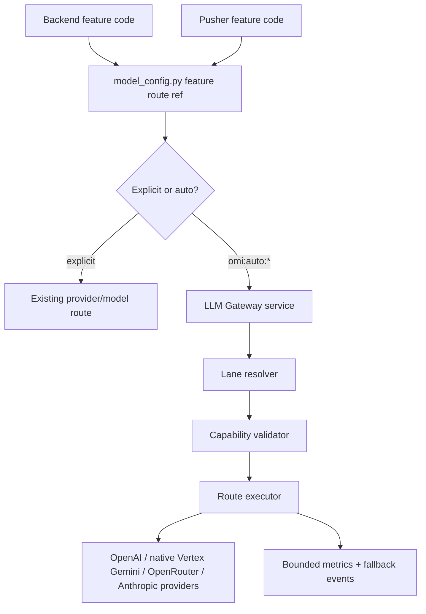

# LLM Gateway Architecture

## Decision

Build a separate **LLM Gateway** service in this repo. Backend, pusher, and later desktop-facing relay surfaces call it through an OpenAI-compatible HTTP surface instead of choosing providers directly for auto-routed work.

The gateway is intentionally narrow:

- Accept explicit model IDs exactly as before, or `omi:auto:*` lane IDs.
- Resolve an auto lane to a versioned route artifact.
- Validate request capabilities before execution.
- Execute the primary provider/model and compatible fallbacks.
- Return a normal provider-compatible response while recording bounded route/fallback terminal telemetry.
- Write a durable, cache-aware usage ledger for each gateway provider attempt without retaining prompts or response bodies.

Do not build a user-facing router product. Do not add sliders, per-user routing preferences, Firestore routing prefs, desktop route caches, or a public `/pick` endpoint for product clients.

The existing realtime `backend/routers/auto_model.py` and desktop `AutoModelSelector` path are legacy context, not the template for this service. New gateway work must not add a public picker endpoint, must not fetch benchmark data in the request path, and must not expand desktop-side routing caches.

## Chat-Structured Lane

The first lane is:

```text
omi:auto:chat-structured
```

For v1, this is the only supported OpenAI-compatible chat-completions interface. It is structured and non-streaming. The broader streaming product chat path remains `/v2/messages`, backed by the retrieval and agentic chat graph documented in [Chat System Architecture](./chat-system.md).

`chat-structured` is for non-streaming structured extraction and classification work, such as memory extraction, chat extraction helpers, conversation post-processing structure, and schema-bound feature decisions. It is the safest first lane because it has clear success checks: JSON/schema validity, parser repair rate, extraction precision/recall, latency, and cost.

Backend structured callers can route non-BYOK requests through the gateway and use their existing provider path only for a hard gateway transport outage (timeout, connection failure, proxy 502/504) or an unusable completed structured result (for example invalid JSON). Gateway HTTP configuration, authentication, and capability failures remain errors; they do not silently select a direct provider. This keeps gateway adoption isolated from user-visible behavior changes unless a feature explicitly promotes the gateway result to authoritative serving.

Non-BYOK requests call `/v1/chat/completions` with `model: "omi:auto:chat-structured"`, text-only messages, and a JSON schema response format. The caller sends low-cardinality feature metadata, not raw user text in logs or telemetry. Service auth uses the existing bearer-token contract; backend callers read `OMI_LLM_GATEWAY_SERVICE_TOKEN` first and then `LLM_GATEWAY_SERVICE_TOKEN` for local compatibility.

BYOK requests skip gateway routing until BYOK forwarding is implemented for the lane. Gemini Developer API keys are never accepted as Vertex credentials; a Gemini BYOK request fails with `byok_unsupported_provider`. The application-level temporary legacy fallback is deliberately limited to hard transport failures (timeout, connection, proxy 502/504). Gateway configuration/authentication/capability failures remain visible instead of silently succeeding through the direct provider path.

The backend exposes the Prometheus counter `llm_gateway_chat_extraction_requests_total{feature,outcome,reason}` for structured gateway callers. Outcomes are bounded classes such as `success`, `fallback`, `error`, and `skipped`; reasons are bounded classes such as `ok`, `timeout`, `request_error`, `http_503`, `invalid_json`, `schema_validation`, `unexpected_error`, and `byok`.

## Deployment

Development gateway deploys continue automatically from `main`. Production deployment is manual-only through the dedicated workflow and requires the independent production service-token secret before Helm can run.

Gateway deploys must go through `backend/scripts/deploy-llm-gateway.sh`. The helper validates backend/gateway env wiring, requires `LLM_GATEWAY_GSA`, deploys backend secrets through `backend/scripts/deploy-backend-secrets.sh`, adopts known gateway ingress resources if they predate Helm ownership, and then runs the Helm upgrade. Do not copy raw `helm upgrade` commands into workflows; that bypasses the required identity/secret/env preflight.

Primary user chat should follow later as a separate lane, likely:

```text
omi:auto:chat-fast-memory
omi:auto:chat-smart-tools
```

Those lanes involve streaming, tool use, retrieval quality, citations, and user-visible response behavior, so they need a stronger evaluation and rollback story.

## Why A Separate Service

The current backend keeps model/provider routing in `backend/utils/llm/model_config.py`, constructs clients in `backend/utils/llm/providers.py`, and exposes callers through `backend/utils/llm/clients.py`. That remains the source of truth for feature routing, but the new auto-route execution brain should be isolated as a service because:

- backend and pusher both run LLM workloads and should share one runtime policy;
- route artifacts need deploy-time validation and gateway-owned route fallback independent of product code;
- route observability needs one consistent set of labels;
- future surfaces can call the same OpenAI-compatible gateway without learning provider details;
- rollback must be config-only and not require desktop or mobile releases.

The service boundary should look like this:



## Language And Framework

Use **Python 3.11 + FastAPI + Pydantic + httpx**.

Reasons:

- The backend is already Python 3.11 and FastAPI.
- Existing auth, logging, sanitizer, executor, test, and deployment patterns are Python.
- Existing LLM provider knowledge lives in Python modules.
- Pydantic is already the natural schema/validation tool for FastAPI.
- `httpx.AsyncClient` matches backend async I/O rules and avoids blocking the event loop.

Do not make the gateway a Swift, Rust, Node, Go, or Kubernetes-controller project for v1. Those choices would increase operational and review burden without helping the first `chat-structured` lane.

Current service layout:

```text
backend/scripts/dev-serve-llm-gateway.sh
backend/scripts/validate-llm-gateway-env.py
backend/scripts/smoke-llm-gateway.py
backend/llm_gateway/
  main.py
  config/
    lanes.yaml
    route_artifacts.yaml
    feature_bundles.yaml
  routers/
    health.py
    openai_compatible.py
    dependencies.py
  gateway/
    schemas.py
    config_loader.py
    auth.py
    credentials.py
    errors.py
    validator.py
    resolver.py
    executor.py
    metrics.py
```

Keep it a separate service entrypoint. Do not place a parallel `utils/auto_router` package under the main backend and do not wire a public task picker into `backend/main.py`.

Implemented internal service auth uses `Authorization: Bearer <LLM_GATEWAY_SERVICE_TOKEN>` plus `X-Omi-Service-Caller`. The default allowlist is low-cardinality service names `backend` and `pusher`; optional `X-Omi-User-Uid` and `X-Omi-Tenant-Id` populate request context only. `/health` remains unauthenticated. `/ready` and `/v1/chat/completions` depend on these helpers instead of Firebase user auth.

`POST /v1/conversations/shared/chat` is a backend-owned public-content surface, not a public gateway surface. Before Redis, Firestore, or gateway work, it requires a Google OIDC token scoped to `PUBLIC_SHARED_CONVERSATION_CHAT_FRONTEND_AUDIENCE`, the exact `PUBLIC_SHARED_CONVERSATION_CHAT_FRONTEND_INVOKER_SA`, and `X-Omi-Public-Chat-Subject` as a 64-character lowercase hex HMAC-SHA-256 derived by that trusted frontend service. The backend never derives identity from `X-Forwarded-For`. Until the frontend has that service-auth facility, its action explicitly returns unavailable and sends no request.

Credential context is request-level metadata. It records credential mode, caller, and provider-key presence or approved key references without exposing raw key material in model dumps or repr output. BYOK credential failures such as missing key, invalid auth, quota, rate-limit, and unsupported provider are visible errors and are not fallback-eligible by default.

## Deployment Shape

For v1, build the gateway as a separate FastAPI app in the backend tree, using the same Python toolchain and dependency-lock workflow as the main backend.

Promotion model:

1. Start with no live product traffic while service startup, readiness, config validation, and service auth are verified.
2. Promote **dev** to gateway-serving with `OMI_LLM_GATEWAY_FEATURE_MODE=gateway`. Keep `OMI_LLM_GATEWAY_ALLOW_DIRECT_MODEL_EXCEPTION=false`: gateway-mode model calls fail closed and never fall back to a provider from product code.
3. Validate dev serving before prod. Prod serving also requires `OMI_LLM_GATEWAY_ALLOW_PROD_FEATURE_MODE=true` and an explicit gateway URL.
4. Promote prod serving only after rollback has been tested and the route artifact has suitable eval evidence.

**Dev serving rollback (config-only):** unset `OMI_LLM_GATEWAY_FEATURE_MODE` (or set it to anything other than `gateway`/`true`/`1`/`yes`) on Cloud Run `backend` / `backend-sync` / `backend-integration` and GKE `backend-listen`. Do not set feature mode on prod without the prod allow env.

Do not start by embedding the gateway router into `backend/main.py`. That would make the gateway look separate in code while still sharing the main backend process, lifecycle, scaling, and blast radius.

Local development runs the gateway as its own process:

```bash
cd backend && ./scripts/dev-serve-llm-gateway.sh
```

The script derives a per-worktree port from `scripts/dev-instance.sh` and defaults to `PYTHON_PORT + 1000`. Override with `LLM_GATEWAY_PORT=<port>` when needed. Backend callers use repo-local configuration through `OMI_LLM_GATEWAY_URL`; `utils.llm.gateway_client.get_llm_gateway_base_url()` defaults to `http://127.0.0.1:9080` for the primary checkout and strips trailing slashes from explicit values.

## Deployment Configuration

The deployed gateway is a separate internal GKE service, not a public client endpoint. The Helm release name is:

```text
<env>-omi-llm-gateway
```

Backend-listen calls the gateway through Kubernetes DNS:

```text
dev:  http://dev-omi-llm-gateway.dev-omi-backend.svc.cluster.local:8080
prod: http://prod-omi-llm-gateway.prod-omi-backend.svc.cluster.local:8080
```

Cloud Run callers use the private internal load-balancer address `http://172.16.160.108`, reserved as `prod-omi-self-hosted-llm-ip-address`. The production gateway chart owns the internal ingress and backend config for that address; do not point Cloud Run at Kubernetes DNS.

Repo wiring:

- gateway chart: `backend/charts/llm-gateway/`
- manual workflow: `.github/workflows/gcp_llm_gateway.yml`
- backend caller env: `backend/charts/backend-listen/{dev,prod}_omi_backend_listen_values.yaml`
- shared secret mapping: `backend/charts/backend-secrets/{dev,prod}_omi_backend_secrets_values.yaml`

Backend-listen env:

| Env | Value |
|---|---|
| `OMI_LLM_GATEWAY_URL` | Internal service URL above |
| `OMI_LLM_GATEWAY_SERVICE_TOKEN` | `*-omi-backend-secrets` key `OMI_LLM_GATEWAY_SERVICE_TOKEN` |
| `OMI_LLM_GATEWAY_FEATURE_MODE` | `gateway` routes non-BYOK `get_llm` traffic through per-feature `omi:auto:*` lanes |
| `PUBLIC_SHARED_CONVERSATION_CHAT_MODE` | Independent `off` or `gateway` switch; dev is checked in as `gateway`, prod and default remain `off`; gateway mode has no direct-provider fallback |
| `OMI_LLM_GATEWAY_ALLOW_PROD_FEATURE_MODE` | Required and set to `true` on prod callers; prevents an accidental production route flip without an explicit checked-in enablement |
| `OMI_LLM_GATEWAY_ALLOW_DIRECT_MODEL_EXCEPTION` | When `true`, acknowledged direct surfaces (BYOK, agentic, file chat, omni realtime) stay on providers |

Gateway env:

| Env | Value |
|---|---|
| `OMI_LLM_GATEWAY_PROD` | `true` |
| `OMI_LLM_GATEWAY_SERVICE_TOKEN` | same `*-omi-backend-secrets` key `OMI_LLM_GATEWAY_SERVICE_TOKEN` |
| `LLM_GATEWAY_ALLOWED_CALLERS` | `backend` |
| `OPENAI_API_KEY` | existing `*-omi-backend-secrets` key `OPENAI_API_KEY` |
| `ANTHROPIC_API_KEY` | existing `*-omi-backend-secrets` key `ANTHROPIC_API_KEY` (required for managed Messages lanes) |
| `GOOGLE_CLOUD_PROJECT` | Vertex project (`based-hardware-dev` / `based-hardware`) |
| `GCP_LOCATION` | Vertex region (`us-central1`) |
| `OPENROUTER_API_KEY` | existing `*-omi-backend-secrets` key `OPENROUTER_API_KEY` (required for openrouter-backed feature lanes) |
| `METRICS_SECRET` | existing `*-omi-backend-secrets` key `METRICS_SECRET` |
| `LLM_GATEWAY_ACCOUNTING_ENABLED` | `true` in deployed values; enables immutable Firestore usage-attempt events |
| `LLM_GATEWAY_ACCOUNTING_WRITE_TIMEOUT_SECONDS` | Bounded non-fatal Firestore-write timeout; `1` in deployed values |

Gemini gateway lanes use native Vertex `generateContent` / `streamGenerateContent` with Application Default Credentials. The Kubernetes service account is annotated at deploy time from the environment-scoped GitHub variable `LLM_GATEWAY_GSA`; it must already be mapped through GKE Workload Identity to a dedicated Google service account with the required Vertex invocation permission (for example, `roles/aiplatform.user`) in the configured project. The exact dev/prod Google service-account identities and IAM bindings are an external platform prerequisite, not chart defaults or secrets.

The same gateway Google service account must also have Firestore data access in the backend project (normally
`roles/datastore.user`) before deployed accounting is enabled. The ledger collection is `llm_gateway_attempts`;
each immutable event contains user/tier attribution, provider/model/route, normalized prompt/output/cache units, and
an integer micro-USD estimate. It contains no prompts, completions, provider response bodies, headers, or API keys.
Costs are estimates from versioned in-repo rate cards: cache hits and partial hits use the provider-reported cached
input token count, while unpriced models and unreported/indeterminate usage remain explicitly non-zero-unknown rather
than being treated as free. Cache storage charges and provider request/tool fees are intentionally out of scope for
this first ledger. Image-generation cards are per generated image and explicitly exclude unreported prompt-input
tokens. Firestore writes are detached from model responses and streaming tails; the configured accounting timeout
bounds both each write and the graceful-shutdown drain. `LLM_GATEWAY_ACCOUNTING_MAX_PENDING_TRACES` bounds detached
in-memory work (default `1000`); queue overflow is emitted as a `delivery=dropped` accounting metric, so this
best-effort delivery path is observable rather than silently treated as free. Gateway calls without an authenticated
user-usage context are recorded as unattributed rather than being assigned to a guessed user or subscription tier.

ExternalSecrets expect a GCP Secret Manager secret named `OMI_LLM_GATEWAY_SERVICE_TOKEN` in both projects:

```text
dev:  based-hardware-dev / OMI_LLM_GATEWAY_SERVICE_TOKEN
prod: based-hardware     / OMI_LLM_GATEWAY_SERVICE_TOKEN
```

Do not use remote config for service-to-service credentials. Rotate the service token through Secret Manager and ExternalSecrets, not through app config.

The chart exposes only a `ClusterIP` service. `/health` is unauthenticated. Kubernetes liveness/startup/readiness probes call `/health`; the deployment workflow then runs an in-cluster authenticated smoke test against `/ready` and `/v1/chat/completions` with `Authorization: Bearer ...` plus `X-Omi-Service-Caller: backend`.

Before any deploy, validate the values files:

```bash
python backend/scripts/validate-llm-gateway-env.py \
  backend/charts/backend-listen/dev_omi_backend_listen_values.yaml \
  backend/charts/llm-gateway/dev_omi_llm_gateway_values.yaml
```

Backend runtime env also has a cross-plane validator backed by
`backend/deploy/runtime_env.yaml`. Run it without Cloud Run state to validate
checked-in GKE config against the manifest:

```bash
python backend/scripts/validate-backend-runtime-env.py --env dev
```

Run it against live Cloud Run revisions before traffic shift when changing
backend runtime env, secret bindings, or internal service discovery:

```bash
python backend/scripts/validate-backend-runtime-env.py --env dev --check-live-cloud-run
```

The manifest separates checked-in non-secret values, checked-in secret binding
names, and platform-specific service discovery. Secret values stay in Secret
Manager. Provisional values mark known migration gaps that require presence but
do not yet have a final stable endpoint; use `--strict-provisional` once the
endpoint is finalized.

Post-deploy smoke check, from inside the GKE network or a pod with cluster DNS access:

```bash
python backend/scripts/smoke-llm-gateway.py \
  --url http://dev-omi-llm-gateway.dev-omi-backend.svc.cluster.local:8080 \
  --token "$OMI_LLM_GATEWAY_SERVICE_TOKEN"
```

DEV readiness order:

1. Create or verify `OMI_LLM_GATEWAY_SERVICE_TOKEN` in `based-hardware-dev` Secret Manager and set the `LLM_GATEWAY_GSA` environment variable after its Workload Identity / Vertex IAM binding exists.
2. Run the values validation command above.
3. Run focused gateway unit tests and preflight checks.
4. Manually dispatch `gcp_llm_gateway.yml` to `development`.
5. Run `/ready` and chat-completions smoke checks.
6. Deploy backend-listen values only after gateway smoke passes, so backend callers do not point at a missing service.

PROD readiness order:

1. Create or verify an independent `OMI_LLM_GATEWAY_SERVICE_TOKEN` in `based-hardware` Secret Manager and the prod `LLM_GATEWAY_GSA` Workload Identity / Vertex IAM binding.
2. Confirm DEV smoke passed with the same image/commit.
3. Run the prod values validation command.
4. Manually dispatch `gcp_llm_gateway.yml` to `prod`.
5. Run prod `/ready` and chat-completions smoke checks from the prod GKE network.
6. Deploy backend-listen and the Cloud Run callers after gateway prod smoke passes; keep `OMI_LLM_GATEWAY_ALLOW_DIRECT_MODEL_EXCEPTION=false`.

## Major Library Choices

Use:

- **FastAPI** for HTTP endpoints and service lifecycle.
- **Pydantic** for lane, artifact, request, and validation schemas.
- **httpx.AsyncClient** for provider HTTP calls and gateway-to-provider calls.
- **OpenAI Python SDK only where it materially reduces request/stream parsing risk.** Prefer direct `httpx` for the gateway core so we preserve request/response metadata, timeouts, headers, and streaming behavior consistently.
- **Prometheus-compatible metrics** following existing backend observability conventions.
- **pytest** for deterministic resolver, validator, and executor tests.

Avoid for v1:

- LangChain inside the gateway execution path. Existing product code can keep using LangChain, but the gateway should speak provider HTTP contracts directly so it can preserve OpenAI-compatible request/response shapes and streaming semantics.
- Firestore/Redis as routing config stores. All lane and route artifacts live in repo files for v1.
- LiteLLM, Portkey, Envoy AI Gateway, or Kong as the gateway foundation.
- Runtime benchmark fetching, including Artificial Analysis calls, inside request handling.

## Open Source Position

We should learn from existing gateways, but not build on top of them for v1.

| Project | Use For | Do Not Use For |
|---|---|---|
| LiteLLM | Provider normalization ideas, error mapping, cost accounting examples, OpenAI-compatible proxy behavior | Canonical gateway foundation, admin dashboard, virtual keys, spend product, broad registry |
| Portkey Gateway | Config-driven fallback/routing patterns and composable fallback examples | User prefs, hosted-control-plane assumptions, its config DSL as our source of truth |
| Envoy AI Gateway | Edge gateway inspiration if Omi later standardizes on Envoy/Kubernetes AI traffic policy | Application route brain or first implementation substrate |
| Kong AI Gateway | Mature edge/platform concepts | Omi route artifacts or feature-to-lane semantics |

Current public docs describe LiteLLM as a self-hosted OpenAI-compatible gateway for 100+ providers with virtual keys, spend tracking, guardrails, load balancing, and dashboard features. Portkey similarly focuses on broad model routing, guardrails, fallbacks, and hosted/enterprise gateway workflows. Envoy AI Gateway provides OpenAI-compatible and Anthropic-compatible routing with provider fallback and load balancing, but assumes an Envoy/Kubernetes operating model.

Those are useful references, but they are broader than Omi's target. Omi needs a small internal service that preserves `model_config.py` as the feature route source and promotes route artifacts through Omi evals.

Reference links checked while writing this spec:

- [LiteLLM](https://github.com/BerriAI/litellm)
- [LiteLLM proxy docs](https://docs.litellm.ai/docs/)
- [Portkey Gateway](https://github.com/Portkey-AI/gateway)
- [Envoy AI Gateway supported endpoints](https://aigateway.envoyproxy.io/docs/0.5/capabilities/llm-integrations/supported-endpoints/)

## API Surface

MVP endpoint:

```http
POST /v1/chat/completions
```

Requests may use either an explicit model:

```json
{
  "model": "gpt-4.1-mini",
  "messages": []
}
```

For v1, explicit-model execution through the gateway is not a generic arbitrary-model proxy. Explicit routes either stay on the existing backend clients or are sent to the gateway as an internal provider-qualified route resolved by `model_config.py`. A bare model string is not enough because Omi's source of truth is `(provider, model)`, not model name alone.

Or an Omi lane:

```json
{
  "model": "omi:auto:chat-structured",
  "messages": [],
  "response_format": {
    "type": "json_schema",
    "json_schema": {
      "name": "RequiresContext",
      "strict": true,
      "schema": {}
    }
  },
  "metadata": {
    "omi_feature": "chat_extraction.requires_context",
    "prompt_version": "chat_extraction.requires_context.v1",
    "parser_version": "RequiresContext.v1"
  }
}
```

Normal responses return the requested lane ID:

```json
{
  "model": "omi:auto:chat-structured",
  "choices": []
}
```

Internal debug may expose route IDs through admin-only headers:

```http
X-Omi-Lane-Id: omi:auto:chat-structured
X-Omi-Route-Id: route.chat_structured.2026_06_27.001
X-Omi-Fallback-Used: false
```

Provider/model details stay internal by default.

## Config Model

All config is checked into this repo for v1.

Implemented config files:

```text
backend/llm_gateway/config/lanes.yaml
backend/llm_gateway/config/route_artifacts.yaml
backend/llm_gateway/config/feature_bundles.yaml
```

`backend/llm_gateway/gateway/config_loader.py` loads those files by default, validates cross-file references, rejects duplicate route IDs, validates active/LKG compatibility, rejects dev/mock evidence in prod mode, and validates route artifact digests.

Lane config:

```yaml
lane_id: omi:auto:chat-structured
surface: openai.chat_completions
capabilities:
  text_input: true
  streaming: false
  structured_output: json_schema
  tools: false
objective:
  quality: 0.60
  latency: 0.20
  cost: 0.20
active_route: route.chat_structured.2026_06_27.001
last_known_good: route.chat_structured.2026_06_20.001
```

Route artifact:

```yaml
route_artifact_id: route.chat_structured.2026_06_27.001
lane_id: omi:auto:chat-structured
primary:
  provider: openai
  model: gpt-4.1-mini
fallbacks:
  - provider: openai
    model: gpt-4.1-mini
timeouts:
  request_ms: 8000
retry:
  max_attempts: 1
capabilities:
  structured_output: json_schema
  streaming: false
evidence:
  benchmark_snapshot: bench.omi.chat_structured.2026_06_27
  eval_report: eval.chat_extraction_requires_context.2026_06_27
rollout:
  stage: shadow
  percent: 0
credential_policy:
  mode: omi_paid
  allow_byok_to_omi_paid_fallback: false
fallback_policy:
  fallback_on:
    - timeout_before_output
    - provider_429_omi_paid
    - provider_5xx_omi_paid
  never_fallback_on:
    - byok_auth
    - byok_quota
    - byok_rate_limit
    - missing_byok_key
    - capability_mismatch
    - invalid_config
artifact_digest: sha256:<computed-by-validation>
```

Feature bundle:

```yaml
feature: chat_extraction.requires_context
lane_id: omi:auto:chat-structured
prompt_version: chat_extraction.requires_context.v1
parser_version: RequiresContext.v1
eval_suite: chat_extraction_requires_context.v1
promotion_gates:
  schema_valid_rate: ">= 99.5%"
  classification_agreement_delta: ">= 0"
  false_negative_regression: "none"
  p95_latency_ms: "<= LKG + 10%"
  cost_per_success: "<= LKG + 15%"
```

Route artifacts are immutable. Promotion creates a new artifact and updates the lane pointer. Rollback updates the lane pointer back to LKG.

Validation rejects duplicate `route_artifact_id` values and exposes a content digest for every artifact. Checked-in artifacts should include `artifact_digest`; if the artifact content changes without changing the digest, validation fails. Once an artifact ID has shipped, changing its content is treated as invalid operational behavior; create a new artifact ID instead.

## Integration With Existing Backend Code

`backend/utils/llm/model_config.py` remains the feature routing source. Add typed route refs behind it:

```python
@dataclass(frozen=True)
class ExplicitRouteRef:
    feature: str
    model: str
    provider: str
    options: dict[str, object]

@dataclass(frozen=True)
class AutoLaneRouteRef:
    feature: str
    lane_id: str
```

Existing APIs must keep working:

- `get_model(feature)`
- `get_provider(feature)`
- `get_llm(feature)`
- `get_route_options(feature, model, provider)`

For auto lanes, product code should not call `get_provider()` expecting a concrete provider. The initial migration should keep existing tuple behavior for all current features, then add explicit new helpers:

```python
get_route_ref(feature) -> ExplicitRouteRef | AutoLaneRouteRef
is_auto_lane_id(model: str) -> bool
```

Implemented route refs are additive only. `get_route_ref(feature)` currently returns an `ExplicitRouteRef` for every existing feature by default, including pinned routes, profile routes, fallback routes, and provider/model construction options from `get_route_options(feature, model, provider)`. `AutoLaneRouteRef` is available behind an intentionally empty feature-to-lane mapping in `model_config.py` so a later ticket can map selected features to `omi:auto:chat-structured` without changing the legacy helpers.

Backend callers that use `get_llm(feature)` can be migrated feature by feature. Route refs do not change return values from `get_model(feature)`, `get_provider(feature)`, or `get_llm(feature)`. Gateway-enabled callers should use explicit application-level fallback until a feature has passed its lane-specific promotion gates.

## BYOK Policy

BYOK failures fail visibly by default.

If a request is using a user-provided provider key and that key is invalid, rate-limited, out of quota, or rejected by the provider, the gateway returns a clear typed error. It must not silently fall back to an Omi-paid provider route unless a route artifact explicitly allows that behavior and the product owner has approved it.

The gateway must not reuse current backend BYOK fallback behavior where unsupported BYOK chat clients or failed embedding calls can fall back to Omi-paid credentials. That behavior may remain in legacy callers until migrated, but the gateway contract is stricter.

Gateway requests carry a `CredentialContext` owned by service-authenticated backend/pusher callers. Desktop and mobile clients never call the gateway directly and never send raw BYOK credentials directly to it. The initial implementation must choose one of these internal patterns before live traffic:

- backend forwards a short-lived BYOK credential envelope to the gateway over service-authenticated transport;
- gateway receives a key reference and resolves it through an approved internal secret path.

The route artifact credential policy controls whether a route is `omi_paid` or `byok`, whether BYOK-to-Omi-paid fallback is allowed, and which failure classes are fallback eligible.

Default behavior:

| Failure | Behavior |
|---|---|
| BYOK invalid key | visible auth error |
| BYOK quota/rate limit | visible provider/key error |
| BYOK unsupported provider for route | capability/config error |
| Omi-paid primary timeout before output | retry/fallback if route policy allows |
| Omi-paid primary schema invalid | repair attempt or compatible fallback if route policy allows |

## Service Auth

`/health` may be unauthenticated.

`/ready` and `/v1/chat/completions` require internal service authentication. The first allowed callers are backend and pusher. Requests must propagate enough caller, tenant, user, BYOK, and usage context for accounting and policy enforcement, but must not expose provider keys in logs or metrics.

Desktop, mobile, and third-party product clients must not call the gateway directly in v1.

## Request Validation And Route Resolution

Implemented v1 route resolution is intentionally narrow:

- `is_auto_lane_id(model)` recognizes only the `omi:auto:` namespace.
- `omi:auto:chat-structured` is the only supported auto lane.
- unknown `omi:auto:*` lanes return a typed model-not-found error.
- bare provider model names such as `gpt-4o-mini` are not direct gateway routes in v1 and return a typed unsupported-model error.
- the resolver maps the supported lane to its configured `active_route` and `last_known_good` route artifact.
- runtime route checks defensively reject active/LKG lane, surface, capability, and credential-mode mismatches as invalid config.

Before execution, the validator accepts only OpenAI chat-completions-shaped requests with:

- `model: "omi:auto:chat-structured"`;
- non-empty text `messages`;
- `stream` absent or false;
- no tool use;
- `response_format.type: "json_schema"`;
- a `response_format.json_schema.schema` object.

The validator rejects streaming, tools, missing or invalid messages, non-text or multimodal content, and structured-output modes other than JSON schema for this lane. These failures are typed gateway exceptions, not ad hoc strings, so future HTTP endpoint code can map them to OpenAI-compatible error envelopes.

Runtime fail-open means active route failure may use LKG only for failure classes allowed by the route artifact. Deploy/startup fail-closed means invalid LKG or invalid config prevents the service from starting. Do not use LKG for BYOK credential failures, capability mismatches, missing BYOK keys, or invalid config.

## HTTP Surface

`GET /ready` is implemented as a service-authenticated readiness check. It loads the same repo-local gateway config used by the route dependency, validates active/LKG artifacts through `load_gateway_config(prod_mode=True)`, and returns lane IDs plus route artifact count. Config validation failures return 503 with a generic message.

`POST /v1/chat/completions` is implemented as an OpenAI-compatible non-streaming route for internal services:

- requires service auth;
- accepts the same request shape validated by the resolver;
- builds an Omi-managed request credential context for the current v1 lane;
- resolves `model: "omi:auto:chat-structured"` to the checked-in active route;
- calls the executor and returns the provider response payload with `model` rewritten to the requested lane ID;
- forwards supported OpenAI chat-completions controls such as `temperature`, `max_tokens`, `max_completion_tokens`, `seed`, `top_p`, penalties, `stop`, and `user`;
- maps typed gateway exceptions to OpenAI-style error envelopes with `error.message`, `error.type`, `error.param`, and `error.code`;
- rejects unknown auto lanes, bare provider model names, streaming, tools, unsupported capabilities, and unknown top-level request parameters before provider execution.

Background callers use the gateway for latency-insensitive structured decisions and post-processing work. Serving requests fail closed when the gateway returns invalid output, times out, or fails; only non-authoritative shadow comparisons may continue to use a legacy result while emitting bounded metrics.

The default provider registry includes the OpenAI-compatible adapter for the checked-in `openai` provider route. It is cached per process, closed during FastAPI lifespan shutdown, uses `OPENAI_API_KEY`, optional `OPENAI_BASE_URL`, and optional `OPENAI_MAX_RESPONSE_BYTES`, posts to `/chat/completions` with `httpx.AsyncClient`, and fails closed with `invalid_route_config` when the managed key is absent or rejected. Tests can still override the registry with fake providers.

## Keyed Chat Completions

Finalization sends a canonical lowercase UUID in `Idempotency-Key` to
`POST /v1/chat/completions/operations`. This route requires a key and older
gateway versions return 404 without dispatching. Gateway versions that implement
this contract reject a key on the ordinary `POST /v1/chat/completions` URL before
dispatch. Keyed callers use the existing service bearer
and caller headers and must supply `X-Omi-User-Uid`. The gateway scopes each
key to the authenticated service caller, user, and optional
`X-Omi-Tenant-Id`. It compares the canonical JSON body and forwarded
credential context. The order of names inside each structured-output schema's
`properties` is significant. Other JSON object keys remain order-independent.
The request limit is 1 MiB.

Keyed calls support OpenAI, OpenRouter, and Anthropic serving routes with
`stream` absent or set to the JSON boolean `false`. Proactivity feature and
identity headers are rejected before claim or replay. The gateway commits a claim before a single provider dispatch and
disables route fallback and retries for that request. Unkeyed calls follow
the usual routing policy.

| Condition | Gateway behavior |
| --- | --- |
| First successful request | Commits the encrypted response before returning it and echoes the key in `X-Omi-Idempotency-Key` |
| Matching POST after commit | Returns the same status and body, including a committed deterministic rejection |
| Matching POST or lookup during the five-minute pending window | HTTP 409 `idempotency_pending`, with `Retry-After: 2` |
| Same key with different JSON or credentials | HTTP 409 `idempotency_conflict` |
| Possible provider submission without a committed result | Keeps the claim fenced. HTTP 409 `idempotency_indeterminate` on later requests |
| Result expired | HTTP 410 `idempotency_expired`. The claim still fences the key |
| Claim TTL elapsed and the document still exists | HTTP 410 `idempotency_expired`. The gateway does not renew the claim |
| Storage unavailable or feature disabled | HTTP 503. The operation cannot start without a durable claim |
| Keyed storage saturated | HTTP 503 `idempotency_store_busy` with `Retry-After: 2` before claim or dispatch |

`GET /v1/chat/completions/operations/{key}` uses the same auth and scope and
returns only a committed successful completion. A missing result returns 404.
Lookup never calls a provider. A timeout or a crash after submission can
leave an operation indeterminate for the rest of its claim lifetime. A response larger than
256 KiB is fenced as indeterminate and never returned as a successful result.

The customer Firestore stores the claim in
`users/{uid}/llm_gateway_idempotency_claims` and the authenticated-encrypted
response in `users/{uid}/llm_gateway_idempotency_results`. The response is
readable for 24 hours after commit, capped by the claim expiry. The claim has a
fixed 30-day TTL from the initial claim, and replay and lookup leave it unchanged.
The claim fences the key after result expiry. After Firestore deletes the claim,
the gateway has no record of the previous use. Callers must end all keyed retries
and redrives before the 30-day horizon. Claim, settlement and lookup
transactions read the account deletion marker. The existing recursive account
wipe removes both subcollections. A first successful request adds four reads
and three writes, plus two eventual TTL deletes. Replay and lookup add up to
three reads and no writes. Transaction retries can increase the read count.

The keyed protocol defaults on. Set `LLM_GATEWAY_IDEMPOTENCY_ENABLED=off`
on every gateway replica to refuse keyed calls while keeping unkeyed traffic
available. Before pointing Go workers at the gateway, verify all replicas
serve the keyed protocol and enable Firestore TTL on the `expires_at` field
for both collection groups. The gateway requires
`LLM_GATEWAY_IDEMPOTENCY_CUSTOMER_PROJECT` for keyed storage and uses the same
customer project and database for claims, responses, and deletion-marker reads.
Verify the gateway runtime identity has access there. Development compute
and the customer project intentionally differ. This pin applies only to
keyed storage. The claim and lookup executor admits eight running and eight
queued transactions per replica. A keyed POST must reserve one of eight separate
settlement slots before reading the body or creating a claim. Claim and lookup
contention cannot take those slots. A canceled HTTP request releases an unused
slot. Once settlement has been submitted, the worker keeps the slot and can
commit the result even if the HTTP request is canceled before the worker starts.
Unkeyed work and accounting use their existing pool.'"

The Helm values accept a gateway-only Kubernetes secret named
`<stage>-omi-llm-gateway-idempotency-keys` in the gateway namespace. Its optional entries use the same names as the gateway environment settings
`LLM_GATEWAY_IDEMPOTENCY_ENCRYPTION_SECRET` and
`LLM_GATEWAY_IDEMPOTENCY_SECONDARY_ENCRYPTION_SECRET`. Until an active key is
provided, the gateway uses `ENCRYPTION_SECRET`. Use cryptographically
random secrets of at least 32 bytes. Claims record the version used for the
fingerprint and response encryption. For rotation, first distribute the next
secret as secondary on every replica. Then promote it to active and keep the
former active secret as secondary across all replicas. Retain the previous key
for at least 30 days after the last replica using it for new claims has drained.
An unavailable recorded version fails closed. Remove the previous key only
after that window, then stage the next rotation. Roll gateway replicas after each
change to the secret. Leave the shared application encryption secret in place. Unkeyed calls and startup do not
require either key.

Use the repository's scoped TTL helper with
`--policy backend/deploy/llm-gateway/retention.json --project <customer-project>`
to print the plan. An authorized operator applies it with `--apply` and
verifies that both TTL policies are active. Keyed clients must always use the
dedicated operations URL, including during a rollback.

### Rollout readback

Measure excess provider attempts per 1,000 keyed POSTs over a settled window
that contains replay traffic. The first production readback uses only
`prod`. The dev and prod charts set `LLM_GATEWAY_IDEMPOTENCY_ENVIRONMENT`
explicitly. It stamps new claims, keyed ledger rows and the keyed POST counter.
Use `sum(increase(llm_gateway_keyed_posts_total{environment="prod"}[<window>]))`
as the denominator, evaluated at the window end. Collect the read-only inputs
before claim TTL or account erasure can remove cohort records.

- `claims` projects the customer Firestore claim document ID as `scope`, plus
  `state`, `started_at` and `environment`. Extract the chosen environment and
  `window_start <= started_at < window_end` from the
  `llm_gateway_idempotency_claims` collection group. If the range index is
  unavailable, scan those projected fields during the bounded rollout and
  apply the same filters in the extract.
- `attempts` projects `idempotency_scope AS scope`, `attempt_id`,
  `occurred_at` as a timestamp, and `idempotency_environment AS environment`
  from the participating replicas' `llm_gateway_attempts` ledgers. Extract
  rows in the chosen environment for each cohort scope, including late rows
  after window end, and all scoped ledger rows occurring within the window.
  Keep `user_uid` for the next lookup only.
- `claim_lookup` contains point reads in customer Firestore for every
  in-window ledger scope absent from the claim cohort. Read
  `users/{user_uid}/llm_gateway_idempotency_claims/{scope}` and project
  `scope`, `started_at` and `environment` for found documents. Only a
  matching-environment claim confirmed outside the window excludes a
  ledger-only scope. Missing claims, mismatched stamps, and found claims
  that should have been in the extract leave coverage unknown. Treat lookup
  errors as an incomplete measurement.

Run the query with `@environment = 'prod'`, `@window_start` and
`@window_end` matching the scrape window, and `@keyed_posts` set to the
environment-filtered denominator. A committed pre-dispatch rejection with
no ledger row is conservatively unknown as well.

```sql
WITH cohort AS (
  SELECT scope, state
  FROM claims
  WHERE environment = @environment
    AND started_at >= @window_start AND started_at < @window_end
), by_scope AS (
  SELECT scope, COUNT(DISTINCT attempt_id) AS attempts,
         MAX(CASE WHEN occurred_at >= @window_start AND occurred_at < @window_end
                  THEN 1 ELSE 0 END) AS in_window
  FROM attempts
  WHERE environment = @environment
  GROUP BY scope
), scoped AS (
  SELECT c.scope, c.state, COALESCE(a.attempts, 0) AS attempts, 1 AS has_claim
  FROM cohort AS c LEFT JOIN by_scope AS a ON c.scope = a.scope
  UNION ALL
  SELECT a.scope, NULL AS state, a.attempts, 0 AS has_claim
  FROM by_scope AS a
  WHERE a.in_window = 1
    AND NOT EXISTS (SELECT 1 FROM cohort AS c WHERE c.scope = a.scope)
    AND NOT EXISTS (
      SELECT 1 FROM claim_lookup AS l
      WHERE l.scope = a.scope AND l.environment = @environment
        AND (l.started_at < @window_start OR l.started_at >= @window_end)
    )
), coverage AS (
  SELECT
    COALESCE(SUM(CASE WHEN attempts > 1 THEN attempts - 1 ELSE 0 END), 0) AS observed_excess,
    COALESCE(SUM(CASE WHEN state = 'committed' AND attempts > 0 THEN 0 ELSE 1 END), 0)
      AS unknown_scopes,
    COALESCE(SUM(has_claim), 0) AS claims
  FROM scoped
)
SELECT observed_excess, unknown_scopes, claims,
       CASE WHEN unknown_scopes = 0 AND claims > 0
            THEN 1000.0 * observed_excess / NULLIF(@keyed_posts, 0)
       END AS excess_per_1000_keyed_posts
FROM coverage;
```

Require complete claim and ledger extracts. Independently compare the keyed
provider-attempt and accounting-delivery counter deltas from the same
environment's scrape targets. A known extract or counter gap makes coverage
unknown. Accept the zero target only with a nonempty cohort, replay traffic,
and complete coverage. A claim removed by TTL or erasure makes the affected
window incomplete. Track replay, conflict, pending, indeterminate,
saturation and storage errors in `llm_gateway_idempotency_outcomes_total`.

## Provider Execution

Implemented executor behavior is non-streaming only:

- the caller passes a resolved route plus a request-level `CredentialContext`;
- the executor sends an OpenAI-compatible chat-completions payload to the active route primary provider first;
- the provider-facing payload replaces the lane model with the selected provider model and forces `stream: false`;
- the caller-facing response payload keeps the normal provider response shape but reports `model` as the requested lane ID, such as `omi:auto:chat-structured`;
- selected route artifact, provider, provider model, fallback reason, and LKG usage are returned only on the executor result metadata, not embedded into the response payload.

Fallback is deliberately narrow:

- active route fallbacks are attempted only when the route policy allows the normalized failure class;
- LKG is attempted only through `select_lkg_route_for_failure`, so active route policy remains the single gate for runtime LKG;
- BYOK missing key, auth, quota, rate limit, unsupported provider, capability mismatch, and invalid config failures fail visibly and do not fall back by default;
- Omi-paid timeout before output, provider 429, and provider 5xx may fall back only when the route artifact allows those classes;
- streaming-after-first-token recovery is unsupported for MVP. The executor assumes no partial output exists and does not try to recover or replay partial responses.

The current provider abstraction is an async protocol plus:

- `OpenAICompatibleChatCompletionProvider` for live non-streaming OpenAI-compatible calls;
- in-memory fake providers for unit tests.

The live adapter does not log raw provider response bodies, prompts, transcripts, screenshots, memory contents, or BYOK keys. It bounds successful response bodies, validates that success responses look like OpenAI chat completions, maps missing Omi-managed keys and provider 401/403 responses to config failure, provider 429 to Omi-paid rate-limit failure, provider 5xx/network failures to Omi-paid provider failure, and provider 4xx request failures to capability mismatch.

## Observability

Gateway-side Prometheus metrics are exposed on `/metrics` with `METRICS_SECRET` bearer auth. The main gateway request metrics are:

```text
llm_gateway_requests_total
llm_gateway_request_latency_seconds
```

Labels are bounded and low-cardinality: `lane_id`, `route_artifact_id`, `provider`, `model`, `used_lkg`, `fallback_used`, `fallback_reason`, `outcome`, and `error_class`.

The backend caller also exposes `llm_gateway_chat_extraction_requests_total{feature,outcome,reason}` for app-level success/fallback/skipped behavior.
The same backend observability helper emits a privacy-safe Cloud Logging line
containing `llm_gateway_backend_event` with the same low-cardinality dimensions
plus `kind`, `field`, `route`, and `service`. This gives rollout owners a stable
query surface even when backend caller metrics are hard to inspect per runtime
surface.

Gateway terminal errors and request rejections emit warning-level, privacy-safe
Cloud Logging lines. `llm_gateway_terminal` includes only the opaque request ID,
route metadata, credential source, and bounded `error_class` / `failure_class`;
it never includes provider bodies, prompts, or credentials. Successful terminal
events remain metrics and info-level logs to avoid turning normal traffic into
an operational alert stream.

Shadow-only features can also emit privacy-safe comparison buckets through
`llm_gateway_chat_extraction_comparisons_total{feature,field,outcome}`. These
metrics compare derived properties such as category match, empty/non-empty
status, length ratio, and normalized similarity bands. They must not store raw
transcripts, prompts, titles, overviews, memories, or provider responses.

Do not log raw prompts, transcripts, screenshots, memory contents, provider
response bodies, conversation IDs, UIDs, or BYOK keys. Use existing sanitizer
patterns for error bodies and user text.

## Shadow Safety

Shadow mode must be explicitly bounded before any live user content goes through the gateway:

- feature-owner/privacy approval for the feature being shadowed;
- sampling limits and a kill switch;
- cost cap;
- no BYOK shadow by default;
- no provider expansion beyond the current production provider class without approval;
- no persistence of raw prompts or raw responses;
- metrics-only comparison unless an approved eval store exists.

Prefer offline replay/eval before live shadow for memory- or transcript-heavy workloads.

Shadow callers must not put gateway latency on the authoritative product path. Run the legacy or serving result first, then schedule shadow work through the shared executor pools or another bounded background path. A gateway timeout, provider outage, disabled feature flag, or sampled-out request should affect only shadow metrics, never the returned product result.

## Explicit Non-Goals

- No desktop Settings UI.
- No quality/latency/cost sliders.
- No per-user routing preferences.
- No Firestore or Redis routing prefs.
- No desktop-side model/route cache.
- No public `/v1/auto-router/pick`.
- No new public `/v1/auto/model-pick`.
- No request-path benchmark fetching.
- No production route from mock benchmark data.
- No benchmark-only promotion.
- No wholesale LiteLLM, Portkey, Envoy AI Gateway, or Kong adoption.

## Maintainer Checklist

Before broad production traffic:

- explicit model routing remains backward compatible;
- `model_config.py` still owns feature-to-route mapping;
- gateway config validation fails closed on invalid prod config;
- active route has valid LKG;
- route artifacts are immutable;
- BYOK failure does not silently fall back to Omi-paid traffic;
- `/v1/chat/completions` requires internal service auth;
- LKG/fallback is limited to artifact-approved failure classes;
- mock benchmarks cannot load in prod;
- Omi eval report exists;
- shadow/canary completed;
- rollback is config-only;
- observability includes route, fallback, latency, errors, and cost.
