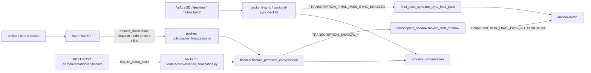
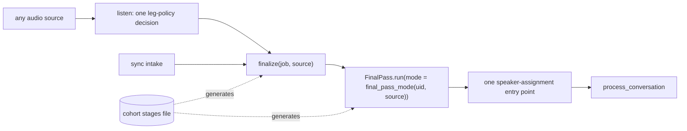

# Transcription architecture map

A reader's map of how audio becomes a finished conversation: live STT,
finalization, the batch final pass, speaker identification, and storage. It is
descriptive only. The owning modules and their docs remain authoritative.

**Verified at:** `origin/main` `aa8227f29e0de975446d4edb79b8b83271b5befe`
(2026-10-14). File:line references and prod flag values are pinned to that SHA;
re-check them with `git grep` before relying on a line number. Prod values come
from `backend/deploy/runtime_env.yaml` and the prod chart values at that SHA.

## Current flow

Three facts that the code does not make obvious:

1. **Live finalization runs on pusher.** `request_finalization` chooses the
   Cloud Tasks route only when `LISTEN_FINALIZATION_DISPATCH_MODE=cloud_tasks`
   (`utils/cloud_tasks.py:220-222`). That value is set only on the Cloud Run
   services (`runtime_env.yaml:2493,2768,2977`), not on listen, so live
   sessions take the `pusher` route. The Cloud Tasks worker serves the REST
   finalize endpoint, which rejects BYOK requests.
2. **Sync does not use the finalizer.** The sync pipeline calls
   `process_conversation` directly (`utils/sync/pipeline.py:1107`) and runs its
   own final pass. Conversations that arrive only through sync never reach the
   transcription shadow.
3. **The final pass has two gate families.** `TRANSCRIPTION_SHADOW_*` admits a
   conversation to the shadow job. `TRANSCRIPTION_FINAL_PASS_*` selects the
   diarizer and decides whether a result is authoritative (live) or runs at all
   (sync). Both must agree for one cohort.

## Entry points

| Stage | Entry points (file:line) | Prod flags at the pinned SHA |
|---|---|---|
| Live STT | `utils/stt/live_chain.py` (`RejectedStream` :98, paid admission :395-436); `utils/stt/live_session.py` (window vs RNNT selection :118-135); `live_router.py`; `live_rollout.py`; `live_health.py`; `recovery_state.py`; `language_policy.py`; `config/live_demand.py`; `routers/listen/demand_routing.py`; `utils/stt/demand_presence.py`, `demand_consumers.py` | `STT_SERVICE_MODELS=parakeet-window,modulate-velma-2,soniox,dg-nova-3`; `STT_ROUTING_MODE=on`, `STT_ROUTING_ON_PERCENT=100`; `STT_FAILOVER_RECOVERY_ENABLED`, `STT_NO_TEXT_RESCUE_ENABLED`, `STT_LEARNED_LANGUAGE_PROFILE` true; `STT_NON_EN_MULTI_PREFER_HINTABLE_PERCENT=100`; `PARAKEET_WINDOW_ALLOCATION_PERCENT=100`; `STT_LIVE_DEMAND_ENABLED=false` |
| Finalization | `utils/conversations/lifecycle.py:861` (`request_finalization`); listen caller `routers/listen/conversations.py:295`; REST finalize `routers/conversations.py:617`; reprocess `routers/conversations.py:747`; pusher worker `utils/pusher_finalization.py:203`; Cloud Tasks worker `routers/conversation_finalization.py:104`; shared `utils/conversations/finalizer.py:111` | `LISTEN_FINALIZATION_DISPATCH_MODE=cloud_tasks` on Cloud Run only; `LISTEN_FINALIZATION_TASKS_MAX_ATTEMPTS=5`. Both workers count retries in `LISTEN_FINALIZATION_RETRIES_TOTAL` |
| Final pass | policy `config/transcription_final_pass.py:7-21`; finalizer pre-gate `finalizer.py:57-69` (called at :230); shadow gate `utils/conversations/transcription_shadow.py:101-115`, admission :118, 7200 s audio cap :295, authoritative commit :498; sync `utils/sync/pipeline.py:1386-1411` → `utils/conversations/final_pass_sync.py`; shared assignment `final_pass_assignment.py` | cohort stages in `config/diarization-cohort-stages.json`, applied through the `&batch_cohort` anchor in `deploy/runtime_env/prod.overlay.yaml:288`. At this SHA: stage A, single-uid allowlist, `AUTHORITATIVE=false`, `SYNC_ENABLED=false`, `TRANSCRIPTION_SHADOW_ENABLED=true` |
| Speaker ID | live `routers/listen/speakers.py` + `utils/stt/speaker_match.py` (threshold :27, margin :33, near-miss :98); sync `utils/sync/speaker_identity.py:119` (also used by the shadow, `transcription_shadow.py:323`); finished-conversation AHC `utils/stt/conversation_speakers.py:50,52` via `utils/conversations/speaker_resolution.py`; final-pass assignment `final_pass_assignment.py`; owner late retry `utils/conversations/speaker_identity_retry.py`; `utils/conversations/speaker_grouping_shadow.py`; manual `assign_segments_bulk` (`routers/conversations.py:1666`) → `utils/speaker_identification.py:788` | Span resolution is unconditional (DEC-PRD-004); `SPEAKER_GROUPING_SHADOW=cohort`, `SPEAKER_GROUPING_MODE=incumbent`; `OWNER_IDENTITY_RETRY_COALESCE_ENABLED=true` (pusher); `PARAKEET_WINDOW_DIARIZATION=false` |
| Storage | `utils/other/storage.py` (span reconcile :657-700, chunk merge :1028, merged-audio cache :1247-1348); sync `pipeline._store_sync_audio_chunk` :1719 | see `utils/other/storage.py` and the sync docs |

### Live STT concepts

A reader of the live path has to hold eight ideas at once: configured
provider order, health/breaker state, the Parakeet window leg vs the RNNT leg,
paid admission, failover recovery with ring replay, no-text rescue, the
non-English language arm, and the demand lane. `utils/stt/ARCHITECTURE.md`
describes the package; `docs/operational/demand-driven-live-stt.md` covers the
demand lane.

### Speaker identification writers

Seven mechanisms can write who spoke: live voiceprint matching, sync
`identify_speakers_for_segments`, finished-conversation AHC, the final-pass
assignment, the owner late retry, the grouping shadow, and manual assignment.
They use different thresholds (live match 0.65 with a 0.10 margin, owner
near-miss 0.70, AHC 0.70 with 0.60 absorb distance).

### Coupled flags worth knowing

- Sync stamps `stt_provider` on segments only when
  `SYNC_SAFETY_WAL_DEDUPE_ENABLED` is on (`utils/sync/pipeline.py:1328-1330`).
- `SYNC_WAL_AUDIO_COVERAGE_ENABLED` and `SYNC_LINEAGE_LIVE_DEDUPE_ENABLED` act
  only for uids admitted by `SYNC_LINEAGE_RESOLVE_UID_ALLOWLIST`
  (`config/sync_audio_coverage.py:19`, `config/sync_live_dedupe.py:29`).
- `postprocess_words` capitalizes only the first character of segment text
  (`_capitalize_first` in `utils/stt/pre_recorded.py`) and keeps the provider's
  casing for the rest, so names, acronyms and "I" survive.

## Target shape

- **One finalizer.** Live, REST and sync conversations all finalize through
  `finalize_persisted_conversation`, with one outcome log and metric family
  that is visible from Cloud Run.
- **One final-pass mode.** A single `final_pass_mode(uid, source)` returns
  `off`, `shadow` or `authoritative`, replacing the two gate families. Both
  drivers call one `FinalPass.run(mode)`.
- **One speaker-assignment entry point,** with one threshold table. Live
  matching stays provisional.
- **One audio storage contract,** owned by the storage and sync-ingest work.
- **One rollout source.** The cohort stages file generates the overlay anchor,
  chart literals and co-host allowlist.
