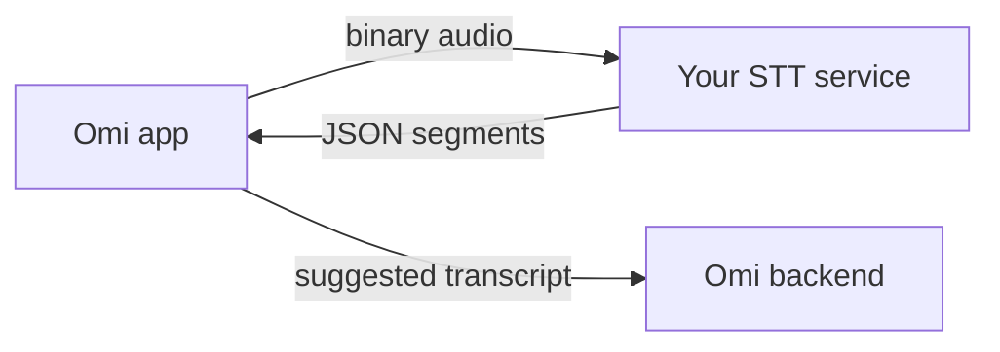

You can point the Omi phone app at your own real-time transcription service (**Settings → Developer Settings → Transcription → Custom**). The app streams audio straight to your service, shows the segments you return, and forwards them to the Omi backend as suggested transcripts.



## What your service receives

| Message | Format | Meaning |
|---------|--------|---------|
| Audio frames | Binary | Raw PCM: signed 16-bit little-endian, mono, no WAV header. The sample rate matches the device (16 kHz on current hardware). The app decodes Opus before sending, so your service never receives Opus packets. |
| `{"type": "CloseStream"}` | JSON | The audio stream has ended |

## What your service sends

A JSON object with a `segments` array:

```json
{
  "segments": [
    { "text": "Hello, how are you?", "speaker": "SPEAKER_00", "start": 0.0, "end": 1.5 },
    { "text": "I'm doing great, thanks!", "speaker": "SPEAKER_01", "start": 1.6, "end": 3.2 }
  ]
}
```

| Field | Type | Required | Meaning |
|-------|------|----------|---------|
| `text` | string | Yes | Transcribed text |
| `speaker` | string | No | Speaker label, such as `SPEAKER_00` |
| `start` | float | No | Start time in seconds |
| `end` | float | No | End time in seconds |

<Warning>
- Send an object with a `segments` key. A bare array is rejected.
- Omit `type`, or set it to `"Results"`. Messages with any other `type` are ignored.
- The connection closes after 90 seconds without activity.
</Warning>

## Related

<CardGroup cols={2}>
  <Card title="Your Own Keys & Custom Transcription" icon="key" href="/doc/get_started/byok_and_custom_transcription">
    Where to configure a custom provider in the app
  </Card>
  <Card title="Capture & Transcription" icon="microphone" href="/doc/how-omi-works/capture-and-transcription">
    How transcription fits into the rest of Omi
  </Card>
</CardGroup>
