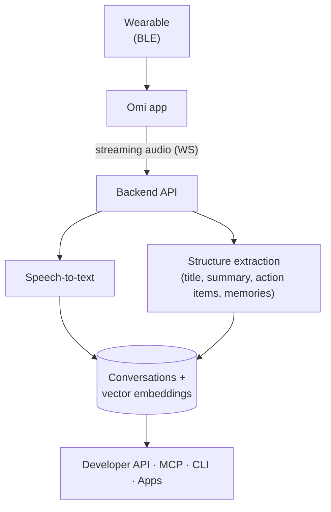

Omi has three planes: a **device** that captures audio, **apps** (mobile and desktop) that manage capture and show results, and a **backend** that transcribes, structures, stores, and serves the data. Everything in between is code you can read in this repository.

## The life of a conversation

1. **Capture.** The wearable streams audio to the phone app over Bluetooth (the protocol is specified in [BLE Protocol](/doc/developer/Protocol)). Devices with storage can also record standalone and sync later.
2. **Transcription.** The app streams audio to the backend over a WebSocket; transcript segments flow back to the app in near real time. See [Capture & transcription](/doc/how-omi-works/capture-and-transcription).
3. **Structuring.** When a conversation ends, the backend processes it: title, overview, category, action items, events, and extracted **memories** (durable facts about you). See [Conversations & memories](/doc/how-omi-works/conversations-and-memories).
4. **Serving.** Everything lands behind one account-scoped surface: the apps, the [Developer API](/doc/developer/api/overview), the [MCP server](/doc/developer/mcp/introduction), and the [CLI](/doc/developer/cli/introduction). Apps you install can react to each stage via webhooks.

## Where things live

| Concern | Owner in the repo |
|---------|-------------------|
| Conversation CRUD and lifecycle | `backend/database/conversations.py` |
| Vector search over conversations | `backend/database/vector_db.py` |
| Structuring and chat prompts | `backend/utils/llm/` |
| Streaming transcription | `backend/routers/transcribe.py` |
| Model-service routing | `backend/utils/llm/model_config.py` |
| Device protocol implementations | `app/lib/services/devices/`, `omi/firmware/` |

Details that change often, such as provider configurations, internal runbooks, and operational checklists, live next to the code (for example in `backend/docs/`), not on this site. Docs here describe the shape of the system; the repo is the source of truth for specifics.

## Read next

<CardGroup cols={2}>
  <Card title="Capture & transcription" icon="microphone" href="/doc/how-omi-works/capture-and-transcription">
    From microphone to transcript segments
  </Card>
  <Card title="Conversations & memories" icon="database" href="/doc/how-omi-works/conversations-and-memories">
    The data model behind your history
  </Card>
  <Card title="Chat" icon="comments" href="/doc/how-omi-works/chat">
    How Omi answers questions with your data
  </Card>
  <Card title="Privacy & data handling" icon="shield" href="/doc/how-omi-works/privacy-and-data">
    What is stored, where, and what you control
  </Card>
</CardGroup>
